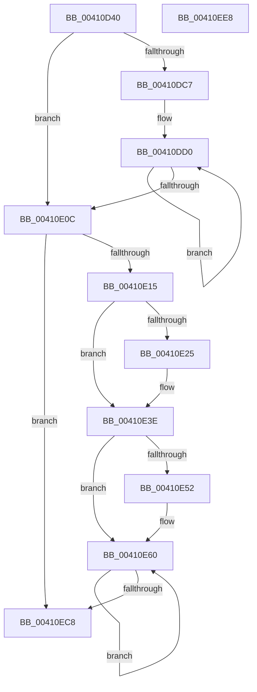

# ST_STORE&lt;SM_TRAITS&gt;::StDmCombinePageEntry

- RVA: `0x00410D40`–`0x00410EE9` (길이 `425` bytes)
- VA: `0x0000000140410D40`
- 실행 섹션: `.text`
- PDB 이름 있음: `예`; PDB Function 태그: `아니요`
- unwind 정보 RVA: `0x0005D79C`
- 디코드: `110`개 명령, `425/425` bytes 표시
- 미해석 바이트: `0` (있으면 어셈블리에 `.byte`로 보존)

> 이 문서는 커널 이미지의 기계어와 PDB 기호를 분석해 생성했습니다. 4번과 5번은 함수 원형과 자료형을 바이너리 사용 방식에서 추정한 C 해석이며 원본 소스 복구 결과는 아닙니다.

## 1. Dependencies

- 직접 호출 지점: **4**; 고유 호출 대상: **4**
- 직접 호출자로 확인된 함수: **2**
- RIP 상대 이미지 참조: **0**

### Outgoing calls
- `0x00410E2C` → [StLockAcquireExclusive](../26/StLockAcquireExclusive_function_00266FF0.md) (function, `0x00266FF0`)
- `0x00410E59` → [StLockReleaseExclusive](../26/StLockReleaseExclusive_function_00267050.md) (function, `0x00267050`)
- `0x00410EAD` → [ST_STORE<SM_TRAITS>::StDmPageRecordUnprotect](../26/ST_STORE_SM_TRAITS_StDmPageRecordUnprotect_function_00268B30.md) (function, `0x00268B30`)
- `0x00410EB8` → [SmHpChunkFree](../26/SmHpChunkFree_function_00268D50.md) (function, `0x00268D50`)

### Direct callers
- [ST_STORE&lt;SM_TRAITS&gt;::StDmPageRemove](../20/ST_STORE_SM_TRAITS_StDmPageRemove_function_002049A0.md) at `0x00204B1C`
- [sub_00410B56](Unknown_function_00410B56.md) at `0x00410C36`

### Static image references
- 디코드된 RIP-relative 메모리 참조가 없습니다.

## 2. Other-region calls and transfers

- 다른 실행 섹션으로 향하는 call: **0**
- 별도 외부 분기/꼬리 이동을 확인하지 못했습니다.

## 3. Assembly (complete function range)

```asm
00410D40  48 89 5C 24 10                  mov qword ptr [rsp + 0x10], rbx
00410D45  48 89 6C 24 18                  mov qword ptr [rsp + 0x18], rbp
00410D4A  48 89 74 24 20                  mov qword ptr [rsp + 0x20], rsi
00410D4F  57                              push rdi
00410D50  41 54                           push r12
00410D52  41 55                           push r13
00410D54  41 56                           push r14
00410D56  41 57                           push r15
00410D58  48 83 EC 20                     sub rsp, 0x20
00410D5C  44 8B 7A 04                     mov r15d, dword ptr [rdx + 4]
00410D60  4C 8D B1 C0 00 00 00            lea r14, [rcx + 0xc0]
00410D67  45 8B 8E 08 01 00 00            mov r9d, dword ptr [r14 + 0x108]
00410D6E  48 8B E9                        mov rbp, rcx
00410D71  45 8B 96 0C 01 00 00            mov r10d, dword ptr [r14 + 0x10c]
00410D78  41 8B C9                        mov ecx, r9d
00410D7B  45 8B 9E 10 01 00 00            mov r11d, dword ptr [r14 + 0x110]
00410D82  45 8B C7                        mov r8d, r15d
00410D85  41 8B BE 18 01 00 00            mov edi, dword ptr [r14 + 0x118]
00410D8C  B8 01 00 00 00                  mov eax, 1
00410D91  41 D3 E8                        shr r8d, cl
00410D94  4C 8B EA                        mov r13, rdx
00410D97  41 0F BD D0                     bsr edx, r8d
00410D9B  41 8B F7                        mov esi, r15d
00410D9E  8B CA                           mov ecx, edx
00410DA0  D3 E0                           shl eax, cl
00410DA2  8B C8                           mov ecx, eax
00410DA4  41 8B C2                        mov eax, r10d
00410DA7  49 8B 1C D6                     mov rbx, qword ptr [r14 + rdx*8]
00410DAB  41 23 C7                        and eax, r15d
00410DAE  49 33 C8                        xor rcx, r8
00410DB1  41 0F AF C3                     imul eax, r11d
00410DB5  48 03 C9                        add rcx, rcx
00410DB8  48 8B 1C CB                     mov rbx, qword ptr [rbx + rcx*8]
00410DBC  48 03 D8                        add rbx, rax
00410DBF  48 03 DF                        add rbx, rdi
00410DC2  83 3B FF                        cmp dword ptr [rbx], -1
00410DC5  75 45                           jne 0x140410e0c
00410DC7  66 0F 1F 84 00 00 00 00 00      nop word ptr [rax + rax]
00410DD0  8B 73 04                        mov esi, dword ptr [rbx + 4]
00410DD3  41 8B C9                        mov ecx, r9d
00410DD6  8B D6                           mov edx, esi
00410DD8  41 B8 01 00 00 00               mov r8d, 1
00410DDE  D3 EA                           shr edx, cl
00410DE0  41 8B C2                        mov eax, r10d
00410DE3  0F BD CA                        bsr ecx, edx
00410DE6  23 C6                           and eax, esi
00410DE8  41 D3 E0                        shl r8d, cl
00410DEB  4C 33 C2                        xor r8, rdx
00410DEE  41 0F AF C3                     imul eax, r11d
00410DF2  4D 03 C0                        add r8, r8
00410DF5  48 8B 9C CD C0 00 00 00         mov rbx, qword ptr [rbp + rcx*8 + 0xc0]
00410DFD  4A 8B 1C C3                     mov rbx, qword ptr [rbx + r8*8]
00410E01  48 03 D8                        add rbx, rax
00410E04  48 03 DF                        add rbx, rdi
00410E07  83 3B FF                        cmp dword ptr [rbx], -1
00410E0A  74 C4                           je 0x140410dd0
00410E0C  44 3B FE                        cmp r15d, esi
00410E0F  0F 84 B3 00 00 00               je 0x140410ec8
00410E15  48 8B BD 20 03 00 00            mov rdi, qword ptr [rbp + 0x320]
00410E1C  F6 87 95 1A 00 00 04            test byte ptr [rdi + 0x1a95], 4
00410E23  74 19                           je 0x140410e3e
00410E25  48 8D 8F B0 1A 00 00            lea rcx, [rdi + 0x1ab0]
00410E2C  E8 BF 61 E5 FF                  call 0x140266ff0
00410E31  48 FF 87 C0 1A 00 00            inc qword ptr [rdi + 0x1ac0]
00410E38  89 87 B8 1A 00 00               mov dword ptr [rdi + 0x1ab8], eax
00410E3E  41 89 75 04                     mov dword ptr [r13 + 4], esi
00410E42  48 8B 8D 20 03 00 00            mov rcx, qword ptr [rbp + 0x320]
00410E49  F6 81 95 1A 00 00 04            test byte ptr [rcx + 0x1a95], 4
00410E50  74 0E                           je 0x140410e60
00410E52  48 81 C1 B0 1A 00 00            add rcx, 0x1ab0
00410E59  E8 F2 61 E5 FF                  call 0x140267050
00410E5E  66 90                           nop
00410E60  41 8B 8E 08 01 00 00            mov ecx, dword ptr [r14 + 0x108]
00410E67  41 8B D7                        mov edx, r15d
00410E6A  41 8B 86 0C 01 00 00            mov eax, dword ptr [r14 + 0x10c]
00410E71  BF 01 00 00 00                  mov edi, 1
00410E76  D3 EA                           shr edx, cl
00410E78  41 23 C7                        and eax, r15d
00410E7B  41 0F AF 86 10 01 00 00         imul eax, dword ptr [r14 + 0x110]
00410E83  0F BD CA                        bsr ecx, edx
00410E86  D3 E7                           shl edi, cl
00410E88  48 33 FA                        xor rdi, rdx
00410E8B  48 03 FF                        add rdi, rdi
00410E8E  49 8B 0C CE                     mov rcx, qword ptr [r14 + rcx*8]
00410E92  48 8B 3C F9                     mov rdi, qword ptr [rcx + rdi*8]
00410E96  48 8B CD                        mov rcx, rbp
00410E99  48 03 F8                        add rdi, rax
00410E9C  41 8B 86 18 01 00 00            mov eax, dword ptr [r14 + 0x118]
00410EA3  48 03 F8                        add rdi, rax
00410EA6  48 8B D7                        mov rdx, rdi
00410EA9  44 8B 7F 04                     mov r15d, dword ptr [rdi + 4]
00410EAD  E8 7E 7C E5 FF                  call 0x140268b30
00410EB2  48 8B D7                        mov rdx, rdi
00410EB5  49 8B CE                        mov rcx, r14
00410EB8  E8 93 7E E5 FF                  call 0x140268d50
00410EBD  FF 8D E0 08 00 00               dec dword ptr [rbp + 0x8e0]
00410EC3  44 3B FE                        cmp r15d, esi
00410EC6  75 98                           jne 0x140410e60
00410EC8  48 8B 6C 24 60                  mov rbp, qword ptr [rsp + 0x60]
00410ECD  48 8B C3                        mov rax, rbx
00410ED0  48 8B 5C 24 58                  mov rbx, qword ptr [rsp + 0x58]
00410ED5  48 8B 74 24 68                  mov rsi, qword ptr [rsp + 0x68]
00410EDA  48 83 C4 20                     add rsp, 0x20
00410EDE  41 5F                           pop r15
00410EE0  41 5E                           pop r14
00410EE2  41 5D                           pop r13
00410EE4  41 5C                           pop r12
00410EE6  5F                              pop rdi
00410EE7  C3                              ret
00410EE8  CC                              int3
```

## 4. C-style interpretation (structured pseudocode)

```c
__int64 __fastcall ST_STORE_SM_TRAITS___StDmCombinePageEntry(__int64 a1, __int64 a2)
{
    __int64 result;
    __int64 v_rbx;
    __int64 v_rdi;
    __int64 v_rsp;
    unsigned __int64 v_stack_p10;
    unsigned __int64 v_stack_p18;
    unsigned __int64 v_stack_p20;

    v_stack_p10 = v_rbx;
    v_stack_p18 = v_rbp;
    v_stack_p20 = v_rsi;
    v_rsp = (v_rsp) - (32);
    a3 = (unsigned int)(((unsigned int)((unsigned int)((unsigned int)(*(unsigned int *)(a2 + 4))))) >> ((unsigned __int8)((unsigned int)((unsigned int)((unsigned int)(*(unsigned int *)(a1 + 192 + 264)))))));
    result = (unsigned int)((1) << ((unsigned __int8)((unsigned int)((unsigned int)(a2)))));
    result = (unsigned int)(((unsigned int)((unsigned int)((unsigned int)(*(unsigned int *)(a1 + 192 + 268))))) & ((unsigned int)((unsigned int)(*(unsigned int *)(a2 + 4)))));
    a1 = ((unsigned int)((unsigned int)(result))) ^ (a3);
    result = (unsigned int)((result) * ((unsigned int)((unsigned int)(*(unsigned int *)(a1 + 192 + 272)))));
    a1 = (a1) + (a1);
    v_rbx = (*(unsigned __int64 *)(*(unsigned __int64 *)(a1 + 192 + a2 * 8) + a1 * 8)) + (result);
    v_rbx = (v_rbx) + ((unsigned int)(*(unsigned int *)(a1 + 192 + 280)));
    if ((*(unsigned int *)(v_rbx)) != -1) goto loc_00410E0C;
loc_00410DD0:
    a2 = (unsigned int)(((unsigned int)((unsigned int)((unsigned int)(*(unsigned int *)(v_rbx + 4))))) >> ((unsigned __int8)((unsigned int)((unsigned int)((unsigned int)(*(unsigned int *)(a1 + 192 + 264)))))));
    result = (unsigned int)(((unsigned int)((unsigned int)((unsigned int)(*(unsigned int *)(a1 + 192 + 268))))) & ((unsigned int)((unsigned int)(*(unsigned int *)(v_rbx + 4)))));
    a3 = (unsigned int)((1) << ((unsigned __int8)((unsigned int)((unsigned int)((unsigned int)(*(unsigned int *)(a1 + 192 + 264)))))));
    a3 = (a3) ^ (a2);
    result = (unsigned int)((result) * ((unsigned int)((unsigned int)(*(unsigned int *)(a1 + 192 + 272)))));
    a3 = (a3) + (a3);
    v_rbx = (*(unsigned __int64 *)(*(unsigned __int64 *)(a1 + (unsigned int)((unsigned int)((unsigned int)(*(unsigned int *)(a1 + 192 + 264)))) * 8 + 192) + a3 * 8)) + (result);
    v_rbx = (v_rbx) + ((unsigned int)(*(unsigned int *)(a1 + 192 + 280)));
    if ((*(unsigned int *)(v_rbx)) == -1) goto loc_00410DD0;
loc_00410E0C:
    if (((unsigned int)((unsigned int)(*(unsigned int *)(a2 + 4)))) == ((unsigned int)((unsigned int)(*(unsigned int *)(v_rbx + 4))))) goto loc_00410EC8;
    if (((*(unsigned __int8 *)(*(unsigned __int64 *)(a1 + 800) + 6805)) & (4)) != 0) {
        a1 = *(unsigned __int64 *)(a1 + 800) + 6832;
        result = StLockAcquireExclusive(a1, a2, a3, (unsigned int)(*(unsigned int *)(a1 + 192 + 264)));
        *(unsigned int *)(*(unsigned __int64 *)(a1 + 800) + 6840) = (unsigned int)(result);
    }
    *(unsigned int *)(a2 + 4) = (unsigned int)((unsigned int)(*(unsigned int *)(v_rbx + 4)));
    if (((*(unsigned __int8 *)(*(unsigned __int64 *)(a1 + 800) + 6805)) & (4)) != 0) {
        a1 = (*(unsigned __int64 *)(a1 + 800)) + (0x1AB0ULL);
        result = StLockReleaseExclusive(a1, a2, a3, (unsigned int)(*(unsigned int *)(a1 + 192 + 264)));
    }
    a2 = (unsigned int)(((unsigned int)((unsigned int)((unsigned int)(*(unsigned int *)(a2 + 4))))) >> ((unsigned __int8)((unsigned int)(*(unsigned int *)(a1 + 192 + 264)))));
    result = (unsigned int)(((unsigned int)(*(unsigned int *)(a1 + 192 + 268))) & ((unsigned int)((unsigned int)(*(unsigned int *)(a2 + 4)))));
    result = (unsigned int)((result) * (*(unsigned int *)(a1 + 192 + 272)));
    v_rdi = (unsigned int)((1) << ((unsigned __int8)((unsigned int)(*(unsigned int *)(a1 + 192 + 264)))));
    v_rdi = (v_rdi) ^ (a2);
    v_rdi = (v_rdi) + (v_rdi);
    v_rdi = (*(unsigned __int64 *)(*(unsigned __int64 *)(a1 + 192 + (unsigned int)(*(unsigned int *)(a1 + 192 + 264)) * 8) + v_rdi * 8)) + (result);
    v_rdi = (v_rdi) + ((unsigned int)(*(unsigned int *)(a1 + 192 + 280)));
    result = ST_STORE_SM_TRAITS___StDmPageRecordUnprotect(a1, v_rdi, a3, (unsigned int)(*(unsigned int *)(a1 + 192 + 264)));
    result = SmHpChunkFree(a1 + 192, v_rdi, a3, (unsigned int)(*(unsigned int *)(a1 + 192 + 264)));
    if (((unsigned int)((unsigned int)(*(unsigned int *)(v_rdi + 4)))) != ((unsigned int)((unsigned int)(*(unsigned int *)(v_rbx + 4))))) goto loc_00410E60;
loc_00410EC8:
    v_rsp = (v_rsp) + (32);
    return v_rbx;
}
```

## 5. (Beta) C Style

```c
int64_t ST_STORE_SM_TRAITS___StDmCombinePageEntry(void *Arg1, void *Arg2)
{
    uint8_t *arg1 = (uint8_t *)Arg1;
    uint8_t *arg2 = (uint8_t *)Arg2;

    int64_t result;
    int64_t local_rbx;
    int64_t local_rdi;
    int64_t local_rsp;
    uint64_t v_stack_p10;
    uint64_t v_stack_p18;
    uint64_t v_stack_p20;

    v_stack_p10 = local_rbx;
    v_stack_p18 = local_rbp;
    v_stack_p20 = local_rsi;
    local_rsp = (local_rsp) - (32);
    a3 = (uint32_t)(((uint32_t)((uint32_t)((uint32_t)(*(uint32_t *)(arg2 + 0x4))))) >> ((uint8_t)((uint32_t)((uint32_t)((uint32_t)(*(uint32_t *)(arg1 + 0xC0 + 0x108)))))));
    result = (uint32_t)((1) << ((uint8_t)((uint32_t)((uint32_t)(Arg2)))));
    result = (uint32_t)(((uint32_t)((uint32_t)((uint32_t)(*(uint32_t *)(arg1 + 0xC0 + 0x10C))))) & ((uint32_t)((uint32_t)(*(uint32_t *)(arg2 + 0x4)))));
    Arg1 = ((uint32_t)((uint32_t)(result))) ^ (a3);
    result = (uint32_t)((result) * ((uint32_t)((uint32_t)(*(uint32_t *)(arg1 + 0xC0 + 0x110)))));
    Arg1 = (Arg1) + (Arg1);
    local_rbx = (*(uint64_t *)(*(uint64_t *)(arg1 + 0xC0 + arg2 * 8) + arg1 * 8)) + (result);
    local_rbx = (local_rbx) + ((uint32_t)(*(uint32_t *)(arg1 + 0xC0 + 0x118)));
    if ((*(uint32_t *)(local_rbx)) != -1) goto loc_00410E0C;
loc_00410DD0:
    Arg2 = (uint32_t)(((uint32_t)((uint32_t)((uint32_t)(*(uint32_t *)(local_rbx + 0x4))))) >> ((uint8_t)((uint32_t)((uint32_t)((uint32_t)(*(uint32_t *)(arg1 + 0xC0 + 0x108)))))));
    result = (uint32_t)(((uint32_t)((uint32_t)((uint32_t)(*(uint32_t *)(arg1 + 0xC0 + 0x10C))))) & ((uint32_t)((uint32_t)(*(uint32_t *)(local_rbx + 0x4)))));
    a3 = (uint32_t)((1) << ((uint8_t)((uint32_t)((uint32_t)((uint32_t)(*(uint32_t *)(arg1 + 0xC0 + 0x108)))))));
    a3 = (a3) ^ (Arg2);
    result = (uint32_t)((result) * ((uint32_t)((uint32_t)(*(uint32_t *)(arg1 + 0xC0 + 0x110)))));
    a3 = (a3) + (a3);
    local_rbx = (*(uint64_t *)(*(uint64_t *)(arg1 + (uint32_t)((uint32_t)((uint32_t)(*(uint32_t *)(arg1 + 0xC0 + 0x108)))) * 8 + 0xC0) + a3 * 8)) + (result);
    local_rbx = (local_rbx) + ((uint32_t)(*(uint32_t *)(arg1 + 0xC0 + 0x118)));
    if ((*(uint32_t *)(local_rbx)) == -1) goto loc_00410DD0;
loc_00410E0C:
    if (((uint32_t)((uint32_t)(*(uint32_t *)(arg2 + 0x4)))) == ((uint32_t)((uint32_t)(*(uint32_t *)(local_rbx + 0x4))))) goto loc_00410EC8;
    if (((*(uint8_t *)(*(uint64_t *)(arg1 + 0x320) + 0x1A95)) & (4)) != 0) {
        Arg1 = *(uint64_t *)(arg1 + 0x320) + 6832;
        result = StLockAcquireExclusive(Arg1, Arg2, a3, (uint32_t)(*(uint32_t *)(arg1 + 0xC0 + 0x108)));
        *(uint32_t *)(*(uint64_t *)(arg1 + 0x320) + 0x1AB8) = (uint32_t)(result);
    }
    *(uint32_t *)(arg2 + 0x4) = (uint32_t)((uint32_t)(*(uint32_t *)(local_rbx + 0x4)));
    if (((*(uint8_t *)(*(uint64_t *)(arg1 + 0x320) + 0x1A95)) & (4)) != 0) {
        Arg1 = (*(uint64_t *)(arg1 + 0x320)) + (0x1AB0ULL);
        result = StLockReleaseExclusive(Arg1, Arg2, a3, (uint32_t)(*(uint32_t *)(arg1 + 0xC0 + 0x108)));
    }
    Arg2 = (uint32_t)(((uint32_t)((uint32_t)((uint32_t)(*(uint32_t *)(arg2 + 0x4))))) >> ((uint8_t)((uint32_t)(*(uint32_t *)(arg1 + 0xC0 + 0x108)))));
    result = (uint32_t)(((uint32_t)(*(uint32_t *)(arg1 + 0xC0 + 0x10C))) & ((uint32_t)((uint32_t)(*(uint32_t *)(arg2 + 0x4)))));
    result = (uint32_t)((result) * (*(uint32_t *)(arg1 + 0xC0 + 0x110)));
    local_rdi = (uint32_t)((1) << ((uint8_t)((uint32_t)(*(uint32_t *)(arg1 + 0xC0 + 0x108)))));
    local_rdi = (local_rdi) ^ (Arg2);
    local_rdi = (local_rdi) + (local_rdi);
    local_rdi = (*(uint64_t *)(*(uint64_t *)(arg1 + 0xC0 + (uint32_t)(*(uint32_t *)(arg1 + 0xC0 + 0x108)) * 8) + local_rdi * 8)) + (result);
    local_rdi = (local_rdi) + ((uint32_t)(*(uint32_t *)(arg1 + 0xC0 + 0x118)));
    result = ST_STORE_SM_TRAITS___StDmPageRecordUnprotect(Arg1, local_rdi, a3, (uint32_t)(*(uint32_t *)(arg1 + 0xC0 + 0x108)));
    result = SmHpChunkFree(Arg1 + 192, local_rdi, a3, (uint32_t)(*(uint32_t *)(arg1 + 0xC0 + 0x108)));
    if (((uint32_t)((uint32_t)(*(uint32_t *)(local_rdi + 0x4)))) != ((uint32_t)((uint32_t)(*(uint32_t *)(local_rbx + 0x4))))) goto loc_00410E60;
loc_00410EC8:
    local_rsp = (local_rsp) + (32);
    return local_rbx;
}
```

### 관측된 메모리 오프셋

구조체 형식이 확인되지 않은 접근은 인자 기준의 오프셋으로만 기록했습니다.

| 기준 인자 | 오프셋 표현 | 폭 (bit) | 접근 |
|---|---:|---:|---|
| `Arg1` | `+ 0x0 + rcx*8` | `64` | `R` |
| `Arg1` | `+ 0x0 + rdx*8` | `64` | `R` |
| `Arg1` | `+ 0xC0` | `64` | `R` |
| `Arg1` | `+ 0xC0 + rcx*8` | `64` | `R` |
| `Arg1` | `+ 0x108` | `32` | `R` |
| `Arg1` | `+ 0x10C` | `32` | `R` |
| `Arg1` | `+ 0x110` | `32` | `R` |
| `Arg1` | `+ 0x118` | `32` | `R` |
| `Arg1` | `+ 0x320` | `64` | `R` |
| `Arg1` | `+ 0x8E0` | `32` | `R/W` |
| `Arg2` | `+ 0x4` | `32` | `R` |
| `Arg2` | `+ 0x4` | `32` | `W` |

## 6. Execution-region graph

[열기: 2D/3D 그래프와 함수 탐색 컨트롤 패널](../../../control-panel.html?section=text&rva=0x00410D40&view=graph)

- 2D 그래프는 위에서 아래로 흐르고, 3D 그래프는 빈 공간을 드래그해 회전합니다. Shift+드래그는 이동, 휠은 확대·축소, 함수 노드 선택은 대상 보고서 이동입니다.

### Static fallback


