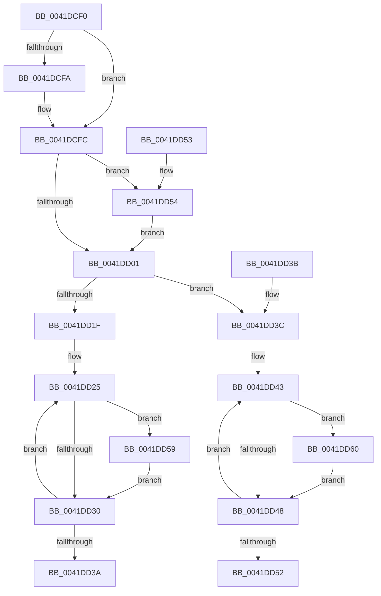

# ST_STORE&lt;SM_TRAITS&gt;::StDmGetSpaceStats

- RVA: `0x0041DCF0`–`0x0041DD67` (길이 `119` bytes)
- VA: `0x000000014041DCF0`
- 실행 섹션: `.text`
- PDB 이름 있음: `예`; PDB Function 태그: `아니요`
- unwind 정보 RVA: `0x000DB714`
- 디코드: `42`개 명령, `119/119` bytes 표시
- 미해석 바이트: `0` (있으면 어셈블리에 `.byte`로 보존)

> 이 문서는 커널 이미지의 기계어와 PDB 기호를 분석해 생성했습니다. 4번과 5번은 함수 원형과 자료형을 바이너리 사용 방식에서 추정한 C 해석이며 원본 소스 복구 결과는 아닙니다.

## 1. Dependencies

- 직접 호출 지점: **0**; 고유 호출 대상: **0**
- 직접 호출자로 확인된 함수: **2**
- RIP 상대 이미지 참조: **0**

### Outgoing calls
- 직접 디코드된 call 명령이 없습니다.

### Direct callers
- [SMKM_STORE&lt;SM_TRAITS&gt;::SmStEtwFillStoreEvent](../61/SMKM_STORE_SM_TRAITS_SmStEtwFillStoreEvent_function_0061058C.md) at `0x006107F5`
- [SMKM_STORE&lt;SM_TRAITS&gt;::SmStEtwFillStoreEvent](../61/SMKM_STORE_SM_TRAITS_SmStEtwFillStoreEvent_function_0061058C.md) at `0x00610805`
- [sub_006E6FD2](../6E/Unknown_function_006E6FD2.md) at `0x006E6FDD`

### Static image references
- 디코드된 RIP-relative 메모리 참조가 없습니다.

## 2. Other-region calls and transfers

- 다른 실행 섹션으로 향하는 call: **0**
- 별도 외부 분기/꼬리 이동을 확인하지 못했습니다.

## 3. Assembly (complete function range)

```asm
0041DCF0  33 C0                           xor eax, eax
0041DCF2  4C 8B CA                        mov r9, rdx
0041DCF5  48 85 D2                        test rdx, rdx
0041DCF8  74 02                           je 0x14041dcfc
0041DCFA  89 02                           mov dword ptr [rdx], eax
0041DCFC  4D 85 C0                        test r8, r8
0041DCFF  75 53                           jne 0x14041dd54
0041DD01  8B 81 08 03 00 00               mov eax, dword ptr [rcx + 0x308]
0041DD07  BA 08 00 00 00                  mov edx, 8
0041DD0C  44 0F B6 D0                     movzx r10d, al
0041DD10  48 8D 81 9C 08 00 00            lea rax, [rcx + 0x89c]
0041DD17  8D 4A F9                        lea ecx, [rdx - 7]
0041DD1A  4D 85 C9                        test r9, r9
0041DD1D  74 1D                           je 0x14041dd3c
0041DD1F  45 85 D2                        test r10d, r10d
0041DD22  0F 45 D1                        cmovne edx, ecx
0041DD25  8B 48 FC                        mov ecx, dword ptr [rax - 4]
0041DD28  41 01 09                        add dword ptr [r9], ecx
0041DD2B  4D 85 C0                        test r8, r8
0041DD2E  75 29                           jne 0x14041dd59
0041DD30  48 83 C0 08                     add rax, 8
0041DD34  48 83 EA 01                     sub rdx, 1
0041DD38  75 EB                           jne 0x14041dd25
0041DD3A  C3                              ret
0041DD3B  CC                              int3
0041DD3C  45 85 D2                        test r10d, r10d
0041DD3F  48 0F 45 D1                     cmovne rdx, rcx
0041DD43  4D 85 C0                        test r8, r8
0041DD46  75 18                           jne 0x14041dd60
0041DD48  48 83 C0 08                     add rax, 8
0041DD4C  48 83 EA 01                     sub rdx, 1
0041DD50  75 F1                           jne 0x14041dd43
0041DD52  C3                              ret
0041DD53  CC                              int3
0041DD54  41 89 00                        mov dword ptr [r8], eax
0041DD57  EB A8                           jmp 0x14041dd01
0041DD59  8B 08                           mov ecx, dword ptr [rax]
0041DD5B  41 01 08                        add dword ptr [r8], ecx
0041DD5E  EB D0                           jmp 0x14041dd30
0041DD60  8B 08                           mov ecx, dword ptr [rax]
0041DD62  41 01 08                        add dword ptr [r8], ecx
0041DD65  EB E1                           jmp 0x14041dd48
```

## 4. C-style interpretation (structured pseudocode)

```c
__int64 __fastcall ST_STORE_SM_TRAITS___StDmGetSpaceStats(__int64 a1, __int64 a2, __int64 a3)
{
    __int64 result;

    result = 0;
    if (a2 != 0) {
        *(unsigned int *)(a2) = 0;
    }
    if (a3 != 0) goto loc_0041DD54;
loc_0041DD01:
    if (a2 == 0) goto loc_0041DD3C;
    a2 = 8;
    if ((unsigned int)((unsigned __int8)((unsigned int)(*(unsigned int *)(a1 + 776)))) != 0) { a2 = (unsigned int)(8 - 7); }
loc_0041DD25:
    if (a3 != 0) goto loc_0041DD59;
loc_0041DD30:
    result = (a1 + 2204) + (8);
    a2 = (a2) - (1);
    if (condition_is_not_equal) goto loc_0041DD25;
    return result;
loc_0041DD3C:
    if ((unsigned int)((unsigned __int8)((unsigned int)(*(unsigned int *)(a1 + 776)))) != 0) { a2 = (unsigned int)(*(unsigned int *)(a1 + 2204 - 4)); }
loc_0041DD43:
    if (a3 != 0) goto loc_0041DD60;
loc_0041DD48:
    result = (result) + (8);
    a2 = (a2) - (1);
    if (condition_is_not_equal) goto loc_0041DD43;
    return result;
loc_0041DD54:
    *(unsigned int *)(a3) = (unsigned int)(result);
    goto loc_0041DD01;
loc_0041DD59:
    goto loc_0041DD30;
loc_0041DD60:
    goto loc_0041DD48;
}
```

## 5. (Beta) C Style

```c
int64_t ST_STORE_SM_TRAITS___StDmGetSpaceStats(void *Arg1, int64_t Arg2, int64_t Arg3)
{
    uint8_t *arg1 = (uint8_t *)Arg1;

    int64_t result;

    result = 0;
    if (Arg2 != 0) {
        *(uint32_t *)(Arg2) = 0;
    }
    if (Arg3 != 0) goto loc_0041DD54;
loc_0041DD01:
    if (Arg2 == 0) goto loc_0041DD3C;
    Arg2 = 8;
    if ((uint32_t)((uint8_t)((uint32_t)(*(uint32_t *)(arg1 + 0x308)))) != 0) { Arg2 = (uint32_t)(8 - 7); }
loc_0041DD25:
    if (Arg3 != 0) goto loc_0041DD59;
loc_0041DD30:
    result = (Arg1 + 2204) + (8);
    Arg2 = (Arg2) - (1);
    if (condition_is_not_equal) goto loc_0041DD25;
    return result;
loc_0041DD3C:
    if ((uint32_t)((uint8_t)((uint32_t)(*(uint32_t *)(arg1 + 0x308)))) != 0) { Arg2 = (uint32_t)(*(uint32_t *)(arg1 + 0x89C - 0x4)); }
loc_0041DD43:
    if (Arg3 != 0) goto loc_0041DD60;
loc_0041DD48:
    result = (result) + (8);
    Arg2 = (Arg2) - (1);
    if (condition_is_not_equal) goto loc_0041DD43;
    return result;
loc_0041DD54:
    *(uint32_t *)(Arg3) = (uint32_t)(result);
    goto loc_0041DD01;
loc_0041DD59:
    goto loc_0041DD30;
loc_0041DD60:
    goto loc_0041DD48;
}
```

### 관측된 메모리 오프셋

구조체 형식이 확인되지 않은 접근은 인자 기준의 오프셋으로만 기록했습니다.

| 기준 인자 | 오프셋 표현 | 폭 (bit) | 접근 |
|---|---:|---:|---|
| `Arg1` | `- 0x4` | `32` | `R` |
| `Arg1` | `+ 0x0` | `32` | `R` |
| `Arg1` | `+ 0x308` | `32` | `R` |
| `Arg1` | `+ 0x89C` | `64` | `R` |

## 6. Execution-region graph

[열기: 2D/3D 그래프와 함수 탐색 컨트롤 패널](../../../control-panel.html?section=text&rva=0x0041DCF0&view=graph)

- 2D 그래프는 위에서 아래로 흐르고, 3D 그래프는 빈 공간을 드래그해 회전합니다. Shift+드래그는 이동, 휠은 확대·축소, 함수 노드 선택은 대상 보고서 이동입니다.

### Static fallback


