# ST_STORE&lt;SM_TRAITS&gt;::StDmPageRetrieve

- RVA: `0x0041FE20`–`0x00420162` (길이 `834` bytes)
- VA: `0x000000014041FE20`
- 실행 섹션: `.text`
- PDB 이름 있음: `예`; PDB Function 태그: `예`
- unwind 정보 RVA: `0x000A00F4`
- 디코드: `210`개 명령, `834/834` bytes 표시
- 미해석 바이트: `0` (있으면 어셈블리에 `.byte`로 보존)

> 이 문서는 커널 이미지의 기계어와 PDB 기호를 분석해 생성했습니다. 4번과 5번은 함수 원형과 자료형을 바이너리 사용 방식에서 추정한 C 해석이며 원본 소스 복구 결과는 아닙니다.

## 1. Dependencies

- 직접 호출 지점: **4**; 고유 호출 대상: **3**
- 직접 호출자로 확인된 함수: **2**
- RIP 상대 이미지 참조: **0**

### Outgoing calls
- `0x0041FE9B` → [MmAreMdlPagesCached](../42/MmAreMdlPagesCached_function_004207C0.md) (function, `0x004207C0`)
- `0x0041FF09` → [KiCheckForKernelApcDelivery](../2E/KiCheckForKernelApcDelivery_function_002E2C80.md) (function, `0x002E2C80`)
- `0x0041FF55` → [ST_STORE<SM_TRAITS>::StDmpSinglePageRetrieve](../42/ST_STORE_SM_TRAITS_StDmpSinglePageRetrieve_function_00420170.md) (function, `0x00420170`)
- `0x00420067` → [KiCheckForKernelApcDelivery](../2E/KiCheckForKernelApcDelivery_function_002E2C80.md) (function, `0x002E2C80`)

### Direct callers
- [SMKM_STORE&lt;SM_TRAITS&gt;::SmStDirectReadIssue](../20/SMKM_STORE_SM_TRAITS_SmStDirectReadIssue_function_00203444.md) at `0x002034BA`
- [sub_002061A0](../20/Unknown_function_002061A0.md) at `0x0020629A`

### Static image references
- 디코드된 RIP-relative 메모리 참조가 없습니다.

## 2. Other-region calls and transfers

- 다른 실행 섹션으로 향하는 call: **0**
- call이 아닌 외부 분기/꼬리 이동: **9**
  - `0x004200C8` → [sub_006EDA08](../6E/Unknown_function_006EDA08.md) (`tail-transfer`)
  - `0x004200D1` → [sub_006EDA08](../6E/Unknown_function_006EDA08.md) (`tail-transfer`)
  - `0x004200E9` → [sub_006EDA08 + 0x15](../6E/Unknown_function_006EDA08.md) (`tail-transfer`)
  - `0x004200FD` → [sub_006EDA08 + 0x1E](../6E/Unknown_function_006EDA08.md) (`tail-transfer`)
  - `0x00420106` → [sub_006EDA08 + 0x1E](../6E/Unknown_function_006EDA08.md) (`tail-transfer`)
  - `0x0042010C` → [sub_006EDA08 + 0x21](../6E/Unknown_function_006EDA08.md) (`tail-transfer`)
  - `0x0042012F` → [sub_006EDA08 + 0xF2](../6E/Unknown_function_006EDA08.md) (`tail-transfer`)
  - `0x00420147` → [sub_006EDA08 + 0x9F](../6E/Unknown_function_006EDA08.md) (`tail-transfer`)
  - `0x0042015D` → [sub_006EDA08 + 0xBA](../6E/Unknown_function_006EDA08.md) (`tail-transfer`)

## 3. Assembly (complete function range)

```asm
0041FE20  40 55                           push rbp
0041FE22  53                              push rbx
0041FE23  56                              push rsi
0041FE24  57                              push rdi
0041FE25  41 54                           push r12
0041FE27  41 55                           push r13
0041FE29  41 56                           push r14
0041FE2B  41 57                           push r15
0041FE2D  48 8B EC                        mov rbp, rsp
0041FE30  48 83 EC 78                     sub rsp, 0x78
0041FE34  45 33 E4                        xor r12d, r12d
0041FE37  48 89 4D B8                     mov qword ptr [rbp - 0x48], rcx
0041FE3B  48 8D 45 C8                     lea rax, [rbp - 0x38]
0041FE3F  44 89 65 60                     mov dword ptr [rbp + 0x60], r12d
0041FE43  48 89 45 D0                     mov qword ptr [rbp - 0x30], rax
0041FE47  41 8B DC                        mov ebx, r12d
0041FE4A  41 8B 40 08                     mov eax, dword ptr [r8 + 8]
0041FE4E  4D 8B F8                        mov r15, r8
0041FE51  41 88 58 08                     mov byte ptr [r8 + 8], bl
0041FE55  4C 8B EA                        mov r13, rdx
0041FE58  4C 8B D1                        mov r10, rcx
0041FE5B  F2 41 0F 10 48 18               movsd xmm1, qword ptr [r8 + 0x18]
0041FE61  41 8B FC                        mov edi, r12d
0041FE64  0F B6 C0                        movzx eax, al
0041FE67  41 0F 10 40 08                  movups xmm0, xmmword ptr [r8 + 8]
0041FE6C  89 45 50                        mov dword ptr [rbp + 0x50], eax
0041FE6F  48 8D 82 98 01 00 00            lea rax, [rdx + 0x198]
0041FE76  48 89 45 C0                     mov qword ptr [rbp - 0x40], rax
0041FE7A  4C 89 65 C8                     mov qword ptr [rbp - 0x38], r12
0041FE7E  C7 45 58 08 00 00 00            mov dword ptr [rbp + 0x58], 8
0041FE85  0F 11 45 D8                     movups xmmword ptr [rbp - 0x28], xmm0
0041FE89  F2 0F 11 4D E8                  movsd qword ptr [rbp - 0x18], xmm1
0041FE8E  48 39 9A 98 01 00 00            cmp qword ptr [rdx + 0x198], rbx
0041FE95  74 15                           je 0x14041feac
0041FE97  49 8B 48 10                     mov rcx, qword ptr [r8 + 0x10]
0041FE9B  E8 20 09 00 00                  call 0x1404207c0
0041FEA0  4C 8B 55 B8                     mov r10, qword ptr [rbp - 0x48]
0041FEA4  85 C0                           test eax, eax
0041FEA6  0F 84 E2 01 00 00               je 0x14042008e
0041FEAC  41 F7 82 08 03 00 00 00 00 02 00  test dword ptr [r10 + 0x308], 0x20000
0041FEB7  74 59                           je 0x14041ff12
0041FEB9  65 48 8B 3C 25 88 01 00 00      mov rdi, qword ptr gs:[0x188]
0041FEC2  66 FF 8F E6 01 00 00            dec word ptr [rdi + 0x1e6]
0041FEC9  90                              nop
0041FECA  0F B6 8F A9 05 00 00            movzx ecx, byte ptr [rdi + 0x5a9]
0041FED1  8B 87 A8 05 00 00               mov eax, dword ptr [rdi + 0x5a8]
0041FED7  F6 C1 01                        test cl, 1
0041FEDA  0F 85 C2 01 00 00               jne 0x1404200a2
0041FEE0  C7 45 58 FF FF FF FF            mov dword ptr [rbp + 0x58], 0xffffffff
0041FEE7  0F BA E8 08                     bts eax, 8
0041FEEB  89 87 A8 05 00 00               mov dword ptr [rdi + 0x5a8], eax
0041FEF1  90                              nop
0041FEF2  66 83 87 E6 01 00 00 01         add word ptr [rdi + 0x1e6], 1
0041FEFA  75 16                           jne 0x14041ff12
0041FEFC  48 8D 87 98 00 00 00            lea rax, [rdi + 0x98]
0041FF03  90                              nop
0041FF04  48 39 00                        cmp qword ptr [rax], rax
0041FF07  74 09                           je 0x14041ff12
0041FF09  E8 72 2D EC FF                  call 0x1402e2c80
0041FF0E  4C 8B 55 B8                     mov r10, qword ptr [rbp - 0x48]
0041FF12  48 8D 45 D8                     lea rax, [rbp - 0x28]
0041FF16  44 89 65 48                     mov dword ptr [rbp + 0x48], r12d
0041FF1A  49 89 85 A0 01 00 00            mov qword ptr [r13 + 0x1a0], rax
0041FF21  49 8D 75 18                     lea rsi, [r13 + 0x18]
0041FF25  66 66 66 0F 1F 84 00 00 00 00 00  nop word ptr [rax + rax]
0041FF30  33 C0                           xor eax, eax
0041FF32  0F 57 C0                        xorps xmm0, xmm0
0041FF35  44 8B E3                        mov r12d, ebx
0041FF38  0F 11 06                        movups xmmword ptr [rsi], xmm0
0041FF3B  48 89 46 10                     mov qword ptr [rsi + 0x10], rax
0041FF3F  41 83 E4 02                     and r12d, 2
0041FF43  0F 85 6D 01 00 00               jne 0x1404200b6
0041FF49  4C 8B CE                        mov r9, rsi
0041FF4C  4D 8B C7                        mov r8, r15
0041FF4F  49 8B D5                        mov rdx, r13
0041FF52  49 8B CA                        mov rcx, r10
0041FF55  E8 16 02 00 00                  call 0x140420170
0041FF5A  3D 10 01 00 C0                  cmp eax, 0xc0000110
0041FF5F  74 4D                           je 0x14041ffae
0041FF61  3D 0E 00 00 80                  cmp eax, 0x8000000e
0041FF66  0F 84 6A 01 00 00               je 0x1404200d6
0041FF6C  85 C0                           test eax, eax
0041FF6E  0F 88 6B 01 00 00               js 0x1404200df
0041FF74  8B 55 D8                        mov edx, dword ptr [rbp - 0x28]
0041FF77  8D 4A 01                        lea ecx, [rdx + 1]
0041FF7A  81 E2 00 FF FF FF               and edx, 0xffffff00
0041FF80  44 0F B6 C1                     movzx r8d, cl
0041FF84  44 0B C2                        or r8d, edx
0041FF87  44 89 45 D8                     mov dword ptr [rbp - 0x28], r8d
0041FF8B  3D 03 01 00 00                  cmp eax, 0x103
0041FF90  0F 84 2D 01 00 00               je 0x1404200c3
0041FF96  8B 55 50                        mov edx, dword ptr [rbp + 0x50]
0041FF99  4C 8B 55 B8                     mov r10, qword ptr [rbp - 0x48]
0041FF9D  41 0F B6 C0                     movzx eax, r8b
0041FFA1  3B C2                           cmp eax, edx
0041FFA3  0F 84 D8 00 00 00               je 0x140420081
0041FFA9  FF 45 E8                        inc dword ptr [rbp - 0x18]
0041FFAC  EB 82                           jmp 0x14041ff30
0041FFAE  4C 8B 55 B8                     mov r10, qword ptr [rbp - 0x48]
0041FFB2  44 8B 65 48                     mov r12d, dword ptr [rbp + 0x48]
0041FFB6  49 8B 82 20 03 00 00            mov rax, qword ptr [r10 + 0x320]
0041FFBD  48 8B 88 C0 1A 00 00            mov rcx, qword ptr [rax + 0x1ac0]
0041FFC4  48 8B 45 C0                     mov rax, qword ptr [rbp - 0x40]
0041FFC8  48 FF C9                        dec rcx
0041FFCB  49 89 8D B8 01 00 00            mov qword ptr [r13 + 0x1b8], rcx
0041FFD2  8B 55 50                        mov edx, dword ptr [rbp + 0x50]
0041FFD5  4D 8D 75 18                     lea r14, [r13 + 0x18]
0041FFD9  49 3B F6                        cmp rsi, r14
0041FFDC  0F 85 0C 01 00 00               jne 0x1404200ee
0041FFE2  44 0F B6 45 D8                  movzx r8d, byte ptr [rbp - 0x28]
0041FFE7  41 8B D0                        mov edx, r8d
0041FFEA  44 3B 45 50                     cmp r8d, dword ptr [rbp + 0x50]
0041FFEE  0F 85 1D 01 00 00               jne 0x140420111
0041FFF4  45 33 E4                        xor r12d, r12d
0041FFF7  41 8B 47 08                     mov eax, dword ptr [r15 + 8]
0041FFFB  0F B6 C8                        movzx ecx, al
0041FFFE  3B CA                           cmp ecx, edx
00420000  74 04                           je 0x140420006
00420002  45 88 47 08                     mov byte ptr [r15 + 8], r8b
00420006  48 8B 55 D0                     mov rdx, qword ptr [rbp - 0x30]
0042000A  48 8D 45 C8                     lea rax, [rbp - 0x38]
0042000E  48 3B D0                        cmp rdx, rax
00420011  0F 85 11 01 00 00               jne 0x140420128
00420017  8B 4D 58                        mov ecx, dword ptr [rbp + 0x58]
0042001A  83 F9 08                        cmp ecx, 8
0042001D  74 4D                           je 0x14042006c
0042001F  48 85 FF                        test rdi, rdi
00420022  75 09                           jne 0x14042002d
00420024  65 48 8B 3C 25 88 01 00 00      mov rdi, qword ptr gs:[0x188]
0042002D  66 FF 8F E6 01 00 00            dec word ptr [rdi + 0x1e6]
00420034  90                              nop
00420035  8B 87 A8 05 00 00               mov eax, dword ptr [rdi + 0x5a8]
0042003B  25 FF F1 FF FF                  and eax, 0xfffff1ff
00420040  83 F9 FF                        cmp ecx, -1
00420043  75 56                           jne 0x14042009b
00420045  0F BA F0 08                     btr eax, 8
00420049  89 87 A8 05 00 00               mov dword ptr [rdi + 0x5a8], eax
0042004F  90                              nop
00420050  66 83 87 E6 01 00 00 01         add word ptr [rdi + 0x1e6], 1
00420058  75 12                           jne 0x14042006c
0042005A  48 81 C7 98 00 00 00            add rdi, 0x98
00420061  90                              nop
00420062  48 39 3F                        cmp qword ptr [rdi], rdi
00420065  74 05                           je 0x14042006c
00420067  E8 14 2C EC FF                  call 0x1402e2c80
0042006C  41 8B C4                        mov eax, r12d
0042006F  48 83 C4 78                     add rsp, 0x78
00420073  41 5F                           pop r15
00420075  41 5E                           pop r14
00420077  41 5D                           pop r13
00420079  41 5C                           pop r12
0042007B  5F                              pop rdi
0042007C  5E                              pop rsi
0042007D  5B                              pop rbx
0042007E  5D                              pop rbp
0042007F  C3                              ret
00420080  CC                              int3
00420081  44 8B 65 48                     mov r12d, dword ptr [rbp + 0x48]
00420085  48 8B 45 C0                     mov rax, qword ptr [rbp - 0x40]
00420089  E9 47 FF FF FF                  jmp 0x14041ffd5
0042008E  41 81 4F 08 00 00 00 08         or dword ptr [r15 + 8], 0x8000000
00420096  E9 11 FE FF FF                  jmp 0x14041feac
0042009B  C1 E1 09                        shl ecx, 9
0042009E  0B C1                           or eax, ecx
004200A0  EB A7                           jmp 0x140420049
004200A2  8B D1                           mov edx, ecx
004200A4  D1 EA                           shr edx, 1
004200A6  83 E2 07                        and edx, 7
004200A9  89 55 58                        mov dword ptr [rbp + 0x58], edx
004200AC  25 FF F1 FF FF                  and eax, 0xfffff1ff
004200B1  E9 35 FE FF FF                  jmp 0x14041feeb
004200B6  48 C7 46 08 01 00 00 00         mov qword ptr [rsi + 8], 1
004200BE  E9 86 FE FF FF                  jmp 0x14041ff49
004200C3  48 83 7E 08 00                  cmp qword ptr [rsi + 8], 0
004200C8  0F 84 3A D9 2C 00               je 0x1406eda08
004200CE  83 CB 02                        or ebx, 2
004200D1  E9 32 D9 2C 00                  jmp 0x1406eda08
004200D6  45 85 E4                        test r12d, r12d
004200D9  0F 85 CF FE FF FF               jne 0x14041ffae
004200DF  44 8B E0                        mov r12d, eax
004200E2  89 45 48                        mov dword ptr [rbp + 0x48], eax
004200E5  48 8B 45 C0                     mov rax, qword ptr [rbp - 0x40]
004200E9  E9 2F D9 2C 00                  jmp 0x1406eda1d
004200EE  48 85 C0                        test rax, rax
004200F1  0F 84 EB FE FF FF               je 0x14041ffe2
004200F7  0F B6 45 D8                     movzx eax, byte ptr [rbp - 0x28]
004200FB  3B C2                           cmp eax, edx
004200FD  0F 84 23 D9 2C 00               je 0x1406eda26
00420103  45 85 E4                        test r12d, r12d
00420106  0F 88 1A D9 2C 00               js 0x1406eda26
0042010C  E9 18 D9 2C 00                  jmp 0x1406eda29
00420111  45 85 E4                        test r12d, r12d
00420114  0F 88 DD FE FF FF               js 0x14041fff7
0042011A  41 8B 4F 18                     mov ecx, dword ptr [r15 + 0x18]
0042011E  03 CA                           add ecx, edx
00420120  89 4D E8                        mov dword ptr [rbp - 0x18], ecx
00420123  E9 08 FE FF FF                  jmp 0x14041ff30
00420128  48 8D 45 C8                     lea rax, [rbp - 0x38]
0042012C  48 3B D0                        cmp rdx, rax
0042012F  0F 84 C5 D9 2C 00               je 0x1406edafa
00420135  4C 8B 45 C8                     mov r8, qword ptr [rbp - 0x38]
00420139  49 8B 00                        mov rax, qword ptr [r8]
0042013C  48 83 E0 F8                     and rax, 0xfffffffffffffff8
00420140  48 89 45 C8                     mov qword ptr [rbp - 0x38], rax
00420144  4C 3B C2                        cmp r8, rdx
00420147  0F 85 5A D9 2C 00               jne 0x1406edaa7
0042014D  48 8D 45 C8                     lea rax, [rbp - 0x38]
00420151  48 C7 45 C8 00 00 00 00         mov qword ptr [rbp - 0x38], 0
00420159  48 89 45 D0                     mov qword ptr [rbp - 0x30], rax
0042015D  E9 60 D9 2C 00                  jmp 0x1406edac2
```

## 4. C-style interpretation (structured pseudocode)

```c
__int64 __fastcall ST_STORE_SM_TRAITS___StDmPageRetrieve(__int64 a1, __int64 a2, __int64 a3)
{
    __int64 result;
    __int64 v_r10;
    __int64 v_r12;
    __int64 v_rbx;
    __int64 v_rdi;
    __int64 v_rsp;
    unsigned __int64 v_stack_m58;
    unsigned __int64 v_stack_m68;
    unsigned __int64 v_stack_m70;
    unsigned __int64 v_stack_m78;
    unsigned __int64 v_stack_m80;
    unsigned __int64 v_stack_m88;
    unsigned int v_stack_p10;
    unsigned int v_stack_p18;
    unsigned int v_stack_p20;
    unsigned int v_stack_p8;

    v_rsp = (v_rsp) - (120);
    v_r12 = 0;
    v_stack_m88 = a1;
    v_stack_p20 = 0;
    v_stack_m70 = v_stack_m78;
    *(unsigned __int8 *)(a3 + 8) = 0;
    v_stack_p10 = (unsigned int)((unsigned __int8)((unsigned int)(*(unsigned int *)(a3 + 8))));
    v_stack_m80 = a2 + 408;
    v_stack_m78 = 0;
    v_stack_p18 = 8;
    v_stack_m68 = v_xmm0;
    v_stack_m58 = v_xmm1;
    if ((*(unsigned __int64 *)(a2 + 408)) == 0) goto loc_0041FEAC;
    result = MmAreMdlPagesCached(*(unsigned __int64 *)(a3 + 16), a2, a3, a4);
    if ((unsigned int)(result) == 0) goto loc_0042008E;
loc_0041FEAC:
    if (((*(unsigned int *)(v_stack_m88 + 776)) & (0x20000ULL)) == 0) goto loc_0041FF12;
    if ((((unsigned __int8)(*(unsigned __int8 *)(*(unsigned __int64 *)(gs_base + (0 + 392)) + 1449))) & (1)) != 0) goto loc_004200A2;
    v_stack_p18 = 0xFFFFFFFFULL;
loc_0041FEEB:
    *(unsigned int *)(*(unsigned __int64 *)(gs_base + (0 + 392)) + 1448) = (unsigned int)((unsigned int)(*(unsigned int *)(*(unsigned __int64 *)(gs_base + (0 + 392)) + 1448)));
    if ((((unsigned __int8)(*(unsigned __int8 *)(*(unsigned __int64 *)(gs_base + (0 + 392)) + 1449))) & (1)) != 0) goto loc_0041FF12;
    result = *(unsigned __int64 *)(gs_base + (0 + 392)) + 152;
    v_r10 = v_stack_m88;
    if ((*(unsigned __int64 *)(*(unsigned __int64 *)(gs_base + (0 + 392)) + 152)) != (*(unsigned __int64 *)(gs_base + (0 + 392)) + 152)) {
        result = KiCheckForKernelApcDelivery(*(unsigned __int8 *)(*(unsigned __int64 *)(gs_base + (0 + 392)) + 1449), a2, a3, a4);
        v_r10 = v_stack_m88;
    }
    v_stack_p8 = 0;
    *(unsigned __int64 *)(a2 + 416) = v_stack_m68;
loc_0041FF30:
    result = 0;
    *(unsigned __int64 *)(a2 + 24) = v_xmm0;
    *(unsigned __int64 *)(a2 + 24 + 16) = 0;
    v_r12 = (unsigned int)((0) & (2));
    if (condition_is_not_equal) goto loc_004200B6;
loc_0041FF49:
    result = ST_STORE_SM_TRAITS___StDmpSinglePageRetrieve(v_r10, a2, a3, a2 + 24);
    if (((unsigned int)(result)) == 0xC0000110ULL) goto loc_0041FFAE;
    if (((unsigned int)(result)) == 0x8000000EULL) goto loc_004200D6;
    if (sign_flag) goto loc_004200DF;
    a2 = (unsigned int)(((unsigned int)(v_stack_m68)) & (0xFFFFFF00ULL));
    a3 = (unsigned int)(((unsigned __int8)((unsigned int)(v_stack_m68) + 1)) | ((unsigned int)(a2)));
    v_stack_m68 = (unsigned int)(a3);
    if (((unsigned int)(result)) == 259) goto loc_004200C3;
    if (((unsigned int)((unsigned __int8)(a3))) == ((unsigned int)((unsigned int)(v_stack_p10)))) goto loc_00420081;
    goto loc_0041FF30;
loc_0041FFAE:
    a1 = (*(unsigned __int64 *)(*(unsigned __int64 *)(v_stack_m88 + 800) + 6848)) - 1;
    *(unsigned __int64 *)(a2 + 440) = a1;
loc_0041FFD5:
    if ((a2 + 24) != (a2 + 24)) goto loc_004200EE;
loc_0041FFE2:
    if (((unsigned int)(v_stack_m68)) != v_stack_p10) goto loc_00420111;
    v_r12 = 0;
loc_0041FFF7:
    if (((unsigned int)((unsigned __int8)((unsigned int)(*(unsigned int *)(a3 + 8))))) != ((unsigned int)((unsigned int)((unsigned int)(v_stack_m68))))) {
        *(unsigned __int8 *)(a3 + 8) = (unsigned __int8)(v_stack_m68);
    }
    if (v_stack_m70 != v_stack_m78) goto loc_00420128;
    if (((unsigned int)((unsigned int)(v_stack_p18))) == 8) goto loc_0042006C;
    v_rdi = *(unsigned __int64 *)(gs_base + (0 + 392));
    if (*(unsigned __int64 *)(gs_base + (0 + 392)) == 0) {
        v_rdi = *(unsigned __int64 *)(gs_base + (0 + 392));
    }
    result = (unsigned int)(((unsigned int)(*(unsigned int *)(v_rdi + 1448))) & (0xFFFFF1FFULL));
    if (((unsigned int)((unsigned int)(v_stack_p18))) != -1) goto loc_0042009B;
loc_00420049:
    *(unsigned int *)(v_rdi + 1448) = (unsigned int)(result);
    if (((unsigned int)((unsigned int)(v_stack_p18))) != -1) goto loc_0042006C;
    v_rdi = (v_rdi) + (152);
    if ((*(unsigned __int64 *)(v_rdi)) != v_rdi) {
        result = KiCheckForKernelApcDelivery((unsigned int)(v_stack_p18), v_stack_m70, v_stack_m68, a2 + 24);
    }
    v_rsp = (v_rsp) + (120);
    return 0;
loc_00420081:
    goto loc_0041FFD5;
loc_0042008E:
    goto loc_0041FEAC;
loc_0042009B:
    a1 = (unsigned int)(((unsigned int)(v_stack_p18)) << (9));
    result = (unsigned int)((v_stack_m80) | ((unsigned int)(a1)));
    goto loc_00420049;
loc_004200A2:
    a2 = (unsigned int)(((unsigned int)((unsigned int)(a1))) >> (1));
    a2 = (unsigned int)((a2) & (7));
    v_stack_p18 = (unsigned int)(a2);
    result = (unsigned int)((result) & (0xFFFFF1FFULL));
    goto loc_0041FEEB;
loc_004200B6:
    *(unsigned __int64 *)(a2 + 24 + 8) = 1;
    goto loc_0041FF49;
loc_004200C3:
    v_rbx = (unsigned int)((0) | (2));
loc_004200D6:
    if ((unsigned int)((unsigned int)(v_stack_p8)) != 0) goto loc_0041FFAE;
loc_004200DF:
    v_stack_p8 = (unsigned int)(result);
loc_004200EE:
    if (v_stack_m80 == 0) goto loc_0041FFE2;
loc_00420111:
    if (sign_flag) goto loc_0041FFF7;
    a1 = (unsigned int)(((unsigned int)(*(unsigned int *)(a3 + 24))) + ((unsigned int)(a2)));
    v_stack_m58 = (unsigned int)(a1);
    goto loc_0041FF30;
loc_00420128:
    result = (*(unsigned __int64 *)(v_stack_m78)) & (-8);
    v_stack_m78 = result;
    v_stack_m78 = 0;
    v_stack_m70 = v_stack_m78;
}
```

## 5. (Beta) C Style

```c
int64_t ST_STORE_SM_TRAITS___StDmPageRetrieve(int64_t Arg1, void *Arg2, void *Arg3)
{
    uint8_t *arg2 = (uint8_t *)Arg2;
    uint8_t *arg3 = (uint8_t *)Arg3;

    int64_t result;
    int64_t local_r10;
    int64_t local_r12;
    int64_t local_rbx;
    int64_t local_rdi;
    int64_t local_rsp;
    uint64_t v_stack_m58;
    uint64_t v_stack_m68;
    uint64_t v_stack_m70;
    uint64_t v_stack_m78;
    uint64_t v_stack_m80;
    uint64_t v_stack_m88;
    uint32_t v_stack_p10;
    uint32_t v_stack_p18;
    uint32_t v_stack_p20;
    uint32_t v_stack_p8;

    local_rsp = (local_rsp) - (120);
    local_r12 = 0;
    v_stack_m88 = Arg1;
    v_stack_p20 = 0;
    v_stack_m70 = v_stack_m78;
    *(uint8_t *)(arg3 + 0x8) = 0;
    v_stack_p10 = (uint32_t)((uint8_t)((uint32_t)(*(uint32_t *)(arg3 + 0x8))));
    v_stack_m80 = Arg2 + 408;
    v_stack_m78 = 0;
    v_stack_p18 = 8;
    v_stack_m68 = v_xmm0;
    v_stack_m58 = v_xmm1;
    if ((*(uint64_t *)(arg2 + 0x198)) == 0) goto loc_0041FEAC;
    result = MmAreMdlPagesCached(*(uint64_t *)(arg3 + 0x10), Arg2, Arg3, a4);
    if ((uint32_t)(result) == 0) goto loc_0042008E;
loc_0041FEAC:
    if (((*(uint32_t *)(v_stack_m88 + 0x308)) & (0x20000ULL)) == 0) goto loc_0041FF12;
    if ((((uint8_t)(*(uint8_t *)(*(uint64_t *)(gs_base + (0 + 0x188)) + 0x5A9))) & (1)) != 0) goto loc_004200A2;
    v_stack_p18 = 0xFFFFFFFFULL;
loc_0041FEEB:
    *(uint32_t *)(*(uint64_t *)(gs_base + (0 + 0x188)) + 0x5A8) = (uint32_t)((uint32_t)(*(uint32_t *)(*(uint64_t *)(gs_base + (0 + 0x188)) + 0x5A8)));
    if ((((uint8_t)(*(uint8_t *)(*(uint64_t *)(gs_base + (0 + 0x188)) + 0x5A9))) & (1)) != 0) goto loc_0041FF12;
    result = *(uint64_t *)(gs_base + (0 + 0x188)) + 152;
    local_r10 = v_stack_m88;
    if ((*(uint64_t *)(*(uint64_t *)(gs_base + (0 + 0x188)) + 0x98)) != (*(uint64_t *)(gs_base + (0 + 0x188)) + 152)) {
        result = KiCheckForKernelApcDelivery(*(uint8_t *)(*(uint64_t *)(gs_base + (0 + 0x188)) + 0x5A9), Arg2, Arg3, a4);
        local_r10 = v_stack_m88;
    }
    v_stack_p8 = 0;
    *(uint64_t *)(arg2 + 0x1A0) = v_stack_m68;
loc_0041FF30:
    result = 0;
    *(uint64_t *)(arg2 + 0x18) = v_xmm0;
    *(uint64_t *)(arg2 + 0x18 + 0x10) = 0;
    local_r12 = (uint32_t)((0) & (2));
    if (condition_is_not_equal) goto loc_004200B6;
loc_0041FF49:
    result = ST_STORE_SM_TRAITS___StDmpSinglePageRetrieve(local_r10, Arg2, Arg3, Arg2 + 24);
    if (((uint32_t)(result)) == 0xC0000110ULL) goto loc_0041FFAE;
    if (((uint32_t)(result)) == 0x8000000EULL) goto loc_004200D6;
    if (sign_flag) goto loc_004200DF;
    Arg2 = (uint32_t)(((uint32_t)(v_stack_m68)) & (0xFFFFFF00ULL));
    Arg3 = (uint32_t)(((uint8_t)((uint32_t)(v_stack_m68) + 1)) | ((uint32_t)(Arg2)));
    v_stack_m68 = (uint32_t)(Arg3);
    if (((uint32_t)(result)) == 259) goto loc_004200C3;
    if (((uint32_t)((uint8_t)(Arg3))) == ((uint32_t)((uint32_t)(v_stack_p10)))) goto loc_00420081;
    goto loc_0041FF30;
loc_0041FFAE:
    Arg1 = (*(uint64_t *)(*(uint64_t *)(v_stack_m88 + 0x320) + 0x1AC0)) - 1;
    *(uint64_t *)(arg2 + 0x1B8) = Arg1;
loc_0041FFD5:
    if ((Arg2 + 24) != (Arg2 + 24)) goto loc_004200EE;
loc_0041FFE2:
    if (((uint32_t)(v_stack_m68)) != v_stack_p10) goto loc_00420111;
    local_r12 = 0;
loc_0041FFF7:
    if (((uint32_t)((uint8_t)((uint32_t)(*(uint32_t *)(arg3 + 0x8))))) != ((uint32_t)((uint32_t)((uint32_t)(v_stack_m68))))) {
        *(uint8_t *)(arg3 + 0x8) = (uint8_t)(v_stack_m68);
    }
    if (v_stack_m70 != v_stack_m78) goto loc_00420128;
    if (((uint32_t)((uint32_t)(v_stack_p18))) == 8) goto loc_0042006C;
    local_rdi = *(uint64_t *)(gs_base + (0 + 0x188));
    if (*(uint64_t *)(gs_base + (0 + 0x188)) == 0) {
        local_rdi = *(uint64_t *)(gs_base + (0 + 0x188));
    }
    result = (uint32_t)(((uint32_t)(*(uint32_t *)(local_rdi + 0x5A8))) & (0xFFFFF1FFULL));
    if (((uint32_t)((uint32_t)(v_stack_p18))) != -1) goto loc_0042009B;
loc_00420049:
    *(uint32_t *)(local_rdi + 0x5A8) = (uint32_t)(result);
    if (((uint32_t)((uint32_t)(v_stack_p18))) != -1) goto loc_0042006C;
    local_rdi = (local_rdi) + (152);
    if ((*(uint64_t *)(local_rdi)) != local_rdi) {
        result = KiCheckForKernelApcDelivery((uint32_t)(v_stack_p18), v_stack_m70, v_stack_m68, Arg2 + 24);
    }
    local_rsp = (local_rsp) + (120);
    return 0;
loc_00420081:
    goto loc_0041FFD5;
loc_0042008E:
    goto loc_0041FEAC;
loc_0042009B:
    Arg1 = (uint32_t)(((uint32_t)(v_stack_p18)) << (9));
    result = (uint32_t)((v_stack_m80) | ((uint32_t)(Arg1)));
    goto loc_00420049;
loc_004200A2:
    Arg2 = (uint32_t)(((uint32_t)((uint32_t)(Arg1))) >> (1));
    Arg2 = (uint32_t)((Arg2) & (7));
    v_stack_p18 = (uint32_t)(Arg2);
    result = (uint32_t)((result) & (0xFFFFF1FFULL));
    goto loc_0041FEEB;
loc_004200B6:
    *(uint64_t *)(arg2 + 0x18 + 0x8) = 1;
    goto loc_0041FF49;
loc_004200C3:
    local_rbx = (uint32_t)((0) | (2));
loc_004200D6:
    if ((uint32_t)((uint32_t)(v_stack_p8)) != 0) goto loc_0041FFAE;
loc_004200DF:
    v_stack_p8 = (uint32_t)(result);
loc_004200EE:
    if (v_stack_m80 == 0) goto loc_0041FFE2;
loc_00420111:
    if (sign_flag) goto loc_0041FFF7;
    Arg1 = (uint32_t)(((uint32_t)(*(uint32_t *)(arg3 + 0x18))) + ((uint32_t)(Arg2)));
    v_stack_m58 = (uint32_t)(Arg1);
    goto loc_0041FF30;
loc_00420128:
    result = (*(uint64_t *)(v_stack_m78)) & (-8);
    v_stack_m78 = result;
    v_stack_m78 = 0;
    v_stack_m70 = v_stack_m78;
}
```

### 관측된 메모리 오프셋

구조체 형식이 확인되지 않은 접근은 인자 기준의 오프셋으로만 기록했습니다.

| 기준 인자 | 오프셋 표현 | 폭 (bit) | 접근 |
|---|---:|---:|---|
| `Arg2` | `+ 0x18` | `64` | `R` |
| `Arg2` | `+ 0x198` | `64` | `R` |
| `Arg2` | `+ 0x1A0` | `64` | `W` |
| `Arg2` | `+ 0x1B8` | `64` | `W` |
| `Arg3` | `+ 0x8` | `8` | `W` |
| `Arg3` | `+ 0x8` | `32` | `R` |
| `Arg3` | `+ 0x8` | `32` | `R/W` |
| `Arg3` | `+ 0x8` | `128` | `R` |
| `Arg3` | `+ 0x10` | `64` | `R` |
| `Arg3` | `+ 0x18` | `32` | `R` |
| `Arg3` | `+ 0x18` | `64` | `R` |

## 6. Execution-region graph

[열기: 2D/3D 그래프와 함수 탐색 컨트롤 패널](../../../control-panel.html?section=text&rva=0x0041FE20&view=graph)

- 2D 그래프는 위에서 아래로 흐르고, 3D 그래프는 빈 공간을 드래그해 회전합니다. Shift+드래그는 이동, 휠은 확대·축소, 함수 노드 선택은 대상 보고서 이동입니다.

### Static fallback

```mermaid
flowchart TD
  bb_0041FE20[BB_0041FE20]
  bb_0041FE97[BB_0041FE97]
  bb_0041FEAC[BB_0041FEAC]
  bb_0041FEB9[BB_0041FEB9]
  bb_0041FEE0[BB_0041FEE0]
  bb_0041FEEB[BB_0041FEEB]
  bb_0041FEFC[BB_0041FEFC]
  bb_0041FF09[BB_0041FF09]
  bb_0041FF12[BB_0041FF12]
  bb_0041FF30[BB_0041FF30]
  bb_0041FF49[BB_0041FF49]
  bb_0041FF61[BB_0041FF61]
  bb_0041FF6C[BB_0041FF6C]
  bb_0041FF74[BB_0041FF74]
  bb_0041FF96[BB_0041FF96]
  bb_0041FFA9[BB_0041FFA9]
  bb_0041FFAE[BB_0041FFAE]
  bb_0041FFD5[BB_0041FFD5]
  bb_0041FFE2[BB_0041FFE2]
  bb_0041FFF4[BB_0041FFF4]
  bb_0041FFF7[BB_0041FFF7]
  bb_00420002[BB_00420002]
  bb_00420006[BB_00420006]
  bb_00420017[BB_00420017]
  bb_0042001F[BB_0042001F]
  bb_00420024[BB_00420024]
  bb_0042002D[BB_0042002D]
  bb_00420045[BB_00420045]
  bb_00420049[BB_00420049]
  bb_0042005A[BB_0042005A]
  bb_00420067[BB_00420067]
  bb_0042006C[BB_0042006C]
  bb_00420080[BB_00420080]
  bb_00420081[BB_00420081]
  bb_0042008E[BB_0042008E]
  bb_0042009B[BB_0042009B]
  bb_004200A2[BB_004200A2]
  bb_004200B6[BB_004200B6]
  bb_004200C3[BB_004200C3]
  bb_004200CE[BB_004200CE]
  bb_004200D6[BB_004200D6]
  bb_004200DF[BB_004200DF]
  bb_004200EE[BB_004200EE]
  bb_004200F7[BB_004200F7]
  bb_00420103[BB_00420103]
  bb_0042010C[BB_0042010C]
  bb_00420111[BB_00420111]
  bb_0042011A[BB_0042011A]
  bb_00420128[BB_00420128]
  bb_00420135[BB_00420135]
  bb_0042014D[BB_0042014D]
  bb_0041FE20 -->|branch| bb_0041FEAC
  bb_0041FE20 -->|fallthrough| bb_0041FE97
  bb_0041FE97 -->|branch| bb_0042008E
  bb_0041FE97 -->|fallthrough| bb_0041FEAC
  bb_0041FEAC -->|branch| bb_0041FF12
  bb_0041FEAC -->|fallthrough| bb_0041FEB9
  bb_0041FEB9 -->|branch| bb_004200A2
  bb_0041FEB9 -->|fallthrough| bb_0041FEE0
  bb_0041FEE0 -->|flow| bb_0041FEEB
  bb_0041FEEB -->|branch| bb_0041FF12
  bb_0041FEEB -->|fallthrough| bb_0041FEFC
  bb_0041FEFC -->|branch| bb_0041FF12
  bb_0041FEFC -->|fallthrough| bb_0041FF09
  bb_0041FF09 -->|flow| bb_0041FF12
  bb_0041FF12 -->|flow| bb_0041FF30
  bb_0041FF30 -->|branch| bb_004200B6
  bb_0041FF30 -->|fallthrough| bb_0041FF49
  bb_0041FF49 -->|branch| bb_0041FFAE
  bb_0041FF49 -->|fallthrough| bb_0041FF61
  bb_0041FF61 -->|branch| bb_004200D6
  bb_0041FF61 -->|fallthrough| bb_0041FF6C
  bb_0041FF6C -->|branch| bb_004200DF
  bb_0041FF6C -->|fallthrough| bb_0041FF74
  bb_0041FF74 -->|branch| bb_004200C3
  bb_0041FF74 -->|fallthrough| bb_0041FF96
  bb_0041FF96 -->|branch| bb_00420081
  bb_0041FF96 -->|fallthrough| bb_0041FFA9
  bb_0041FFA9 -->|branch| bb_0041FF30
  bb_0041FFAE -->|flow| bb_0041FFD5
  bb_0041FFD5 -->|branch| bb_004200EE
  bb_0041FFD5 -->|fallthrough| bb_0041FFE2
  bb_0041FFE2 -->|branch| bb_00420111
  bb_0041FFE2 -->|fallthrough| bb_0041FFF4
  bb_0041FFF4 -->|flow| bb_0041FFF7
  bb_0041FFF7 -->|branch| bb_00420006
  bb_0041FFF7 -->|fallthrough| bb_00420002
  bb_00420002 -->|flow| bb_00420006
  bb_00420006 -->|branch| bb_00420128
  bb_00420006 -->|fallthrough| bb_00420017
  bb_00420017 -->|branch| bb_0042006C
  bb_00420017 -->|fallthrough| bb_0042001F
  bb_0042001F -->|branch| bb_0042002D
  bb_0042001F -->|fallthrough| bb_00420024
  bb_00420024 -->|flow| bb_0042002D
  bb_0042002D -->|branch| bb_0042009B
  bb_0042002D -->|fallthrough| bb_00420045
  bb_00420045 -->|flow| bb_00420049
  bb_00420049 -->|branch| bb_0042006C
  bb_00420049 -->|fallthrough| bb_0042005A
  bb_0042005A -->|branch| bb_0042006C
  bb_0042005A -->|fallthrough| bb_00420067
  bb_00420067 -->|flow| bb_0042006C
  bb_00420080 -->|flow| bb_00420081
  bb_00420081 -->|branch| bb_0041FFD5
  bb_0042008E -->|branch| bb_0041FEAC
  bb_0042009B -->|branch| bb_00420049
  bb_004200A2 -->|branch| bb_0041FEEB
  bb_004200B6 -->|branch| bb_0041FF49
  bb_004200C3 -->|fallthrough| bb_004200CE
  bb_004200D6 -->|branch| bb_0041FFAE
  bb_004200D6 -->|fallthrough| bb_004200DF
  bb_004200EE -->|branch| bb_0041FFE2
  bb_004200EE -->|fallthrough| bb_004200F7
  bb_004200F7 -->|fallthrough| bb_00420103
  bb_00420103 -->|fallthrough| bb_0042010C
  bb_00420111 -->|branch| bb_0041FFF7
  bb_00420111 -->|fallthrough| bb_0042011A
  bb_0042011A -->|branch| bb_0041FF30
  bb_00420128 -->|fallthrough| bb_00420135
  bb_00420135 -->|fallthrough| bb_0042014D
```


