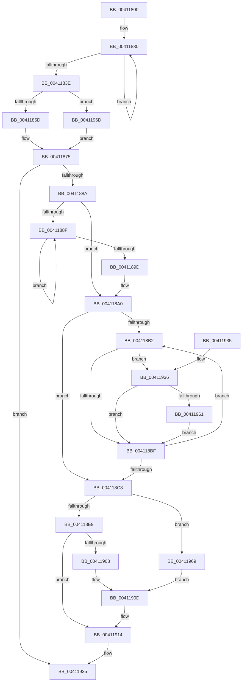

# ST_STORE&lt;SM_TRAITS&gt;::StLazyWorkMgrQueueWork

- RVA: `0x00411800`–`0x00411978` (길이 `376` bytes)
- VA: `0x0000000140411800`
- 실행 섹션: `.text`
- PDB 이름 있음: `예`; PDB Function 태그: `아니요`
- unwind 정보 RVA: `0x0009BE4C`
- 디코드: `96`개 명령, `376/376` bytes 표시
- 미해석 바이트: `0` (있으면 어셈블리에 `.byte`로 보존)

> 이 문서는 커널 이미지의 기계어와 PDB 기호를 분석해 생성했습니다. 4번과 5번은 함수 원형과 자료형을 바이너리 사용 방식에서 추정한 C 해석이며 원본 소스 복구 결과는 아닙니다.

## 1. Dependencies

- 직접 호출 지점: **0**; 고유 호출 대상: **0**
- 직접 호출자로 확인된 함수: **6**
- RIP 상대 이미지 참조: **0**

### Outgoing calls
- 직접 디코드된 call 명령이 없습니다.

### Direct callers
- [sub_0020634E](../20/Unknown_function_0020634E.md) at `0x002064DC`
- [ST_STORE&lt;SM_TRAITS&gt;::StDmCurrentRegionSet](../3B/ST_STORE_SM_TRAITS_StDmCurrentRegionSet_function_003B1130.md) at `0x003B1295`
- [sub_00410C73](Unknown_function_00410C73.md) at `0x00410C8B`
- [ST_STORE&lt;SM_TRAITS&gt;::StQueueCompaction](ST_STORE_SM_TRAITS_StQueueCompaction_function_00411790.md) at `0x004117C9`
- [ST_STORE&lt;SM_TRAITS&gt;::StDmCombinePageRecords](../4E/ST_STORE_SM_TRAITS_StDmCombinePageRecords_function_004EBC80.md) at `0x004EBDC3`
- [ST_STORE&lt;SM_TRAITS&gt;::StEmptyStore](../4F/ST_STORE_SM_TRAITS_StEmptyStore_function_004FB4B0.md) at `0x004FB4FC`

### Static image references
- 디코드된 RIP-relative 메모리 참조가 없습니다.

## 2. Other-region calls and transfers

- 다른 실행 섹션으로 향하는 call: **0**
- 별도 외부 분기/꼬리 이동을 확인하지 못했습니다.

## 3. Assembly (complete function range)

```asm
00411800  48 89 5C 24 08                  mov qword ptr [rsp + 8], rbx
00411805  48 89 74 24 10                  mov qword ptr [rsp + 0x10], rsi
0041180A  48 89 7C 24 18                  mov qword ptr [rsp + 0x18], rdi
0041180F  45 8B D8                        mov r11d, r8d
00411812  48 8B D9                        mov rbx, rcx
00411815  48 BF B0 03 00 00 80 F7 FF FF   movabs rdi, 0xfffff780000003b0
0041181F  48 BE 08 00 00 00 80 F7 FF FF   movabs rsi, 0xfffff78000000008
00411829  0F 1F 80 00 00 00 00            nop dword ptr [rax]
00411830  48 8B 0F                        mov rcx, qword ptr [rdi]
00411833  4C 8B 16                        mov r10, qword ptr [rsi]
00411836  48 8B 07                        mov rax, qword ptr [rdi]
00411839  48 3B C8                        cmp rcx, rax
0041183C  75 F2                           jne 0x140411830
0041183E  4C 2B D1                        sub r10, rcx
00411841  48 63 C2                        movsxd rax, edx
00411844  48 8D 0C 40                     lea rcx, [rax + rax*2]
00411848  48 8D 14 CB                     lea rdx, [rbx + rcx*8]
0041184C  48 C7 C1 FF FF FF FF            mov rcx, 0xffffffffffffffff
00411853  41 83 F9 FF                     cmp r9d, -1
00411857  0F 84 10 01 00 00               je 0x14041196d
0041185D  41 8B C1                        mov eax, r9d
00411860  4C 69 C0 10 27 00 00            imul r8, rax, 0x2710
00411867  4C 89 52 10                     mov qword ptr [rdx + 0x10], r10
0041186B  4D 03 C2                        add r8, r10
0041186E  49 69 C3 10 27 00 00            imul rax, r11, 0x2710
00411875  48 89 02                        mov qword ptr [rdx], rax
00411878  4C 89 42 08                     mov qword ptr [rdx + 8], r8
0041187C  8B 83 E0 00 00 00               mov eax, dword ptr [rbx + 0xe0]
00411882  A8 01                           test al, 1
00411884  0F 85 9B 00 00 00               jne 0x140411925
0041188A  4D 85 D2                        test r10, r10
0041188D  75 11                           jne 0x1404118a0
0041188F  48 8B 17                        mov rdx, qword ptr [rdi]
00411892  4C 8B 16                        mov r10, qword ptr [rsi]
00411895  48 8B 07                        mov rax, qword ptr [rdi]
00411898  48 3B D0                        cmp rdx, rax
0041189B  75 F2                           jne 0x14041188f
0041189D  4C 2B D2                        sub r10, rdx
004118A0  4C 8D 8B A8 00 00 00            lea r9, [rbx + 0xa8]
004118A7  48 8B C3                        mov rax, rbx
004118AA  48 8B F9                        mov rdi, rcx
004118AD  49 3B D9                        cmp rbx, r9
004118B0  73 16                           jae 0x1404118c8
004118B2  4C 8B 40 08                     mov r8, qword ptr [rax + 8]
004118B6  4C 8B D9                        mov r11, rcx
004118B9  49 83 F8 FF                     cmp r8, -1
004118BD  75 77                           jne 0x140411936
004118BF  48 83 C0 18                     add rax, 0x18
004118C3  49 3B C1                        cmp rax, r9
004118C6  72 EA                           jb 0x1404118b2
004118C8  49 3B CA                        cmp rcx, r10
004118CB  4D 8B C2                        mov r8, r10
004118CE  49 8B D2                        mov rdx, r10
004118D1  4C 0F 43 C1                     cmovae r8, rcx
004118D5  49 3B FA                        cmp rdi, r10
004118D8  48 0F 43 D7                     cmovae rdx, rdi
004118DC  49 89 11                        mov qword ptr [r9], rdx
004118DF  48 83 FA FF                     cmp rdx, -1
004118E3  0F 84 80 00 00 00               je 0x140411969
004118E9  48 8B CA                        mov rcx, rdx
004118EC  49 8B C0                        mov rax, r8
004118EF  49 2B C2                        sub rax, r10
004118F2  49 2B D2                        sub rdx, r10
004118F5  49 3B C8                        cmp rcx, r8
004118F8  48 0F 43 D0                     cmovae rdx, rax
004118FC  48 89 93 B0 00 00 00            mov qword ptr [rbx + 0xb0], rdx
00411903  48 85 D2                        test rdx, rdx
00411906  75 0C                           jne 0x140411914
00411908  BA 01 00 00 00                  mov edx, 1
0041190D  48 89 93 B0 00 00 00            mov qword ptr [rbx + 0xb0], rdx
00411914  48 8B 83 B0 E6 FF FF            mov rax, qword ptr [rbx - 0x1950]
0041191B  48 F7 DA                        neg rdx
0041191E  48 89 90 10 1D 00 00            mov qword ptr [rax + 0x1d10], rdx
00411925  48 8B 5C 24 08                  mov rbx, qword ptr [rsp + 8]
0041192A  48 8B 74 24 10                  mov rsi, qword ptr [rsp + 0x10]
0041192F  48 8B 7C 24 18                  mov rdi, qword ptr [rsp + 0x18]
00411934  C3                              ret
00411935  CC                              int3
00411936  48 8B 50 10                     mov rdx, qword ptr [rax + 0x10]
0041193A  49 8B CA                        mov rcx, r10
0041193D  48 2B 8B B8 00 00 00            sub rcx, qword ptr [rbx + 0xb8]
00411944  48 3B D1                        cmp rdx, rcx
00411947  48 0F 42 D1                     cmovb rdx, rcx
0041194B  48 8B 08                        mov rcx, qword ptr [rax]
0041194E  48 03 CA                        add rcx, rdx
00411951  49 3B CB                        cmp rcx, r11
00411954  49 0F 43 CB                     cmovae rcx, r11
00411958  4C 3B C7                        cmp r8, rdi
0041195B  0F 83 5E FF FF FF               jae 0x1404118bf
00411961  49 8B F8                        mov rdi, r8
00411964  E9 56 FF FF FF                  jmp 0x1404118bf
00411969  33 D2                           xor edx, edx
0041196B  EB A0                           jmp 0x14041190d
0041196D  4C 8B C1                        mov r8, rcx
00411970  48 8B C1                        mov rax, rcx
00411973  E9 FD FE FF FF                  jmp 0x140411875
```

## 4. C-style interpretation (structured pseudocode)

```c
__int64 __fastcall ST_STORE_SM_TRAITS___StLazyWorkMgrQueueWork(__int64 a1, int a2, int a3, int a4)
{
    __int64 result;
    __int64 v_r10;
    unsigned __int64 v_stack_p10;
    unsigned __int64 v_stack_p18;
    unsigned __int64 v_stack_p8;

    v_stack_p8 = v_rbx;
    v_stack_p10 = v_rsi;
    v_stack_p18 = v_rdi;
loc_00411830:
    if ((*(unsigned __int64 *)(v_rdi)) != (*(unsigned __int64 *)(v_rdi))) goto loc_00411830;
    v_r10 = (*(unsigned __int64 *)(v_rsi)) - (*(unsigned __int64 *)(v_rdi));
    if (a4 == -1) goto loc_0041196D;
    a3 = (a3) * ((unsigned int)(a4));
    *(unsigned __int64 *)(a1 + (int)(a2) + (int)(a2) * 2 * 8 + 16) = v_r10;
    a3 = (a3) + (v_r10);
    result = ((unsigned int)(a4)) * ((unsigned int)(a3));
loc_00411875:
    *(unsigned __int64 *)(a1 + (int)(a2) + (int)(a2) * 2 * 8) = result;
    *(unsigned __int64 *)(a1 + (int)(a2) + (int)(a2) * 2 * 8 + 8) = a3;
    if ((((unsigned __int8)((unsigned int)(*(unsigned int *)(a1 + 224)))) & (1)) != 0) goto loc_00411925;
    if (v_r10 != 0) goto loc_004118A0;
loc_0041188F:
    if ((*(unsigned __int64 *)(v_rdi)) != (*(unsigned __int64 *)(v_rdi))) goto loc_0041188F;
    v_r10 = (*(unsigned __int64 *)(v_rsi)) - (*(unsigned __int64 *)(v_rdi));
loc_004118A0:
    if (a1 >= (a1 + 168)) goto loc_004118C8;
loc_004118B2:
    if ((*(unsigned __int64 *)(a1 + 8)) != -1) goto loc_00411936;
loc_004118BF:
    result = (a1) + (24);
    if (result < (a1 + 168)) goto loc_004118B2;
loc_004118C8:
    a3 = v_r10;
    if (-1 >= v_r10) { a3 = -1; }
    a2 = v_r10;
    if (-1 >= v_r10) { a2 = -1; }
    *(unsigned __int64 *)(a1 + 168) = a2;
    if (a2 == -1) goto loc_00411969;
    result = (a3) - (v_r10);
    a2 = (a2) - (v_r10);
    if (a2 >= a3) { a2 = result; }
    *(unsigned __int64 *)(a1 + 176) = a2;
    if (a2 != 0) goto loc_00411914;
loc_0041190D:
    *(unsigned __int64 *)(a1 + 176) = 1;
loc_00411914:
    a2 = -(1);
    *(unsigned __int64 *)(*(unsigned __int64 *)(a1 - 6480) + 7440) = a2;
loc_00411925:
    return *(unsigned __int64 *)(a1 - 6480);
loc_00411936:
    a1 = (v_r10) - (*(unsigned __int64 *)(v_stack_p8 + 184));
    a2 = *(unsigned __int64 *)(*(unsigned __int64 *)(a1 - 6480) + 16);
    if ((*(unsigned __int64 *)(*(unsigned __int64 *)(a1 - 6480) + 16)) < a1) { a2 = a1; }
    a1 = (*(unsigned __int64 *)(*(unsigned __int64 *)(a1 - 6480))) + (a2);
    if (a1 >= -1) { a1 = -1; }
    if (a3 >= v_stack_p18) goto loc_004118BF;
    goto loc_004118BF;
loc_00411969:
    a2 = 0;
    goto loc_0041190D;
loc_0041196D:
    goto loc_00411875;
}
```

## 5. (Beta) C Style

```c
int64_t ST_STORE_SM_TRAITS___StLazyWorkMgrQueueWork(void *Arg1, void *Arg2, int32_t Arg3, int32_t Arg4)
{
    uint8_t *arg1 = (uint8_t *)Arg1;
    uint8_t *arg2 = (uint8_t *)Arg2;

    int64_t result;
    int64_t local_r10;
    uint64_t v_stack_p10;
    uint64_t v_stack_p18;
    uint64_t v_stack_p8;

    v_stack_p8 = local_rbx;
    v_stack_p10 = local_rsi;
    v_stack_p18 = local_rdi;
loc_00411830:
    if ((*(uint64_t *)(local_rdi)) != (*(uint64_t *)(local_rdi))) goto loc_00411830;
    local_r10 = (*(uint64_t *)(local_rsi)) - (*(uint64_t *)(local_rdi));
    if (Arg4 == -1) goto loc_0041196D;
    Arg3 = (Arg3) * ((uint32_t)(Arg4));
    *(uint64_t *)(arg1 + (int32_t)(arg2) + (int32_t)(arg2) * 2 * 8 + 0x10) = local_r10;
    Arg3 = (Arg3) + (local_r10);
    result = ((uint32_t)(Arg4)) * ((uint32_t)(Arg3));
loc_00411875:
    *(uint64_t *)(arg1 + (int32_t)(arg2) + (int32_t)(arg2) * 2 * 8) = result;
    *(uint64_t *)(arg1 + (int32_t)(arg2) + (int32_t)(arg2) * 2 * 8 + 0x8) = Arg3;
    if ((((uint8_t)((uint32_t)(*(uint32_t *)(arg1 + 0xE0)))) & (1)) != 0) goto loc_00411925;
    if (local_r10 != 0) goto loc_004118A0;
loc_0041188F:
    if ((*(uint64_t *)(local_rdi)) != (*(uint64_t *)(local_rdi))) goto loc_0041188F;
    local_r10 = (*(uint64_t *)(local_rsi)) - (*(uint64_t *)(local_rdi));
loc_004118A0:
    if (Arg1 >= (Arg1 + 168)) goto loc_004118C8;
loc_004118B2:
    if ((*(uint64_t *)(arg1 + 0x8)) != -1) goto loc_00411936;
loc_004118BF:
    result = (Arg1) + (24);
    if (result < (Arg1 + 168)) goto loc_004118B2;
loc_004118C8:
    Arg3 = local_r10;
    if (-1 >= local_r10) { Arg3 = -1; }
    Arg2 = local_r10;
    if (-1 >= local_r10) { Arg2 = -1; }
    *(void **)(arg1 + 0xA8) = Arg2;
    if (Arg2 == -1) goto loc_00411969;
    result = (Arg3) - (local_r10);
    Arg2 = (Arg2) - (local_r10);
    if (Arg2 >= Arg3) { Arg2 = result; }
    *(void **)(arg1 + 0xB0) = Arg2;
    if (Arg2 != NULL) goto loc_00411914;
loc_0041190D:
    *(uint64_t *)(arg1 + 0xB0) = 1;
loc_00411914:
    Arg2 = -(1);
    *(void **)(*(uint64_t *)(arg1 - 0x1950) + 0x1D10) = Arg2;
loc_00411925:
    return *(uint64_t *)(arg1 - 0x1950);
loc_00411936:
    Arg1 = (local_r10) - (*(uint64_t *)(v_stack_p8 + 0xB8));
    Arg2 = *(uint64_t *)(*(uint64_t *)(arg1 - 0x1950) + 0x10);
    if ((*(uint64_t *)(*(uint64_t *)(arg1 - 0x1950) + 0x10)) < Arg1) { Arg2 = Arg1; }
    Arg1 = (*(uint64_t *)(*(uint64_t *)(arg1 - 0x1950))) + (Arg2);
    if (Arg1 >= -1) { Arg1 = -1; }
    if (Arg3 >= v_stack_p18) goto loc_004118BF;
    goto loc_004118BF;
loc_00411969:
    Arg2 = 0;
    goto loc_0041190D;
loc_0041196D:
    goto loc_00411875;
}
```

### 관측된 메모리 오프셋

구조체 형식이 확인되지 않은 접근은 인자 기준의 오프셋으로만 기록했습니다.

| 기준 인자 | 오프셋 표현 | 폭 (bit) | 접근 |
|---|---:|---:|---|
| `Arg1` | `+ 0x0` | `64` | `W` |
| `Arg1` | `+ 0x0 + rcx*8` | `64` | `R` |
| `Arg1` | `+ 0x8` | `64` | `W` |
| `Arg1` | `+ 0x10` | `64` | `W` |
| `Arg1` | `+ 0xA8` | `64` | `R` |
| `Arg1` | `+ 0xE0` | `32` | `R` |
| `Arg2` | `+ 0x0 + rax*2` | `64` | `R` |

## 6. Execution-region graph

[열기: 2D/3D 그래프와 함수 탐색 컨트롤 패널](../../../control-panel.html?section=text&rva=0x00411800&view=graph)

- 2D 그래프는 위에서 아래로 흐르고, 3D 그래프는 빈 공간을 드래그해 회전합니다. Shift+드래그는 이동, 휠은 확대·축소, 함수 노드 선택은 대상 보고서 이동입니다.

### Static fallback


