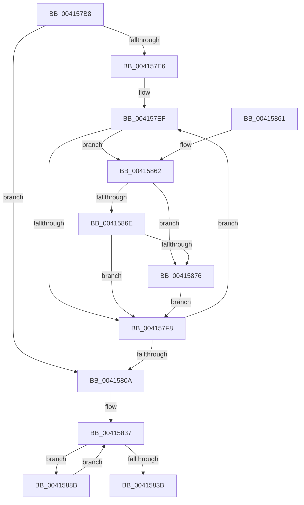

# ST_STORE&lt;SM_TRAITS&gt;::StLazyWorkMgrRunExpiredWork

- RVA: `0x004157B8`–`0x004158AE` (길이 `246` bytes)
- VA: `0x00000001404157B8`
- 실행 섹션: `.text`
- PDB 이름 있음: `예`; PDB Function 태그: `아니요`
- unwind 정보 RVA: `0x0009C2C0`
- 디코드: `68`개 명령, `246/246` bytes 표시
- 미해석 바이트: `0` (있으면 어셈블리에 `.byte`로 보존)

> 이 문서는 커널 이미지의 기계어와 PDB 기호를 분석해 생성했습니다. 4번과 5번은 함수 원형과 자료형을 바이너리 사용 방식에서 추정한 C 해석이며 원본 소스 복구 결과는 아닙니다.

## 1. Dependencies

- 직접 호출 지점: **2**; 고유 호출 대상: **2**
- 직접 호출자로 확인된 함수: **2**
- RIP 상대 이미지 참조: **0**

### Outgoing calls
- `0x00415847` → [ST_STORE<SM_TRAITS>::StLazyWorkMgrSetSchedule](ST_STORE_SM_TRAITS_StLazyWorkMgrSetSchedule_function_004158C0.md) (function, `0x004158C0`)
- `0x004158A7` → [ST_STORE<SM_TRAITS>::StWorkItemProcess](../20/ST_STORE_SM_TRAITS_StWorkItemProcess_function_00205DD0.md) (function, `0x00205DD0`)

### Direct callers
- [sub_00205558](../20/Unknown_function_00205558.md) at `0x0020555E`
- [sub_00206865](../20/Unknown_function_00206865.md) at `0x00206CC1`

### Static image references
- 디코드된 RIP-relative 메모리 참조가 없습니다.

## 2. Other-region calls and transfers

- 다른 실행 섹션으로 향하는 call: **0**
- 별도 외부 분기/꼬리 이동을 확인하지 못했습니다.

## 3. Assembly (complete function range)

```asm
004157B8  48 89 5C 24 08                  mov qword ptr [rsp + 8], rbx
004157BD  48 89 6C 24 10                  mov qword ptr [rsp + 0x10], rbp
004157C2  48 89 74 24 18                  mov qword ptr [rsp + 0x18], rsi
004157C7  57                              push rdi
004157C8  48 83 EC 40                     sub rsp, 0x40
004157CC  33 FF                           xor edi, edi
004157CE  4C 8D 99 A8 00 00 00            lea r11, [rcx + 0xa8]
004157D5  45 33 C9                        xor r9d, r9d
004157D8  48 8B F2                        mov rsi, rdx
004157DB  48 8B D9                        mov rbx, rcx
004157DE  4C 8B C1                        mov r8, rcx
004157E1  49 3B CB                        cmp rcx, r11
004157E4  73 24                           jae 0x14041580a
004157E6  33 C9                           xor ecx, ecx
004157E8  45 33 D2                        xor r10d, r10d
004157EB  48 83 CD FF                     or rbp, 0xffffffffffffffff
004157EF  49 8B 50 08                     mov rdx, qword ptr [r8 + 8]
004157F3  48 3B D5                        cmp rdx, rbp
004157F6  75 6A                           jne 0x140415862
004157F8  49 83 C0 18                     add r8, 0x18
004157FC  41 FF C1                        inc r9d
004157FF  41 8B C9                        mov ecx, r9d
00415802  45 8B D1                        mov r10d, r9d
00415805  4D 3B C3                        cmp r8, r11
00415808  72 E5                           jb 0x1404157ef
0041580A  0F 57 C0                        xorps xmm0, xmm0
0041580D  48 8D 74 24 20                  lea rsi, [rsp + 0x20]
00415812  0F 11 44 24 20                  movups xmmword ptr [rsp + 0x20], xmm0
00415817  48 83 CE 01                     or rsi, 1
0041581B  C7 44 24 20 06 00 00 00         mov dword ptr [rsp + 0x20], 6
00415823  83 8B E0 00 00 00 01            or dword ptr [rbx + 0xe0], 1
0041582A  0F 11 44 24 30                  movups xmmword ptr [rsp + 0x30], xmm0
0041582F  C7 44 24 28 01 00 00 00         mov dword ptr [rsp + 0x28], 1
00415837  85 FF                           test edi, edi
00415839  75 50                           jne 0x14041588b
0041583B  83 A3 E0 00 00 00 FE            and dword ptr [rbx + 0xe0], 0xfffffffe
00415842  33 D2                           xor edx, edx
00415844  48 8B CB                        mov rcx, rbx
00415847  E8 74 00 00 00                  call 0x1404158c0
0041584C  48 8B 5C 24 50                  mov rbx, qword ptr [rsp + 0x50]
00415851  48 8B 6C 24 58                  mov rbp, qword ptr [rsp + 0x58]
00415856  48 8B 74 24 60                  mov rsi, qword ptr [rsp + 0x60]
0041585B  48 83 C4 40                     add rsp, 0x40
0041585F  5F                              pop rdi
00415860  C3                              ret
00415861  CC                              int3
00415862  48 8B 83 B8 00 00 00            mov rax, qword ptr [rbx + 0xb8]
00415869  49 39 00                        cmp qword ptr [r8], rax
0041586C  76 08                           jbe 0x140415876
0041586E  41 8B CA                        mov ecx, r10d
00415871  48 3B D6                        cmp rdx, rsi
00415874  77 82                           ja 0x1404157f8
00415876  B8 01 00 00 00                  mov eax, 1
0041587B  49 89 28                        mov qword ptr [r8], rbp
0041587E  D3 E0                           shl eax, cl
00415880  0B F8                           or edi, eax
00415882  49 89 68 08                     mov qword ptr [r8 + 8], rbp
00415886  E9 6D FF FF FF                  jmp 0x1404157f8
0041588B  0F BC CF                        bsf ecx, edi
0041588E  B8 01 00 00 00                  mov eax, 1
00415893  48 8B D6                        mov rdx, rsi
00415896  D3 E0                           shl eax, cl
00415898  F7 D0                           not eax
0041589A  89 4C 24 30                     mov dword ptr [rsp + 0x30], ecx
0041589E  23 F8                           and edi, eax
004158A0  48 8D 8B 98 E6 FF FF            lea rcx, [rbx - 0x1968]
004158A7  E8 24 05 DF FF                  call 0x140205dd0
004158AC  EB 89                           jmp 0x140415837
```

## 4. C-style interpretation (structured pseudocode)

```c
__int64 __fastcall ST_STORE_SM_TRAITS___StLazyWorkMgrRunExpiredWork(__int64 a1, __int64 a2, __int64 a3, int a4)
{
    __int64 result;
    __int64 v_r10;
    __int64 v_rbp;
    __int64 v_rdi;
    __int64 v_rsi;
    __int64 v_rsp;
    unsigned __int64 v_stack_m18;
    unsigned int v_stack_m20;
    unsigned __int64 v_stack_m28;
    unsigned __int64 v_stack_p10;
    unsigned __int64 v_stack_p18;
    unsigned int v_stack_p30;
    unsigned __int64 v_stack_p8;

    v_stack_p8 = v_rbx;
    v_stack_p10 = v_rbp;
    v_stack_p18 = v_rsi;
    v_rsp = (v_rsp) - (64);
    v_rdi = 0;
    a4 = 0;
    if (a1 >= (a1 + 168)) goto loc_0041580A;
    a1 = 0;
    v_r10 = 0;
    v_rbp = (v_rbp) | (-1);
loc_004157EF:
    if ((*(unsigned __int64 *)(a1 + 8)) != v_rbp) goto loc_00415862;
loc_004157F8:
    a3 = (a1) + (24);
    a4 = (unsigned int)((a4) + 1);
    if (a3 < (a1 + 168)) goto loc_004157EF;
loc_0041580A:
    v_stack_m28 = v_xmm0;
    v_rsi = (v_stack_m28) | (1);
    v_stack_m28 = 6;
    v_stack_m18 = v_xmm0;
    v_stack_m20 = 1;
loc_00415837:
    if (0 != 0) goto loc_0041588B;
    a2 = 0;
    result = ST_STORE_SM_TRAITS___StLazyWorkMgrSetSchedule(0, a2, a3, a4);
    v_rsp = (v_rsp) + (64);
    return result;
loc_00415862:
    if ((*(unsigned __int64 *)(a3)) <= (*(unsigned __int64 *)(v_stack_p8 + 184))) goto loc_00415876;
    if (0 > v_stack_p18) goto loc_004157F8;
loc_00415876:
    *(unsigned __int64 *)(a3) = v_stack_p10;
    result = (unsigned int)((1) << ((unsigned __int8)((unsigned int)((unsigned int)((unsigned int)(a4))))));
    v_rdi = (unsigned int)((v_rdi) | ((unsigned int)(result)));
    *(unsigned __int64 *)(a3 + 8) = v_stack_p10;
    goto loc_004157F8;
loc_0041588B:
    result = (unsigned int)((1) << ((unsigned __int8)((unsigned int)((unsigned int)((unsigned int)(a4))))));
    result = (unsigned int)(~(result));
    v_stack_p30 = (unsigned int)((unsigned int)((unsigned int)((unsigned int)(a4))));
    v_rdi = (unsigned int)((v_rdi) & ((unsigned int)(result)));
    result = ST_STORE_SM_TRAITS___StWorkItemProcess(v_stack_p8 - 6504, v_stack_p18, a3, a4);
    goto loc_00415837;
}
```

## 5. (Beta) C Style

```c
int64_t ST_STORE_SM_TRAITS___StLazyWorkMgrRunExpiredWork(void *Arg1, int64_t Arg2, int64_t Arg3, int32_t Arg4)
{
    uint8_t *arg1 = (uint8_t *)Arg1;

    int64_t result;
    int64_t local_r10;
    int64_t local_rbp;
    int64_t local_rdi;
    int64_t local_rsi;
    int64_t local_rsp;
    uint64_t v_stack_m18;
    uint32_t v_stack_m20;
    uint64_t v_stack_m28;
    uint64_t v_stack_p10;
    uint64_t v_stack_p18;
    uint32_t v_stack_p30;
    uint64_t v_stack_p8;

    v_stack_p8 = local_rbx;
    v_stack_p10 = local_rbp;
    v_stack_p18 = local_rsi;
    local_rsp = (local_rsp) - (64);
    local_rdi = 0;
    Arg4 = 0;
    if (Arg1 >= (Arg1 + 168)) goto loc_0041580A;
    Arg1 = 0;
    local_r10 = 0;
    local_rbp = (local_rbp) | (-1);
loc_004157EF:
    if ((*(uint64_t *)(arg1 + 0x8)) != local_rbp) goto loc_00415862;
loc_004157F8:
    Arg3 = (Arg1) + (24);
    Arg4 = (uint32_t)((Arg4) + 1);
    if (Arg3 < (Arg1 + 168)) goto loc_004157EF;
loc_0041580A:
    v_stack_m28 = v_xmm0;
    local_rsi = (v_stack_m28) | (1);
    v_stack_m28 = 6;
    v_stack_m18 = v_xmm0;
    v_stack_m20 = 1;
loc_00415837:
    if (0 != 0) goto loc_0041588B;
    Arg2 = 0;
    result = ST_STORE_SM_TRAITS___StLazyWorkMgrSetSchedule(0, Arg2, Arg3, Arg4);
    local_rsp = (local_rsp) + (64);
    return result;
loc_00415862:
    if ((*(uint64_t *)(Arg3)) <= (*(uint64_t *)(v_stack_p8 + 0xB8))) goto loc_00415876;
    if (0 > v_stack_p18) goto loc_004157F8;
loc_00415876:
    *(uint64_t *)(Arg3) = v_stack_p10;
    result = (uint32_t)((1) << ((uint8_t)((uint32_t)((uint32_t)((uint32_t)(Arg4))))));
    local_rdi = (uint32_t)((local_rdi) | ((uint32_t)(result)));
    *(uint64_t *)(Arg3 + 0x8) = v_stack_p10;
    goto loc_004157F8;
loc_0041588B:
    result = (uint32_t)((1) << ((uint8_t)((uint32_t)((uint32_t)((uint32_t)(Arg4))))));
    result = (uint32_t)(~(result));
    v_stack_p30 = (uint32_t)((uint32_t)((uint32_t)((uint32_t)(Arg4))));
    local_rdi = (uint32_t)((local_rdi) & ((uint32_t)(result)));
    result = ST_STORE_SM_TRAITS___StWorkItemProcess(v_stack_p8 - 6504, v_stack_p18, Arg3, Arg4);
    goto loc_00415837;
}
```

### 관측된 메모리 오프셋

구조체 형식이 확인되지 않은 접근은 인자 기준의 오프셋으로만 기록했습니다.

| 기준 인자 | 오프셋 표현 | 폭 (bit) | 접근 |
|---|---:|---:|---|
| `Arg1` | `- 0x1968` | `64` | `R` |
| `Arg1` | `+ 0xA8` | `64` | `R` |
| `Arg1` | `+ 0xB8` | `64` | `R` |
| `Arg1` | `+ 0xE0` | `32` | `R/W` |

## 6. Execution-region graph

[열기: 2D/3D 그래프와 함수 탐색 컨트롤 패널](../../../control-panel.html?section=text&rva=0x004157B8&view=graph)

- 2D 그래프는 위에서 아래로 흐르고, 3D 그래프는 빈 공간을 드래그해 회전합니다. Shift+드래그는 이동, 휠은 확대·축소, 함수 노드 선택은 대상 보고서 이동입니다.

### Static fallback


