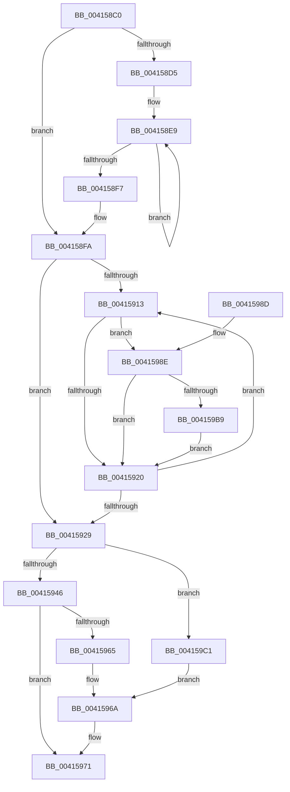

# ST_STORE&lt;SM_TRAITS&gt;::StLazyWorkMgrSetSchedule

- RVA: `0x004158C0`–`0x004159C5` (길이 `261` bytes)
- VA: `0x00000001404158C0`
- 실행 섹션: `.text`
- PDB 이름 있음: `예`; PDB Function 태그: `아니요`
- unwind 정보 RVA: `0x0007BEA4`
- 디코드: `69`개 명령, `261/261` bytes 표시
- 미해석 바이트: `0` (있으면 어셈블리에 `.byte`로 보존)

> 이 문서는 커널 이미지의 기계어와 PDB 기호를 분석해 생성했습니다. 4번과 5번은 함수 원형과 자료형을 바이너리 사용 방식에서 추정한 C 해석이며 원본 소스 복구 결과는 아닙니다.

## 1. Dependencies

- 직접 호출 지점: **0**; 고유 호출 대상: **0**
- 직접 호출자로 확인된 함수: **1**
- RIP 상대 이미지 참조: **0**

### Outgoing calls
- 직접 디코드된 call 명령이 없습니다.

### Direct callers
- [ST_STORE&lt;SM_TRAITS&gt;::StLazyWorkMgrRunExpiredWork](ST_STORE_SM_TRAITS_StLazyWorkMgrRunExpiredWork_function_004157B8.md) at `0x00415847`

### Static image references
- 디코드된 RIP-relative 메모리 참조가 없습니다.

## 2. Other-region calls and transfers

- 다른 실행 섹션으로 향하는 call: **0**
- 별도 외부 분기/꼬리 이동을 확인하지 못했습니다.

## 3. Assembly (complete function range)

```asm
004158C0  48 89 5C 24 08                  mov qword ptr [rsp + 8], rbx
004158C5  48 89 7C 24 10                  mov qword ptr [rsp + 0x10], rdi
004158CA  48 8B DA                        mov rbx, rdx
004158CD  4C 8B D9                        mov r11, rcx
004158D0  48 85 D2                        test rdx, rdx
004158D3  75 25                           jne 0x1404158fa
004158D5  48 BA B0 03 00 00 80 F7 FF FF   movabs rdx, 0xfffff780000003b0
004158DF  49 B8 08 00 00 00 80 F7 FF FF   movabs r8, 0xfffff78000000008
004158E9  48 8B 0A                        mov rcx, qword ptr [rdx]
004158EC  49 8B 18                        mov rbx, qword ptr [r8]
004158EF  48 8B 02                        mov rax, qword ptr [rdx]
004158F2  48 3B C8                        cmp rcx, rax
004158F5  75 F2                           jne 0x1404158e9
004158F7  48 2B D9                        sub rbx, rcx
004158FA  4D 8D 8B A8 00 00 00            lea r9, [r11 + 0xa8]
00415901  48 C7 C1 FF FF FF FF            mov rcx, 0xffffffffffffffff
00415908  49 8B C3                        mov rax, r11
0041590B  48 8B F9                        mov rdi, rcx
0041590E  4D 3B D9                        cmp r11, r9
00415911  73 16                           jae 0x140415929
00415913  4C 8B 40 08                     mov r8, qword ptr [rax + 8]
00415917  4C 8B D1                        mov r10, rcx
0041591A  49 83 F8 FF                     cmp r8, -1
0041591E  75 6E                           jne 0x14041598e
00415920  48 83 C0 18                     add rax, 0x18
00415924  49 3B C1                        cmp rax, r9
00415927  72 EA                           jb 0x140415913
00415929  48 3B CB                        cmp rcx, rbx
0041592C  4C 8B C3                        mov r8, rbx
0041592F  48 8B D3                        mov rdx, rbx
00415932  4C 0F 43 C1                     cmovae r8, rcx
00415936  48 3B FB                        cmp rdi, rbx
00415939  48 0F 43 D7                     cmovae rdx, rdi
0041593D  49 89 11                        mov qword ptr [r9], rdx
00415940  48 83 FA FF                     cmp rdx, -1
00415944  74 7B                           je 0x1404159c1
00415946  48 8B CA                        mov rcx, rdx
00415949  49 8B C0                        mov rax, r8
0041594C  48 2B C3                        sub rax, rbx
0041594F  48 2B D3                        sub rdx, rbx
00415952  49 3B C8                        cmp rcx, r8
00415955  48 0F 43 D0                     cmovae rdx, rax
00415959  49 89 93 B0 00 00 00            mov qword ptr [r11 + 0xb0], rdx
00415960  48 85 D2                        test rdx, rdx
00415963  75 0C                           jne 0x140415971
00415965  BA 01 00 00 00                  mov edx, 1
0041596A  49 89 93 B0 00 00 00            mov qword ptr [r11 + 0xb0], rdx
00415971  49 8B 83 B0 E6 FF FF            mov rax, qword ptr [r11 - 0x1950]
00415978  48 F7 DA                        neg rdx
0041597B  48 8B 5C 24 08                  mov rbx, qword ptr [rsp + 8]
00415980  48 8B 7C 24 10                  mov rdi, qword ptr [rsp + 0x10]
00415985  48 89 90 10 1D 00 00            mov qword ptr [rax + 0x1d10], rdx
0041598C  C3                              ret
0041598D  CC                              int3
0041598E  48 8B 50 10                     mov rdx, qword ptr [rax + 0x10]
00415992  48 8B CB                        mov rcx, rbx
00415995  49 2B 8B B8 00 00 00            sub rcx, qword ptr [r11 + 0xb8]
0041599C  48 3B D1                        cmp rdx, rcx
0041599F  48 0F 42 D1                     cmovb rdx, rcx
004159A3  48 8B 08                        mov rcx, qword ptr [rax]
004159A6  48 03 CA                        add rcx, rdx
004159A9  49 3B CA                        cmp rcx, r10
004159AC  49 0F 43 CA                     cmovae rcx, r10
004159B0  4C 3B C7                        cmp r8, rdi
004159B3  0F 83 67 FF FF FF               jae 0x140415920
004159B9  49 8B F8                        mov rdi, r8
004159BC  E9 5F FF FF FF                  jmp 0x140415920
004159C1  33 D2                           xor edx, edx
004159C3  EB A5                           jmp 0x14041596a
```

## 4. C-style interpretation (structured pseudocode)

```c
__int64 __fastcall ST_STORE_SM_TRAITS___StLazyWorkMgrSetSchedule(__int64 a1, __int64 a2)
{
    __int64 result;
    __int64 v_rbx;
    unsigned __int64 v_stack_p10;
    unsigned __int64 v_stack_p8;

    v_stack_p8 = v_rbx;
    v_stack_p10 = v_rdi;
    if (a2 != 0) goto loc_004158FA;
loc_004158E9:
    if ((*(unsigned __int64 *)(a2)) != (*(unsigned __int64 *)(a2))) goto loc_004158E9;
    v_rbx = (*(unsigned __int64 *)(a3)) - (*(unsigned __int64 *)(a2));
loc_004158FA:
    if (a1 >= (a1 + 168)) goto loc_00415929;
loc_00415913:
    if ((*(unsigned __int64 *)(a1 + 8)) != -1) goto loc_0041598E;
loc_00415920:
    result = (a1) + (24);
    if (result < (a1 + 168)) goto loc_00415913;
loc_00415929:
    a3 = v_rbx;
    if (-1 >= v_rbx) { a3 = -1; }
    a2 = v_rbx;
    if (-1 >= v_rbx) { a2 = -1; }
    *(unsigned __int64 *)(a1 + 168) = a2;
    if (a2 == -1) goto loc_004159C1;
    result = (a3) - (v_rbx);
    a2 = (a2) - (v_rbx);
    if (a2 >= a3) { a2 = result; }
    *(unsigned __int64 *)(a1 + 176) = a2;
    if (a2 != 0) goto loc_00415971;
loc_0041596A:
    *(unsigned __int64 *)(a1 + 176) = 1;
loc_00415971:
    a2 = -(1);
    *(unsigned __int64 *)(*(unsigned __int64 *)(a1 - 6480) + 7440) = a2;
    return *(unsigned __int64 *)(a1 - 6480);
loc_0041598E:
    a1 = (v_stack_p8) - (*(unsigned __int64 *)(a1 + 184));
    a2 = *(unsigned __int64 *)(*(unsigned __int64 *)(a1 - 6480) + 16);
    if ((*(unsigned __int64 *)(*(unsigned __int64 *)(a1 - 6480) + 16)) < a1) { a2 = a1; }
    a1 = (*(unsigned __int64 *)(*(unsigned __int64 *)(a1 - 6480))) + (a2);
    if (a1 >= -1) { a1 = -1; }
    if (a3 >= v_stack_p10) goto loc_00415920;
    goto loc_00415920;
loc_004159C1:
    a2 = 0;
    goto loc_0041596A;
}
```

## 5. (Beta) C Style

```c
int64_t ST_STORE_SM_TRAITS___StLazyWorkMgrSetSchedule(void *Arg1, int64_t Arg2)
{
    uint8_t *arg1 = (uint8_t *)Arg1;

    int64_t result;
    int64_t local_rbx;
    uint64_t v_stack_p10;
    uint64_t v_stack_p8;

    v_stack_p8 = local_rbx;
    v_stack_p10 = local_rdi;
    if (Arg2 != 0) goto loc_004158FA;
loc_004158E9:
    if ((*(uint64_t *)(Arg2)) != (*(uint64_t *)(Arg2))) goto loc_004158E9;
    local_rbx = (*(uint64_t *)(a3)) - (*(uint64_t *)(Arg2));
loc_004158FA:
    if (Arg1 >= (Arg1 + 168)) goto loc_00415929;
loc_00415913:
    if ((*(uint64_t *)(arg1 + 0x8)) != -1) goto loc_0041598E;
loc_00415920:
    result = (Arg1) + (24);
    if (result < (Arg1 + 168)) goto loc_00415913;
loc_00415929:
    a3 = local_rbx;
    if (-1 >= local_rbx) { a3 = -1; }
    Arg2 = local_rbx;
    if (-1 >= local_rbx) { Arg2 = -1; }
    *(uint64_t *)(arg1 + 0xA8) = Arg2;
    if (Arg2 == -1) goto loc_004159C1;
    result = (a3) - (local_rbx);
    Arg2 = (Arg2) - (local_rbx);
    if (Arg2 >= a3) { Arg2 = result; }
    *(uint64_t *)(arg1 + 0xB0) = Arg2;
    if (Arg2 != 0) goto loc_00415971;
loc_0041596A:
    *(uint64_t *)(arg1 + 0xB0) = 1;
loc_00415971:
    Arg2 = -(1);
    *(uint64_t *)(*(uint64_t *)(arg1 - 0x1950) + 0x1D10) = Arg2;
    return *(uint64_t *)(arg1 - 0x1950);
loc_0041598E:
    Arg1 = (v_stack_p8) - (*(uint64_t *)(arg1 + 0xB8));
    Arg2 = *(uint64_t *)(*(uint64_t *)(arg1 - 0x1950) + 0x10);
    if ((*(uint64_t *)(*(uint64_t *)(arg1 - 0x1950) + 0x10)) < Arg1) { Arg2 = Arg1; }
    Arg1 = (*(uint64_t *)(*(uint64_t *)(arg1 - 0x1950))) + (Arg2);
    if (Arg1 >= -1) { Arg1 = -1; }
    if (a3 >= v_stack_p10) goto loc_00415920;
    goto loc_00415920;
loc_004159C1:
    Arg2 = 0;
    goto loc_0041596A;
}
```

### 관측된 메모리 오프셋

구조체 형식이 확인되지 않은 접근은 인자 기준의 오프셋으로만 기록했습니다.

| 기준 인자 | 오프셋 표현 | 폭 (bit) | 접근 |
|---|---:|---:|---|
| `Arg1` | `+ 0x0` | `64` | `W` |
| `Arg1` | `+ 0xA8` | `64` | `R` |

## 6. Execution-region graph

[열기: 2D/3D 그래프와 함수 탐색 컨트롤 패널](../../../control-panel.html?section=text&rva=0x004158C0&view=graph)

- 2D 그래프는 위에서 아래로 흐르고, 3D 그래프는 빈 공간을 드래그해 회전합니다. Shift+드래그는 이동, 휠은 확대·축소, 함수 노드 선택은 대상 보고서 이동입니다.

### Static fallback


