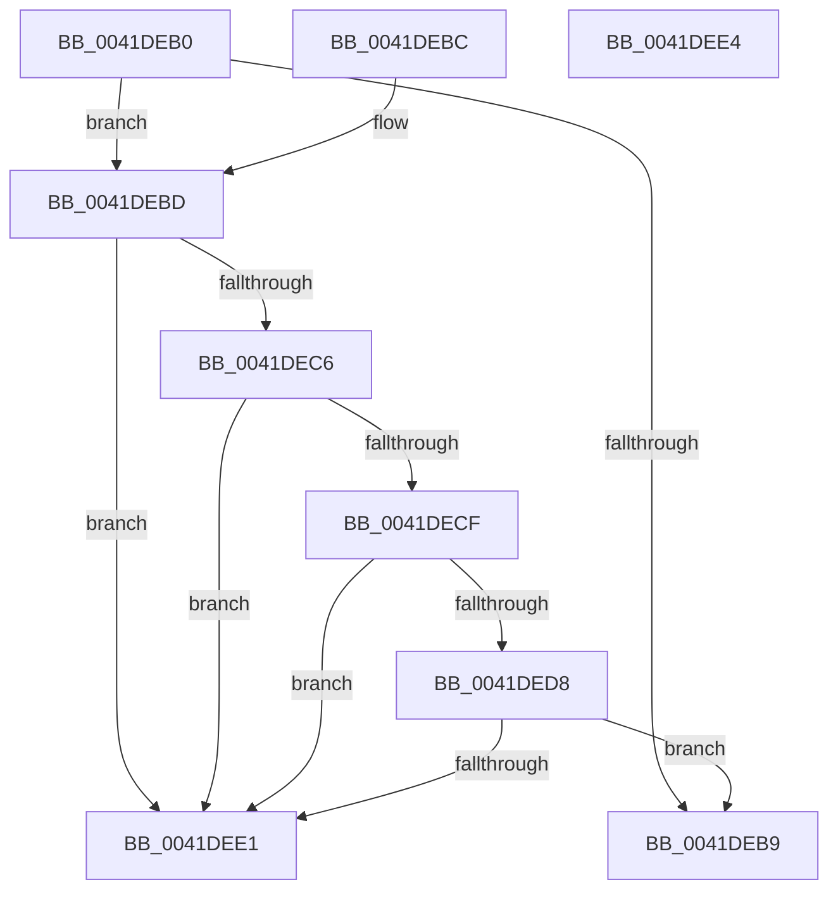

# SeAuditHeaderRequired

- RVA: `0x0041DEB0`–`0x0041DEE5` (길이 `53` bytes)
- VA: `0x000000014041DEB0`
- 실행 섹션: `.text`
- PDB 이름 있음: `예`; PDB Function 태그: `아니요`
- unwind 정보 RVA: `0x000DB714`
- 디코드: `16`개 명령, `53/53` bytes 표시
- 미해석 바이트: `0` (있으면 어셈블리에 `.byte`로 보존)

> 이 문서는 커널 이미지의 기계어와 PDB 기호를 분석해 생성했습니다. 4번과 5번은 함수 원형과 자료형을 바이너리 사용 방식에서 추정한 C 해석이며 원본 소스 복구 결과는 아닙니다.

## 1. Dependencies

- 직접 호출 지점: **0**; 고유 호출 대상: **0**
- 직접 호출자로 확인된 함수: **1**
- RIP 상대 이미지 참조: **5**

### Outgoing calls
- 직접 디코드된 call 명령이 없습니다.

### Direct callers
- [ObpAllocateObject](../../page/89/ObpAllocateObject_function_00899FF0.md) at `0x0089A02C`

### Static image references
- `0x0041DEB0` → RVA `0x00FC6AE0` (`ALMOSTRO`; read)
- `0x0041DEBD` → RVA `0x00F04B02` (`.data`; read)
- `0x0041DEC6` → RVA `0x00F04B1A` (`.data`; read)
- `0x0041DECF` → RVA `0x00F04B03` (`.data`; read)
- `0x0041DED8` → RVA `0x00F04B1B` (`.data`; read)

## 2. Other-region calls and transfers

- 다른 실행 섹션으로 향하는 call: **0**
- 별도 외부 분기/꼬리 이동을 확인하지 못했습니다.

## 3. Assembly (complete function range)

```asm
0041DEB0  48 3B 0D 29 8C BA 00            cmp rcx, qword ptr [rip + 0xba8c29]
0041DEB7  74 04                           je 0x14041debd
0041DEB9  32 C0                           xor al, al
0041DEBB  C3                              ret
0041DEBC  CC                              int3
0041DEBD  80 3D 3E 6C AE 00 00            cmp byte ptr [rip + 0xae6c3e], 0
0041DEC4  75 1B                           jne 0x14041dee1
0041DEC6  80 3D 4D 6C AE 00 00            cmp byte ptr [rip + 0xae6c4d], 0
0041DECD  75 12                           jne 0x14041dee1
0041DECF  80 3D 2D 6C AE 00 00            cmp byte ptr [rip + 0xae6c2d], 0
0041DED6  75 09                           jne 0x14041dee1
0041DED8  80 3D 3C 6C AE 00 00            cmp byte ptr [rip + 0xae6c3c], 0
0041DEDF  74 D8                           je 0x14041deb9
0041DEE1  B0 01                           mov al, 1
0041DEE3  C3                              ret
0041DEE4  CC                              int3
```

## 4. C-style interpretation (structured pseudocode)

```c
__int64 __fastcall SeAuditHeaderRequired(__int64 a1)
{
    __int64 result;

    if (a1 == (*(unsigned __int64 *)(v_rip + 12225577))) goto loc_0041DEBD;
loc_0041DEB9:
    result = 0;
    return result;
loc_0041DEBD:
    if ((*(unsigned __int8 *)(v_rip + 11430974)) != 0) goto loc_0041DEE1;
    if ((*(unsigned __int8 *)(v_rip + 11430989)) != 0) goto loc_0041DEE1;
    if ((*(unsigned __int8 *)(v_rip + 11430957)) != 0) goto loc_0041DEE1;
    if ((*(unsigned __int8 *)(v_rip + 11430972)) == 0) goto loc_0041DEB9;
loc_0041DEE1:
    return 1;
}
```

## 5. (Beta) C Style

```c
int64_t SeAuditHeaderRequired(int64_t Arg1)
{
    int64_t result;

    if (Arg1 == (*(uint64_t *)(v_rip + 0xBA8C29))) goto loc_0041DEBD;
loc_0041DEB9:
    result = 0;
    return result;
loc_0041DEBD:
    if ((*(uint8_t *)(v_rip + 0xAE6C3E)) != 0) goto loc_0041DEE1;
    if ((*(uint8_t *)(v_rip + 0xAE6C4D)) != 0) goto loc_0041DEE1;
    if ((*(uint8_t *)(v_rip + 0xAE6C2D)) != 0) goto loc_0041DEE1;
    if ((*(uint8_t *)(v_rip + 0xAE6C3C)) == 0) goto loc_0041DEB9;
loc_0041DEE1:
    return 1;
}
```

## 6. Execution-region graph

[열기: 2D/3D 그래프와 함수 탐색 컨트롤 패널](../../../control-panel.html?section=text&rva=0x0041DEB0&view=graph)

- 2D 그래프는 위에서 아래로 흐르고, 3D 그래프는 빈 공간을 드래그해 회전합니다. Shift+드래그는 이동, 휠은 확대·축소, 함수 노드 선택은 대상 보고서 이동입니다.

### Static fallback


