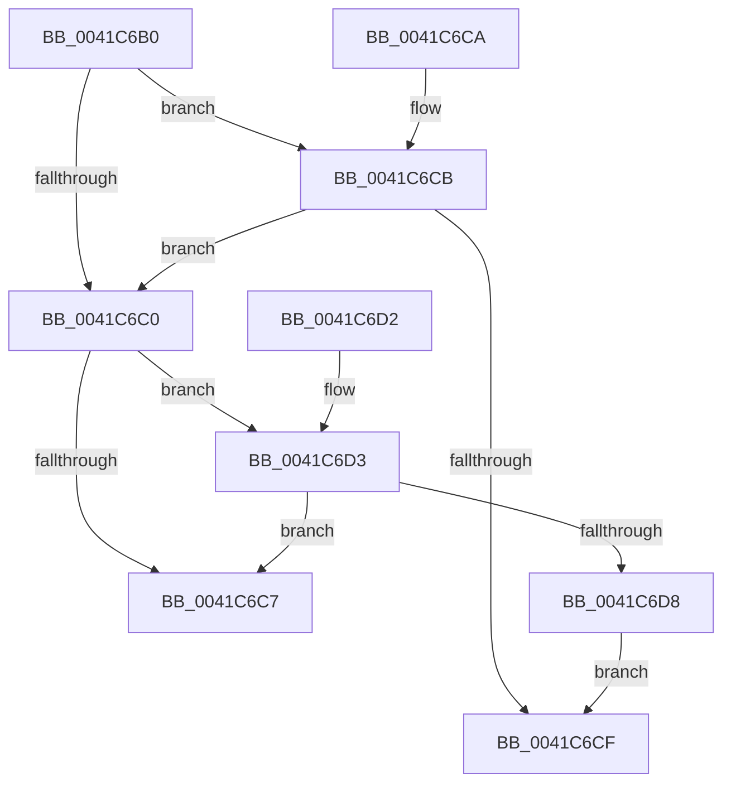

# SepAuditingEnabledForSubcategory

- RVA: `0x0041C6B0`–`0x0041C6DA` (길이 `42` bytes)
- VA: `0x000000014041C6B0`
- 실행 섹션: `.text`
- PDB 이름 있음: `예`; PDB Function 태그: `아니요`
- unwind 정보 RVA: `0x000DB714`
- 디코드: `17`개 명령, `42/42` bytes 표시
- 미해석 바이트: `0` (있으면 어셈블리에 `.byte`로 보존)

> 이 문서는 커널 이미지의 기계어와 PDB 기호를 분석해 생성했습니다. 4번과 5번은 함수 원형과 자료형을 바이너리 사용 방식에서 추정한 C 해석이며 원본 소스 복구 결과는 아닙니다.

## 1. Dependencies

- 직접 호출 지점: **0**; 고유 호출 대상: **0**
- 직접 호출자로 확인된 함수: **3**
- RIP 상대 이미지 참조: **1**

### Outgoing calls
- 직접 디코드된 call 명령이 없습니다.

### Direct callers
- [SepAdtAuditObjectAccessWithContext](../../page/86/SepAdtAuditObjectAccessWithContext_function_0086EEF0.md) at `0x0086F024`
- [SepAdtAuditObjectAccessWithContext](../../page/86/SepAdtAuditObjectAccessWithContext_function_0086EEF0.md) at `0x0086F128`
- [sub_00870AEF](../../page/87/Unknown_function_00870AEF.md) at `0x00870AF4`
- [sub_0091FBAE](../../page/91/Unknown_function_0091FBAE.md) at `0x0091FBC4`
- [sub_0091FBAE](../../page/91/Unknown_function_0091FBAE.md) at `0x0091FBE8`

### Static image references
- `0x0041C6B3` → RVA `0x00F04AE0` (`.data`; read)

## 2. Other-region calls and transfers

- 다른 실행 섹션으로 향하는 call: **0**
- 별도 외부 분기/꼬리 이동을 확인하지 못했습니다.

## 3. Assembly (complete function range)

```asm
0041C6B0  83 C1 9C                        add ecx, -0x64
0041C6B3  48 8D 05 26 84 AE 00            lea rax, [rip + 0xae8426]
0041C6BA  80 3C 48 00                     cmp byte ptr [rax + rcx*2], 0
0041C6BE  75 0B                           jne 0x14041c6cb
0041C6C0  80 7C 48 01 00                  cmp byte ptr [rax + rcx*2 + 1], 0
0041C6C5  75 0C                           jne 0x14041c6d3
0041C6C7  32 C0                           xor al, al
0041C6C9  C3                              ret
0041C6CA  CC                              int3
0041C6CB  84 D2                           test dl, dl
0041C6CD  74 F1                           je 0x14041c6c0
0041C6CF  B0 01                           mov al, 1
0041C6D1  C3                              ret
0041C6D2  CC                              int3
0041C6D3  45 84 C0                        test r8b, r8b
0041C6D6  74 EF                           je 0x14041c6c7
0041C6D8  EB F5                           jmp 0x14041c6cf
```

## 4. C-style interpretation (structured pseudocode)

```c
__int64 __fastcall SepAuditingEnabledForSubcategory(int a1, unsigned __int8 a2, unsigned __int8 a3)
{
    __int64 result;

    a1 = (unsigned int)((a1) + (-100));
    if ((*(unsigned __int8 *)(v_rip + 11437094 + a1 * 2)) != 0) goto loc_0041C6CB;
loc_0041C6C0:
    if ((*(unsigned __int8 *)(v_rip + 11437094 + a1 * 2 + 1)) != 0) goto loc_0041C6D3;
loc_0041C6C7:
    result = 0;
    return result;
loc_0041C6CB:
    if (a2 == 0) goto loc_0041C6C0;
loc_0041C6CF:
    return 1;
loc_0041C6D3:
    if (a3 == 0) goto loc_0041C6C7;
    goto loc_0041C6CF;
}
```

## 5. (Beta) C Style

```c
int64_t SepAuditingEnabledForSubcategory(int32_t Arg1, uint8_t Arg2, uint8_t Arg3)
{
    int64_t result;

    Arg1 = (uint32_t)((Arg1) + (-100));
    if ((*(uint8_t *)(v_rip + 0xAE8426 + Arg1 * 2)) != 0) goto loc_0041C6CB;
loc_0041C6C0:
    if ((*(uint8_t *)(v_rip + 0xAE8426 + Arg1 * 2 + 0x1)) != 0) goto loc_0041C6D3;
loc_0041C6C7:
    result = 0;
    return result;
loc_0041C6CB:
    if (Arg2 == 0) goto loc_0041C6C0;
loc_0041C6CF:
    return 1;
loc_0041C6D3:
    if (Arg3 == 0) goto loc_0041C6C7;
    goto loc_0041C6CF;
}
```

## 6. Execution-region graph

[열기: 2D/3D 그래프와 함수 탐색 컨트롤 패널](../../../control-panel.html?section=text&rva=0x0041C6B0&view=graph)

- 2D 그래프는 위에서 아래로 흐르고, 3D 그래프는 빈 공간을 드래그해 회전합니다. Shift+드래그는 이동, 휠은 확대·축소, 함수 노드 선택은 대상 보고서 이동입니다.

### Static fallback


