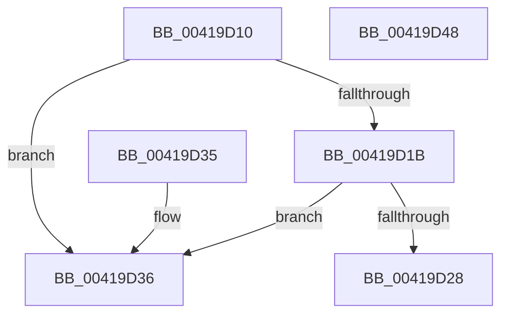

# SepCopyTokenIntegrity

- RVA: `0x00419D10`–`0x00419D49` (길이 `57` bytes)
- VA: `0x0000000140419D10`
- 실행 섹션: `.text`
- PDB 이름 있음: `예`; PDB Function 태그: `아니요`
- unwind 정보 RVA: `0x000DB714`
- 디코드: `17`개 명령, `57/57` bytes 표시
- 미해석 바이트: `0` (있으면 어셈블리에 `.byte`로 보존)

> 이 문서는 커널 이미지의 기계어와 PDB 기호를 분석해 생성했습니다. 4번과 5번은 함수 원형과 자료형을 바이너리 사용 방식에서 추정한 C 해석이며 원본 소스 복구 결과는 아닙니다.

## 1. Dependencies

- 직접 호출 지점: **0**; 고유 호출 대상: **0**
- 직접 호출자로 확인된 함수: **9**
- RIP 상대 이미지 참조: **1**

### Outgoing calls
- 직접 디코드된 call 명령이 없습니다.

### Direct callers
- [AuthzBasepQueryTokenAttributeAndValues](../30/AuthzBasepQueryTokenAttributeAndValues_function_00300208.md) at `0x003002C8`
- [SeQueryTokenIntegrity](SeQueryTokenIntegrity_function_00419CF4.md) at `0x00419CF8`
- [SeQueryInformationToken](../../page/8B/SeQueryInformationToken_function_008B5090.md) at `0x008B56DC`
- [sub_008BBC01](../../page/8B/Unknown_function_008BBC01.md) at `0x008BBD2D`
- [sub_008CC5C2](../../page/8C/Unknown_function_008CC5C2.md) at `0x008CC5DF`
- [sub_008CC5C2](../../page/8C/Unknown_function_008CC5C2.md) at `0x008CC5EC`
- [SepCopyTokenLoggingInformation](../../page/9A/SepCopyTokenLoggingInformation_function_009A8618.md) at `0x009A868D`
- [SepAdjustPrivileges](../../page/9C/SepAdjustPrivileges_function_009C8DFC.md) at `0x009C8ED5`
- [SeIsTokenAssignableToProcess](../../page/A3/SeIsTokenAssignableToProcess_function_00A3B2C0.md) at `0x00A3B34C`
- [SeIsTokenAssignableToProcess](../../page/A3/SeIsTokenAssignableToProcess_function_00A3B2C0.md) at `0x00A3B39B`
- [NtQueryInformationToken](../../page/AE/NtQueryInformationToken_function_00AECDD0.md) at `0x00AEEEEB`

### Static image references
- `0x00419D36` → RVA `0x00F05818` (`.data`; read)

## 2. Other-region calls and transfers

- 다른 실행 섹션으로 향하는 call: **0**
- 별도 외부 분기/꼬리 이동을 확인하지 못했습니다.

## 3. Assembly (complete function range)

```asm
00419D10  8B 81 D0 00 00 00               mov eax, dword ptr [rcx + 0xd0]
00419D16  83 F8 FF                        cmp eax, -1
00419D19  74 1B                           je 0x140419d36
00419D1B  48 C1 E0 04                     shl rax, 4
00419D1F  48 03 81 98 00 00 00            add rax, qword ptr [rcx + 0x98]
00419D26  74 0E                           je 0x140419d36
00419D28  48 8B 08                        mov rcx, qword ptr [rax]
00419D2B  48 89 0A                        mov qword ptr [rdx], rcx
00419D2E  8B 48 08                        mov ecx, dword ptr [rax + 8]
00419D31  89 4A 08                        mov dword ptr [rdx + 8], ecx
00419D34  C3                              ret
00419D35  CC                              int3
00419D36  48 8B 05 DB BA AE 00            mov rax, qword ptr [rip + 0xaebadb]
00419D3D  48 89 02                        mov qword ptr [rdx], rax
00419D40  C7 42 08 60 00 00 00            mov dword ptr [rdx + 8], 0x60
00419D47  C3                              ret
00419D48  CC                              int3
```

## 4. C-style interpretation (structured pseudocode)

```c
__int64 __fastcall SepCopyTokenIntegrity(__int64 a1, __int64 a2)
{
    __int64 result;

    if (((unsigned int)((unsigned int)(*(unsigned int *)(a1 + 208)))) == -1) goto loc_00419D36;
    result = ((unsigned int)(*(unsigned int *)(a1 + 208))) << (4);
    result = (result) + (*(unsigned __int64 *)(a1 + 152));
    if (condition_is_equal) goto loc_00419D36;
    *(unsigned __int64 *)(a2) = *(unsigned __int64 *)(result);
    *(unsigned int *)(a2 + 8) = (unsigned int)((unsigned int)(*(unsigned int *)(result + 8)));
    return result;
loc_00419D36:
    *(unsigned __int64 *)(a2) = *(unsigned __int64 *)(v_rip + 11451099);
    *(unsigned int *)(a2 + 8) = 96;
    return *(unsigned __int64 *)(v_rip + 11451099);
}
```

## 5. (Beta) C Style

```c
int64_t SepCopyTokenIntegrity(void *Arg1, void *Arg2)
{
    uint8_t *arg1 = (uint8_t *)Arg1;
    uint8_t *arg2 = (uint8_t *)Arg2;

    int64_t result;

    if (((uint32_t)((uint32_t)(*(uint32_t *)(arg1 + 0xD0)))) == -1) goto loc_00419D36;
    result = ((uint32_t)(*(uint32_t *)(arg1 + 0xD0))) << (4);
    result = (result) + (*(uint64_t *)(arg1 + 0x98));
    if (condition_is_equal) goto loc_00419D36;
    *(uint64_t *)(arg2) = *(uint64_t *)(result);
    *(uint32_t *)(arg2 + 0x8) = (uint32_t)((uint32_t)(*(uint32_t *)(result + 0x8)));
    return result;
loc_00419D36:
    *(uint64_t *)(arg2) = *(uint64_t *)(v_rip + 0xAEBADB);
    *(uint32_t *)(arg2 + 0x8) = 96;
    return *(uint64_t *)(v_rip + 0xAEBADB);
}
```

### 관측된 메모리 오프셋

구조체 형식이 확인되지 않은 접근은 인자 기준의 오프셋으로만 기록했습니다.

| 기준 인자 | 오프셋 표현 | 폭 (bit) | 접근 |
|---|---:|---:|---|
| `Arg1` | `+ 0x98` | `64` | `R` |
| `Arg1` | `+ 0xD0` | `32` | `R` |
| `Arg2` | `+ 0x0` | `64` | `W` |
| `Arg2` | `+ 0x8` | `32` | `W` |

## 6. Execution-region graph

[열기: 2D/3D 그래프와 함수 탐색 컨트롤 패널](../../../control-panel.html?section=text&rva=0x00419D10&view=graph)

- 2D 그래프는 위에서 아래로 흐르고, 3D 그래프는 빈 공간을 드래그해 회전합니다. Shift+드래그는 이동, 휠은 확대·축소, 함수 노드 선택은 대상 보고서 이동입니다.

### Static fallback


