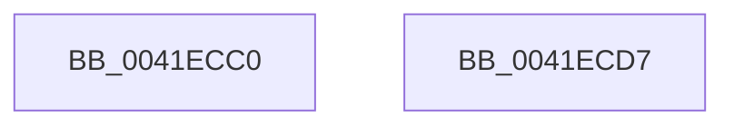

# SepFilterToDiscretionary

- RVA: `0x0041ECC0`–`0x0041ECD8` (길이 `24` bytes)
- VA: `0x000000014041ECC0`
- 실행 섹션: `.text`
- PDB 이름 있음: `예`; PDB Function 태그: `아니요`
- unwind 정보 RVA: `0x000DB714`
- 디코드: `9`개 명령, `24/24` bytes 표시
- 미해석 바이트: `0` (있으면 어셈블리에 `.byte`로 보존)

> 이 문서는 커널 이미지의 기계어와 PDB 기호를 분석해 생성했습니다. 4번과 5번은 함수 원형과 자료형을 바이너리 사용 방식에서 추정한 C 해석이며 원본 소스 복구 결과는 아닙니다.

## 1. Dependencies

- 직접 호출 지점: **0**; 고유 호출 대상: **0**
- 직접 호출자로 확인된 함수: **1**
- RIP 상대 이미지 참조: **0**

### Outgoing calls
- 직접 디코드된 call 명령이 없습니다.

### Direct callers
- [SepAccessCheckAndAuditAlarm](../../page/A1/SepAccessCheckAndAuditAlarm_function_00A1AF4C.md) at `0x00A1B858`
- [SepAccessCheckAndAuditAlarm](../../page/A1/SepAccessCheckAndAuditAlarm_function_00A1AF4C.md) at `0x00A1B8BE`

### Static image references
- 디코드된 RIP-relative 메모리 참조가 없습니다.

## 2. Other-region calls and transfers

- 다른 실행 섹션으로 향하는 call: **0**
- 별도 외부 분기/꼬리 이동을 확인하지 못했습니다.

## 3. Assembly (complete function range)

```asm
0041ECC0  8B 09                           mov ecx, dword ptr [rcx]
0041ECC2  0F BA F2 19                     btr edx, 0x19
0041ECC6  45 33 C0                        xor r8d, r8d
0041ECC9  23 CA                           and ecx, edx
0041ECCB  3B CA                           cmp ecx, edx
0041ECCD  B8 22 00 00 C0                  mov eax, 0xc0000022
0041ECD2  41 0F 44 C0                     cmove eax, r8d
0041ECD6  C3                              ret
0041ECD7  CC                              int3
```

## 4. C-style interpretation (structured pseudocode)

```c
__int64 __fastcall SepFilterToDiscretionary(__int64 a1, int a2, int a3)
{
    __int64 result;

    a3 = 0;
    a1 = (unsigned int)(((unsigned int)(*(unsigned int *)(a1))) & (a2));
    result = (unsigned int)(0xC0000022ULL);
    if (((unsigned int)(a1)) == a2) { result = 0; }
    return result;
}
```

## 5. (Beta) C Style

```c
int64_t SepFilterToDiscretionary(void *Arg1, int32_t Arg2, int32_t Arg3)
{
    uint8_t *arg1 = (uint8_t *)Arg1;

    int64_t result;

    Arg3 = 0;
    Arg1 = (uint32_t)(((uint32_t)(*(uint32_t *)(arg1))) & (Arg2));
    result = (uint32_t)(0xC0000022ULL);
    if (((uint32_t)(Arg1)) == Arg2) { result = 0; }
    return result;
}
```

### 관측된 메모리 오프셋

구조체 형식이 확인되지 않은 접근은 인자 기준의 오프셋으로만 기록했습니다.

| 기준 인자 | 오프셋 표현 | 폭 (bit) | 접근 |
|---|---:|---:|---|
| `Arg1` | `+ 0x0` | `32` | `R` |

## 6. Execution-region graph

[열기: 2D/3D 그래프와 함수 탐색 컨트롤 패널](../../../control-panel.html?section=text&rva=0x0041ECC0&view=graph)

- 2D 그래프는 위에서 아래로 흐르고, 3D 그래프는 빈 공간을 드래그해 회전합니다. Shift+드래그는 이동, 휠은 확대·축소, 함수 노드 선택은 대상 보고서 이동입니다.

### Static fallback


