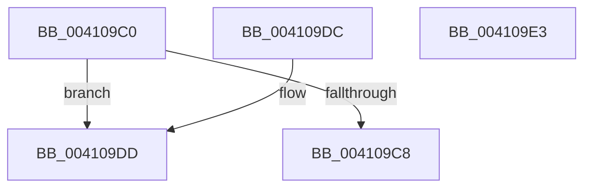

# SepGetCurrentLogLevel

- RVA: `0x004109C0`–`0x004109E4` (길이 `36` bytes)
- VA: `0x00000001404109C0`
- 실행 섹션: `.text`
- PDB 이름 있음: `예`; PDB Function 태그: `아니요`
- unwind 정보 RVA: `0x000DB714`
- 디코드: `11`개 명령, `36/36` bytes 표시
- 미해석 바이트: `0` (있으면 어셈블리에 `.byte`로 보존)

> 이 문서는 커널 이미지의 기계어와 PDB 기호를 분석해 생성했습니다. 4번과 5번은 함수 원형과 자료형을 바이너리 사용 방식에서 추정한 C 해석이며 원본 소스 복구 결과는 아닙니다.

## 1. Dependencies

- 직접 호출 지점: **0**; 고유 호출 대상: **0**
- 직접 호출자로 확인된 함수: **2**
- RIP 상대 이미지 참조: **0**

### Outgoing calls
- 직접 디코드된 call 명령이 없습니다.

### Direct callers
- [SeSetLearningModeObjectInformation](../4C/SeSetLearningModeObjectInformation_function_004C7098.md) at `0x004C72B3`
- [SepGetLearningModeObjectInformation](../60/SepGetLearningModeObjectInformation_function_00608F74.md) at `0x00608F9C`

### Static image references
- 디코드된 RIP-relative 메모리 참조가 없습니다.

## 2. Other-region calls and transfers

- 다른 실행 섹션으로 향하는 call: **0**
- 별도 외부 분기/꼬리 이동을 확인하지 못했습니다.

## 3. Assembly (complete function range)

```asm
004109C0  44 0F 20 C0                     mov rax, cr8
004109C4  84 C0                           test al, al
004109C6  75 15                           jne 0x1404109dd
004109C8  65 48 8B 04 25 88 01 00 00      mov rax, qword ptr gs:[0x188]
004109D1  0F B6 80 C0 00 00 00            movzx eax, byte ptr [rax + 0xc0]
004109D8  83 E0 01                        and eax, 1
004109DB  C3                              ret
004109DC  CC                              int3
004109DD  B8 02 00 00 00                  mov eax, 2
004109E2  C3                              ret
004109E3  CC                              int3
```

## 4. C-style interpretation (structured pseudocode)

```c
__int64 __fastcall SepGetCurrentLogLevel(void)
{
    __int64 result;

    if ((unsigned __int8)(v_cr8) != 0) goto loc_004109DD;
    result = (unsigned int)((*(unsigned __int8 *)(*(unsigned __int64 *)(gs_base + (0 + 392)) + 192)) & (1));
    return result;
loc_004109DD:
    return 2;
}
```

## 5. (Beta) C Style

```c
void SepGetCurrentLogLevel(void)
{
    int64_t result;

    if ((uint8_t)(v_cr8) != 0) goto loc_004109DD;
    result = (uint32_t)((*(uint8_t *)(*(uint64_t *)(gs_base + (0 + 0x188)) + 0xC0)) & (1));
    return result;
loc_004109DD:
    return 2;
}
```

## 6. Execution-region graph

[열기: 2D/3D 그래프와 함수 탐색 컨트롤 패널](../../../control-panel.html?section=text&rva=0x004109C0&view=graph)

- 2D 그래프는 위에서 아래로 흐르고, 3D 그래프는 빈 공간을 드래그해 회전합니다. Shift+드래그는 이동, 휠은 확대·축소, 함수 노드 선택은 대상 보고서 이동입니다.

### Static fallback


