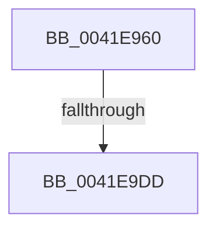

# SepGetStackTraceHash

- RVA: `0x0041E960`–`0x0041E9E0` (길이 `128` bytes)
- VA: `0x000000014041E960`
- 실행 섹션: `.text`
- PDB 이름 있음: `예`; PDB Function 태그: `아니요`
- unwind 정보 RVA: `0x0009FBDC`
- 디코드: `32`개 명령, `128/128` bytes 표시
- 미해석 바이트: `0` (있으면 어셈블리에 `.byte`로 보존)

> 이 문서는 커널 이미지의 기계어와 PDB 기호를 분석해 생성했습니다. 4번과 5번은 함수 원형과 자료형을 바이너리 사용 방식에서 추정한 C 해석이며 원본 소스 복구 결과는 아닙니다.

## 1. Dependencies

- 직접 호출 지점: **3**; 고유 호출 대상: **3**
- 직접 호출자로 확인된 함수: **1**
- RIP 상대 이미지 참조: **1**

### Outgoing calls
- `0x0041E998` → [memset](../6C/memset_function_006C6C40.md) (function, `0x006C6C40`)
- `0x0041E9C0` → [RtlCaptureStackBackTrace](../2F/RtlCaptureStackBackTrace_function_002F9FF0.md) (function, `0x002F9FF0`)
- `0x0041E9D0` → [RtlWalkFrameChain](../2F/RtlWalkFrameChain_function_002F85E0.md) (function, `0x002F85E0`)

### Direct callers
- [SepLogLpacAccessFailure](SepLogLpacAccessFailure_function_0041E8A0.md) at `0x0041E8D9`

### Static image references
- `0x0041E970` → RVA `0x00E0A740` (`.data`; read)

## 2. Other-region calls and transfers

- 다른 실행 섹션으로 향하는 call: **0**
- call이 아닌 외부 분기/꼬리 이동: **1**
  - `0x0041E9D7` → [sub_0041EA7E](Unknown_function_0041EA7E.md) (`tail-transfer`)

## 3. Assembly (complete function range)

```asm
0041E960  48 89 5C 24 18                  mov qword ptr [rsp + 0x18], rbx
0041E965  55                              push rbp
0041E966  56                              push rsi
0041E967  41 56                           push r14
0041E969  48 81 EC E0 00 00 00            sub rsp, 0xe0
0041E970  48 8B 05 C9 BD 9E 00            mov rax, qword ptr [rip + 0x9ebdc9]
0041E977  48 33 C4                        xor rax, rsp
0041E97A  48 89 84 24 D0 00 00 00         mov qword ptr [rsp + 0xd0], rax
0041E982  4C 8B F1                        mov r14, rcx
0041E985  33 ED                           xor ebp, ebp
0041E987  48 8D 4C 24 50                  lea rcx, [rsp + 0x50]
0041E98C  89 6C 24 30                     mov dword ptr [rsp + 0x30], ebp
0041E990  33 D2                           xor edx, edx
0041E992  41 B8 80 00 00 00               mov r8d, 0x80
0041E998  E8 A3 82 2A 00                  call 0x1406c6c40
0041E99D  0F 57 C0                        xorps xmm0, xmm0
0041E9A0  4C 8D 4C 24 30                  lea r9, [rsp + 0x30]
0041E9A5  33 C0                           xor eax, eax
0041E9A7  4C 8D 44 24 50                  lea r8, [rsp + 0x50]
0041E9AC  BE 10 00 00 00                  mov esi, 0x10
0041E9B1  48 89 44 24 48                  mov qword ptr [rsp + 0x48], rax
0041E9B6  8B D6                           mov edx, esi
0041E9B8  8D 4D 02                        lea ecx, [rbp + 2]
0041E9BB  0F 11 44 24 38                  movups xmmword ptr [rsp + 0x38], xmm0
0041E9C0  E8 2B B6 ED FF                  call 0x1402f9ff0
0041E9C5  44 8D 45 01                     lea r8d, [rbp + 1]
0041E9C9  8B D6                           mov edx, esi
0041E9CB  48 8D 4C 24 50                  lea rcx, [rsp + 0x50]
0041E9D0  E8 0B 9C ED FF                  call 0x1402f85e0
0041E9D5  3B C6                           cmp eax, esi
0041E9D7  0F 86 A1 00 00 00               jbe 0x14041ea7e
0041E9DD  0F B7 DD                        movzx ebx, bp
```

## 4. C-style interpretation (structured pseudocode)

```c
__int64 __fastcall SepGetStackTraceHash(__int64 a1, int a2)
{
    __int64 result;
    __int64 v_rbp;
    __int64 v_rsp;
    unsigned __int64 v_stack_m28;
    unsigned __int64 v_stack_mA8;
    unsigned __int64 v_stack_mB0;
    unsigned __int64 v_stack_mC0;
    unsigned int v_stack_mC8;
    unsigned __int64 v_stack_p18;

    v_stack_p18 = v_rbx;
    v_rsp = (v_rsp) - (224);
    result = (*(unsigned __int64 *)(v_rip + 10403273)) ^ (v_rsp);
    v_stack_m28 = result;
    v_rbp = 0;
    v_stack_mC8 = 0;
    a2 = 0;
    result = memset(v_stack_mA8, a2, 128, a4);
    result = 0;
    v_stack_mB0 = 0;
    v_stack_mC0 = v_xmm0;
    result = RtlCaptureStackBackTrace(v_rbp + 2, 16, v_stack_mA8, v_stack_mC8);
    result = RtlWalkFrameChain(v_stack_mA8, 16, v_rbp + 1, v_stack_mC8);
    return result;
}
```

## 5. (Beta) C Style

```c
int64_t SepGetStackTraceHash(int64_t Arg1, int32_t Arg2)
{
    int64_t result;
    int64_t local_rbp;
    int64_t local_rsp;
    uint64_t v_stack_m28;
    uint64_t v_stack_mA8;
    uint64_t v_stack_mB0;
    uint64_t v_stack_mC0;
    uint32_t v_stack_mC8;
    uint64_t v_stack_p18;

    v_stack_p18 = local_rbx;
    local_rsp = (local_rsp) - (224);
    result = (*(uint64_t *)(v_rip + 0x9EBDC9)) ^ (local_rsp);
    v_stack_m28 = result;
    local_rbp = 0;
    v_stack_mC8 = 0;
    Arg2 = 0;
    result = memset(v_stack_mA8, Arg2, 128, a4);
    result = 0;
    v_stack_mB0 = 0;
    v_stack_mC0 = v_xmm0;
    result = RtlCaptureStackBackTrace(local_rbp + 2, 16, v_stack_mA8, v_stack_mC8);
    result = RtlWalkFrameChain(v_stack_mA8, 16, local_rbp + 1, v_stack_mC8);
    return result;
}
```

## 6. Execution-region graph

[열기: 2D/3D 그래프와 함수 탐색 컨트롤 패널](../../../control-panel.html?section=text&rva=0x0041E960&view=graph)

- 2D 그래프는 위에서 아래로 흐르고, 3D 그래프는 빈 공간을 드래그해 회전합니다. Shift+드래그는 이동, 휠은 확대·축소, 함수 노드 선택은 대상 보고서 이동입니다.

### Static fallback


