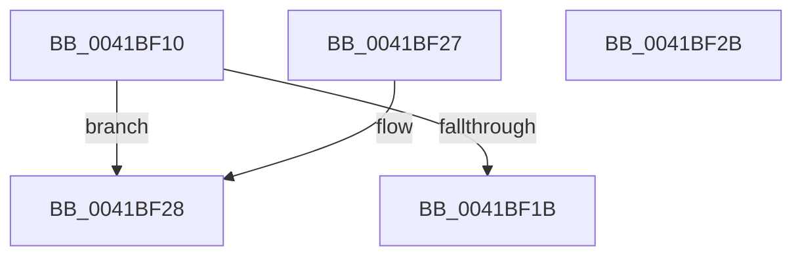

# SepLocateTokenIntegrity

- RVA: `0x0041BF10`–`0x0041BF2C` (길이 `28` bytes)
- VA: `0x000000014041BF10`
- 실행 섹션: `.text`
- PDB 이름 있음: `예`; PDB Function 태그: `아니요`
- unwind 정보 RVA: `0x000DB714`
- 디코드: `10`개 명령, `28/28` bytes 표시
- 미해석 바이트: `0` (있으면 어셈블리에 `.byte`로 보존)

> 이 문서는 커널 이미지의 기계어와 PDB 기호를 분석해 생성했습니다. 4번과 5번은 함수 원형과 자료형을 바이너리 사용 방식에서 추정한 C 해석이며 원본 소스 복구 결과는 아닙니다.

## 1. Dependencies

- 직접 호출 지점: **0**; 고유 호출 대상: **0**
- 직접 호출자로 확인된 함수: **6**
- RIP 상대 이미지 참조: **0**

### Outgoing calls
- 직접 디코드된 call 명령이 없습니다.

### Direct callers
- [SepMandatorySubProcessToken](../4C/SepMandatorySubProcessToken_function_004C0B88.md) at `0x004C0D09`
- [SepMandatorySubProcessToken](../4C/SepMandatorySubProcessToken_function_004C0B88.md) at `0x004C0E23`
- [SepMandatorySubProcessToken](../4C/SepMandatorySubProcessToken_function_004C0B88.md) at `0x004C0E76`
- [SepCreateAppContainerToken](../4F/SepCreateAppContainerToken_function_004F43AC.md) at `0x004F4708`
- [SepCreateAppContainerToken](../4F/SepCreateAppContainerToken_function_004F43AC.md) at `0x004F477C`
- [SepCreateAppContainerToken](../4F/SepCreateAppContainerToken_function_004F43AC.md) at `0x004F485C`
- [SepCreateAppContainerToken](../4F/SepCreateAppContainerToken_function_004F43AC.md) at `0x004F48D7`
- [SepCreateAppContainerToken](../4F/SepCreateAppContainerToken_function_004F43AC.md) at `0x004F493D`
- [SepCreateAppContainerToken](../4F/SepCreateAppContainerToken_function_004F43AC.md) at `0x004F4988`
- [RtlpNewSecurityObject](../../page/92/RtlpNewSecurityObject_function_0092AB50.md) at `0x0092AD7B`
- [SeSubProcessToken](../../page/AA/SeSubProcessToken_function_00AAD570.md) at `0x00AAD81E`
- [SeSubProcessToken](../../page/AA/SeSubProcessToken_function_00AAD570.md) at `0x00AADB57`
- [NtCreateLowBoxToken](../../page/AB/NtCreateLowBoxToken_function_00AB9880.md) at `0x00AB9F49`
- [NtCreateLowBoxToken](../../page/AB/NtCreateLowBoxToken_function_00AB9880.md) at `0x00AB9FCD`
- [NtCreateLowBoxToken](../../page/AB/NtCreateLowBoxToken_function_00AB9880.md) at `0x00ABA0C1`
- [NtSetInformationToken](../../page/AF/NtSetInformationToken_function_00AF0530.md) at `0x00AF19DF`
- [NtSetInformationToken](../../page/AF/NtSetInformationToken_function_00AF0530.md) at `0x00AF1B30`

### Static image references
- 디코드된 RIP-relative 메모리 참조가 없습니다.

## 2. Other-region calls and transfers

- 다른 실행 섹션으로 향하는 call: **0**
- 별도 외부 분기/꼬리 이동을 확인하지 못했습니다.

## 3. Assembly (complete function range)

```asm
0041BF10  8B 81 D0 00 00 00               mov eax, dword ptr [rcx + 0xd0]
0041BF16  83 F8 FF                        cmp eax, -1
0041BF19  74 0D                           je 0x14041bf28
0041BF1B  48 C1 E0 04                     shl rax, 4
0041BF1F  48 03 81 98 00 00 00            add rax, qword ptr [rcx + 0x98]
0041BF26  C3                              ret
0041BF27  CC                              int3
0041BF28  33 C0                           xor eax, eax
0041BF2A  C3                              ret
0041BF2B  CC                              int3
```

## 4. C-style interpretation (structured pseudocode)

```c
__int64 __fastcall SepLocateTokenIntegrity(__int64 a1)
{
    __int64 result;

    if (((unsigned int)((unsigned int)(*(unsigned int *)(a1 + 208)))) == -1) goto loc_0041BF28;
    result = ((unsigned int)(*(unsigned int *)(a1 + 208))) << (4);
    result = (result) + (*(unsigned __int64 *)(a1 + 152));
    return result;
loc_0041BF28:
    result = 0;
    return result;
}
```

## 5. (Beta) C Style

```c
int64_t SepLocateTokenIntegrity(void *Arg1)
{
    uint8_t *arg1 = (uint8_t *)Arg1;

    int64_t result;

    if (((uint32_t)((uint32_t)(*(uint32_t *)(arg1 + 0xD0)))) == -1) goto loc_0041BF28;
    result = ((uint32_t)(*(uint32_t *)(arg1 + 0xD0))) << (4);
    result = (result) + (*(uint64_t *)(arg1 + 0x98));
    return result;
loc_0041BF28:
    result = 0;
    return result;
}
```

### 관측된 메모리 오프셋

구조체 형식이 확인되지 않은 접근은 인자 기준의 오프셋으로만 기록했습니다.

| 기준 인자 | 오프셋 표현 | 폭 (bit) | 접근 |
|---|---:|---:|---|
| `Arg1` | `+ 0x98` | `64` | `R` |
| `Arg1` | `+ 0xD0` | `32` | `R` |

## 6. Execution-region graph

[열기: 2D/3D 그래프와 함수 탐색 컨트롤 패널](../../../control-panel.html?section=text&rva=0x0041BF10&view=graph)

- 2D 그래프는 위에서 아래로 흐르고, 3D 그래프는 빈 공간을 드래그해 회전합니다. Shift+드래그는 이동, 휠은 확대·축소, 함수 노드 선택은 대상 보고서 이동입니다.

### Static fallback


