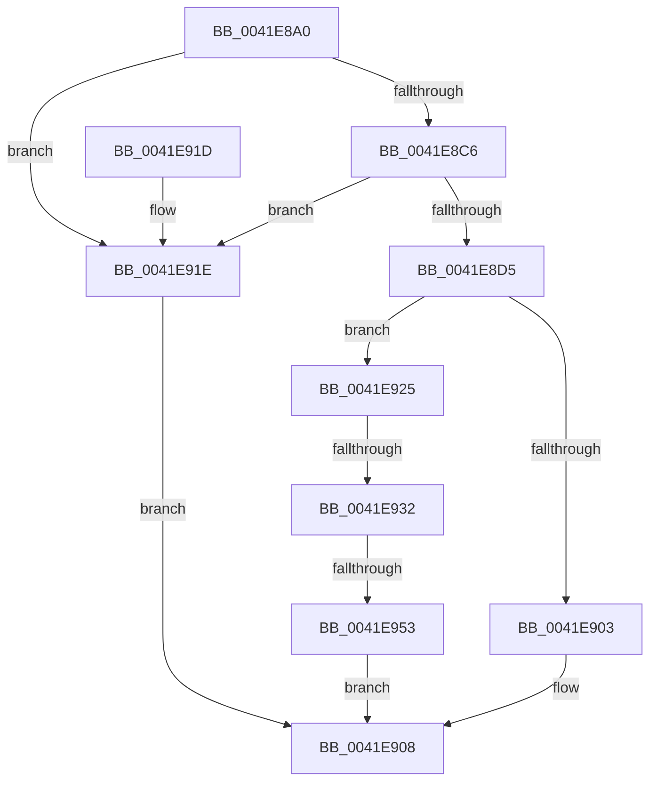

# SepLogLpacAccessFailure

- RVA: `0x0041E8A0`–`0x0041E957` (길이 `183` bytes)
- VA: `0x000000014041E8A0`
- 실행 섹션: `.text`
- PDB 이름 있음: `예`; PDB Function 태그: `예`
- unwind 정보 RVA: `0x0009FBB4`
- 디코드: `48`개 명령, `183/183` bytes 표시
- 미해석 바이트: `0` (있으면 어셈블리에 `.byte`로 보존)

> 이 문서는 커널 이미지의 기계어와 PDB 기호를 분석해 생성했습니다. 4번과 5번은 함수 원형과 자료형을 바이너리 사용 방식에서 추정한 C 해석이며 원본 소스 복구 결과는 아닙니다.

## 1. Dependencies

- 직접 호출 지점: **2**; 고유 호출 대상: **2**
- 직접 호출자로 확인된 함수: **4**
- RIP 상대 이미지 참조: **3**

### Outgoing calls
- `0x0041E8D9` → [SepGetStackTraceHash](SepGetStackTraceHash_function_0041E960.md) (function, `0x0041E960`)
- `0x0041E8F5` → [EtwTraceLpacAccessFailure](../../page/9F/EtwTraceLpacAccessFailure_function_009FEF40.md) (function, `0x009FEF40`)

### Direct callers
- [SeAccessCheckWithHint](../3A/SeAccessCheckWithHint_function_003A6C30.md) at `0x003A76D0`
- [SeAccessCheckByType](../44/SeAccessCheckByType_function_00440BC8.md) at `0x004426A9`
- [SepCommonAccessCheckEx](../47/SepCommonAccessCheckEx_function_0047602C.md) at `0x004772E5`
- [SepAccessCheckAndAuditAlarm](../../page/A1/SepAccessCheckAndAuditAlarm_function_00A1AF4C.md) at `0x00A1CF97`

### Static image references
- `0x0041E8FA` → RVA `0x00E67B8C` (`.data`; read)
- `0x0041E925` → RVA `0x00E0CCA4` (`.data`; read)
- `0x0041E936` → RVA `0x00E67D90` (`.data`; read)

## 2. Other-region calls and transfers

- 다른 실행 섹션으로 향하는 call: **1**
  - `0x0041E8F5` → [EtwTraceLpacAccessFailure](../../page/9F/EtwTraceLpacAccessFailure_function_009FEF40.md) (`.text` → `PAGE`)
- call이 아닌 외부 분기/꼬리 이동: **2**
  - `0x0041E92C` → [sub_006ED8E6 + 0x3](../6E/Unknown_function_006ED8E6.md) (`tail-transfer`)
  - `0x0041E94D` → [sub_006ED8E6](../6E/Unknown_function_006ED8E6.md) (`tail-transfer`)

## 3. Assembly (complete function range)

```asm
0041E8A0  48 8B C4                        mov rax, rsp
0041E8A3  48 89 58 10                     mov qword ptr [rax + 0x10], rbx
0041E8A7  48 89 78 18                     mov qword ptr [rax + 0x18], rdi
0041E8AB  89 48 08                        mov dword ptr [rax + 8], ecx
0041E8AE  55                              push rbp
0041E8AF  48 8D 68 A1                     lea rbp, [rax - 0x5f]
0041E8B3  48 81 EC C0 00 00 00            sub rsp, 0xc0
0041E8BA  83 65 67 00                     and dword ptr [rbp + 0x67], 0
0041E8BE  44 0F 20 C0                     mov rax, cr8
0041E8C2  3C 02                           cmp al, 2
0041E8C4  73 58                           jae 0x14041e91e
0041E8C6  65 8B 04 25 3C 3A 00 00         mov eax, dword ptr gs:[0x3a3c]
0041E8CE  A9 01 00 01 00                  test eax, 0x10001
0041E8D3  75 49                           jne 0x14041e91e
0041E8D5  48 8D 4D 67                     lea rcx, [rbp + 0x67]
0041E8D9  E8 82 00 00 00                  call 0x14041e960
0041E8DE  8B 5D 67                        mov ebx, dword ptr [rbp + 0x67]
0041E8E1  8B C3                           mov eax, ebx
0041E8E3  C1 E8 10                        shr eax, 0x10
0041E8E6  8B CB                           mov ecx, ebx
0041E8E8  66 33 C3                        xor ax, bx
0041E8EB  0F B7 F8                        movzx edi, ax
0041E8EE  66 C1 EF 08                     shr di, 8
0041E8F2  40 32 F8                        xor dil, al
0041E8F5  E8 46 06 5E 00                  call 0x1409fef40
0041E8FA  83 3D 8B 92 A4 00 00            cmp dword ptr [rip + 0xa4928b], 0
0041E901  75 22                           jne 0x14041e925
0041E903  B8 56 03 00 C0                  mov eax, 0xc0000356
0041E908  4C 8D 9C 24 C0 00 00 00         lea r11, [rsp + 0xc0]
0041E910  49 8B 5B 18                     mov rbx, qword ptr [r11 + 0x18]
0041E914  49 8B 7B 20                     mov rdi, qword ptr [r11 + 0x20]
0041E918  49 8B E3                        mov rsp, r11
0041E91B  5D                              pop rbp
0041E91C  C3                              ret
0041E91D  CC                              int3
0041E91E  B8 BB 00 00 C0                  mov eax, 0xc00000bb
0041E923  EB E3                           jmp 0x14041e908
0041E925  83 3D 78 E3 9E 00 00            cmp dword ptr [rip + 0x9ee378], 0
0041E92C  0F 84 B7 EF 2C 00               je 0x1406ed8e9
0041E932  40 0F B6 C7                     movzx eax, dil
0041E936  48 8D 15 53 94 A4 00            lea rdx, [rip + 0xa49453]
0041E93D  48 C1 E8 05                     shr rax, 5
0041E941  40 0F B6 CF                     movzx ecx, dil
0041E945  83 E1 1F                        and ecx, 0x1f
0041E948  F0 0F AB 0C 82                  lock bts dword ptr [rdx + rax*4], ecx
0041E94D  0F 83 93 EF 2C 00               jae 0x1406ed8e6
0041E953  33 C0                           xor eax, eax
0041E955  EB B1                           jmp 0x14041e908
```

## 4. C-style interpretation (structured pseudocode)

```c
__int64 __fastcall SepLogLpacAccessFailure(int a1)
{
    __int64 result;
    __int64 v_rdi;
    __int64 v_rsp;
    unsigned __int64 v_stack_m8;

    *(unsigned __int64 *)(v_rsp + 16) = v_rbx;
    *(unsigned __int64 *)(v_rsp + 24) = v_rdi;
    *(unsigned int *)(v_rsp + 8) = a1;
    v_rsp = (v_rsp) - (192);
    if (((unsigned __int8)(v_cr8)) >= 2) goto loc_0041E91E;
    if ((((unsigned int)((unsigned int)(*(unsigned int *)(gs_base + (0 + 14908))))) & (0x10001ULL)) != 0) goto loc_0041E91E;
    result = SepGetStackTraceHash(v_rsp - 95 + 103, a2, a3, a4);
    result = (unsigned int)(((unsigned int)((unsigned int)((unsigned int)(*(unsigned int *)(v_rsp - 95 + 103))))) >> (16));
    result = (unsigned __int16)((result) ^ ((unsigned __int16)((unsigned int)(*(unsigned int *)(v_rsp - 95 + 103)))));
    v_rdi = (unsigned __int16)(((unsigned __int16)(result)) >> (8));
    v_rdi = (unsigned __int8)((v_rdi) ^ ((unsigned __int8)(result)));
    result = EtwTraceLpacAccessFailure((unsigned int)((unsigned int)((unsigned int)(*(unsigned int *)(v_rsp - 95 + 103)))), a2, a3, a4);
    if ((*(unsigned int *)(v_rip + 10785419)) != 0) goto loc_0041E925;
loc_0041E908:
    return (unsigned int)(0xC0000356ULL);
loc_0041E91E:
    goto loc_0041E908;
loc_0041E925:
    result = ((unsigned __int8)(*(unsigned __int64 *)(v_stack_m8 + 32))) >> (5);
    a1 = (unsigned int)(((unsigned __int8)(*(unsigned __int64 *)(v_stack_m8 + 32))) & (31));
    result = 0;
    goto loc_0041E908;
}
```

## 5. (Beta) C Style

```c
int64_t SepLogLpacAccessFailure(int32_t Arg1)
{
    int64_t result;
    int64_t local_rdi;
    int64_t local_rsp;
    uint64_t v_stack_m8;

    *(uint64_t *)(local_rsp + 0x10) = local_rbx;
    *(uint64_t *)(local_rsp + 0x18) = local_rdi;
    *(uint32_t *)(local_rsp + 0x8) = Arg1;
    local_rsp = (local_rsp) - (192);
    if (((uint8_t)(v_cr8)) >= 2) goto loc_0041E91E;
    if ((((uint32_t)((uint32_t)(*(uint32_t *)(gs_base + (0 + 0x3A3C))))) & (0x10001ULL)) != 0) goto loc_0041E91E;
    result = SepGetStackTraceHash(local_rsp - 95 + 103, a2, a3, a4);
    result = (uint32_t)(((uint32_t)((uint32_t)((uint32_t)(*(uint32_t *)(local_rsp - 0x5F + 0x67))))) >> (16));
    result = (uint16_t)((result) ^ ((uint16_t)((uint32_t)(*(uint32_t *)(local_rsp - 0x5F + 0x67)))));
    local_rdi = (uint16_t)(((uint16_t)(result)) >> (8));
    local_rdi = (uint8_t)((local_rdi) ^ ((uint8_t)(result)));
    result = EtwTraceLpacAccessFailure((uint32_t)((uint32_t)((uint32_t)(*(uint32_t *)(local_rsp - 0x5F + 0x67)))), a2, a3, a4);
    if ((*(uint32_t *)(v_rip + 0xA4928B)) != 0) goto loc_0041E925;
loc_0041E908:
    return (uint32_t)(0xC0000356ULL);
loc_0041E91E:
    goto loc_0041E908;
loc_0041E925:
    result = ((uint8_t)(*(uint64_t *)(v_stack_m8 + 0x20))) >> (5);
    Arg1 = (uint32_t)(((uint8_t)(*(uint64_t *)(v_stack_m8 + 0x20))) & (31));
    result = 0;
    goto loc_0041E908;
}
```

## 6. Execution-region graph

[열기: 2D/3D 그래프와 함수 탐색 컨트롤 패널](../../../control-panel.html?section=text&rva=0x0041E8A0&view=graph)

- 2D 그래프는 위에서 아래로 흐르고, 3D 그래프는 빈 공간을 드래그해 회전합니다. Shift+드래그는 이동, 휠은 확대·축소, 함수 노드 선택은 대상 보고서 이동입니다.

### Static fallback


