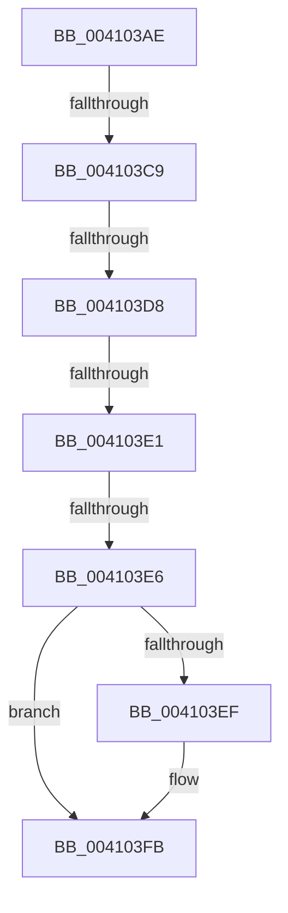

# sub_004103AE

- RVA: `0x004103AE`–`0x0041040E` (길이 `96` bytes)
- VA: `0x00000001404103AE`
- 실행 섹션: `.text`
- PDB 이름 있음: `아니요`; PDB Function 태그: `아니요`
- unwind 정보 RVA: `0x0009BC60`
- 디코드: `24`개 명령, `96/96` bytes 표시
- 미해석 바이트: `0` (있으면 어셈블리에 `.byte`로 보존)

> 이 문서는 커널 이미지의 기계어와 PDB 기호를 분석해 생성했습니다. 4번과 5번은 함수 원형과 자료형을 바이너리 사용 방식에서 추정한 C 해석이며 원본 소스 복구 결과는 아닙니다.

## 1. Dependencies

- 직접 호출 지점: **1**; 고유 호출 대상: **1**
- 직접 호출자로 확인된 함수: **0**
- RIP 상대 이미지 참조: **2**

### Outgoing calls
- `0x004103F6` → [KiLowerIrqlProcessIrqlFlags](../4F/KiLowerIrqlProcessIrqlFlags_function_004F5698.md) (function, `0x004F5698`)

### Direct callers
- 이 함수 시작 RVA로 연결되는 직접 call은 확인되지 않았습니다. 간접 호출은 완전히 역산할 수 없습니다.

### Static image references
- `0x004103C0` → RVA `0x00FC6D20` (`ALMOSTRO`; read)
- `0x004103C9` → RVA `0x00F8F9A0` (`.data`; read)

## 2. Other-region calls and transfers

- 다른 실행 섹션으로 향하는 call: **0**
- call이 아닌 외부 분기/꼬리 이동: **4**
  - `0x004103C7` → [sub_0041040F](Unknown_function_0041040F.md) (`tail-transfer`)
  - `0x004103D2` → [sub_0041040F + 0xB3](Unknown_function_0041040F.md) (`tail-transfer`)
  - `0x004103DB` → [sub_0041040F + 0x78](Unknown_function_0041040F.md) (`tail-transfer`)
  - `0x004103E4` → [sub_0041040F + 0xD](Unknown_function_0041040F.md) (`tail-transfer`)

## 3. Assembly (complete function range)

```asm
004103AE  48 89 5C 24 20                  mov qword ptr [rsp + 0x20], rbx
004103B3  44 0F 20 C3                     mov rbx, cr8
004103B7  B8 0F 00 00 00                  mov eax, 0xf
004103BC  44 0F 22 C0                     mov cr8, rax
004103C0  83 3D 59 69 BB 00 00            cmp dword ptr [rip + 0xbb6959], 0
004103C7  75 46                           jne 0x14041040f
004103C9  8B 05 D1 F5 B7 00               mov eax, dword ptr [rip + 0xb7f5d1]
004103CF  83 E8 01                        sub eax, 1
004103D2  0F 84 EA 00 00 00               je 0x1404104c2
004103D8  83 E8 01                        sub eax, 1
004103DB  0F 84 A6 00 00 00               je 0x140410487
004103E1  83 F8 01                        cmp eax, 1
004103E4  74 36                           je 0x14041041c
004103E6  83 3D 33 69 BB 00 00            cmp dword ptr [rip + 0xbb6933], 0
004103ED  74 0C                           je 0x1404103fb
004103EF  44 0F 20 C1                     mov rcx, cr8
004103F3  0F B6 D3                        movzx edx, bl
004103F6  E8 9D 52 0E 00                  call 0x1404f5698
004103FB  0F B6 C3                        movzx eax, bl
004103FE  44 0F 22 C0                     mov cr8, rax
00410402  48 8B 5C 24 20                  mov rbx, qword ptr [rsp + 0x20]
00410407  B0 01                           mov al, 1
00410409  48 83 C4 28                     add rsp, 0x28
0041040D  C3                              ret
```

## 4. C-style interpretation (structured pseudocode)

```c
__int64 __fastcall sub_004103AE(void)
{
    __int64 result;
    __int64 v_rsp;
    unsigned __int64 v_stack_p20;

    v_stack_p20 = v_rbx;
    result = (unsigned int)(((unsigned int)(*(unsigned int *)(v_rip + 12056017))) - (1));
    result = (unsigned int)((result) - (1));
    if ((*(unsigned int *)(v_rip + 12282163)) != 0) {
        a1 = 15;
        a2 = (unsigned __int8)(v_cr8);
        result = KiLowerIrqlProcessIrqlFlags(a1, a2, a3, a4);
    }
    v_rsp = (v_rsp) + (40);
    return 1;
}
```

## 5. (Beta) C Style

```c
void sub_004103AE(void)
{
    int64_t result;
    int64_t local_rsp;
    uint64_t v_stack_p20;

    v_stack_p20 = local_rbx;
    result = (uint32_t)(((uint32_t)(*(uint32_t *)(v_rip + 0xB7F5D1))) - (1));
    result = (uint32_t)((result) - (1));
    if ((*(uint32_t *)(v_rip + 0xBB6933)) != 0) {
        a1 = 15;
        a2 = (uint8_t)(v_cr8);
        result = KiLowerIrqlProcessIrqlFlags(a1, a2, a3, a4);
    }
    local_rsp = (local_rsp) + (40);
    return 1;
}
```

## 6. Execution-region graph

[열기: 2D/3D 그래프와 함수 탐색 컨트롤 패널](../../../control-panel.html?section=text&rva=0x004103AE&view=graph)

- 2D 그래프는 위에서 아래로 흐르고, 3D 그래프는 빈 공간을 드래그해 회전합니다. Shift+드래그는 이동, 휠은 확대·축소, 함수 노드 선택은 대상 보고서 이동입니다.

### Static fallback


