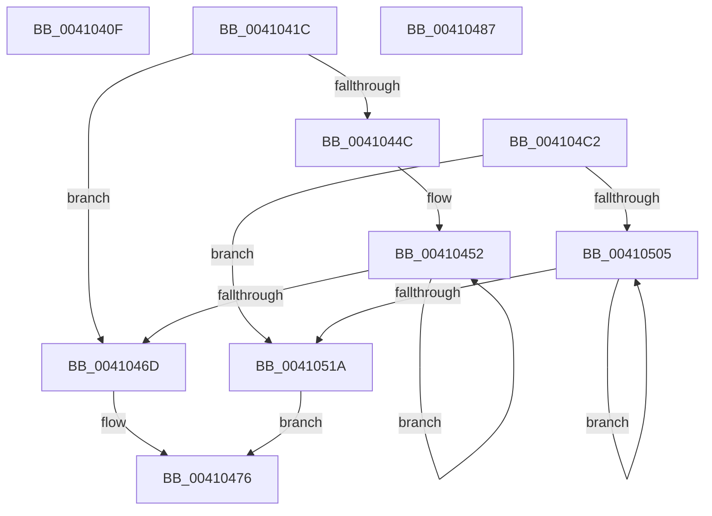

# sub_0041040F

- RVA: `0x0041040F`–`0x00410528` (길이 `281` bytes)
- VA: `0x000000014041040F`
- 실행 섹션: `.text`
- PDB 이름 있음: `아니요`; PDB Function 태그: `아니요`
- unwind 정보 RVA: `0x0009BC88`
- 디코드: `82`개 명령, `281/281` bytes 표시
- 미해석 바이트: `0` (있으면 어셈블리에 `.byte`로 보존)

> 이 문서는 커널 이미지의 기계어와 PDB 기호를 분석해 생성했습니다. 4번과 5번은 함수 원형과 자료형을 바이너리 사용 방식에서 추정한 C 해석이며 원본 소스 복구 결과는 아닙니다.

## 1. Dependencies

- 직접 호출 지점: **1**; 고유 호출 대상: **1**
- 직접 호출자로 확인된 함수: **0**
- RIP 상대 이미지 참조: **2**

### Outgoing calls
- `0x00410415` → [KiRaiseIrqlProcessIrqlFlags](../4F/KiRaiseIrqlProcessIrqlFlags_function_004F56FC.md) (function, `0x004F56FC`)

### Direct callers
- 이 함수 시작 RVA로 연결되는 직접 call은 확인되지 않았습니다. 간접 호출은 완전히 역산할 수 없습니다.

### Static image references
- `0x0041043D` → RVA `0x00F8F998` (`.data`; read)
- `0x004104A5` → RVA `0x00F8F990` (`.data`; read)

## 2. Other-region calls and transfers

- 다른 실행 섹션으로 향하는 call: **0**
- call이 아닌 외부 분기/꼬리 이동: **3**
  - `0x0041041A` → [sub_004103AE + 0x1B](Unknown_function_004103AE.md) (`tail-transfer`)
  - `0x00410482` → [sub_004103AE + 0x38](Unknown_function_004103AE.md) (`tail-transfer`)
  - `0x004104BD` → [sub_004103AE + 0x38](Unknown_function_004103AE.md) (`tail-transfer`)

## 3. Assembly (complete function range)

```asm
0041040F  0F B6 D0                        movzx edx, al
00410412  0F B6 CB                        movzx ecx, bl
00410415  E8 E2 52 0E 00                  call 0x1404f56fc
0041041A  EB AD                           jmp 0x1404103c9
0041041C  B9 0F 01 00 C0                  mov ecx, 0xc000010f
00410421  0F 32                           rdmsr
00410423  48 C1 E2 20                     shl rdx, 0x20
00410427  48 0B C2                        or rax, rdx
0041042A  48 8B D0                        mov rdx, rax
0041042D  4C 8B C8                        mov r9, rax
00410430  48 83 E2 BF                     and rdx, 0xffffffffffffffbf
00410434  48 8B C2                        mov rax, rdx
00410437  48 C1 EA 20                     shr rdx, 0x20
0041043B  0F 30                           wrmsr
0041043D  44 8B 1D 54 F5 B7 00            mov r11d, dword ptr [rip + 0xb7f554]
00410444  45 33 C0                        xor r8d, r8d
00410447  45 85 DB                        test r11d, r11d
0041044A  74 21                           je 0x14041046d
0041044C  41 BA 01 03 01 C0               mov r10d, 0xc0010301
00410452  33 C0                           xor eax, eax
00410454  41 8D 4A FF                     lea ecx, [r10 - 1]
00410458  33 D2                           xor edx, edx
0041045A  0F 30                           wrmsr
0041045C  41 8B CA                        mov ecx, r10d
0041045F  0F 30                           wrmsr
00410461  41 FF C0                        inc r8d
00410464  41 83 C2 02                     add r10d, 2
00410468  45 3B C3                        cmp r8d, r11d
0041046B  72 E5                           jb 0x140410452
0041046D  49 83 C9 40                     or r9, 0x40
00410471  B9 0F 01 00 C0                  mov ecx, 0xc000010f
00410476  49 8B D1                        mov rdx, r9
00410479  49 8B C1                        mov rax, r9
0041047C  48 C1 EA 20                     shr rdx, 0x20
00410480  0F 30                           wrmsr
00410482  E9 5F FF FF FF                  jmp 0x1404103e6
00410487  33 C0                           xor eax, eax
00410489  B9 CE 14 00 00                  mov ecx, 0x14ce
0041048E  33 D2                           xor edx, edx
00410490  0F 30                           wrmsr
00410492  8B 15 00 F5 B7 00               mov edx, dword ptr [rip + 0xb7f500]
00410498  B9 CF 14 00 00                  mov ecx, 0x14cf
0041049D  8B C2                           mov eax, edx
0041049F  48 C1 EA 20                     shr rdx, 0x20
004104A3  0F 30                           wrmsr
004104A5  8B 15 E5 F4 B7 00               mov edx, dword ptr [rip + 0xb7f4e5]
004104AB  B9 CE 14 00 00                  mov ecx, 0x14ce
004104B0  48 83 CA 01                     or rdx, 1
004104B4  48 8B C2                        mov rax, rdx
004104B7  48 C1 EA 20                     shr rdx, 0x20
004104BB  0F 30                           wrmsr
004104BD  E9 24 FF FF FF                  jmp 0x1404103e6
004104C2  B9 D9 01 00 00                  mov ecx, 0x1d9
004104C7  0F 32                           rdmsr
004104C9  48 C1 E2 20                     shl rdx, 0x20
004104CD  48 0B C2                        or rax, rdx
004104D0  48 8B D0                        mov rdx, rax
004104D3  4C 8B C8                        mov r9, rax
004104D6  48 83 E2 FE                     and rdx, 0xfffffffffffffffe
004104DA  48 8B C2                        mov rax, rdx
004104DD  48 C1 EA 20                     shr rdx, 0x20
004104E1  0F 30                           wrmsr
004104E3  44 8B 15 AE F4 B7 00            mov r10d, dword ptr [rip + 0xb7f4ae]
004104EA  41 8D 4A FF                     lea ecx, [r10 - 1]
004104EE  8B D1                           mov edx, ecx
004104F0  8B C1                           mov eax, ecx
004104F2  B9 C9 01 00 00                  mov ecx, 0x1c9
004104F7  48 C1 EA 20                     shr rdx, 0x20
004104FB  0F 30                           wrmsr
004104FD  45 33 C0                        xor r8d, r8d
00410500  45 85 D2                        test r10d, r10d
00410503  74 15                           je 0x14041051a
00410505  33 C0                           xor eax, eax
00410507  41 8D 88 80 06 00 00            lea ecx, [r8 + 0x680]
0041050E  33 D2                           xor edx, edx
00410510  0F 30                           wrmsr
00410512  41 FF C0                        inc r8d
00410515  45 3B C2                        cmp r8d, r10d
00410518  72 EB                           jb 0x140410505
0041051A  49 83 C9 01                     or r9, 1
0041051E  B9 D9 01 00 00                  mov ecx, 0x1d9
00410523  E9 4E FF FF FF                  jmp 0x140410476
```

## 4. C-style interpretation (structured pseudocode)

```c
__int64 __fastcall sub_0041040F(__int64 a1, __int64 a2, int a3)
{
    __int64 result;

    result = KiRaiseIrqlProcessIrqlFlags((unsigned __int8)(v_rbx), (unsigned __int8)(result), a3, a4);
}
```

## 5. (Beta) C Style

```c
int64_t sub_0041040F(int64_t Arg1, int64_t Arg2, int32_t Arg3)
{
    int64_t result;

    result = KiRaiseIrqlProcessIrqlFlags((uint8_t)(local_rbx), (uint8_t)(result), Arg3, a4);
}
```

## 6. Execution-region graph

[열기: 2D/3D 그래프와 함수 탐색 컨트롤 패널](../../../control-panel.html?section=text&rva=0x0041040F&view=graph)

- 2D 그래프는 위에서 아래로 흐르고, 3D 그래프는 빈 공간을 드래그해 회전합니다. Shift+드래그는 이동, 휠은 확대·축소, 함수 노드 선택은 대상 보고서 이동입니다.

### Static fallback


