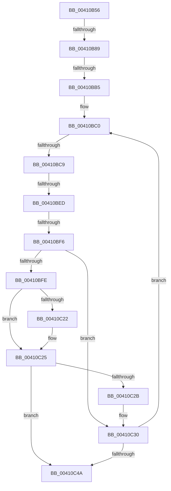

# sub_00410B56

- RVA: `0x00410B56`–`0x00410C73` (길이 `285` bytes)
- VA: `0x0000000140410B56`
- 실행 섹션: `.text`
- PDB 이름 있음: `아니요`; PDB Function 태그: `아니요`
- unwind 정보 RVA: `0x0009BCE4`
- 디코드: `65`개 명령, `285/285` bytes 표시
- 미해석 바이트: `0` (있으면 어셈블리에 `.byte`로 보존)

> 이 문서는 커널 이미지의 기계어와 PDB 기호를 분석해 생성했습니다. 4번과 5번은 함수 원형과 자료형을 바이너리 사용 방식에서 추정한 C 해석이며 원본 소스 복구 결과는 아닙니다.

## 1. Dependencies

- 직접 호출 지점: **2**; 고유 호출 대상: **2**
- 직접 호출자로 확인된 함수: **0**
- RIP 상대 이미지 참조: **0**

### Outgoing calls
- `0x00410B9D` → [B_TREE<_SM_PAGE_KEY,ST_STORE<SM_TRAITS>::_ST_PAGE_ENTRY,4096,NP_CONTEXT,B_TREE_KEY_COMPARATOR<_SM_PAGE_KEY> >::BTreeIteratorAttachEx](B_TREE__SM_PAGE_KEY_ST_STORE_SM_TRAITS__ST_PAGE_ENTRY_4096_NP_CONTEXT_B_TREE_KEY_COMPARATOR__SM_PAGE_function_004110A0.md) (function, `0x004110A0`)
- `0x00410C36` → [ST_STORE<SM_TRAITS>::StDmCombinePageEntry](ST_STORE_SM_TRAITS_StDmCombinePageEntry_function_00410D40.md) (function, `0x00410D40`)

### Direct callers
- 이 함수 시작 RVA로 연결되는 직접 call은 확인되지 않았습니다. 간접 호출은 완전히 역산할 수 없습니다.

### Static image references
- 디코드된 RIP-relative 메모리 참조가 없습니다.

## 2. Other-region calls and transfers

- 다른 실행 섹션으로 향하는 call: **0**
- call이 아닌 외부 분기/꼬리 이동: **6**
  - `0x00410B83` → [sub_00410D15](Unknown_function_00410D15.md) (`tail-transfer`)
  - `0x00410BAF` → [sub_00410CA4 + 0x49](Unknown_function_00410CA4.md) (`tail-transfer`)
  - `0x00410BC3` → [sub_00410CA4 + 0x49](Unknown_function_00410CA4.md) (`tail-transfer`)
  - `0x00410BE7` → [sub_00410CA4](Unknown_function_00410CA4.md) (`tail-transfer`)
  - `0x00410BF0` → [sub_00410CA4 + 0x49](Unknown_function_00410CA4.md) (`tail-transfer`)
  - `0x00410C6D` → [sub_00410D09](Unknown_function_00410D09.md) (`tail-transfer`)

## 3. Assembly (complete function range)

```asm
00410B56  48 89 5C 24 40                  mov qword ptr [rsp + 0x40], rbx
00410B5B  48 8B F1                        mov rsi, rcx
00410B5E  0F B6 89 E9 08 00 00            movzx ecx, byte ptr [rcx + 0x8e9]
00410B65  0F 57 C0                        xorps xmm0, xmm0
00410B68  48 89 6C 24 48                  mov qword ptr [rsp + 0x48], rbp
00410B6D  0F B6 C1                        movzx eax, cl
00410B70  24 03                           and al, 3
00410B72  48 89 7C 24 50                  mov qword ptr [rsp + 0x50], rdi
00410B77  4C 89 74 24 58                  mov qword ptr [rsp + 0x58], r14
00410B7C  0F 11 44 24 20                  movups xmmword ptr [rsp + 0x20], xmm0
00410B81  3C 01                           cmp al, 1
00410B83  0F 85 8C 01 00 00               jne 0x140410d15
00410B89  80 E1 FE                        and cl, 0xfe
00410B8C  48 8B D6                        mov rdx, rsi
00410B8F  80 C9 02                        or cl, 2
00410B92  88 8E E9 08 00 00               mov byte ptr [rsi + 0x8e9], cl
00410B98  48 8D 4C 24 20                  lea rcx, [rsp + 0x20]
00410B9D  E8 FE 04 00 00                  call 0x1404110a0
00410BA2  45 33 F6                        xor r14d, r14d
00410BA5  41 8B EE                        mov ebp, r14d
00410BA8  44 39 B6 E0 08 00 00            cmp dword ptr [rsi + 0x8e0], r14d
00410BAF  0F 86 38 01 00 00               jbe 0x140410ced
00410BB5  48 8B 7C 24 20                  mov rdi, qword ptr [rsp + 0x20]
00410BBA  66 0F 1F 44 00 00               nop word ptr [rax + rax]
00410BC0  48 85 FF                        test rdi, rdi
00410BC3  0F 84 24 01 00 00               je 0x140410ced
00410BC9  48 8B 5C 24 28                  mov rbx, qword ptr [rsp + 0x28]
00410BCE  8B 07                           mov eax, dword ptr [rdi]
00410BD0  48 83 C3 08                     add rbx, 8
00410BD4  0F B7 C0                        movzx eax, ax
00410BD7  48 83 C0 02                     add rax, 2
00410BDB  48 89 5C 24 28                  mov qword ptr [rsp + 0x28], rbx
00410BE0  48 8D 04 C7                     lea rax, [rdi + rax*8]
00410BE4  48 3B D8                        cmp rbx, rax
00410BE7  0F 83 B7 00 00 00               jae 0x140410ca4
00410BED  48 85 DB                        test rbx, rbx
00410BF0  0F 84 F7 00 00 00               je 0x140410ced
00410BF6  81 FD 00 02 00 00               cmp ebp, 0x200
00410BFC  72 32                           jb 0x140410c30
00410BFE  48 8B 96 20 03 00 00            mov rdx, qword ptr [rsi + 0x320]
00410C05  8B 82 00 1B 00 00               mov eax, dword ptr [rdx + 0x1b00]
00410C0B  0F B6 8A 96 1A 00 00            movzx ecx, byte ptr [rdx + 0x1a96]
00410C12  03 82 08 1D 00 00               add eax, dword ptr [rdx + 0x1d08]
00410C18  84 C9                           test cl, cl
00410C1A  8B 8A 04 1B 00 00               mov ecx, dword ptr [rdx + 0x1b04]
00410C20  74 03                           je 0x140410c25
00410C22  C1 E9 08                        shr ecx, 8
00410C25  03 C1                           add eax, ecx
00410C27  85 C0                           test eax, eax
00410C29  75 1F                           jne 0x140410c4a
00410C2B  48 8B 7C 24 20                  mov rdi, qword ptr [rsp + 0x20]
00410C30  48 8B D3                        mov rdx, rbx
00410C33  48 8B CE                        mov rcx, rsi
00410C36  E8 05 01 00 00                  call 0x140410d40
00410C3B  FF C5                           inc ebp
00410C3D  44 39 B6 E0 08 00 00            cmp dword ptr [rsi + 0x8e0], r14d
00410C44  0F 87 76 FF FF FF               ja 0x140410bc0
00410C4A  8B 03                           mov eax, dword ptr [rbx]
00410C4C  89 86 98 05 00 00               mov dword ptr [rsi + 0x598], eax
00410C52  44 39 B6 E0 08 00 00            cmp dword ptr [rsi + 0x8e0], r14d
00410C59  4C 8B 74 24 58                  mov r14, qword ptr [rsp + 0x58]
00410C5E  48 8B 7C 24 50                  mov rdi, qword ptr [rsp + 0x50]
00410C63  48 8B 6C 24 48                  mov rbp, qword ptr [rsp + 0x48]
00410C68  48 8B 5C 24 40                  mov rbx, qword ptr [rsp + 0x40]
00410C6D  0F 86 96 00 00 00               jbe 0x140410d09
```

## 4. C-style interpretation (structured pseudocode)

```c
__int64 __fastcall sub_00410B56(__int64 a1, __int64 a2, __int64 a3, __int64 a4, __int64 a5, __int64 a6, __int64 a7, __int64 a8, __int64 a9, __int64 a10, __int64 a11)
{
    __int64 result;
    __int64 v_r14;
    __int64 v_rbp;
    __int64 v_rbx;
    unsigned __int64 v_stack_p20;
    unsigned __int64 v_stack_p28;
    unsigned __int64 v_stack_p40;
    unsigned __int64 v_stack_p48;
    unsigned __int64 v_stack_p50;
    unsigned __int64 v_stack_p58;

    v_stack_p40 = v_rbx;
    v_stack_p48 = v_rbp;
    result = (unsigned __int8)(((unsigned __int8)(*(unsigned __int8 *)(a1 + 2281))) & (3));
    v_stack_p50 = v_rdi;
    v_stack_p58 = v_r14;
    v_stack_p20 = v_xmm0;
    a1 = (unsigned __int8)((*(unsigned __int8 *)(a1 + 2281)) & (254));
    a1 = (unsigned __int8)((a1) | (2));
    *(unsigned __int8 *)(a1 + 2281) = (unsigned __int8)(a1);
    result = B_TREE__SM_PAGE_KEY_ST_STORE_SM_TRAITS____ST_PAGE_ENTRY_4096_NP_CONTEXT_B_TREE_KEY_COMPARATOR__SM_PA(v_stack_p20, a1, a3, a4);
    v_r14 = 0;
loc_00410BC0:
    v_rbx = (a5) + (8);
    result = ((unsigned __int16)((unsigned int)(*(unsigned int *)(v_stack_p20)))) + (2);
    v_stack_p28 = v_rbx;
    if (0 < 512) goto loc_00410C30;
    result = (unsigned int)(((unsigned int)(*(unsigned int *)(*(unsigned __int64 *)(a1 + 800) + 6912))) + (*(unsigned int *)(*(unsigned __int64 *)(a1 + 800) + 7432)));
    if ((unsigned __int8)(*(unsigned __int8 *)(*(unsigned __int64 *)(a1 + 800) + 6806)) != 0) {
        a1 = (unsigned int)(((unsigned int)(*(unsigned int *)(*(unsigned __int64 *)(a1 + 800) + 6916))) >> (8));
    }
    result = (unsigned int)((result) + ((unsigned int)(a1)));
    if ((unsigned int)(result) != 0) goto loc_00410C4A;
loc_00410C30:
    result = ST_STORE_SM_TRAITS___StDmCombinePageEntry(a1, v_rbx, a3, a4);
    v_rbp = (unsigned int)((0) + 1);
    if ((*(unsigned int *)(a1 + 2272)) > 0) goto loc_00410BC0;
loc_00410C4A:
    *(unsigned int *)(a1 + 1432) = (unsigned int)((unsigned int)(*(unsigned int *)(v_rbx)));
}
```

## 5. (Beta) C Style

```c
int64_t sub_00410B56(void *Arg1, int64_t Arg2, int64_t Arg3, int64_t Arg4, int64_t Arg5, uint64_t Arg6, uint64_t Arg7, int64_t Arg8, int64_t Arg9, int64_t Arg10, int64_t Arg11)
{
    uint8_t *arg1 = (uint8_t *)Arg1;

    int64_t result;
    int64_t local_r14;
    int64_t local_rbp;
    int64_t local_rbx;
    uint64_t v_stack_p20;
    uint64_t v_stack_p28;
    uint64_t v_stack_p40;
    uint64_t v_stack_p48;
    uint64_t v_stack_p50;
    uint64_t v_stack_p58;

    v_stack_p40 = local_rbx;
    v_stack_p48 = local_rbp;
    result = (uint8_t)(((uint8_t)(*(uint8_t *)(arg1 + 0x8E9))) & (3));
    v_stack_p50 = local_rdi;
    v_stack_p58 = local_r14;
    v_stack_p20 = v_xmm0;
    Arg1 = (uint8_t)((*(uint8_t *)(arg1 + 0x8E9)) & (254));
    Arg1 = (uint8_t)((Arg1) | (2));
    *(uint8_t *)(arg1 + 0x8E9) = (uint8_t)(Arg1);
    result = B_TREE__SM_PAGE_KEY_ST_STORE_SM_TRAITS____ST_PAGE_ENTRY_4096_NP_CONTEXT_B_TREE_KEY_COMPARATOR__SM_PA(v_stack_p20, Arg1, Arg3, Arg4);
    local_r14 = 0;
loc_00410BC0:
    local_rbx = (Arg5) + (8);
    result = ((uint16_t)((uint32_t)(*(uint32_t *)(v_stack_p20)))) + (2);
    v_stack_p28 = local_rbx;
    if (0 < 512) goto loc_00410C30;
    result = (uint32_t)(((uint32_t)(*(uint32_t *)(*(uint64_t *)(arg1 + 0x320) + 0x1B00))) + (*(uint32_t *)(*(uint64_t *)(arg1 + 0x320) + 0x1D08)));
    if ((uint8_t)(*(uint8_t *)(*(uint64_t *)(arg1 + 0x320) + 0x1A96)) != 0) {
        Arg1 = (uint32_t)(((uint32_t)(*(uint32_t *)(*(uint64_t *)(arg1 + 0x320) + 0x1B04))) >> (8));
    }
    result = (uint32_t)((result) + ((uint32_t)(Arg1)));
    if ((uint32_t)(result) != 0) goto loc_00410C4A;
loc_00410C30:
    result = ST_STORE_SM_TRAITS___StDmCombinePageEntry(Arg1, local_rbx, Arg3, Arg4);
    local_rbp = (uint32_t)((0) + 1);
    if ((*(uint32_t *)(arg1 + 0x8E0)) > 0) goto loc_00410BC0;
loc_00410C4A:
    *(uint32_t *)(arg1 + 0x598) = (uint32_t)((uint32_t)(*(uint32_t *)(local_rbx)));
}
```

### 관측된 메모리 오프셋

구조체 형식이 확인되지 않은 접근은 인자 기준의 오프셋으로만 기록했습니다.

| 기준 인자 | 오프셋 표현 | 폭 (bit) | 접근 |
|---|---:|---:|---|
| `Arg1` | `+ 0x320` | `64` | `R` |
| `Arg1` | `+ 0x598` | `32` | `W` |
| `Arg1` | `+ 0x8E0` | `32` | `R` |
| `Arg1` | `+ 0x8E9` | `8` | `R` |
| `Arg1` | `+ 0x8E9` | `8` | `W` |

## 6. Execution-region graph

[열기: 2D/3D 그래프와 함수 탐색 컨트롤 패널](../../../control-panel.html?section=text&rva=0x00410B56&view=graph)

- 2D 그래프는 위에서 아래로 흐르고, 3D 그래프는 빈 공간을 드래그해 회전합니다. Shift+드래그는 이동, 휠은 확대·축소, 함수 노드 선택은 대상 보고서 이동입니다.

### Static fallback


