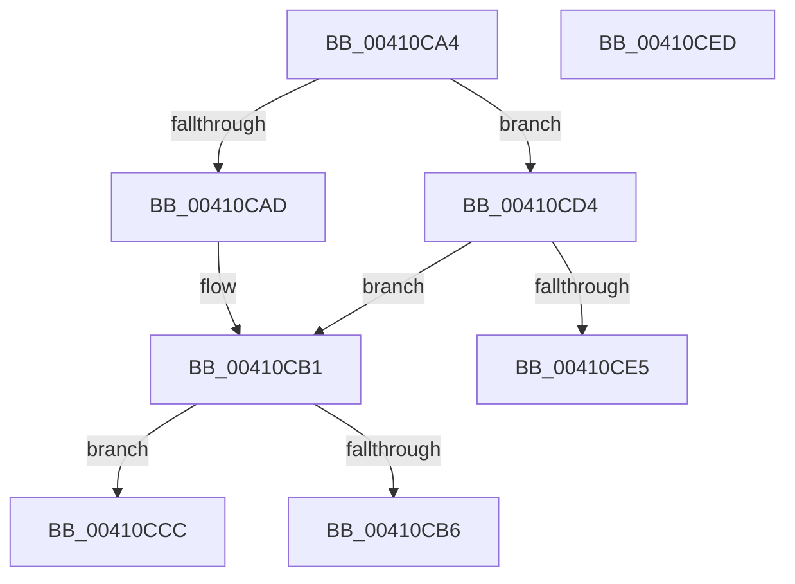

# sub_00410CA4

- RVA: `0x00410CA4`–`0x00410D09` (길이 `101` bytes)
- VA: `0x0000000140410CA4`
- 실행 섹션: `.text`
- PDB 이름 있음: `아니요`; PDB Function 태그: `아니요`
- unwind 정보 RVA: `0x0009BD18`
- 디코드: `26`개 명령, `101/101` bytes 표시
- 미해석 바이트: `0` (있으면 어셈블리에 `.byte`로 보존)

> 이 문서는 커널 이미지의 기계어와 PDB 기호를 분석해 생성했습니다. 4번과 5번은 함수 원형과 자료형을 바이너리 사용 방식에서 추정한 C 해석이며 원본 소스 복구 결과는 아닙니다.

## 1. Dependencies

- 직접 호출 지점: **1**; 고유 호출 대상: **1**
- 직접 호출자로 확인된 함수: **0**
- RIP 상대 이미지 참조: **0**

### Outgoing calls
- `0x00410CDA` → [B_TREE<_SM_PAGE_KEY,ST_STORE<SM_TRAITS>::_ST_PAGE_ENTRY,4096,NP_CONTEXT,B_TREE_KEY_COMPARATOR<_SM_PAGE_KEY> >::BTreeFindLeafSibling](B_TREE__SM_PAGE_KEY_ST_STORE_SM_TRAITS__ST_PAGE_ENTRY_4096_NP_CONTEXT_B_TREE_KEY_COMPARATOR__SM_PAGE_function_00410EF0.md) (function, `0x00410EF0`)

### Direct callers
- 이 함수 시작 RVA로 연결되는 직접 call은 확인되지 않았습니다. 간접 호출은 완전히 역산할 수 없습니다.

### Static image references
- 디코드된 RIP-relative 메모리 참조가 없습니다.

## 2. Other-region calls and transfers

- 다른 실행 섹션으로 향하는 call: **0**
- call이 아닌 외부 분기/꼬리 이동: **4**
  - `0x00410CC7` → [sub_00410B56 + 0x97](Unknown_function_00410B56.md) (`tail-transfer`)
  - `0x00410CCF` → [sub_00410B56 + 0x97](Unknown_function_00410B56.md) (`tail-transfer`)
  - `0x00410CE8` → [sub_00410B56 + 0x97](Unknown_function_00410B56.md) (`tail-transfer`)
  - `0x00410D04` → [sub_00410B56 + 0xFC](Unknown_function_00410B56.md) (`tail-transfer`)

## 3. Assembly (complete function range)

```asm
00410CA4  48 8B 46 10                     mov rax, qword ptr [rsi + 0x10]
00410CA8  83 38 FF                        cmp dword ptr [rax], -1
00410CAB  75 27                           jne 0x140410cd4
00410CAD  48 8B 47 08                     mov rax, qword ptr [rdi + 8]
00410CB1  48 85 C0                        test rax, rax
00410CB4  74 16                           je 0x140410ccc
00410CB6  48 8D 58 10                     lea rbx, [rax + 0x10]
00410CBA  48 89 44 24 20                  mov qword ptr [rsp + 0x20], rax
00410CBF  48 89 5C 24 28                  mov qword ptr [rsp + 0x28], rbx
00410CC4  48 8B F8                        mov rdi, rax
00410CC7  E9 21 FF FF FF                  jmp 0x140410bed
00410CCC  49 8B DE                        mov rbx, r14
00410CCF  E9 19 FF FF FF                  jmp 0x140410bed
00410CD4  48 8B D7                        mov rdx, rdi
00410CD7  48 8B CE                        mov rcx, rsi
00410CDA  E8 11 02 00 00                  call 0x140410ef0
00410CDF  48 83 F8 FF                     cmp rax, -1
00410CE3  75 CC                           jne 0x140410cb1
00410CE5  48 8B D8                        mov rbx, rax
00410CE8  E9 00 FF FF FF                  jmp 0x140410bed
00410CED  0F B6 86 E9 08 00 00            movzx eax, byte ptr [rsi + 0x8e9]
00410CF4  41 BE 00 04 00 00               mov r14d, 0x400
00410CFA  24 FD                           and al, 0xfd
00410CFC  0C 01                           or al, 1
00410CFE  88 86 E9 08 00 00               mov byte ptr [rsi + 0x8e9], al
00410D04  E9 49 FF FF FF                  jmp 0x140410c52
```

## 4. C-style interpretation (structured pseudocode)

```c
__int64 __fastcall sub_00410CA4(void)
{
    __int64 result;
    unsigned __int64 v_stack_p20;
    unsigned __int64 v_stack_p28;

    if ((*(unsigned int *)(*(unsigned __int64 *)(v_rsi + 16))) != -1) goto loc_00410CD4;
loc_00410CB1:
    if (*(unsigned __int64 *)(v_rdi + 8) == 0) goto loc_00410CCC;
    v_stack_p20 = *(unsigned __int64 *)(v_rdi + 8);
    v_stack_p28 = *(unsigned __int64 *)(v_rdi + 8) + 16;
loc_00410CCC:
loc_00410CD4:
    result = B_TREE__SM_PAGE_KEY_ST_STORE_SM_TRAITS____ST_PAGE_ENTRY_4096_NP_CONTEXT_B_TREE_KEY_COMPARATOR__SM_PA(v_rsi, *(unsigned __int64 *)(v_rdi + 8), a3, a4);
    if (result != -1) goto loc_00410CB1;
}
```

## 5. (Beta) C Style

```c
void sub_00410CA4(void)
{
    int64_t result;
    uint64_t v_stack_p20;
    uint64_t v_stack_p28;

    if ((*(uint32_t *)(*(uint64_t *)(local_rsi + 0x10))) != -1) goto loc_00410CD4;
loc_00410CB1:
    if (*(uint64_t *)(local_rdi + 0x8) == 0) goto loc_00410CCC;
    v_stack_p20 = *(uint64_t *)(local_rdi + 0x8);
    v_stack_p28 = *(uint64_t *)(local_rdi + 0x8) + 16;
loc_00410CCC:
loc_00410CD4:
    result = B_TREE__SM_PAGE_KEY_ST_STORE_SM_TRAITS____ST_PAGE_ENTRY_4096_NP_CONTEXT_B_TREE_KEY_COMPARATOR__SM_PA(local_rsi, *(uint64_t *)(local_rdi + 0x8), a3, a4);
    if (result != -1) goto loc_00410CB1;
}
```

## 6. Execution-region graph

[열기: 2D/3D 그래프와 함수 탐색 컨트롤 패널](../../../control-panel.html?section=text&rva=0x00410CA4&view=graph)

- 2D 그래프는 위에서 아래로 흐르고, 3D 그래프는 빈 공간을 드래그해 회전합니다. Shift+드래그는 이동, 휠은 확대·축소, 함수 노드 선택은 대상 보고서 이동입니다.

### Static fallback


