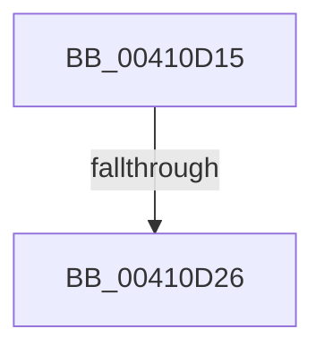

# sub_00410D15

- RVA: `0x00410D15`–`0x00410D38` (길이 `35` bytes)
- VA: `0x0000000140410D15`
- 실행 섹션: `.text`
- PDB 이름 있음: `아니요`; PDB Function 태그: `아니요`
- unwind 정보 RVA: `0x0009BD48`
- 디코드: `9`개 명령, `35/35` bytes 표시
- 미해석 바이트: `0` (있으면 어셈블리에 `.byte`로 보존)

> 이 문서는 커널 이미지의 기계어와 PDB 기호를 분석해 생성했습니다. 4번과 5번은 함수 원형과 자료형을 바이너리 사용 방식에서 추정한 C 해석이며 원본 소스 복구 결과는 아닙니다.

## 1. Dependencies

- 직접 호출 지점: **1**; 고유 호출 대상: **1**
- 직접 호출자로 확인된 함수: **0**
- RIP 상대 이미지 참조: **0**

### Outgoing calls
- `0x00410D2D` → [B_TREE<_SM_PAGE_KEY,ST_STORE<SM_TRAITS>::_ST_PAGE_ENTRY,4096,NP_CONTEXT,B_TREE_KEY_COMPARATOR<_SM_PAGE_KEY> >::BTreeSearchResultDeref](../3A/B_TREE__SM_PAGE_KEY_ST_STORE_SM_TRAITS__ST_PAGE_ENTRY_4096_NP_CONTEXT_B_TREE_KEY_COMPARATOR__SM_PAGE_function_003AC5D0.md) (function, `0x003AC5D0`)

### Direct callers
- 이 함수 시작 RVA로 연결되는 직접 call은 확인되지 않았습니다. 간접 호출은 완전히 역산할 수 없습니다.

### Static image references
- 디코드된 RIP-relative 메모리 참조가 없습니다.

## 2. Other-region calls and transfers

- 다른 실행 섹션으로 향하는 call: **0**
- call이 아닌 외부 분기/꼬리 이동: **2**
  - `0x00410D20` → [sub_006ED096](../6E/Unknown_function_006ED096.md) (`tail-transfer`)
  - `0x00410D33` → [sub_006ED096](../6E/Unknown_function_006ED096.md) (`tail-transfer`)

## 3. Assembly (complete function range)

```asm
00410D15  8B 46 38                        mov eax, dword ptr [rsi + 0x38]
00410D18  8B 9E 98 05 00 00               mov ebx, dword ptr [rsi + 0x598]
00410D1E  A8 01                           test al, 1
00410D20  0F 85 70 C3 2D 00               jne 0x1406ed096
00410D26  48 8D 56 18                     lea rdx, [rsi + 0x18]
00410D2A  48 8B CE                        mov rcx, rsi
00410D2D  E8 9E B8 F9 FF                  call 0x1403ac5d0
00410D32  90                              nop
00410D33  E9 5E C3 2D 00                  jmp 0x1406ed096
```

## 4. C-style interpretation (structured pseudocode)

```c
__int64 __fastcall sub_00410D15(void)
{
    __int64 result;

    result = B_TREE__SM_PAGE_KEY_ST_STORE_SM_TRAITS____ST_PAGE_ENTRY_4096_NP_CONTEXT_B_TREE_KEY_COMPARATOR__SM_PA(v_rsi, v_rsi + 24, a3, a4);
}
```

## 5. (Beta) C Style

```c
void sub_00410D15(void)
{
    int64_t result;

    result = B_TREE__SM_PAGE_KEY_ST_STORE_SM_TRAITS____ST_PAGE_ENTRY_4096_NP_CONTEXT_B_TREE_KEY_COMPARATOR__SM_PA(local_rsi, local_rsi + 24, a3, a4);
}
```

## 6. Execution-region graph

[열기: 2D/3D 그래프와 함수 탐색 컨트롤 패널](../../../control-panel.html?section=text&rva=0x00410D15&view=graph)

- 2D 그래프는 위에서 아래로 흐르고, 3D 그래프는 빈 공간을 드래그해 회전합니다. Shift+드래그는 이동, 휠은 확대·축소, 함수 노드 선택은 대상 보고서 이동입니다.

### Static fallback


