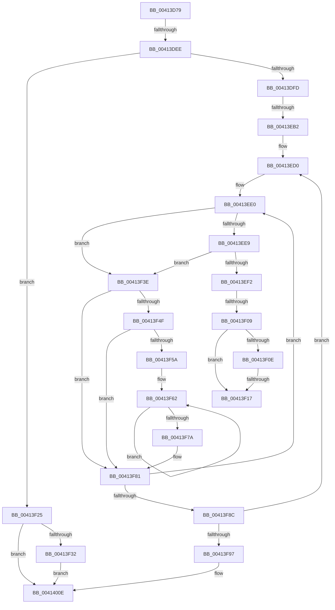

# sub_00413D79

- RVA: `0x00413D79`–`0x0041401D` (길이 `676` bytes)
- VA: `0x0000000140413D79`
- 실행 섹션: `.text`
- PDB 이름 있음: `아니요`; PDB Function 태그: `아니요`
- unwind 정보 RVA: `0x0009C01C`
- 디코드: `167`개 명령, `676/676` bytes 표시
- 미해석 바이트: `0` (있으면 어셈블리에 `.byte`로 보존)

> 이 문서는 커널 이미지의 기계어와 PDB 기호를 분석해 생성했습니다. 4번과 5번은 함수 원형과 자료형을 바이너리 사용 방식에서 추정한 C 해석이며 원본 소스 복구 결과는 아닙니다.

## 1. Dependencies

- 직접 호출 지점: **1**; 고유 호출 대상: **1**
- 직접 호출자로 확인된 함수: **0**
- RIP 상대 이미지 참조: **4**

### Outgoing calls
- `0x00413F25` → [PpmHeteroIsMultiClassParkingEnabled](PpmHeteroIsMultiClassParkingEnabled_function_00414310.md) (function, `0x00414310`)

### Direct callers
- 이 함수 시작 RVA로 연결되는 직접 call은 확인되지 않았습니다. 간접 호출은 완전히 역산할 수 없습니다.

### Static image references
- `0x00413EA5` → RVA `0x00FC6B40` (`ALMOSTRO`; read)
- `0x00413EB5` → RVA `0x00000000` (`image boundary/outside`; read)
- `0x00413EE0` → RVA `0x00FC6A86` (`ALMOSTRO`; read)
- `0x00413EE9` → RVA `0x00FC6C88` (`ALMOSTRO`; read)

## 2. Other-region calls and transfers

- 다른 실행 섹션으로 향하는 call: **0**
- call이 아닌 외부 분기/꼬리 이동: **6**
  - `0x00413DE8` → [sub_004140CB](Unknown_function_004140CB.md) (`tail-transfer`)
  - `0x00413EAC` → [sub_004140CB + 0x1D](Unknown_function_004140CB.md) (`tail-transfer`)
  - `0x00413F03` → [sub_004140CB + 0x2B](Unknown_function_004140CB.md) (`tail-transfer`)
  - `0x00413F11` → [sub_004140CB + 0x7E](Unknown_function_004140CB.md) (`tail-transfer`)
  - `0x00413F20` → [sub_004140CB + 0x34](Unknown_function_004140CB.md) (`tail-transfer`)
  - `0x0041401B` → [sub_00414089](Unknown_function_00414089.md) (`tail-transfer`)

## 3. Assembly (complete function range)

```asm
00413D79  4C 89 6C 24 50                  mov qword ptr [rsp + 0x50], r13
00413D7E  4C 8B 2F                        mov r13, qword ptr [rdi]
00413D81  4C 89 74 24 48                  mov qword ptr [rsp + 0x48], r14
00413D86  4C 8B 75 58                     mov r14, qword ptr [rbp + 0x58]
00413D8A  4C 89 64 24 30                  mov qword ptr [rsp + 0x30], r12
00413D8F  48 89 74 24 20                  mov qword ptr [rsp + 0x20], rsi
00413D94  4D 2B 4E 08                     sub r9, qword ptr [r14 + 8]
00413D98  4D 2B 2E                        sub r13, qword ptr [r14]
00413D9B  49 3B F3                        cmp rsi, r11
00413D9E  49 0F 42 CB                     cmovb rcx, r11
00413DA2  33 D2                           xor edx, edx
00413DA4  48 F7 F1                        div rcx
00413DA7  4D 3B EB                        cmp r13, r11
00413DAA  49 8B CD                        mov rcx, r13
00413DAD  4C 8B D0                        mov r10, rax
00413DB0  48 89 84 24 A0 00 00 00         mov qword ptr [rsp + 0xa0], rax
00413DB8  49 0F 42 CB                     cmovb rcx, r11
00413DBC  33 D2                           xor edx, edx
00413DBE  49 6B C1 64                     imul rax, r9, 0x64
00413DC2  48 F7 F1                        div rcx
00413DC5  44 0F B6 C8                     movzx r9d, al
00413DC9  45 3B C8                        cmp r9d, r8d
00413DCC  45 0F 47 C8                     cmova r9d, r8d
00413DD0  4D 8B 47 08                     mov r8, qword ptr [r15 + 8]
00413DD4  45 85 D2                        test r10d, r10d
00413DD7  4C 89 44 24 28                  mov qword ptr [rsp + 0x28], r8
00413DDC  44 89 8C 24 90 00 00 00         mov dword ptr [rsp + 0x90], r9d
00413DE4  45 8D 53 63                     lea r10d, [r11 + 0x63]
00413DE8  0F 84 DD 02 00 00               je 0x1404140cb
00413DEE  41 80 7F 44 00                  cmp byte ptr [r15 + 0x44], 0
00413DF3  49 8D 5F 44                     lea rbx, [r15 + 0x44]
00413DF7  0F 84 28 01 00 00               je 0x140413f25
00413DFD  48 8B 57 10                     mov rdx, qword ptr [rdi + 0x10]
00413E01  49 8B CD                        mov rcx, r13
00413E04  49 2B 56 10                     sub rdx, qword ptr [r14 + 0x10]
00413E08  4D 3B EB                        cmp r13, r11
00413E0B  49 0F 42 CB                     cmovb rcx, r11
00413E0F  48 6B C2 64                     imul rax, rdx, 0x64
00413E13  33 D2                           xor edx, edx
00413E15  48 F7 F1                        div rcx
00413E18  3C 64                           cmp al, 0x64
00413E1A  0F B6 C8                        movzx ecx, al
00413E1D  41 0F 47 CA                     cmova ecx, r10d
00413E21  88 8D E8 00 00 00               mov byte ptr [rbp + 0xe8], cl
00413E27  49 8B CD                        mov rcx, r13
00413E2A  48 8B 57 18                     mov rdx, qword ptr [rdi + 0x18]
00413E2E  49 2B 56 18                     sub rdx, qword ptr [r14 + 0x18]
00413E32  4D 3B EB                        cmp r13, r11
00413E35  49 0F 42 CB                     cmovb rcx, r11
00413E39  48 6B C2 64                     imul rax, rdx, 0x64
00413E3D  33 D2                           xor edx, edx
00413E3F  48 F7 F1                        div rcx
00413E42  3C 64                           cmp al, 0x64
00413E44  0F B6 C8                        movzx ecx, al
00413E47  41 0F 47 CA                     cmova ecx, r10d
00413E4B  88 8D E9 00 00 00               mov byte ptr [rbp + 0xe9], cl
00413E51  49 8B CD                        mov rcx, r13
00413E54  48 8B 57 20                     mov rdx, qword ptr [rdi + 0x20]
00413E58  49 2B 56 20                     sub rdx, qword ptr [r14 + 0x20]
00413E5C  4D 3B EB                        cmp r13, r11
00413E5F  49 0F 42 CB                     cmovb rcx, r11
00413E63  48 6B C2 64                     imul rax, rdx, 0x64
00413E67  33 D2                           xor edx, edx
00413E69  48 F7 F1                        div rcx
00413E6C  3C 64                           cmp al, 0x64
00413E6E  0F B6 C8                        movzx ecx, al
00413E71  41 0F 47 CA                     cmova ecx, r10d
00413E75  88 8D EA 00 00 00               mov byte ptr [rbp + 0xea], cl
00413E7B  49 8B CD                        mov rcx, r13
00413E7E  48 8B 57 28                     mov rdx, qword ptr [rdi + 0x28]
00413E82  49 2B 56 28                     sub rdx, qword ptr [r14 + 0x28]
00413E86  4D 3B EB                        cmp r13, r11
00413E89  49 0F 42 CB                     cmovb rcx, r11
00413E8D  48 6B C2 64                     imul rax, rdx, 0x64
00413E91  33 D2                           xor edx, edx
00413E93  48 F7 F1                        div rcx
00413E96  3C 64                           cmp al, 0x64
00413E98  0F B6 C8                        movzx ecx, al
00413E9B  41 0F 47 CA                     cmova ecx, r10d
00413E9F  88 8D EB 00 00 00               mov byte ptr [rbp + 0xeb], cl
00413EA5  83 3D 94 2C BB 00 00            cmp dword ptr [rip + 0xbb2c94], 0
00413EAC  0F 84 36 02 00 00               je 0x1404140e8
00413EB2  45 33 C9                        xor r9d, r9d
00413EB5  4C 8D 05 44 C1 BE FF            lea r8, [rip - 0x413ebc]
00413EBC  33 F6                           xor esi, esi
00413EBE  4C 89 8C 24 98 00 00 00         mov qword ptr [rsp + 0x98], r9
00413EC6  8B EE                           mov ebp, esi
00413EC8  0F 1F 84 00 00 00 00 00         nop dword ptr [rax + rax]
00413ED0  48 63 C6                        movsxd rax, esi
00413ED3  33 DB                           xor ebx, ebx
00413ED5  4C 8D 24 00                     lea r12, [rax + rax]
00413ED9  0F 1F 80 00 00 00 00            nop dword ptr [rax]
00413EE0  80 3D 9F 2B BB 00 00            cmp byte ptr [rip + 0xbb2b9f], 0
00413EE7  75 55                           jne 0x140413f3e
00413EE9  83 3D 98 2D BB 00 00            cmp dword ptr [rip + 0xbb2d98], 0
00413EF0  74 4C                           je 0x140413f3e
00413EF2  48 63 D3                        movsxd rdx, ebx
00413EF5  49 03 D4                        add rdx, r12
00413EF8  41 8B 8C 90 60 54 FC 00         mov ecx, dword ptr [r8 + rdx*4 + 0xfc5460]
00413F00  83 F9 04                        cmp ecx, 4
00413F03  0F 84 ED 01 00 00               je 0x1404140f6
00413F09  83 E9 01                        sub ecx, 1
00413F0C  74 09                           je 0x140413f17
00413F0E  83 E9 01                        sub ecx, 1
00413F11  0F 85 32 02 00 00               jne 0x140414149
00413F17  42 0F B6 8C 02 E8 70 FC 00      movzx ecx, byte ptr [rdx + r8 + 0xfc70e8]
00413F20  E9 DA 01 00 00                  jmp 0x1404140ff
00413F25  E8 E6 03 00 00                  call 0x140414310
00413F2A  84 C0                           test al, al
00413F2C  0F 84 DC 00 00 00               je 0x14041400e
00413F32  C6 85 ED 00 00 00 64            mov byte ptr [rbp + 0xed], 0x64
00413F39  E9 D0 00 00 00                  jmp 0x14041400e
00413F3E  48 63 C3                        movsxd rax, ebx
00413F41  49 03 C4                        add rax, r12
00413F44  41 83 BC 80 60 54 FC 00 03      cmp dword ptr [r8 + rax*4 + 0xfc5460], 3
00413F4D  74 32                           je 0x140413f81
00413F4F  44 8B 57 30                     mov r10d, dword ptr [rdi + 0x30]
00413F53  33 C0                           xor eax, eax
00413F55  45 85 D2                        test r10d, r10d
00413F58  74 27                           je 0x140413f81
00413F5A  44 8D 1C 73                     lea r11d, [rbx + rsi*2]
00413F5E  45 0F AF DA                     imul r11d, r10d
00413F62  41 8D 0C 03                     lea ecx, [r11 + rax]
00413F66  FF C0                           inc eax
00413F68  4C 8B 44 CF 38                  mov r8, qword ptr [rdi + rcx*8 + 0x38]
00413F6D  4D 2B 44 CE 38                  sub r8, qword ptr [r14 + rcx*8 + 0x38]
00413F72  4D 03 C8                        add r9, r8
00413F75  41 3B C2                        cmp eax, r10d
00413F78  72 E8                           jb 0x140413f62
00413F7A  4C 8D 05 7F C0 BE FF            lea r8, [rip - 0x413f81]
00413F81  FF C3                           inc ebx
00413F83  83 FB 02                        cmp ebx, 2
00413F86  0F 82 54 FF FF FF               jb 0x140413ee0
00413F8C  FF C6                           inc esi
00413F8E  83 FE 07                        cmp esi, 7
00413F91  0F 82 39 FF FF FF               jb 0x140413ed0
00413F97  48 8B AC 24 A8 00 00 00         mov rbp, qword ptr [rsp + 0xa8]
00413F9F  49 83 FD 01                     cmp r13, 1
00413FA3  48 8B 74 24 20                  mov rsi, qword ptr [rsp + 0x20]
00413FA8  41 BB 01 00 00 00               mov r11d, 1
00413FAE  4C 8B 64 24 30                  mov r12, qword ptr [rsp + 0x30]
00413FB3  49 8B CD                        mov rcx, r13
00413FB6  49 0F 42 CB                     cmovb rcx, r11
00413FBA  41 B8 64 00 00 00               mov r8d, 0x64
00413FC0  33 D2                           xor edx, edx
00413FC2  49 6B C1 64                     imul rax, r9, 0x64
00413FC6  44 8B 8C 24 90 00 00 00         mov r9d, dword ptr [rsp + 0x90]
00413FCE  48 F7 F1                        div rcx
00413FD1  3C 64                           cmp al, 0x64
00413FD3  0F B6 C8                        movzx ecx, al
00413FD6  41 0F 47 C8                     cmova ecx, r8d
00413FDA  4D 3B EB                        cmp r13, r11
00413FDD  88 8D EC 00 00 00               mov byte ptr [rbp + 0xec], cl
00413FE3  4D 0F 42 EB                     cmovb r13, r11
00413FE7  33 D2                           xor edx, edx
00413FE9  48 6B 84 24 98 00 00 00 64      imul rax, qword ptr [rsp + 0x98], 0x64
00413FF2  49 F7 F5                        div r13
00413FF5  41 3A C0                        cmp al, r8b
00413FF8  0F B6 C8                        movzx ecx, al
00413FFB  41 0F 47 C8                     cmova ecx, r8d
00413FFF  4C 8B 44 24 28                  mov r8, qword ptr [rsp + 0x28]
00414004  88 8D ED 00 00 00               mov byte ptr [rbp + 0xed], cl
0041400A  49 8D 5F 44                     lea rbx, [r15 + 0x44]
0041400E  4C 8B 6C 24 50                  mov r13, qword ptr [rsp + 0x50]
00414013  66 45 89 4F 3C                  mov word ptr [r15 + 0x3c], r9w
00414018  4D 85 C0                        test r8, r8
0041401B  75 6C                           jne 0x140414089
```

## 4. C-style interpretation (structured pseudocode)

```c
__int64 __fastcall sub_00413D79(__int64 a1, int a2, int a3, __int64 a4, __int64 a5, __int64 a6, __int64 a7, __int64 a8, __int64 a9, __int64 a10, __int64 a11, __int64 a12, __int64 a13, __int64 a14, __int64 a15, __int64 a16, __int64 a17, unsigned int a18, __int64 a19, __int64 a20, __int64 a21)
{
    __int64 result;
    __int64 v_r11;
    __int64 v_r13;
    __int64 v_rbx;
    __int64 v_rsi;
    unsigned __int64 v_stack_p20;
    unsigned __int64 v_stack_p28;
    unsigned __int64 v_stack_p30;
    unsigned __int64 v_stack_p48;
    unsigned __int64 v_stack_p50;
    unsigned int v_stack_p90;
    unsigned __int64 v_stack_p98;
    unsigned __int64 v_stack_pA0;

    v_stack_p50 = v_r13;
    v_stack_p48 = v_r14;
    v_stack_p30 = v_r12;
    v_stack_p20 = v_rsi;
    a4 = (a4) - (*(unsigned __int64 *)(*(unsigned __int64 *)(v_rbp + 88) + 8));
    v_r13 = (*(unsigned __int64 *)(v_rdi)) - (*(unsigned __int64 *)(*(unsigned __int64 *)(v_rbp + 88)));
    if (v_rsi < v_r11) { a1 = v_r11; }
    a2 = 0;
    v_stack_pA0 = result;
    a1 = v_r13;
    if (v_r13 < v_r11) { a1 = v_r11; }
    a2 = 0;
    result = (result) * (a4);
    a4 = (unsigned __int8)(result);
    if (((unsigned int)((unsigned __int8)(result))) > a3) { a4 = a3; }
    v_stack_p28 = *(unsigned __int64 *)(v_r15 + 8);
    v_stack_p90 = (unsigned int)(a4);
    if ((*(unsigned __int8 *)(v_r15 + 68)) == 0) goto loc_00413F25;
    a2 = (*(unsigned __int64 *)(v_rdi + 16)) - (*(unsigned __int64 *)(*(unsigned __int64 *)(v_rbp + 88) + 16));
    a1 = v_r13;
    if (v_r13 < v_r11) { a1 = v_r11; }
    result = (result) * (a2);
    a2 = 0;
    a1 = (unsigned __int8)(result);
    if (((unsigned __int8)(result)) > 100) { a1 = (unsigned int)(v_r11 + 99); }
    *(unsigned __int8 *)(v_rbp + 232) = (unsigned __int8)(a1);
    a2 = (*(unsigned __int64 *)(v_rdi + 24)) - (*(unsigned __int64 *)(*(unsigned __int64 *)(v_rbp + 88) + 24));
    a1 = v_r13;
    if (v_r13 < v_r11) { a1 = v_r11; }
    result = (result) * (a2);
    a2 = 0;
    a1 = (unsigned __int8)(result);
    if (((unsigned __int8)(result)) > 100) { a1 = (unsigned int)(v_r11 + 99); }
    *(unsigned __int8 *)(v_rbp + 233) = (unsigned __int8)(a1);
    a2 = (*(unsigned __int64 *)(v_rdi + 32)) - (*(unsigned __int64 *)(*(unsigned __int64 *)(v_rbp + 88) + 32));
    a1 = v_r13;
    if (v_r13 < v_r11) { a1 = v_r11; }
    result = (result) * (a2);
    a2 = 0;
    a1 = (unsigned __int8)(result);
    if (((unsigned __int8)(result)) > 100) { a1 = (unsigned int)(v_r11 + 99); }
    *(unsigned __int8 *)(v_rbp + 234) = (unsigned __int8)(a1);
    a2 = (*(unsigned __int64 *)(v_rdi + 40)) - (*(unsigned __int64 *)(*(unsigned __int64 *)(v_rbp + 88) + 40));
    a1 = v_r13;
    if (v_r13 < v_r11) { a1 = v_r11; }
    result = (result) * (a2);
    a2 = 0;
    a1 = (unsigned __int8)(result);
    if (((unsigned __int8)(result)) > 100) { a1 = (unsigned int)(v_r11 + 99); }
    *(unsigned __int8 *)(v_rbp + 235) = (unsigned __int8)(a1);
    a4 = 0;
    v_rsi = 0;
    v_stack_p98 = 0;
loc_00413ED0:
    v_rbx = 0;
loc_00413EE0:
    if ((*(unsigned __int8 *)(v_rip + 12266399)) != 0) goto loc_00413F3E;
    if ((*(unsigned int *)(v_rip + 12266904)) == 0) goto loc_00413F3E;
    a2 = ((int)(0)) + ((int)(0) + (int)(0) * 1);
    a1 = (unsigned int)(((unsigned int)(*(unsigned int *)(v_rip - 4275900 + a2 * 4 + 16536672))) - (1));
    if (condition_is_equal) goto loc_00413F17;
    a1 = (unsigned int)((a1) - (1));
loc_00413F17:
loc_00413F25:
    result = PpmHeteroIsMultiClassParkingEnabled(*(unsigned __int8 *)(a2 + v_rip - 4275900 * 1 + 16543976), a2, v_rip - 4275900, a4);
    if ((unsigned __int8)(result) == 0) goto loc_0041400E;
    *(unsigned __int8 *)(0 + 237) = 100;
    goto loc_0041400E;
loc_00413F3E:
    result = ((int)(0)) + ((int)(0) + (int)(0) * 1);
    if ((*(unsigned int *)(v_rip - 4275900 + result * 4 + 16536672)) == 3) goto loc_00413F81;
    result = 0;
    if ((unsigned int)((unsigned int)(*(unsigned int *)(v_rdi + 48))) == 0) goto loc_00413F81;
    v_r11 = (unsigned int)((v_rbx + v_rsi * 2) * ((unsigned int)((unsigned int)(*(unsigned int *)(v_rdi + 48)))));
loc_00413F62:
    result = (unsigned int)((result) + 1);
    a3 = (*(unsigned __int64 *)(v_rdi + v_r11 + result * 1 * 8 + 56)) - (*(unsigned __int64 *)(*(unsigned __int64 *)(v_rbp + 88) + v_r11 + result * 1 * 8 + 56));
    a4 = (a4) + (a3);
    if (((unsigned int)(result)) < ((unsigned int)((unsigned int)(*(unsigned int *)(v_rdi + 48))))) goto loc_00413F62;
loc_00413F81:
    v_rbx = (unsigned int)((v_rbx) + 1);
    if (((unsigned int)(v_rbx)) < 2) goto loc_00413EE0;
    v_rsi = (unsigned int)((v_rsi) + 1);
    if (((unsigned int)(v_rsi)) < 7) goto loc_00413ED0;
    a1 = v_r13;
    if (v_r13 < 1) { a1 = 1; }
    a2 = 0;
    result = (result) * (a4);
    a1 = (unsigned __int8)(result);
    if (((unsigned __int8)(result)) > 100) { a1 = 100; }
    *(unsigned __int8 *)(a21 + 236) = (unsigned __int8)(a1);
    if (v_r13 < 1) { v_r13 = 1; }
    a2 = 0;
    result = (result) * (a19);
    a1 = (unsigned __int8)(result);
    if (((unsigned __int8)(result)) > 100) { a1 = 100; }
    *(unsigned __int8 *)(a21 + 237) = (unsigned __int8)(a1);
loc_0041400E:
    *(unsigned __int16 *)(v_r15 + 60) = (unsigned __int16)((unsigned int)(a18));
}
```

## 5. (Beta) C Style

```c
int64_t sub_00413D79(int64_t Arg1, int32_t Arg2, int32_t Arg3, int64_t Arg4, int64_t Arg5, int64_t Arg6, uint64_t Arg7, uint64_t Arg8, uint64_t Arg9, int64_t Arg10, uint64_t Arg11, uint64_t Arg12, uint64_t Arg13, uint64_t Arg14, uint64_t Arg15, uint64_t Arg16, uint64_t Arg17, uint32_t Arg18, int64_t Arg19, uint64_t Arg20, void *Arg21)
{
    uint8_t *arg21 = (uint8_t *)Arg21;

    int64_t result;
    int64_t local_r11;
    int64_t local_r13;
    int64_t local_rbx;
    int64_t local_rsi;
    uint64_t v_stack_p20;
    uint64_t v_stack_p28;
    uint64_t v_stack_p30;
    uint64_t v_stack_p48;
    uint64_t v_stack_p50;
    uint32_t v_stack_p90;
    uint64_t v_stack_p98;
    uint64_t v_stack_pA0;

    v_stack_p50 = local_r13;
    v_stack_p48 = local_r14;
    v_stack_p30 = local_r12;
    v_stack_p20 = local_rsi;
    Arg4 = (Arg4) - (*(uint64_t *)(*(uint64_t *)(local_rbp + 0x58) + 0x8));
    local_r13 = (*(uint64_t *)(local_rdi)) - (*(uint64_t *)(*(uint64_t *)(local_rbp + 0x58)));
    if (local_rsi < local_r11) { Arg1 = local_r11; }
    Arg2 = 0;
    v_stack_pA0 = result;
    Arg1 = local_r13;
    if (local_r13 < local_r11) { Arg1 = local_r11; }
    Arg2 = 0;
    result = (result) * (Arg4);
    Arg4 = (uint8_t)(result);
    if (((uint32_t)((uint8_t)(result))) > Arg3) { Arg4 = Arg3; }
    v_stack_p28 = *(uint64_t *)(local_r15 + 0x8);
    v_stack_p90 = (uint32_t)(Arg4);
    if ((*(uint8_t *)(local_r15 + 0x44)) == 0) goto loc_00413F25;
    Arg2 = (*(uint64_t *)(local_rdi + 0x10)) - (*(uint64_t *)(*(uint64_t *)(local_rbp + 0x58) + 0x10));
    Arg1 = local_r13;
    if (local_r13 < local_r11) { Arg1 = local_r11; }
    result = (result) * (Arg2);
    Arg2 = 0;
    Arg1 = (uint8_t)(result);
    if (((uint8_t)(result)) > 100) { Arg1 = (uint32_t)(local_r11 + 99); }
    *(uint8_t *)(local_rbp + 0xE8) = (uint8_t)(Arg1);
    Arg2 = (*(uint64_t *)(local_rdi + 0x18)) - (*(uint64_t *)(*(uint64_t *)(local_rbp + 0x58) + 0x18));
    Arg1 = local_r13;
    if (local_r13 < local_r11) { Arg1 = local_r11; }
    result = (result) * (Arg2);
    Arg2 = 0;
    Arg1 = (uint8_t)(result);
    if (((uint8_t)(result)) > 100) { Arg1 = (uint32_t)(local_r11 + 99); }
    *(uint8_t *)(local_rbp + 0xE9) = (uint8_t)(Arg1);
    Arg2 = (*(uint64_t *)(local_rdi + 0x20)) - (*(uint64_t *)(*(uint64_t *)(local_rbp + 0x58) + 0x20));
    Arg1 = local_r13;
    if (local_r13 < local_r11) { Arg1 = local_r11; }
    result = (result) * (Arg2);
    Arg2 = 0;
    Arg1 = (uint8_t)(result);
    if (((uint8_t)(result)) > 100) { Arg1 = (uint32_t)(local_r11 + 99); }
    *(uint8_t *)(local_rbp + 0xEA) = (uint8_t)(Arg1);
    Arg2 = (*(uint64_t *)(local_rdi + 0x28)) - (*(uint64_t *)(*(uint64_t *)(local_rbp + 0x58) + 0x28));
    Arg1 = local_r13;
    if (local_r13 < local_r11) { Arg1 = local_r11; }
    result = (result) * (Arg2);
    Arg2 = 0;
    Arg1 = (uint8_t)(result);
    if (((uint8_t)(result)) > 100) { Arg1 = (uint32_t)(local_r11 + 99); }
    *(uint8_t *)(local_rbp + 0xEB) = (uint8_t)(Arg1);
    Arg4 = 0;
    local_rsi = 0;
    v_stack_p98 = 0;
loc_00413ED0:
    local_rbx = 0;
loc_00413EE0:
    if ((*(uint8_t *)(v_rip + 0xBB2B9F)) != 0) goto loc_00413F3E;
    if ((*(uint32_t *)(v_rip + 0xBB2D98)) == 0) goto loc_00413F3E;
    Arg2 = ((int32_t)(0)) + ((int32_t)(0) + (int32_t)(0) * 1);
    Arg1 = (uint32_t)(((uint32_t)(*(uint32_t *)(v_rip - 0x413EBC + Arg2 * 4 + 0xFC5460))) - (1));
    if (condition_is_equal) goto loc_00413F17;
    Arg1 = (uint32_t)((Arg1) - (1));
loc_00413F17:
loc_00413F25:
    result = PpmHeteroIsMultiClassParkingEnabled(*(uint8_t *)(Arg2 + v_rip - 0x413EBC * 1 + 0xFC70E8), Arg2, v_rip - 4275900, Arg4);
    if ((uint8_t)(result) == 0) goto loc_0041400E;
    *(uint8_t *)(0 + 0xED) = 100;
    goto loc_0041400E;
loc_00413F3E:
    result = ((int32_t)(0)) + ((int32_t)(0) + (int32_t)(0) * 1);
    if ((*(uint32_t *)(v_rip - 0x413EBC + result * 4 + 0xFC5460)) == 3) goto loc_00413F81;
    result = 0;
    if ((uint32_t)((uint32_t)(*(uint32_t *)(local_rdi + 0x30))) == 0) goto loc_00413F81;
    local_r11 = (uint32_t)((local_rbx + local_rsi * 2) * ((uint32_t)((uint32_t)(*(uint32_t *)(local_rdi + 0x30)))));
loc_00413F62:
    result = (uint32_t)((result) + 1);
    Arg3 = (*(uint64_t *)(local_rdi + local_r11 + result * 1 * 8 + 0x38)) - (*(uint64_t *)(*(uint64_t *)(local_rbp + 0x58) + local_r11 + result * 1 * 8 + 0x38));
    Arg4 = (Arg4) + (Arg3);
    if (((uint32_t)(result)) < ((uint32_t)((uint32_t)(*(uint32_t *)(local_rdi + 0x30))))) goto loc_00413F62;
loc_00413F81:
    local_rbx = (uint32_t)((local_rbx) + 1);
    if (((uint32_t)(local_rbx)) < 2) goto loc_00413EE0;
    local_rsi = (uint32_t)((local_rsi) + 1);
    if (((uint32_t)(local_rsi)) < 7) goto loc_00413ED0;
    Arg1 = local_r13;
    if (local_r13 < 1) { Arg1 = 1; }
    Arg2 = 0;
    result = (result) * (Arg4);
    Arg1 = (uint8_t)(result);
    if (((uint8_t)(result)) > 100) { Arg1 = 100; }
    *(uint8_t *)(arg21 + 0xEC) = (uint8_t)(Arg1);
    if (local_r13 < 1) { local_r13 = 1; }
    Arg2 = 0;
    result = (result) * (Arg19);
    Arg1 = (uint8_t)(result);
    if (((uint8_t)(result)) > 100) { Arg1 = 100; }
    *(uint8_t *)(arg21 + 0xED) = (uint8_t)(Arg1);
loc_0041400E:
    *(uint16_t *)(local_r15 + 0x3C) = (uint16_t)((uint32_t)(Arg18));
}
```

### 관측된 메모리 오프셋

구조체 형식이 확인되지 않은 접근은 인자 기준의 오프셋으로만 기록했습니다.

| 기준 인자 | 오프셋 표현 | 폭 (bit) | 접근 |
|---|---:|---:|---|
| `Arg21` | `+ 0xEC` | `8` | `W` |
| `Arg21` | `+ 0xED` | `8` | `W` |

## 6. Execution-region graph

[열기: 2D/3D 그래프와 함수 탐색 컨트롤 패널](../../../control-panel.html?section=text&rva=0x00413D79&view=graph)

- 2D 그래프는 위에서 아래로 흐르고, 3D 그래프는 빈 공간을 드래그해 회전합니다. Shift+드래그는 이동, 휠은 확대·축소, 함수 노드 선택은 대상 보고서 이동입니다.

### Static fallback


