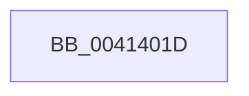

# sub_0041401D

- RVA: `0x0041401D`–`0x0041406E` (길이 `81` bytes)
- VA: `0x000000014041401D`
- 실행 섹션: `.text`
- PDB 이름 있음: `아니요`; PDB Function 태그: `아니요`
- unwind 정보 RVA: `0x0009C034`
- 디코드: `19`개 명령, `81/81` bytes 표시
- 미해석 바이트: `0` (있으면 어셈블리에 `.byte`로 보존)

> 이 문서는 커널 이미지의 기계어와 PDB 기호를 분석해 생성했습니다. 4번과 5번은 함수 원형과 자료형을 바이너리 사용 방식에서 추정한 C 해석이며 원본 소스 복구 결과는 아닙니다.

## 1. Dependencies

- 직접 호출 지점: **1**; 고유 호출 대상: **1**
- 직접 호출자로 확인된 함수: **0**
- RIP 상대 이미지 참조: **0**

### Outgoing calls
- `0x00414055` → [memcpy](../6C/memcpy_function_006C6840.md) (function, `0x006C6840`)

### Direct callers
- 이 함수 시작 RVA로 연결되는 직접 call은 확인되지 않았습니다. 간접 호출은 완전히 역산할 수 없습니다.

### Static image references
- 디코드된 RIP-relative 메모리 참조가 없습니다.

## 2. Other-region calls and transfers

- 다른 실행 섹션으로 향하는 call: **0**
- call이 아닌 외부 분기/꼬리 이동: **1**
  - `0x0041406C` → [sub_0041406E + 0x8](Unknown_function_0041406E.md) (`tail-transfer`)

## 3. Assembly (complete function range)

```asm
0041401D  0F 10 45 60                     movups xmm0, xmmword ptr [rbp + 0x60]
00414021  48 8B D7                        mov rdx, rdi
00414024  49 8B CE                        mov rcx, r14
00414027  0F 11 45 20                     movups xmmword ptr [rbp + 0x20], xmm0
0041402B  0F 10 4D 70                     movups xmm1, xmmword ptr [rbp + 0x70]
0041402F  0F 11 4D 30                     movups xmmword ptr [rbp + 0x30], xmm1
00414033  0F 10 85 80 00 00 00            movups xmm0, xmmword ptr [rbp + 0x80]
0041403A  0F 11 45 40                     movups xmmword ptr [rbp + 0x40], xmm0
0041403E  F2 0F 10 8D 90 00 00 00         movsd xmm1, qword ptr [rbp + 0x90]
00414046  F2 0F 11 4D 50                  movsd qword ptr [rbp + 0x50], xmm1
0041404B  6B 47 30 70                     imul eax, dword ptr [rdi + 0x30], 0x70
0041404F  83 C0 38                        add eax, 0x38
00414052  4C 63 C0                        movsxd r8, eax
00414055  E8 E6 27 2B 00                  call 0x1406c6840
0041405A  80 3B 00                        cmp byte ptr [rbx], 0
0041405D  48 8B 5C 24 70                  mov rbx, qword ptr [rsp + 0x70]
00414062  4C 8B 74 24 48                  mov r14, qword ptr [rsp + 0x48]
00414067  48 8B 7C 24 60                  mov rdi, qword ptr [rsp + 0x60]
0041406C  74 08                           je 0x140414076
```

## 4. C-style interpretation (structured pseudocode)

```c
__int64 __fastcall sub_0041401D(__int64 a1, __int64 a2, __int64 a3, __int64 a4, __int64 a5, __int64 a6, __int64 a7, __int64 a8, __int64 a9, __int64 a10, __int64 a11, __int64 a12, __int64 a13, __int64 a14)
{
    __int64 result;

    *(unsigned __int64 *)(v_rbp + 32) = v_xmm0;
    *(unsigned __int64 *)(v_rbp + 48) = v_xmm1;
    *(unsigned __int64 *)(v_rbp + 64) = v_xmm0;
    *(unsigned __int64 *)(v_rbp + 80) = v_xmm1;
    result = (unsigned int)((result) * (*(unsigned int *)(v_rdi + 48)));
    result = (unsigned int)((result) + (56));
    result = memcpy(v_r14, v_rdi, (int)((unsigned int)(result)), a4);
}
```

## 5. (Beta) C Style

```c
int64_t sub_0041401D(int64_t Arg1, int64_t Arg2, int64_t Arg3, int64_t Arg4, uint64_t Arg5, uint64_t Arg6, uint64_t Arg7, uint64_t Arg8, int64_t Arg9, uint64_t Arg10, uint64_t Arg11, int64_t Arg12, uint64_t Arg13, int64_t Arg14)
{
    int64_t result;

    *(uint64_t *)(local_rbp + 0x20) = v_xmm0;
    *(uint64_t *)(local_rbp + 0x30) = v_xmm1;
    *(uint64_t *)(local_rbp + 0x40) = v_xmm0;
    *(uint64_t *)(local_rbp + 0x50) = v_xmm1;
    result = (uint32_t)((result) * (*(uint32_t *)(local_rdi + 0x30)));
    result = (uint32_t)((result) + (56));
    result = memcpy(local_r14, local_rdi, (int32_t)((uint32_t)(result)), Arg4);
}
```

## 6. Execution-region graph

[열기: 2D/3D 그래프와 함수 탐색 컨트롤 패널](../../../control-panel.html?section=text&rva=0x0041401D&view=graph)

- 2D 그래프는 위에서 아래로 흐르고, 3D 그래프는 빈 공간을 드래그해 회전합니다. Shift+드래그는 이동, 휠은 확대·축소, 함수 노드 선택은 대상 보고서 이동입니다.

### Static fallback


