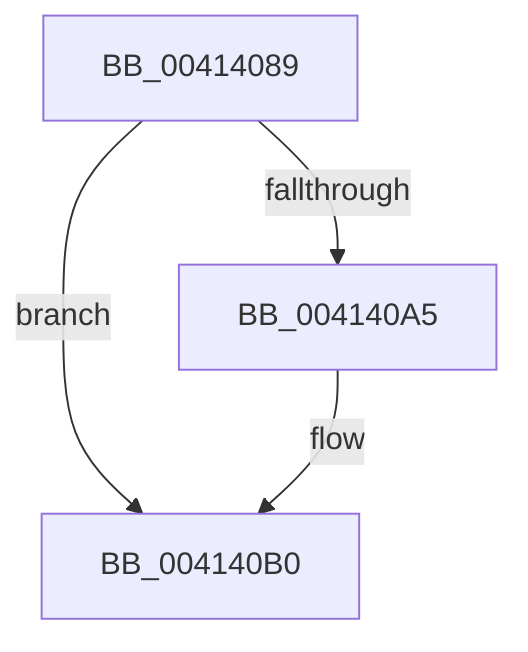

# sub_00414089

- RVA: `0x00414089`–`0x004140CB` (길이 `66` bytes)
- VA: `0x0000000140414089`
- 실행 섹션: `.text`
- PDB 이름 있음: `아니요`; PDB Function 태그: `아니요`
- unwind 정보 RVA: `0x0009C074`
- 디코드: `15`개 명령, `66/66` bytes 표시
- 미해석 바이트: `0` (있으면 어셈블리에 `.byte`로 보존)

> 이 문서는 커널 이미지의 기계어와 PDB 기호를 분석해 생성했습니다. 4번과 5번은 함수 원형과 자료형을 바이너리 사용 방식에서 추정한 C 해석이며 원본 소스 복구 결과는 아닙니다.

## 1. Dependencies

- 직접 호출 지점: **0**; 고유 호출 대상: **0**
- 직접 호출자로 확인된 함수: **0**
- RIP 상대 이미지 참조: **0**

### Outgoing calls
- 직접 디코드된 call 명령이 없습니다.

### Direct callers
- 이 함수 시작 RVA로 연결되는 직접 call은 확인되지 않았습니다. 간접 호출은 완전히 역산할 수 없습니다.

### Static image references
- 디코드된 RIP-relative 메모리 참조가 없습니다.

## 2. Other-region calls and transfers

- 다른 실행 섹션으로 향하는 call: **0**
- call이 아닌 외부 분기/꼬리 이동: **1**
  - `0x004140C6` → [sub_0041401D](Unknown_function_0041401D.md) (`tail-transfer`)

## 3. Assembly (complete function range)

```asm
00414089  48 8B 45 78                     mov rax, qword ptr [rbp + 0x78]
0041408D  48 8B CE                        mov rcx, rsi
00414090  48 2B 45 38                     sub rax, qword ptr [rbp + 0x38]
00414094  48 83 FE 01                     cmp rsi, 1
00414098  49 0F 42 CB                     cmovb rcx, r11
0041409C  33 D2                           xor edx, edx
0041409E  48 F7 F1                        div rcx
004140A1  85 C0                           test eax, eax
004140A3  75 0B                           jne 0x1404140b0
004140A5  41 8B 80 84 00 00 00            mov eax, dword ptr [r8 + 0x84]
004140AC  49 8D 5F 44                     lea rbx, [r15 + 0x44]
004140B0  41 89 80 84 00 00 00            mov dword ptr [r8 + 0x84], eax
004140B7  48 8B 84 24 A0 00 00 00         mov rax, qword ptr [rsp + 0xa0]
004140BF  41 89 80 88 00 00 00            mov dword ptr [r8 + 0x88], eax
004140C6  E9 52 FF FF FF                  jmp 0x14041401d
```

## 4. C-style interpretation (structured pseudocode)

```c
__int64 __fastcall sub_00414089(__int64 a1, int a2, __int64 a3, __int64 a4, __int64 a5, __int64 a6, __int64 a7, __int64 a8, __int64 a9, __int64 a10, __int64 a11, __int64 a12, __int64 a13, __int64 a14, __int64 a15, __int64 a16, __int64 a17, __int64 a18, __int64 a19, __int64 a20)
{
    __int64 result;
    __int64 v_rbx;

    result = (*(unsigned __int64 *)(v_rbp + 120)) - (*(unsigned __int64 *)(v_rbp + 56));
    a1 = v_rsi;
    if (v_rsi < 1) { a1 = v_r11; }
    a2 = 0;
    if ((unsigned int)(result) == 0) {
        result = *(unsigned int *)(a3 + 132);
        v_rbx = v_r15 + 68;
    }
    *(unsigned int *)(a3 + 132) = (unsigned int)(result);
    *(unsigned int *)(a3 + 136) = (unsigned int)(a20);
}
```

## 5. (Beta) C Style

```c
int64_t sub_00414089(int64_t Arg1, int32_t Arg2, void *Arg3, int64_t Arg4, uint64_t Arg5, uint64_t Arg6, uint64_t Arg7, uint64_t Arg8, uint64_t Arg9, uint64_t Arg10, uint64_t Arg11, uint64_t Arg12, uint64_t Arg13, uint64_t Arg14, uint64_t Arg15, uint64_t Arg16, uint64_t Arg17, uint64_t Arg18, uint64_t Arg19, int64_t Arg20)
{
    uint8_t *arg3 = (uint8_t *)Arg3;

    int64_t result;
    int64_t local_rbx;

    result = (*(uint64_t *)(local_rbp + 0x78)) - (*(uint64_t *)(local_rbp + 0x38));
    Arg1 = local_rsi;
    if (local_rsi < 1) { Arg1 = local_r11; }
    Arg2 = 0;
    if ((uint32_t)(result) == 0) {
        result = *(uint32_t *)(arg3 + 0x84);
        local_rbx = local_r15 + 68;
    }
    *(uint32_t *)(arg3 + 0x84) = (uint32_t)(result);
    *(uint32_t *)(arg3 + 0x88) = (uint32_t)(Arg20);
}
```

### 관측된 메모리 오프셋

구조체 형식이 확인되지 않은 접근은 인자 기준의 오프셋으로만 기록했습니다.

| 기준 인자 | 오프셋 표현 | 폭 (bit) | 접근 |
|---|---:|---:|---|
| `Arg3` | `+ 0x84` | `32` | `R` |
| `Arg3` | `+ 0x84` | `32` | `W` |
| `Arg3` | `+ 0x88` | `32` | `W` |

## 6. Execution-region graph

[열기: 2D/3D 그래프와 함수 탐색 컨트롤 패널](../../../control-panel.html?section=text&rva=0x00414089&view=graph)

- 2D 그래프는 위에서 아래로 흐르고, 3D 그래프는 빈 공간을 드래그해 회전합니다. Shift+드래그는 이동, 휠은 확대·축소, 함수 노드 선택은 대상 보고서 이동입니다.

### Static fallback


