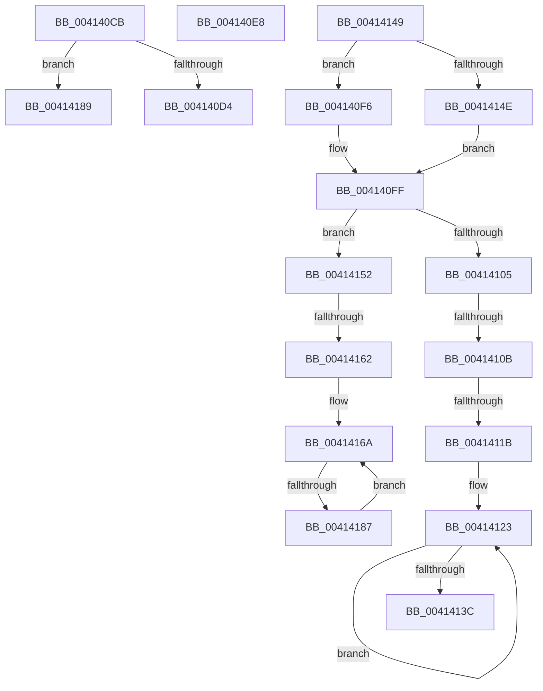

# sub_004140CB

- RVA: `0x004140CB`–`0x00414196` (길이 `203` bytes)
- VA: `0x00000001404140CB`
- 실행 섹션: `.text`
- PDB 이름 있음: `아니요`; PDB Function 태그: `아니요`
- unwind 정보 RVA: `0x0009C098`
- 디코드: `47`개 명령, `203/203` bytes 표시
- 미해석 바이트: `0` (있으면 어셈블리에 `.byte`로 보존)

> 이 문서는 커널 이미지의 기계어와 PDB 기호를 분석해 생성했습니다. 4번과 5번은 함수 원형과 자료형을 바이너리 사용 방식에서 추정한 C 해석이며 원본 소스 복구 결과는 아닙니다.

## 1. Dependencies

- 직접 호출 지점: **0**; 고유 호출 대상: **0**
- 직접 호출자로 확인된 함수: **0**
- RIP 상대 이미지 참조: **0**

### Outgoing calls
- 직접 디코드된 call 명령이 없습니다.

### Direct callers
- 이 함수 시작 RVA로 연결되는 직접 call은 확인되지 않았습니다. 간접 호출은 완전히 역산할 수 없습니다.

### Static image references
- 디코드된 RIP-relative 메모리 참조가 없습니다.

## 2. Other-region calls and transfers

- 다른 실행 섹션으로 향하는 call: **0**
- call이 아닌 외부 분기/꼬리 이동: **8**
  - `0x004140E3` → [sub_00413D79 + 0x75](Unknown_function_00413D79.md) (`tail-transfer`)
  - `0x004140F1` → [sub_00413D79 + 0x28B](Unknown_function_00413D79.md) (`tail-transfer`)
  - `0x00414105` → [sub_00413D79 + 0x208](Unknown_function_00413D79.md) (`tail-transfer`)
  - `0x00414115` → [sub_00413D79 + 0x201](Unknown_function_00413D79.md) (`tail-transfer`)
  - `0x00414144` → [sub_00413D79 + 0x201](Unknown_function_00413D79.md) (`tail-transfer`)
  - `0x0041415C` → [sub_00413D79 + 0x201](Unknown_function_00413D79.md) (`tail-transfer`)
  - `0x00414181` → [sub_00413D79 + 0x201](Unknown_function_00413D79.md) (`tail-transfer`)
  - `0x00414191` → [sub_00413D79 + 0x75](Unknown_function_00413D79.md) (`tail-transfer`)

## 3. Assembly (complete function range)

```asm
004140CB  4D 85 C0                        test r8, r8
004140CE  0F 84 B5 00 00 00               je 0x140414189
004140D4  41 8B 80 88 00 00 00            mov eax, dword ptr [r8 + 0x88]
004140DB  48 89 84 24 A0 00 00 00         mov qword ptr [rsp + 0xa0], rax
004140E3  E9 06 FD FF FF                  jmp 0x140413dee
004140E8  C6 85 EC 00 00 00 64            mov byte ptr [rbp + 0xec], 0x64
004140EF  B1 64                           mov cl, 0x64
004140F1  E9 0E FF FF FF                  jmp 0x140414004
004140F6  42 0F B6 8C 02 F8 70 FC 00      movzx ecx, byte ptr [rdx + r8 + 0xfc70f8]
004140FF  41 3A 4F 58                     cmp cl, byte ptr [r15 + 0x58]
00414103  77 4D                           ja 0x140414152
00414105  0F 85 76 FE FF FF               jne 0x140413f81
0041410B  44 8B 57 30                     mov r10d, dword ptr [rdi + 0x30]
0041410F  45 33 C0                        xor r8d, r8d
00414112  45 85 D2                        test r10d, r10d
00414115  0F 84 5F FE FF FF               je 0x140413f7a
0041411B  44 8D 1C 73                     lea r11d, [rbx + rsi*2]
0041411F  45 0F AF DA                     imul r11d, r10d
00414123  43 8D 04 03                     lea eax, [r11 + r8]
00414127  41 FF C0                        inc r8d
0041412A  48 8B 54 C7 38                  mov rdx, qword ptr [rdi + rax*8 + 0x38]
0041412F  49 2B 54 C6 38                  sub rdx, qword ptr [r14 + rax*8 + 0x38]
00414134  48 03 EA                        add rbp, rdx
00414137  45 3B C2                        cmp r8d, r10d
0041413A  72 E7                           jb 0x140414123
0041413C  48 89 AC 24 98 00 00 00         mov qword ptr [rsp + 0x98], rbp
00414144  E9 31 FE FF FF                  jmp 0x140413f7a
00414149  83 F9 01                        cmp ecx, 1
0041414C  74 A8                           je 0x1404140f6
0041414E  B1 FF                           mov cl, 0xff
00414150  EB AD                           jmp 0x1404140ff
00414152  44 8B 57 30                     mov r10d, dword ptr [rdi + 0x30]
00414156  45 33 C0                        xor r8d, r8d
00414159  45 85 D2                        test r10d, r10d
0041415C  0F 84 18 FE FF FF               je 0x140413f7a
00414162  44 8D 1C 73                     lea r11d, [rbx + rsi*2]
00414166  45 0F AF DA                     imul r11d, r10d
0041416A  43 8D 04 03                     lea eax, [r11 + r8]
0041416E  41 FF C0                        inc r8d
00414171  48 8B 54 C7 38                  mov rdx, qword ptr [rdi + rax*8 + 0x38]
00414176  49 2B 54 C6 38                  sub rdx, qword ptr [r14 + rax*8 + 0x38]
0041417B  4C 03 CA                        add r9, rdx
0041417E  45 3B C2                        cmp r8d, r10d
00414181  0F 83 F3 FD FF FF               jae 0x140413f7a
00414187  EB E1                           jmp 0x14041416a
00414189  44 89 94 24 A0 00 00 00         mov dword ptr [rsp + 0xa0], r10d
00414191  E9 58 FC FF FF                  jmp 0x140413dee
```

## 4. C-style interpretation (structured pseudocode)

```c
__int64 __fastcall sub_004140CB(__int64 a1, __int64 a2, __int64 a3, __int64 a4)
{
    unsigned __int64 v_stack_p98;
    unsigned __int64 v_stack_pA0;

    if (a3 == 0) goto loc_00414189;
    v_stack_pA0 = (unsigned int)(*(unsigned int *)(a3 + 136));
loc_00414189:
    v_stack_pA0 = (unsigned int)(v_r10);
}
```

## 5. (Beta) C Style

```c
int64_t sub_004140CB(int64_t Arg1, int64_t Arg2, int64_t Arg3, int64_t Arg4)
{
    uint64_t v_stack_p98;
    uint64_t v_stack_pA0;

    if (Arg3 == 0) goto loc_00414189;
    v_stack_pA0 = (uint32_t)(*(uint32_t *)(Arg3 + 0x88));
loc_00414189:
    v_stack_pA0 = (uint32_t)(local_r10);
}
```

## 6. Execution-region graph

[열기: 2D/3D 그래프와 함수 탐색 컨트롤 패널](../../../control-panel.html?section=text&rva=0x004140CB&view=graph)

- 2D 그래프는 위에서 아래로 흐르고, 3D 그래프는 빈 공간을 드래그해 회전합니다. Shift+드래그는 이동, 휠은 확대·축소, 함수 노드 선택은 대상 보고서 이동입니다.

### Static fallback


