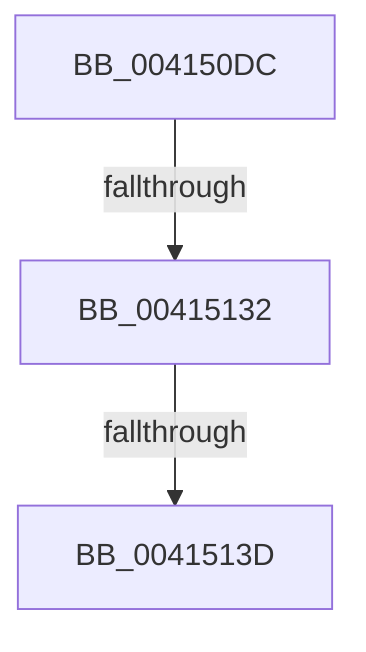

# sub_004150DC

- RVA: `0x004150DC`–`0x00415140` (길이 `100` bytes)
- VA: `0x00000001404150DC`
- 실행 섹션: `.text`
- PDB 이름 있음: `아니요`; PDB Function 태그: `아니요`
- unwind 정보 RVA: `0x0009C1D4`
- 디코드: `23`개 명령, `100/100` bytes 표시
- 미해석 바이트: `0` (있으면 어셈블리에 `.byte`로 보존)

> 이 문서는 커널 이미지의 기계어와 PDB 기호를 분석해 생성했습니다. 4번과 5번은 함수 원형과 자료형을 바이너리 사용 방식에서 추정한 C 해석이며 원본 소스 복구 결과는 아닙니다.

## 1. Dependencies

- 직접 호출 지점: **1**; 고유 호출 대상: **1**
- 직접 호출자로 확인된 함수: **0**
- RIP 상대 이미지 참조: **1**

### Outgoing calls
- `0x00415110` → [KeAbPreAcquire](../21/KeAbPreAcquire_function_00210230.md) (function, `0x00210230`)

### Direct callers
- 이 함수 시작 RVA로 연결되는 직접 call은 확인되지 않았습니다. 간접 호출은 완전히 역산할 수 없습니다.

### Static image references
- `0x00415125` → RVA `0x00FC6D20` (`ALMOSTRO`; read)

## 2. Other-region calls and transfers

- 다른 실행 섹션으로 향하는 call: **0**
- call이 아닌 외부 분기/꼬리 이동: **2**
  - `0x0041512C` → [sub_00415263](Unknown_function_00415263.md) (`tail-transfer`)
  - `0x00415137` → [sub_004151D9](Unknown_function_004151D9.md) (`tail-transfer`)

## 3. Assembly (complete function range)

```asm
004150DC  48 89 58 18                     mov qword ptr [rax + 0x18], rbx
004150E0  48 8B F9                        mov rdi, rcx
004150E3  48 89 68 F0                     mov qword ptr [rax - 0x10], rbp
004150E7  45 33 C0                        xor r8d, r8d
004150EA  4C 89 68 D8                     mov qword ptr [rax - 0x28], r13
004150EE  4C 89 70 D0                     mov qword ptr [rax - 0x30], r14
004150F2  48 8B C2                        mov rax, rdx
004150F5  65 4C 8B 34 25 88 01 00 00      mov r14, qword ptr gs:[0x188]
004150FE  48 8B 59 18                     mov rbx, qword ptr [rcx + 0x18]
00415102  48 89 54 24 70                  mov qword ptr [rsp + 0x70], rdx
00415107  33 D2                           xor edx, edx
00415109  48 8B 5B 30                     mov rbx, qword ptr [rbx + 0x30]
0041510D  48 8B CB                        mov rcx, rbx
00415110  E8 1B B1 DF FF                  call 0x140210230
00415115  48 8B E8                        mov rbp, rax
00415118  45 0F 20 C5                     mov r13, cr8
0041511C  BA 01 00 00 00                  mov edx, 1
00415121  44 0F 22 C2                     mov cr8, rdx
00415125  83 3D F4 1B BB 00 00            cmp dword ptr [rip + 0xbb1bf4], 0
0041512C  0F 85 31 01 00 00               jne 0x140415263
00415132  F0 0F BA 33 00                  lock btr dword ptr [rbx], 0
00415137  0F 82 9C 00 00 00               jb 0x1404151d9
0041513D  FF 43 10                        inc dword ptr [rbx + 0x10]
```

## 4. C-style interpretation (structured pseudocode)

```c
__int64 __fastcall sub_004150DC(__int64 a1, __int64 a2, int a3)
{
    __int64 result;
    unsigned __int64 v_stack_p70;

    *(unsigned __int64 *)(result + 24) = v_rbx;
    *(unsigned __int64 *)(result - 16) = v_rbp;
    a3 = 0;
    *(unsigned __int64 *)(result - 40) = v_r13;
    *(unsigned __int64 *)(result - 48) = v_r14;
    v_stack_p70 = a2;
    a2 = 0;
    result = KeAbPreAcquire(*(unsigned __int64 *)(*(unsigned __int64 *)(a1 + 24) + 48), a2, a3, a4);
    return result;
}
```

## 5. (Beta) C Style

```c
int64_t sub_004150DC(void *Arg1, int64_t Arg2, int32_t Arg3)
{
    uint8_t *arg1 = (uint8_t *)Arg1;

    int64_t result;
    uint64_t v_stack_p70;

    *(uint64_t *)(result + 0x18) = local_rbx;
    *(uint64_t *)(result - 0x10) = local_rbp;
    Arg3 = 0;
    *(uint64_t *)(result - 0x28) = local_r13;
    *(uint64_t *)(result - 0x30) = local_r14;
    v_stack_p70 = Arg2;
    Arg2 = 0;
    result = KeAbPreAcquire(*(uint64_t *)(*(uint64_t *)(arg1 + 0x18) + 0x30), Arg2, Arg3, a4);
    return result;
}
```

### 관측된 메모리 오프셋

구조체 형식이 확인되지 않은 접근은 인자 기준의 오프셋으로만 기록했습니다.

| 기준 인자 | 오프셋 표현 | 폭 (bit) | 접근 |
|---|---:|---:|---|
| `Arg1` | `+ 0x18` | `64` | `R` |

## 6. Execution-region graph

[열기: 2D/3D 그래프와 함수 탐색 컨트롤 패널](../../../control-panel.html?section=text&rva=0x004150DC&view=graph)

- 2D 그래프는 위에서 아래로 흐르고, 3D 그래프는 빈 공간을 드래그해 회전합니다. Shift+드래그는 이동, 휠은 확대·축소, 함수 노드 선택은 대상 보고서 이동입니다.

### Static fallback


