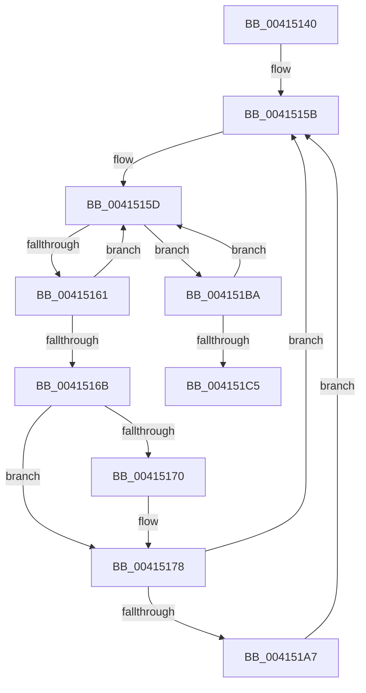

# sub_00415140

- RVA: `0x00415140`–`0x004151D9` (길이 `153` bytes)
- VA: `0x0000000140415140`
- 실행 섹션: `.text`
- PDB 이름 있음: `아니요`; PDB Function 태그: `아니요`
- unwind 정보 RVA: `0x0009C1F4`
- 디코드: `41`개 명령, `153/153` bytes 표시
- 미해석 바이트: `0` (있으면 어셈블리에 `.byte`로 보존)

> 이 문서는 커널 이미지의 기계어와 PDB 기호를 분석해 생성했습니다. 4번과 5번은 함수 원형과 자료형을 바이너리 사용 방식에서 추정한 C 해석이며 원본 소스 복구 결과는 아닙니다.

## 1. Dependencies

- 직접 호출 지점: **3**; 고유 호출 대상: **3**
- 직접 호출자로 확인된 함수: **0**
- RIP 상대 이미지 참조: **0**

### Outgoing calls
- `0x00415173` → [KeAbPreWait](../20/KeAbPreWait_function_0020E560.md) (function, `0x0020E560`)
- `0x0041518F` → [KeWaitForSingleObject](../20/KeWaitForSingleObject_function_0020E6B0.md) (function, `0x0020E6B0`)
- `0x004151B0` → [KeAbPreAcquire](../21/KeAbPreAcquire_function_00210230.md) (function, `0x00210230`)

### Direct callers
- 이 함수 시작 RVA로 연결되는 직접 call은 확인되지 않았습니다. 간접 호출은 완전히 역산할 수 없습니다.

### Static image references
- 디코드된 RIP-relative 메모리 참조가 없습니다.

## 2. Other-region calls and transfers

- 다른 실행 섹션으로 향하는 call: **0**
- 별도 외부 분기/꼬리 이동을 확인하지 못했습니다.

## 3. Assembly (complete function range)

```asm
00415140  48 89 74 24 50                  mov qword ptr [rsp + 0x50], rsi
00415145  48 8B F5                        mov rsi, rbp
00415148  4C 89 64 24 48                  mov qword ptr [rsp + 0x48], r12
0041514D  44 8B E2                        mov r12d, edx
00415150  4C 89 7C 24 30                  mov qword ptr [rsp + 0x30], r15
00415155  41 BF 04 00 00 00               mov r15d, 4
0041515B  8B 03                           mov eax, dword ptr [rbx]
0041515D  A8 01                           test al, 1
0041515F  75 59                           jne 0x1404151ba
00415161  41 8D 0C 07                     lea ecx, [r15 + rax]
00415165  F0 0F B1 0B                     lock cmpxchg dword ptr [rbx], ecx
00415169  75 F2                           jne 0x14041515d
0041516B  48 85 F6                        test rsi, rsi
0041516E  74 08                           je 0x140415178
00415170  48 8B CE                        mov rcx, rsi
00415173  E8 E8 93 DF FF                  call 0x14020e560
00415178  45 33 C9                        xor r9d, r9d
0041517B  48 C7 44 24 20 00 00 00 00      mov qword ptr [rsp + 0x20], 0
00415184  48 8D 4B 18                     lea rcx, [rbx + 0x18]
00415188  45 33 C0                        xor r8d, r8d
0041518B  41 8D 51 22                     lea edx, [r9 + 0x22]
0041518F  E8 1C 95 DF FF                  call 0x14020e6b0
00415194  0F 0D 0B                        prefetchw byte ptr [rbx]
00415197  41 BC 03 00 00 00               mov r12d, 3
0041519D  45 8D 7C 24 FF                  lea r15d, [r12 - 1]
004151A2  48 85 F6                        test rsi, rsi
004151A5  74 B4                           je 0x14041515b
004151A7  45 33 C0                        xor r8d, r8d
004151AA  48 8B D6                        mov rdx, rsi
004151AD  48 8B CB                        mov rcx, rbx
004151B0  E8 7B B0 DF FF                  call 0x140210230
004151B5  48 8B F0                        mov rsi, rax
004151B8  EB A1                           jmp 0x14041515b
004151BA  8B C8                           mov ecx, eax
004151BC  41 33 CC                        xor ecx, r12d
004151BF  F0 0F B1 0B                     lock cmpxchg dword ptr [rbx], ecx
004151C3  75 98                           jne 0x14041515d
004151C5  4C 8B 7C 24 30                  mov r15, qword ptr [rsp + 0x30]
004151CA  BA 01 00 00 00                  mov edx, 1
004151CF  4C 8B 64 24 48                  mov r12, qword ptr [rsp + 0x48]
004151D4  48 8B 74 24 50                  mov rsi, qword ptr [rsp + 0x50]
```

## 4. C-style interpretation (structured pseudocode)

```c
__int64 __fastcall sub_00415140(__int64 a1, int a2, int a3, int a4, __int64 a5, __int64 a6, __int64 a7, __int64 a8, __int64 a9, __int64 a10)
{
    __int64 result;
    unsigned __int64 v_stack_p20;
    unsigned __int64 v_stack_p30;
    unsigned __int64 v_stack_p48;
    unsigned __int64 v_stack_p50;

    v_stack_p50 = v_rsi;
    v_stack_p48 = v_r12;
    v_stack_p30 = v_r15;
loc_0041515B:
loc_0041515D:
    if ((((unsigned __int8)((unsigned int)(*(unsigned int *)(v_rbx)))) & (1)) != 0) goto loc_004151BA;
    if ((((unsigned __int8)((unsigned int)(*(unsigned int *)(v_rbx)))) & (1)) != 0) goto loc_0041515D;
    result = (unsigned int)(*(unsigned int *)(v_rbx));
    if (v_rbp != 0) {
        a1 = v_rbp;
        result = KeAbPreWait(a1, a2, a3, a4);
    }
    a4 = 0;
    v_stack_p20 = 0;
    a3 = 0;
    result = KeWaitForSingleObject(v_rbx + 24, a4 + 34, a3, a4);
    if (v_rbp == 0) goto loc_0041515B;
    a3 = 0;
    result = KeAbPreAcquire(v_rbx, v_rbp, a3, a4);
    goto loc_0041515B;
loc_004151BA:
    a1 = (unsigned int)(((unsigned int)((unsigned int)(result))) ^ (3));
    if (condition_is_not_equal) goto loc_0041515D;
    return result;
}
```

## 5. (Beta) C Style

```c
int64_t sub_00415140(int64_t Arg1, int32_t Arg2, int32_t Arg3, int32_t Arg4, uint64_t Arg5, int64_t Arg6, uint64_t Arg7, uint64_t Arg8, int64_t Arg9, int64_t Arg10)
{
    int64_t result;
    uint64_t v_stack_p20;
    uint64_t v_stack_p30;
    uint64_t v_stack_p48;
    uint64_t v_stack_p50;

    v_stack_p50 = local_rsi;
    v_stack_p48 = local_r12;
    v_stack_p30 = local_r15;
loc_0041515B:
loc_0041515D:
    if ((((uint8_t)((uint32_t)(*(uint32_t *)(local_rbx)))) & (1)) != 0) goto loc_004151BA;
    if ((((uint8_t)((uint32_t)(*(uint32_t *)(local_rbx)))) & (1)) != 0) goto loc_0041515D;
    result = (uint32_t)(*(uint32_t *)(local_rbx));
    if (local_rbp != 0) {
        Arg1 = local_rbp;
        result = KeAbPreWait(Arg1, Arg2, Arg3, Arg4);
    }
    Arg4 = 0;
    v_stack_p20 = 0;
    Arg3 = 0;
    result = KeWaitForSingleObject(local_rbx + 24, Arg4 + 34, Arg3, Arg4);
    if (local_rbp == 0) goto loc_0041515B;
    Arg3 = 0;
    result = KeAbPreAcquire(local_rbx, local_rbp, Arg3, Arg4);
    goto loc_0041515B;
loc_004151BA:
    Arg1 = (uint32_t)(((uint32_t)((uint32_t)(result))) ^ (3));
    if (condition_is_not_equal) goto loc_0041515D;
    return result;
}
```

## 6. Execution-region graph

[열기: 2D/3D 그래프와 함수 탐색 컨트롤 패널](../../../control-panel.html?section=text&rva=0x00415140&view=graph)

- 2D 그래프는 위에서 아래로 흐르고, 3D 그래프는 빈 공간을 드래그해 회전합니다. Shift+드래그는 이동, 휠은 확대·축소, 함수 노드 선택은 대상 보고서 이동입니다.

### Static fallback


