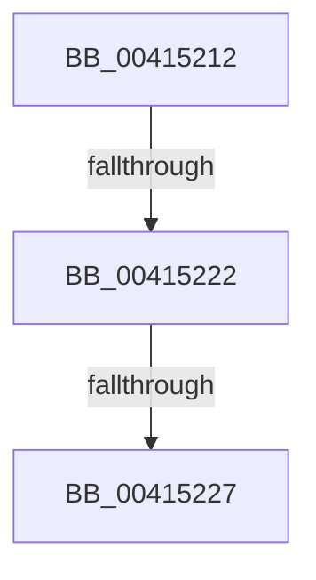

# sub_00415212

- RVA: `0x00415212`–`0x00415247` (길이 `53` bytes)
- VA: `0x0000000140415212`
- 실행 섹션: `.text`
- PDB 이름 있음: `아니요`; PDB Function 태그: `아니요`
- unwind 정보 RVA: `0x0009C220`
- 디코드: `15`개 명령, `53/53` bytes 표시
- 미해석 바이트: `0` (있으면 어셈블리에 `.byte`로 보존)

> 이 문서는 커널 이미지의 기계어와 PDB 기호를 분석해 생성했습니다. 4번과 5번은 함수 원형과 자료형을 바이너리 사용 방식에서 추정한 C 해석이며 원본 소스 복구 결과는 아닙니다.

## 1. Dependencies

- 직접 호출 지점: **0**; 고유 호출 대상: **0**
- 직접 호출자로 확인된 함수: **0**
- RIP 상대 이미지 참조: **0**

### Outgoing calls
- 직접 디코드된 call 명령이 없습니다.

### Direct callers
- 이 함수 시작 RVA로 연결되는 직접 call은 확인되지 않았습니다. 간접 호출은 완전히 역산할 수 없습니다.

### Static image references
- 디코드된 RIP-relative 메모리 참조가 없습니다.

## 2. Other-region calls and transfers

- 다른 실행 섹션으로 향하는 call: **0**
- call이 아닌 외부 분기/꼬리 이동: **3**
  - `0x00415220` → [sub_00415276](Unknown_function_00415276.md) (`tail-transfer`)
  - `0x00415225` → [sub_00415276 + 0x6](Unknown_function_00415276.md) (`tail-transfer`)
  - `0x00415245` → [sub_00415247 + 0x8](Unknown_function_00415247.md) (`tail-transfer`)

## 3. Assembly (complete function range)

```asm
00415212  48 8B 44 24 70                  mov rax, qword ptr [rsp + 0x70]
00415217  F0 FF 00                        lock inc dword ptr [rax]
0041521A  48 8B 07                        mov rax, qword ptr [rdi]
0041521D  49 3B C6                        cmp rax, r14
00415220  74 54                           je 0x140415276
00415222  48 85 C0                        test rax, rax
00415225  75 55                           jne 0x14041527c
00415227  4C 89 37                        mov qword ptr [rdi], r14
0041522A  66 89 57 26                     mov word ptr [rdi + 0x26], dx
0041522E  48 8B 44 24 78                  mov rax, qword ptr [rsp + 0x78]
00415233  4C 8B 74 24 38                  mov r14, qword ptr [rsp + 0x38]
00415238  48 89 44 24 78                  mov qword ptr [rsp + 0x78], rax
0041523D  48 8B 44 24 78                  mov rax, qword ptr [rsp + 0x78]
00415242  48 85 C0                        test rax, rax
00415245  74 08                           je 0x14041524f
```

## 4. C-style interpretation (structured pseudocode)

```c
__int64 __fastcall sub_00415212(__int64 a1, unsigned __int16 a2, __int64 a3, __int64 a4, __int64 a5, __int64 a6, __int64 a7, __int64 a8, __int64 a9, __int64 a10, __int64 a11, __int64 a12, __int64 a13, __int64 a14, __int64 a15)
{
    unsigned __int64 v_stack_p78;

    *(unsigned __int64 *)(v_rdi) = v_r14;
    *(unsigned __int16 *)(v_rdi + 38) = a2;
    v_stack_p78 = a15;
}
```

## 5. (Beta) C Style

```c
int64_t sub_00415212(int64_t Arg1, uint16_t Arg2, int64_t Arg3, int64_t Arg4, uint64_t Arg5, uint64_t Arg6, int64_t Arg7, uint64_t Arg8, uint64_t Arg9, uint64_t Arg10, uint64_t Arg11, uint64_t Arg12, uint64_t Arg13, void *Arg14, int64_t Arg15)
{
    uint8_t *arg14 = (uint8_t *)Arg14;

    uint64_t v_stack_p78;

    *(uint64_t *)(local_rdi) = local_r14;
    *(uint16_t *)(local_rdi + 0x26) = Arg2;
    v_stack_p78 = Arg15;
}
```

### 관측된 메모리 오프셋

구조체 형식이 확인되지 않은 접근은 인자 기준의 오프셋으로만 기록했습니다.

| 기준 인자 | 오프셋 표현 | 폭 (bit) | 접근 |
|---|---:|---:|---|
| `Arg14` | `+ 0x0` | `32` | `R/W` |

## 6. Execution-region graph

[열기: 2D/3D 그래프와 함수 탐색 컨트롤 패널](../../../control-panel.html?section=text&rva=0x00415212&view=graph)

- 2D 그래프는 위에서 아래로 흐르고, 3D 그래프는 빈 공간을 드래그해 회전합니다. Shift+드래그는 이동, 휠은 확대·축소, 함수 노드 선택은 대상 보고서 이동입니다.

### Static fallback


