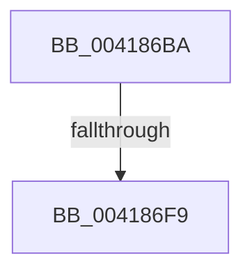

# sub_004186BA

- RVA: `0x004186BA`–`0x00418706` (길이 `76` bytes)
- VA: `0x00000001404186BA`
- 실행 섹션: `.text`
- PDB 이름 있음: `아니요`; PDB Function 태그: `아니요`
- unwind 정보 RVA: `0x0009CF18`
- 디코드: `15`개 명령, `76/76` bytes 표시
- 미해석 바이트: `0` (있으면 어셈블리에 `.byte`로 보존)

> 이 문서는 커널 이미지의 기계어와 PDB 기호를 분석해 생성했습니다. 4번과 5번은 함수 원형과 자료형을 바이너리 사용 방식에서 추정한 C 해석이며 원본 소스 복구 결과는 아닙니다.

## 1. Dependencies

- 직접 호출 지점: **0**; 고유 호출 대상: **0**
- 직접 호출자로 확인된 함수: **0**
- RIP 상대 이미지 참조: **2**

### Outgoing calls
- 직접 디코드된 call 명령이 없습니다.

### Direct callers
- 이 함수 시작 RVA로 연결되는 직접 call은 확인되지 않았습니다. 간접 호출은 완전히 역산할 수 없습니다.

### Static image references
- `0x004186ED` → RVA `0x00FC6D20` (`ALMOSTRO`; read)
- `0x004186F9` → RVA `0x00FC6B06` (`ALMOSTRO`; read)

## 2. Other-region calls and transfers

- 다른 실행 섹션으로 향하는 call: **0**
- call이 아닌 외부 분기/꼬리 이동: **2**
  - `0x004186F3` → [sub_004187EB + 0x1F](Unknown_function_004187EB.md) (`tail-transfer`)
  - `0x00418700` → [sub_004187EB](Unknown_function_004187EB.md) (`tail-transfer`)

## 3. Assembly (complete function range)

```asm
004186BA  48 89 BC 24 80 00 00 00         mov qword ptr [rsp + 0x80], rdi
004186C2  33 C0                           xor eax, eax
004186C4  4C 89 74 24 50                  mov qword ptr [rsp + 0x50], r14
004186C9  0F 11 44 24 20                  movups xmmword ptr [rsp + 0x20], xmm0
004186CE  48 89 44 24 40                  mov qword ptr [rsp + 0x40], rax
004186D3  48 8B F9                        mov rdi, rcx
004186D6  0F 11 44 24 30                  movups xmmword ptr [rsp + 0x30], xmm0
004186DB  48 8D 59 48                     lea rbx, [rcx + 0x48]
004186DF  44 0F 20 C5                     mov rbp, cr8
004186E3  41 BE 02 00 00 00               mov r14d, 2
004186E9  45 0F 22 C6                     mov cr8, r14
004186ED  39 05 2D E6 BA 00               cmp dword ptr [rip + 0xbae62d], eax
004186F3  0F 85 11 01 00 00               jne 0x14041880a
004186F9  F6 05 06 E4 BA 00 21            test byte ptr [rip + 0xbae406], 0x21
00418700  0F 85 E5 00 00 00               jne 0x1404187eb
```

## 4. C-style interpretation (structured pseudocode)

```c
__int64 __fastcall sub_004186BA(__int64 a1, __int64 a2, __int64 a3, __int64 a4, __int64 a5, __int64 a6)
{
    __int64 result;
    unsigned __int64 v_stack_p20;
    unsigned __int64 v_stack_p40;
    unsigned __int64 v_stack_p50;
    unsigned __int64 v_stack_p80;

    v_stack_p80 = v_rdi;
    result = 0;
    v_stack_p50 = v_r14;
    v_stack_p20 = v_xmm0;
    v_stack_p40 = 0;
    a6 = v_xmm0;
}
```

## 5. (Beta) C Style

```c
int64_t sub_004186BA(void *Arg1, int64_t Arg2, int64_t Arg3, int64_t Arg4, uint64_t Arg5, int64_t Arg6)
{
    uint8_t *arg1 = (uint8_t *)Arg1;

    int64_t result;
    uint64_t v_stack_p20;
    uint64_t v_stack_p40;
    uint64_t v_stack_p50;
    uint64_t v_stack_p80;

    v_stack_p80 = local_rdi;
    result = 0;
    v_stack_p50 = local_r14;
    v_stack_p20 = v_xmm0;
    v_stack_p40 = 0;
    Arg6 = v_xmm0;
}
```

### 관측된 메모리 오프셋

구조체 형식이 확인되지 않은 접근은 인자 기준의 오프셋으로만 기록했습니다.

| 기준 인자 | 오프셋 표현 | 폭 (bit) | 접근 |
|---|---:|---:|---|
| `Arg1` | `+ 0x48` | `64` | `R` |

## 6. Execution-region graph

[열기: 2D/3D 그래프와 함수 탐색 컨트롤 패널](../../../control-panel.html?section=text&rva=0x004186BA&view=graph)

- 2D 그래프는 위에서 아래로 흐르고, 3D 그래프는 빈 공간을 드래그해 회전합니다. Shift+드래그는 이동, 휠은 확대·축소, 함수 노드 선택은 대상 보고서 이동입니다.

### Static fallback


