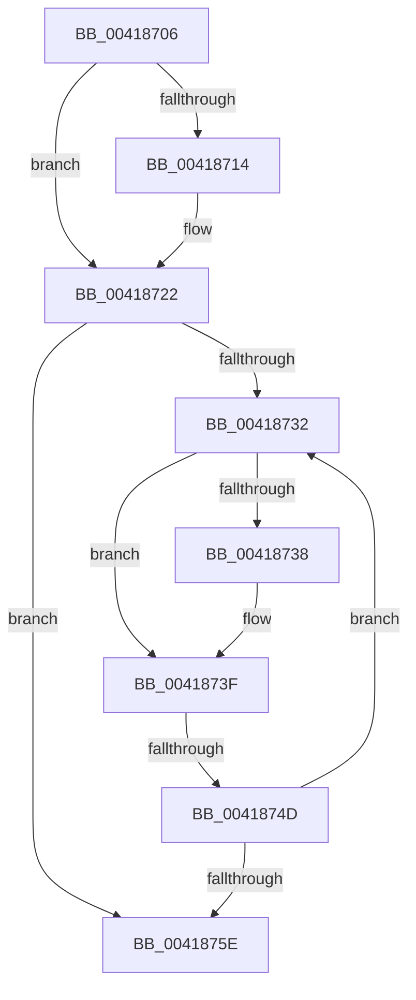

# sub_00418706

- RVA: `0x00418706`–`0x00418763` (길이 `93` bytes)
- VA: `0x0000000140418706`
- 실행 섹션: `.text`
- PDB 이름 있음: `아니요`; PDB Function 태그: `아니요`
- unwind 정보 RVA: `0x0009CF30`
- 디코드: `26`개 명령, `93/93` bytes 표시
- 미해석 바이트: `0` (있으면 어셈블리에 `.byte`로 보존)

> 이 문서는 커널 이미지의 기계어와 PDB 기호를 분석해 생성했습니다. 4번과 5번은 함수 원형과 자료형을 바이너리 사용 방식에서 추정한 C 해석이며 원본 소스 복구 결과는 아닙니다.

## 1. Dependencies

- 직접 호출 지점: **1**; 고유 호출 대상: **1**
- 직접 호출자로 확인된 함수: **0**
- RIP 상대 이미지 참조: **1**

### Outgoing calls
- `0x0041871B` → [ExpWaitForSpinLockExclusiveAndAcquire](../32/ExpWaitForSpinLockExclusiveAndAcquire_function_003239A0.md) (function, `0x003239A0`)

### Direct callers
- 이 함수 시작 RVA로 연결되는 직접 call은 확인되지 않았습니다. 간접 호출은 완전히 역산할 수 없습니다.

### Static image references
- `0x00418741` → RVA `0x00FC52AC` (`ALMOSTRO`; reference)

## 2. Other-region calls and transfers

- 다른 실행 섹션으로 향하는 call: **0**
- call이 아닌 외부 분기/꼬리 이동: **1**
  - `0x00418747` → [sub_0041881C](Unknown_function_0041881C.md) (`tail-transfer`)

## 3. Assembly (complete function range)

```asm
00418706  48 89 74 24 78                  mov qword ptr [rsp + 0x78], rsi
0041870B  33 F6                           xor esi, esi
0041870D  F0 0F BA 2B 1F                  lock bts dword ptr [rbx], 0x1f
00418712  73 0E                           jae 0x140418722
00418714  40 0F B6 D5                     movzx edx, bpl
00418718  48 8B CB                        mov rcx, rbx
0041871B  E8 80 B2 F0 FF                  call 0x1403239a0
00418720  8B F0                           mov esi, eax
00418722  8B 13                           mov edx, dword ptr [rbx]
00418724  8B CA                           mov ecx, edx
00418726  0F BA F1 1E                     btr ecx, 0x1e
0041872A  81 F9 00 00 00 80               cmp ecx, 0x80000000
00418730  74 2C                           je 0x14041875e
00418732  0F BA E2 1E                     bt edx, 0x1e
00418736  72 07                           jb 0x14041873f
00418738  F0 81 0B 00 00 00 40            lock or dword ptr [rbx], 0x40000000
0041873F  FF C6                           inc esi
00418741  85 35 65 CB BA 00               test dword ptr [rip + 0xbacb65], esi
00418747  0F 84 CF 00 00 00               je 0x14041881c
0041874D  F3 90                           pause
0041874F  8B 13                           mov edx, dword ptr [rbx]
00418751  8B C2                           mov eax, edx
00418753  0F BA F0 1E                     btr eax, 0x1e
00418757  3D 00 00 00 80                  cmp eax, 0x80000000
0041875C  75 D4                           jne 0x140418732
0041875E  48 8B 74 24 78                  mov rsi, qword ptr [rsp + 0x78]
```

## 4. C-style interpretation (structured pseudocode)

```c
__int64 __fastcall sub_00418706(__int64 a1, __int64 a2, __int64 a3, __int64 a4, __int64 a5, __int64 a6, __int64 a7, __int64 a8, __int64 a9, __int64 a10, __int64 a11, __int64 a12, __int64 a13, __int64 a14, __int64 a15)
{
    __int64 result;
    __int64 v_rsi;
    unsigned __int64 v_stack_p78;

    v_stack_p78 = v_rsi;
    v_rsi = 0;
    if (!(condition_is_above_or_equal)) {
        a2 = (unsigned __int8)(v_rbp);
        a1 = v_rbx;
        result = ExpWaitForSpinLockExclusiveAndAcquire(a1, a2, a3, a4);
        v_rsi = (unsigned int)(result);
    }
    if (((unsigned int)((unsigned int)((unsigned int)((unsigned int)(*(unsigned int *)(v_rbx)))))) == 0x80000000ULL) goto loc_0041875E;
loc_00418732:
    if (((unsigned int)((unsigned int)((unsigned int)((unsigned int)(*(unsigned int *)(v_rbx)))))) >= 0x80000000ULL) {
    }
    v_rsi = (unsigned int)((v_rsi) + 1);
    if (((unsigned int)((unsigned int)((unsigned int)((unsigned int)(*(unsigned int *)(v_rbx)))))) != 0x80000000ULL) goto loc_00418732;
loc_0041875E:
    return (unsigned int)((unsigned int)((unsigned int)(*(unsigned int *)(v_rbx))));
}
```

## 5. (Beta) C Style

```c
int64_t sub_00418706(int64_t Arg1, int64_t Arg2, int64_t Arg3, int64_t Arg4, uint64_t Arg5, uint64_t Arg6, uint64_t Arg7, uint64_t Arg8, uint64_t Arg9, uint64_t Arg10, uint64_t Arg11, uint64_t Arg12, uint64_t Arg13, uint64_t Arg14, int64_t Arg15)
{
    int64_t result;
    int64_t local_rsi;
    uint64_t v_stack_p78;

    v_stack_p78 = local_rsi;
    local_rsi = 0;
    if (!(condition_is_above_or_equal)) {
        Arg2 = (uint8_t)(local_rbp);
        Arg1 = local_rbx;
        result = ExpWaitForSpinLockExclusiveAndAcquire(Arg1, Arg2, Arg3, Arg4);
        local_rsi = (uint32_t)(result);
    }
    if (((uint32_t)((uint32_t)((uint32_t)((uint32_t)(*(uint32_t *)(local_rbx)))))) == 0x80000000ULL) goto loc_0041875E;
loc_00418732:
    if (((uint32_t)((uint32_t)((uint32_t)((uint32_t)(*(uint32_t *)(local_rbx)))))) >= 0x80000000ULL) {
    }
    local_rsi = (uint32_t)((local_rsi) + 1);
    if (((uint32_t)((uint32_t)((uint32_t)((uint32_t)(*(uint32_t *)(local_rbx)))))) != 0x80000000ULL) goto loc_00418732;
loc_0041875E:
    return (uint32_t)((uint32_t)((uint32_t)(*(uint32_t *)(local_rbx))));
}
```

## 6. Execution-region graph

[열기: 2D/3D 그래프와 함수 탐색 컨트롤 패널](../../../control-panel.html?section=text&rva=0x00418706&view=graph)

- 2D 그래프는 위에서 아래로 흐르고, 3D 그래프는 빈 공간을 드래그해 회전합니다. Shift+드래그는 이동, 휠은 확대·축소, 함수 노드 선택은 대상 보고서 이동입니다.

### Static fallback


