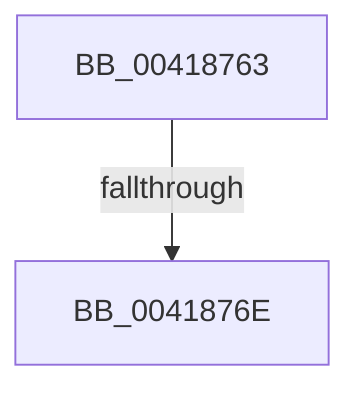

# sub_00418763

- RVA: `0x00418763`–`0x00418797` (길이 `52` bytes)
- VA: `0x0000000140418763`
- 실행 섹션: `.text`
- PDB 이름 있음: `아니요`; PDB Function 태그: `아니요`
- unwind 정보 RVA: `0x0009CF44`
- 디코드: `11`개 명령, `52/52` bytes 표시
- 미해석 바이트: `0` (있으면 어셈블리에 `.byte`로 보존)

> 이 문서는 커널 이미지의 기계어와 PDB 기호를 분석해 생성했습니다. 4번과 5번은 함수 원형과 자료형을 바이너리 사용 방식에서 추정한 C 해석이며 원본 소스 복구 결과는 아닙니다.

## 1. Dependencies

- 직접 호출 지점: **0**; 고유 호출 대상: **0**
- 직접 호출자로 확인된 함수: **0**
- RIP 상대 이미지 참조: **1**

### Outgoing calls
- 직접 디코드된 call 명령이 없습니다.

### Direct callers
- 이 함수 시작 RVA로 연결되는 직접 call은 확인되지 않았습니다. 간접 호출은 완전히 역산할 수 없습니다.

### Static image references
- `0x0041876E` → RVA `0x00013600` (`.rdata`; read)

## 2. Other-region calls and transfers

- 다른 실행 섹션으로 향하는 call: **0**
- call이 아닌 외부 분기/꼬리 이동: **2**
  - `0x00418768` → [sub_006ED466](../6E/Unknown_function_006ED466.md) (`tail-transfer`)
  - `0x00418795` → [sub_00418797 + 0x39](Unknown_function_00418797.md) (`tail-transfer`)

## 3. Assembly (complete function range)

```asm
00418763  8B 47 38                        mov eax, dword ptr [rdi + 0x38]
00418766  A8 04                           test al, 4
00418768  0F 85 F8 4C 2D 00               jne 0x1406ed466
0041876E  66 0F 6F 0D 8A AE BF FF         movdqa xmm1, xmmword ptr [rip - 0x405176]
00418776  4C 8B 74 24 50                  mov r14, qword ptr [rsp + 0x50]
0041877B  F3 0F 6F 47 28                  movdqu xmm0, xmmword ptr [rdi + 0x28]
00418780  66 0F D4 C8                     paddq xmm1, xmm0
00418784  F3 0F 7F 4F 28                  movdqu xmmword ptr [rdi + 0x28], xmm1
00418789  48 8B BC 24 80 00 00 00         mov rdi, qword ptr [rsp + 0x80]
00418791  40 80 FD 11                     cmp bpl, 0x11
00418795  74 39                           je 0x1404187d0
```

## 4. C-style interpretation (structured pseudocode)

```c
__int64 __fastcall sub_00418763(__int64 a1, __int64 a2, __int64 a3, __int64 a4, __int64 a5, __int64 a6, __int64 a7, __int64 a8, __int64 a9, __int64 a10, __int64 a11, __int64 a12, __int64 a13, __int64 a14, __int64 a15, __int64 a16)
{
    *(unsigned __int64 *)(v_rdi + 40) = v_xmm1;
}
```

## 5. (Beta) C Style

```c
int64_t sub_00418763(int64_t Arg1, int64_t Arg2, int64_t Arg3, int64_t Arg4, uint64_t Arg5, uint64_t Arg6, uint64_t Arg7, uint64_t Arg8, uint64_t Arg9, int64_t Arg10, uint64_t Arg11, uint64_t Arg12, uint64_t Arg13, uint64_t Arg14, uint64_t Arg15, int64_t Arg16)
{
    *(uint64_t *)(local_rdi + 0x28) = v_xmm1;
}
```

## 6. Execution-region graph

[열기: 2D/3D 그래프와 함수 탐색 컨트롤 패널](../../../control-panel.html?section=text&rva=0x00418763&view=graph)

- 2D 그래프는 위에서 아래로 흐르고, 3D 그래프는 빈 공간을 드래그해 회전합니다. Shift+드래그는 이동, 휠은 확대·축소, 함수 노드 선택은 대상 보고서 이동입니다.

### Static fallback


