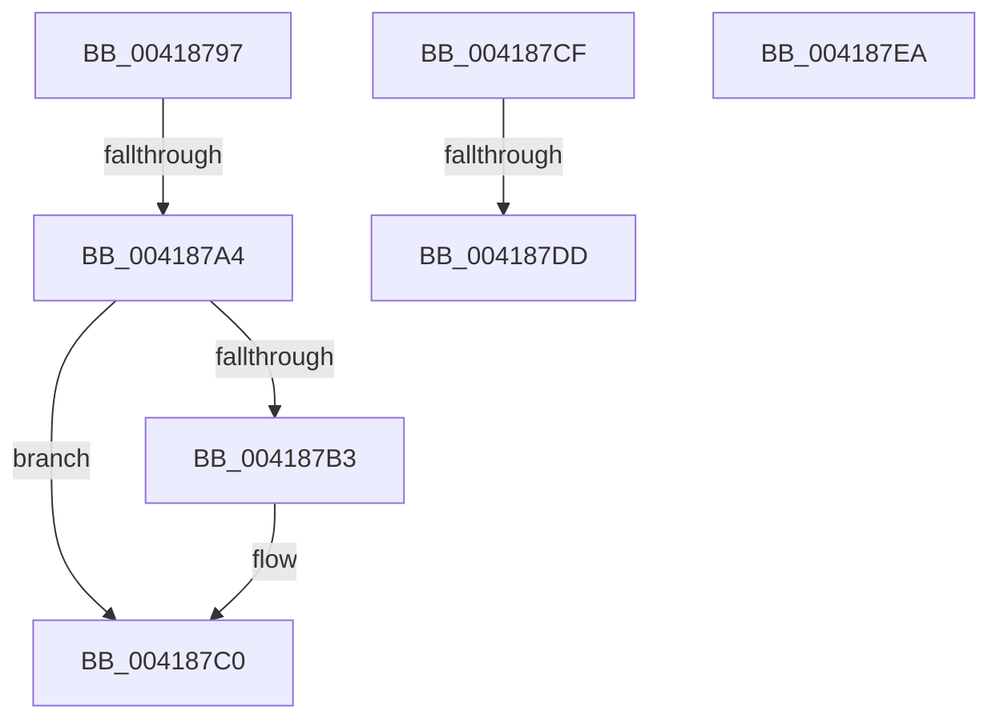

# sub_00418797

- RVA: `0x00418797`–`0x004187EB` (길이 `84` bytes)
- VA: `0x0000000140418797`
- 실행 섹션: `.text`
- PDB 이름 있음: `아니요`; PDB Function 태그: `아니요`
- unwind 정보 RVA: `0x0009CF54`
- 디코드: `23`개 명령, `84/84` bytes 표시
- 미해석 바이트: `0` (있으면 어셈블리에 `.byte`로 보존)

> 이 문서는 커널 이미지의 기계어와 PDB 기호를 분석해 생성했습니다. 4번과 5번은 함수 원형과 자료형을 바이너리 사용 방식에서 추정한 C 해석이며 원본 소스 복구 결과는 아닙니다.

## 1. Dependencies

- 직접 호출 지점: **1**; 고유 호출 대상: **1**
- 직접 호출자로 확인된 함수: **0**
- RIP 상대 이미지 참조: **2**

### Outgoing calls
- `0x004187BB` → [KiLowerIrqlProcessIrqlFlags](../4F/KiLowerIrqlProcessIrqlFlags_function_004F5698.md) (function, `0x004F5698`)

### Direct callers
- 이 함수 시작 RVA로 연결되는 직접 call은 확인되지 않았습니다. 간접 호출은 완전히 역산할 수 없습니다.

### Static image references
- `0x00418797` → RVA `0x00FC6B06` (`ALMOSTRO`; read)
- `0x004187AA` → RVA `0x00FC6D20` (`ALMOSTRO`; read)

## 2. Other-region calls and transfers

- 다른 실행 섹션으로 향하는 call: **0**
- call이 아닌 외부 분기/꼬리 이동: **2**
  - `0x0041879E` → [sub_00418843](Unknown_function_00418843.md) (`tail-transfer`)
  - `0x004187D7` → [sub_00418843 + 0x20](Unknown_function_00418843.md) (`tail-transfer`)

## 3. Assembly (complete function range)

```asm
00418797  F6 05 68 E3 BA 00 01            test byte ptr [rip + 0xbae368], 1
0041879E  0F 85 9F 00 00 00               jne 0x140418843
004187A4  C7 03 00 00 00 00               mov dword ptr [rbx], 0
004187AA  83 3D 6F E5 BA 00 00            cmp dword ptr [rip + 0xbae56f], 0
004187B1  74 0D                           je 0x1404187c0
004187B3  44 0F 20 C1                     mov rcx, cr8
004187B7  40 0F B6 D5                     movzx edx, bpl
004187BB  E8 D8 CE 0D 00                  call 0x1404f5698
004187C0  40 0F B6 C5                     movzx eax, bpl
004187C4  44 0F 22 C0                     mov cr8, rax
004187C8  48 83 C4 58                     add rsp, 0x58
004187CC  5D                              pop rbp
004187CD  5B                              pop rbx
004187CE  C3                              ret
004187CF  CC                              int3
004187D0  F6 05 2F E3 BA 00 01            test byte ptr [rip + 0xbae32f], 1
004187D7  0F 85 86 00 00 00               jne 0x140418863
004187DD  C7 03 00 00 00 00               mov dword ptr [rbx], 0
004187E3  48 83 C4 58                     add rsp, 0x58
004187E7  5D                              pop rbp
004187E8  5B                              pop rbx
004187E9  C3                              ret
004187EA  CC                              int3
```

## 4. C-style interpretation (structured pseudocode)

```c
__int64 __fastcall sub_00418797(void)
{
    __int64 result;
    __int64 v_rsp;

    *(unsigned int *)(v_rbx) = 0;
    if ((*(unsigned int *)(v_rip + 12248431)) != 0) {
        a1 = v_cr8;
        a2 = (unsigned __int8)(v_rbp);
        result = KiLowerIrqlProcessIrqlFlags(a1, a2, a3, a4);
    }
    v_rsp = (v_rsp) + (88);
    return (unsigned __int8)(v_rbp);
}
```

## 5. (Beta) C Style

```c
void sub_00418797(void)
{
    int64_t result;
    int64_t local_rsp;

    *(uint32_t *)(local_rbx) = 0;
    if ((*(uint32_t *)(v_rip + 0xBAE56F)) != 0) {
        a1 = v_cr8;
        a2 = (uint8_t)(local_rbp);
        result = KiLowerIrqlProcessIrqlFlags(a1, a2, a3, a4);
    }
    local_rsp = (local_rsp) + (88);
    return (uint8_t)(local_rbp);
}
```

## 6. Execution-region graph

[열기: 2D/3D 그래프와 함수 탐색 컨트롤 패널](../../../control-panel.html?section=text&rva=0x00418797&view=graph)

- 2D 그래프는 위에서 아래로 흐르고, 3D 그래프는 빈 공간을 드래그해 회전합니다. Shift+드래그는 이동, 휠은 확대·축소, 함수 노드 선택은 대상 보고서 이동입니다.

### Static fallback


