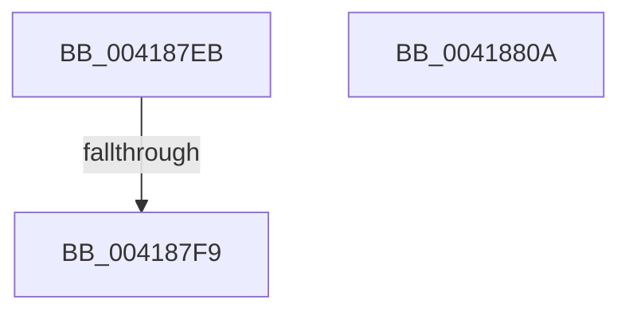

# sub_004187EB

- RVA: `0x004187EB`–`0x0041881C` (길이 `49` bytes)
- VA: `0x00000001404187EB`
- 실행 섹션: `.text`
- PDB 이름 있음: `아니요`; PDB Function 태그: `아니요`
- unwind 정보 RVA: `0x0009CF6C`
- 디코드: `11`개 명령, `49/49` bytes 표시
- 미해석 바이트: `0` (있으면 어셈블리에 `.byte`로 보존)

> 이 문서는 커널 이미지의 기계어와 PDB 기호를 분석해 생성했습니다. 4번과 5번은 함수 원형과 자료형을 바이너리 사용 방식에서 추정한 C 해석이며 원본 소스 복구 결과는 아닙니다.

## 1. Dependencies

- 직접 호출 지점: **2**; 고유 호출 대상: **2**
- 직접 호출자로 확인된 함수: **0**
- RIP 상대 이미지 참조: **1**

### Outgoing calls
- `0x00418800` → [ExpAcquireSpinLockExclusiveAtDpcLevelInstrumented](../32/ExpAcquireSpinLockExclusiveAtDpcLevelInstrumented_function_00323A70.md) (function, `0x00323A70`)
- `0x00418812` → [KiRaiseIrqlProcessIrqlFlags](../4F/KiRaiseIrqlProcessIrqlFlags_function_004F56FC.md) (function, `0x004F56FC`)

### Direct callers
- 이 함수 시작 RVA로 연결되는 직접 call은 확인되지 않았습니다. 간접 호출은 완전히 역산할 수 없습니다.

### Static image references
- `0x004187EB` → RVA `0x00F0DE58` (`.data`; read)

## 2. Other-region calls and transfers

- 다른 실행 섹션으로 향하는 call: **0**
- call이 아닌 외부 분기/꼬리 이동: **3**
  - `0x004187F3` → [sub_00418706](Unknown_function_00418706.md) (`tail-transfer`)
  - `0x00418805` → [sub_00418763](Unknown_function_00418763.md) (`tail-transfer`)
  - `0x00418817` → [sub_004186BA + 0x3F](Unknown_function_004186BA.md) (`tail-transfer`)

## 3. Assembly (complete function range)

```asm
004187EB  8B 05 67 56 AF 00               mov eax, dword ptr [rip + 0xaf5667]
004187F1  85 C0                           test eax, eax
004187F3  0F 85 0D FF FF FF               jne 0x140418706
004187F9  40 0F B6 D5                     movzx edx, bpl
004187FD  48 8B CB                        mov rcx, rbx
00418800  E8 6B B2 F0 FF                  call 0x140323a70
00418805  E9 59 FF FF FF                  jmp 0x140418763
0041880A  41 0F B6 D6                     movzx edx, r14b
0041880E  40 0F B6 CD                     movzx ecx, bpl
00418812  E8 E5 CE 0D 00                  call 0x1404f56fc
00418817  E9 DD FE FF FF                  jmp 0x1404186f9
```

## 4. C-style interpretation (structured pseudocode)

```c
__int64 __fastcall sub_004187EB(void)
{
    __int64 result;

    result = ExpAcquireSpinLockExclusiveAtDpcLevelInstrumented(v_rbx, (unsigned __int8)(v_rbp), a3, a4);
}
```

## 5. (Beta) C Style

```c
void sub_004187EB(void)
{
    int64_t result;

    result = ExpAcquireSpinLockExclusiveAtDpcLevelInstrumented(local_rbx, (uint8_t)(local_rbp), a3, a4);
}
```

## 6. Execution-region graph

[열기: 2D/3D 그래프와 함수 탐색 컨트롤 패널](../../../control-panel.html?section=text&rva=0x004187EB&view=graph)

- 2D 그래프는 위에서 아래로 흐르고, 3D 그래프는 빈 공간을 드래그해 회전합니다. Shift+드래그는 이동, 휠은 확대·축소, 함수 노드 선택은 대상 보고서 이동입니다.

### Static fallback


