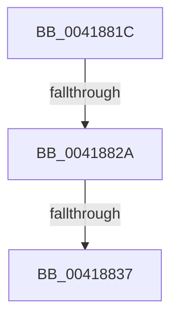

# sub_0041881C

- RVA: `0x0041881C`–`0x00418843` (길이 `39` bytes)
- VA: `0x000000014041881C`
- 실행 섹션: `.text`
- PDB 이름 있음: `아니요`; PDB Function 태그: `아니요`
- unwind 정보 RVA: `0x0009CF84`
- 디코드: `9`개 명령, `39/39` bytes 표시
- 미해석 바이트: `0` (있으면 어셈블리에 `.byte`로 보존)

> 이 문서는 커널 이미지의 기계어와 PDB 기호를 분석해 생성했습니다. 4번과 5번은 함수 원형과 자료형을 바이너리 사용 방식에서 추정한 C 해석이며 원본 소스 복구 결과는 아닙니다.

## 1. Dependencies

- 직접 호출 지점: **2**; 고유 호출 대상: **2**
- 직접 호출자로 확인된 함수: **0**
- RIP 상대 이미지 참조: **1**

### Outgoing calls
- `0x0041882A` → [KiCheckVpBackingLongSpinWaitHypercall](../30/KiCheckVpBackingLongSpinWaitHypercall_function_0030F490.md) (function, `0x0030F490`)
- `0x00418839` → [HvlNotifyLongSpinWait](../30/HvlNotifyLongSpinWait_function_0030F460.md) (function, `0x0030F460`)

### Direct callers
- 이 함수 시작 RVA로 연결되는 직접 call은 확인되지 않았습니다. 간접 호출은 완전히 역산할 수 없습니다.

### Static image references
- `0x0041881C` → RVA `0x00FC6AB8` (`ALMOSTRO`; read)

## 2. Other-region calls and transfers

- 다른 실행 섹션으로 향하는 call: **0**
- call이 아닌 외부 분기/꼬리 이동: **3**
  - `0x00418824` → [sub_00418706 + 0x47](Unknown_function_00418706.md) (`tail-transfer`)
  - `0x00418831` → [sub_00418706 + 0x47](Unknown_function_00418706.md) (`tail-transfer`)
  - `0x0041883E` → [sub_00418706 + 0x49](Unknown_function_00418706.md) (`tail-transfer`)

## 3. Assembly (complete function range)

```asm
0041881C  8B 05 96 E2 BA 00               mov eax, dword ptr [rip + 0xbae296]
00418822  A8 40                           test al, 0x40
00418824  0F 84 23 FF FF FF               je 0x14041874d
0041882A  E8 61 6C EF FF                  call 0x14030f490
0041882F  84 C0                           test al, al
00418831  0F 84 16 FF FF FF               je 0x14041874d
00418837  8B CE                           mov ecx, esi
00418839  E8 22 6C EF FF                  call 0x14030f460
0041883E  E9 0C FF FF FF                  jmp 0x14041874f
```

## 4. C-style interpretation (structured pseudocode)

```c
__int64 __fastcall sub_0041881C(void)
{
    __int64 result;

    result = KiCheckVpBackingLongSpinWaitHypercall(a1, a2, a3, a4);
    result = HvlNotifyLongSpinWait((unsigned int)((unsigned int)(v_rsi)), a2, a3, a4);
}
```

## 5. (Beta) C Style

```c
void sub_0041881C(void)
{
    int64_t result;

    result = KiCheckVpBackingLongSpinWaitHypercall(a1, a2, a3, a4);
    result = HvlNotifyLongSpinWait((uint32_t)((uint32_t)(local_rsi)), a2, a3, a4);
}
```

## 6. Execution-region graph

[열기: 2D/3D 그래프와 함수 탐색 컨트롤 패널](../../../control-panel.html?section=text&rva=0x0041881C&view=graph)

- 2D 그래프는 위에서 아래로 흐르고, 3D 그래프는 빈 공간을 드래그해 회전합니다. Shift+드래그는 이동, 휠은 확대·축소, 함수 노드 선택은 대상 보고서 이동입니다.

### Static fallback


