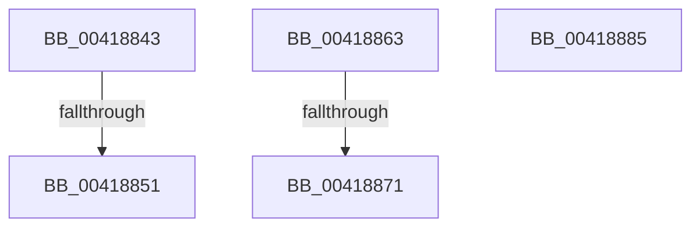

# sub_00418843

- RVA: `0x00418843`–`0x00418886` (길이 `67` bytes)
- VA: `0x0000000140418843`
- 실행 섹션: `.text`
- PDB 이름 있음: `아니요`; PDB Function 태그: `아니요`
- unwind 정보 RVA: `0x0009CFA0`
- 디코드: `18`개 명령, `67/67` bytes 표시
- 미해석 바이트: `0` (있으면 어셈블리에 `.byte`로 보존)

> 이 문서는 커널 이미지의 기계어와 PDB 기호를 분석해 생성했습니다. 4번과 5번은 함수 원형과 자료형을 바이너리 사용 방식에서 추정한 C 해석이며 원본 소스 복구 결과는 아닙니다.

## 1. Dependencies

- 직접 호출 지점: **2**; 고유 호출 대상: **1**
- 직접 호출자로 확인된 함수: **0**
- RIP 상대 이미지 참조: **1**

### Outgoing calls
- `0x00418859` → [ExpReleaseSpinLockExclusiveFromDpcLevelInstrumented](../2C/ExpReleaseSpinLockExclusiveFromDpcLevelInstrumented_function_002C0F44.md) (function, `0x002C0F44`)
- `0x00418879` → [ExpReleaseSpinLockExclusiveFromDpcLevelInstrumented](../2C/ExpReleaseSpinLockExclusiveFromDpcLevelInstrumented_function_002C0F44.md) (function, `0x002C0F44`)

### Direct callers
- 이 함수 시작 RVA로 연결되는 직접 call은 확인되지 않았습니다. 간접 호출은 완전히 역산할 수 없습니다.

### Static image references
- `0x00418843` → RVA `0x00F0DE58` (`.data`; read)

## 2. Other-region calls and transfers

- 다른 실행 섹션으로 향하는 call: **0**
- call이 아닌 외부 분기/꼬리 이동: **3**
  - `0x0041884B` → [sub_00418797 + 0xD](Unknown_function_00418797.md) (`tail-transfer`)
  - `0x0041885E` → [sub_00418797 + 0x13](Unknown_function_00418797.md) (`tail-transfer`)
  - `0x0041886B` → [sub_00418797 + 0x46](Unknown_function_00418797.md) (`tail-transfer`)

## 3. Assembly (complete function range)

```asm
00418843  8B 05 0F 56 AF 00               mov eax, dword ptr [rip + 0xaf560f]
00418849  85 C0                           test eax, eax
0041884B  0F 85 53 FF FF FF               jne 0x1404187a4
00418851  48 8B 54 24 68                  mov rdx, qword ptr [rsp + 0x68]
00418856  48 8B CB                        mov rcx, rbx
00418859  E8 E6 86 EA FF                  call 0x1402c0f44
0041885E  E9 47 FF FF FF                  jmp 0x1404187aa
00418863  8B 05 EF 55 AF 00               mov eax, dword ptr [rip + 0xaf55ef]
00418869  85 C0                           test eax, eax
0041886B  0F 85 6C FF FF FF               jne 0x1404187dd
00418871  48 8B 54 24 68                  mov rdx, qword ptr [rsp + 0x68]
00418876  48 8B CB                        mov rcx, rbx
00418879  E8 C6 86 EA FF                  call 0x1402c0f44
0041887E  48 83 C4 58                     add rsp, 0x58
00418882  5D                              pop rbp
00418883  5B                              pop rbx
00418884  C3                              ret
00418885  CC                              int3
```

## 4. C-style interpretation (structured pseudocode)

```c
__int64 __fastcall sub_00418843(__int64 a1, __int64 a2, __int64 a3, __int64 a4, __int64 a5, __int64 a6, __int64 a7, __int64 a8, __int64 a9, __int64 a10, __int64 a11, __int64 a12, __int64 a13)
{
    __int64 result;
    unsigned __int64 v_stack_p68;

    result = ExpReleaseSpinLockExclusiveFromDpcLevelInstrumented(v_rbx, a13, a3, a4);
}
```

## 5. (Beta) C Style

```c
int64_t sub_00418843(int64_t Arg1, int64_t Arg2, int64_t Arg3, int64_t Arg4, uint64_t Arg5, uint64_t Arg6, uint64_t Arg7, uint64_t Arg8, uint64_t Arg9, uint64_t Arg10, uint64_t Arg11, uint64_t Arg12, int64_t Arg13)
{
    int64_t result;
    uint64_t v_stack_p68;

    result = ExpReleaseSpinLockExclusiveFromDpcLevelInstrumented(local_rbx, Arg13, Arg3, Arg4);
}
```

## 6. Execution-region graph

[열기: 2D/3D 그래프와 함수 탐색 컨트롤 패널](../../../control-panel.html?section=text&rva=0x00418843&view=graph)

- 2D 그래프는 위에서 아래로 흐르고, 3D 그래프는 빈 공간을 드래그해 회전합니다. Shift+드래그는 이동, 휠은 확대·축소, 함수 노드 선택은 대상 보고서 이동입니다.

### Static fallback


