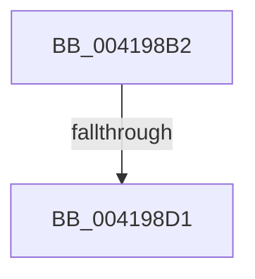

# sub_004198B2

- RVA: `0x004198B2`–`0x004198DE` (길이 `44` bytes)
- VA: `0x00000001404198B2`
- 실행 섹션: `.text`
- PDB 이름 있음: `아니요`; PDB Function 태그: `아니요`
- unwind 정보 RVA: `0x0009D164`
- 디코드: `13`개 명령, `44/44` bytes 표시
- 미해석 바이트: `0` (있으면 어셈블리에 `.byte`로 보존)

> 이 문서는 커널 이미지의 기계어와 PDB 기호를 분석해 생성했습니다. 4번과 5번은 함수 원형과 자료형을 바이너리 사용 방식에서 추정한 C 해석이며 원본 소스 복구 결과는 아닙니다.

## 1. Dependencies

- 직접 호출 지점: **1**; 고유 호출 대상: **1**
- 직접 호출자로 확인된 함수: **0**
- RIP 상대 이미지 참조: **0**

### Outgoing calls
- `0x004198BE` → [ObpTraceObjectReferenceIfActive](../21/ObpTraceObjectReferenceIfActive_function_00210780.md) (function, `0x00210780`)

### Direct callers
- 이 함수 시작 RVA로 연결되는 직접 call은 확인되지 않았습니다. 간접 호출은 완전히 역산할 수 없습니다.

### Static image references
- 디코드된 RIP-relative 메모리 참조가 없습니다.

## 2. Other-region calls and transfers

- 다른 실행 섹션으로 향하는 call: **0**
- call이 아닌 외부 분기/꼬리 이동: **1**
  - `0x004198CF` → [sub_004198DF](Unknown_function_004198DF.md) (`tail-transfer`)

## 3. Assembly (complete function range)

```asm
004198B2  48 89 7C 24 40                  mov qword ptr [rsp + 0x40], rdi
004198B7  BF 01 00 00 00                  mov edi, 1
004198BC  8B D7                           mov edx, edi
004198BE  E8 BD 6E DF FF                  call 0x140210780
004198C3  F0 48 0F C1 3B                  lock xadd qword ptr [rbx], rdi
004198C8  48 FF C7                        inc rdi
004198CB  48 83 FF 01                     cmp rdi, 1
004198CF  7E 0E                           jle 0x1404198df
004198D1  48 8B 7C 24 40                  mov rdi, qword ptr [rsp + 0x40]
004198D6  33 C0                           xor eax, eax
004198D8  48 83 C4 30                     add rsp, 0x30
004198DC  5B                              pop rbx
004198DD  C3                              ret
```

## 4. C-style interpretation (structured pseudocode)

```c
__int64 __fastcall sub_004198B2(__int64 a1, __int64 a2, __int64 a3, __int64 a4, __int64 a5, __int64 a6, __int64 a7, __int64 a8)
{
    __int64 result;
    __int64 v_rdi;
    __int64 v_rsp;
    unsigned __int64 v_stack_p40;

    v_stack_p40 = v_rdi;
    result = ObpTraceObjectReferenceIfActive(a1, 1, a3, a4);
    v_rdi = (1) + 1;
    result = 0;
    v_rsp = (v_rsp) + (48);
    return result;
}
```

## 5. (Beta) C Style

```c
int64_t sub_004198B2(int64_t Arg1, int64_t Arg2, int64_t Arg3, int64_t Arg4, uint64_t Arg5, uint64_t Arg6, uint64_t Arg7, int64_t Arg8)
{
    int64_t result;
    int64_t local_rdi;
    int64_t local_rsp;
    uint64_t v_stack_p40;

    v_stack_p40 = local_rdi;
    result = ObpTraceObjectReferenceIfActive(Arg1, 1, Arg3, Arg4);
    local_rdi = (1) + 1;
    result = 0;
    local_rsp = (local_rsp) + (48);
    return result;
}
```

## 6. Execution-region graph

[열기: 2D/3D 그래프와 함수 탐색 컨트롤 패널](../../../control-panel.html?section=text&rva=0x004198B2&view=graph)

- 2D 그래프는 위에서 아래로 흐르고, 3D 그래프는 빈 공간을 드래그해 회전합니다. Shift+드래그는 이동, 휠은 확대·축소, 함수 노드 선택은 대상 보고서 이동입니다.

### Static fallback


