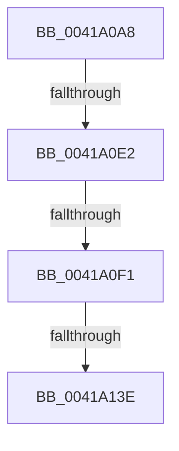

# sub_0041A0A8

- RVA: `0x0041A0A8`–`0x0041A155` (길이 `173` bytes)
- VA: `0x000000014041A0A8`
- 실행 섹션: `.text`
- PDB 이름 있음: `아니요`; PDB Function 태그: `아니요`
- unwind 정보 RVA: `0x0009D348`
- 디코드: `36`개 명령, `173/173` bytes 표시
- 미해석 바이트: `0` (있으면 어셈블리에 `.byte`로 보존)

> 이 문서는 커널 이미지의 기계어와 PDB 기호를 분석해 생성했습니다. 4번과 5번은 함수 원형과 자료형을 바이너리 사용 방식에서 추정한 C 해석이며 원본 소스 복구 결과는 아닙니다.

## 1. Dependencies

- 직접 호출 지점: **0**; 고유 호출 대상: **0**
- 직접 호출자로 확인된 함수: **0**
- RIP 상대 이미지 참조: **0**

### Outgoing calls
- 직접 디코드된 call 명령이 없습니다.

### Direct callers
- 이 함수 시작 RVA로 연결되는 직접 call은 확인되지 않았습니다. 간접 호출은 완전히 역산할 수 없습니다.

### Static image references
- 디코드된 RIP-relative 메모리 참조가 없습니다.

## 2. Other-region calls and transfers

- 다른 실행 섹션으로 향하는 call: **0**
- call이 아닌 외부 분기/꼬리 이동: **4**
  - `0x0041A0DC` → [sub_0041A7B1 + 0x25](Unknown_function_0041A7B1.md) (`tail-transfer`)
  - `0x0041A0EB` → [sub_0041A7B1 + 0x25](Unknown_function_0041A7B1.md) (`tail-transfer`)
  - `0x0041A138` → [sub_0041A1D1](Unknown_function_0041A1D1.md) (`tail-transfer`)
  - `0x0041A153` → [sub_0041A155 + 0x2C](Unknown_function_0041A155.md) (`tail-transfer`)

## 3. Assembly (complete function range)

```asm
0041A0A8  48 89 BC 24 C8 00 00 00         mov qword ptr [rsp + 0xc8], rdi
0041A0B0  4D 8D 48 DA                     lea r9, [r8 - 0x26]
0041A0B4  48 8B BC 24 E0 00 00 00         mov rdi, qword ptr [rsp + 0xe0]
0041A0BC  4C 89 64 24 78                  mov qword ptr [rsp + 0x78], r12
0041A0C1  4C 89 6C 24 70                  mov qword ptr [rsp + 0x70], r13
0041A0C6  4D 8D 6B D7                     lea r13, [r11 - 0x29]
0041A0CA  4C 89 6C 24 20                  mov qword ptr [rsp + 0x20], r13
0041A0CF  4C 89 4C 24 28                  mov qword ptr [rsp + 0x28], r9
0041A0D4  48 89 44 24 30                  mov qword ptr [rsp + 0x30], rax
0041A0D9  48 85 FF                        test rdi, rdi
0041A0DC  0F 84 F4 06 00 00               je 0x14041a7d6
0041A0E2  8B 8C 24 F0 00 00 00            mov ecx, dword ptr [rsp + 0xf0]
0041A0E9  3B CA                           cmp ecx, edx
0041A0EB  0F 87 E5 06 00 00               ja 0x14041a7d6
0041A0F1  48 8B 84 24 E8 00 00 00         mov rax, qword ptr [rsp + 0xe8]
0041A0F9  49 8D 77 05                     lea rsi, [r15 + 5]
0041A0FD  44 8B E1                        mov r12d, ecx
0041A100  49 8D 5A 01                     lea rbx, [r10 + 1]
0041A104  4D 03 E2                        add r12, r10
0041A107  48 89 44 24 58                  mov qword ptr [rsp + 0x58], rax
0041A10C  41 0F B6 02                     movzx eax, byte ptr [r10]
0041A110  4D 3B CC                        cmp r9, r12
0041A113  48 89 7C 24 50                  mov qword ptr [rsp + 0x50], rdi
0041A118  41 BE 02 00 00 00               mov r14d, 2
0041A11E  4D 0F 42 E1                     cmovb r12, r9
0041A122  89 4C 24 60                     mov dword ptr [rsp + 0x60], ecx
0041A126  4C 89 A4 24 B0 00 00 00         mov qword ptr [rsp + 0xb0], r12
0041A12E  49 8B EF                        mov rbp, r15
0041A131  41 88 47 04                     mov byte ptr [r15 + 4], al
0041A135  83 FA 40                        cmp edx, 0x40
0041A138  0F 83 93 00 00 00               jae 0x14041a1d1
0041A13E  4C 8B 6C 24 70                  mov r13, qword ptr [rsp + 0x70]
0041A143  4C 8B 64 24 78                  mov r12, qword ptr [rsp + 0x78]
0041A148  48 8B BC 24 C8 00 00 00         mov rdi, qword ptr [rsp + 0xc8]
0041A150  49 3B D8                        cmp rbx, r8
0041A153  73 2C                           jae 0x14041a181
```

## 4. C-style interpretation (structured pseudocode)

```c
__int64 __fastcall sub_0041A0A8(__int64 a1, int a2, __int64 a3, __int64 a4, __int64 a5, __int64 a6, __int64 a7, __int64 a8, __int64 a9, __int64 a10, __int64 a11, __int64 a12, __int64 a13, __int64 a14, __int64 a15, __int64 a16, __int64 a17, __int64 a18, __int64 a19, __int64 a20, __int64 a21, __int64 a22, __int64 a23, __int64 a24, __int64 a25, __int64 a26, __int64 a27, __int64 a28, __int64 a29, unsigned int a30)
{
    __int64 v_r12;
    unsigned __int64 v_stack_p20;
    unsigned __int64 v_stack_p28;
    unsigned __int64 v_stack_p30;
    unsigned __int64 v_stack_p50;
    unsigned __int64 v_stack_p58;
    unsigned int v_stack_p60;
    unsigned __int64 v_stack_p70;
    unsigned __int64 v_stack_p78;
    unsigned __int64 v_stack_pB0;
    unsigned __int64 v_stack_pC8;

    v_stack_pC8 = v_rdi;
    v_stack_p78 = v_r12;
    v_stack_p70 = v_r13;
    v_stack_p20 = v_r11 - 41;
    v_stack_p28 = a3 - 38;
    v_stack_p30 = result;
    v_r12 = ((unsigned int)((unsigned int)((unsigned int)(a30)))) + (v_r10);
    v_stack_p58 = a29;
    v_stack_p50 = a28;
    if ((a3 - 38) < v_r12) { v_r12 = a3 - 38; }
    v_stack_p60 = (unsigned int)((unsigned int)(a30));
    v_stack_pB0 = v_r12;
    *(unsigned __int8 *)(v_r15 + 4) = (unsigned __int8)(*(unsigned __int8 *)(v_r10));
}
```

## 5. (Beta) C Style

```c
int64_t sub_0041A0A8(int64_t Arg1, int32_t Arg2, void *Arg3, int64_t Arg4, uint64_t Arg5, uint64_t Arg6, uint64_t Arg7, uint64_t Arg8, uint64_t Arg9, uint64_t Arg10, uint64_t Arg11, uint64_t Arg12, uint64_t Arg13, int64_t Arg14, int64_t Arg15, uint64_t Arg16, uint64_t Arg17, uint64_t Arg18, uint64_t Arg19, uint64_t Arg20, uint64_t Arg21, uint64_t Arg22, uint64_t Arg23, uint64_t Arg24, int64_t Arg25, uint64_t Arg26, uint64_t Arg27, int64_t Arg28, int64_t Arg29, uint32_t Arg30)
{
    uint8_t *arg3 = (uint8_t *)Arg3;

    int64_t local_r12;
    uint64_t v_stack_p20;
    uint64_t v_stack_p28;
    uint64_t v_stack_p30;
    uint64_t v_stack_p50;
    uint64_t v_stack_p58;
    uint32_t v_stack_p60;
    uint64_t v_stack_p70;
    uint64_t v_stack_p78;
    uint64_t v_stack_pB0;
    uint64_t v_stack_pC8;

    v_stack_pC8 = local_rdi;
    v_stack_p78 = local_r12;
    v_stack_p70 = local_r13;
    v_stack_p20 = local_r11 - 41;
    v_stack_p28 = Arg3 - 38;
    v_stack_p30 = result;
    local_r12 = ((uint32_t)((uint32_t)((uint32_t)(Arg30)))) + (local_r10);
    v_stack_p58 = Arg29;
    v_stack_p50 = Arg28;
    if ((Arg3 - 38) < local_r12) { local_r12 = Arg3 - 38; }
    v_stack_p60 = (uint32_t)((uint32_t)(Arg30));
    v_stack_pB0 = local_r12;
    *(uint8_t *)(local_r15 + 0x4) = (uint8_t)(*(uint8_t *)(local_r10));
}
```

### 관측된 메모리 오프셋

구조체 형식이 확인되지 않은 접근은 인자 기준의 오프셋으로만 기록했습니다.

| 기준 인자 | 오프셋 표현 | 폭 (bit) | 접근 |
|---|---:|---:|---|
| `Arg3` | `- 0x26` | `64` | `R` |

## 6. Execution-region graph

[열기: 2D/3D 그래프와 함수 탐색 컨트롤 패널](../../../control-panel.html?section=text&rva=0x0041A0A8&view=graph)

- 2D 그래프는 위에서 아래로 흐르고, 3D 그래프는 빈 공간을 드래그해 회전합니다. Shift+드래그는 이동, 휠은 확대·축소, 함수 노드 선택은 대상 보고서 이동입니다.

### Static fallback


