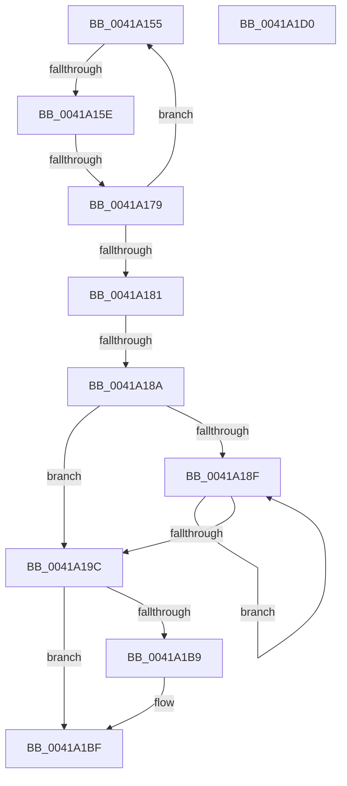

# sub_0041A155

- RVA: `0x0041A155`–`0x0041A1D1` (길이 `124` bytes)
- VA: `0x000000014041A155`
- 실행 섹션: `.text`
- PDB 이름 있음: `아니요`; PDB Function 태그: `아니요`
- unwind 정보 RVA: `0x0009D364`
- 디코드: `37`개 명령, `124/124` bytes 표시
- 미해석 바이트: `0` (있으면 어셈블리에 `.byte`로 보존)

> 이 문서는 커널 이미지의 기계어와 PDB 기호를 분석해 생성했습니다. 4번과 5번은 함수 원형과 자료형을 바이너리 사용 방식에서 추정한 C 해석이며 원본 소스 복구 결과는 아닙니다.

## 1. Dependencies

- 직접 호출 지점: **0**; 고유 호출 대상: **0**
- 직접 호출자로 확인된 함수: **0**
- RIP 상대 이미지 참조: **0**

### Outgoing calls
- 직접 디코드된 call 명령이 없습니다.

### Direct callers
- 이 함수 시작 RVA로 연결되는 직접 call은 확인되지 않았습니다. 간접 호출은 완전히 역산할 수 없습니다.

### Static image references
- 디코드된 RIP-relative 메모리 참조가 없습니다.

## 2. Other-region calls and transfers

- 다른 실행 섹션으로 향하는 call: **0**
- call이 아닌 외부 분기/꼬리 이동: **3**
  - `0x0041A158` → [sub_0041A754](Unknown_function_0041A754.md) (`tail-transfer`)
  - `0x0041A173` → [sub_0041A79C](Unknown_function_0041A79C.md) (`tail-transfer`)
  - `0x0041A184` → [sub_0041A754](Unknown_function_0041A754.md) (`tail-transfer`)

## 3. Assembly (complete function range)

```asm
0041A155  49 3B F3                        cmp rsi, r11
0041A158  0F 83 F6 05 00 00               jae 0x14041a754
0041A15E  0F B6 03                        movzx eax, byte ptr [rbx]
0041A161  48 FF C3                        inc rbx
0041A164  88 06                           mov byte ptr [rsi], al
0041A166  48 FF C6                        inc rsi
0041A169  43 8D 04 36                     lea eax, [r14 + r14]
0041A16D  48 8B CE                        mov rcx, rsi
0041A170  45 85 F6                        test r14d, r14d
0041A173  0F 8E 23 06 00 00               jle 0x14041a79c
0041A179  44 8B F0                        mov r14d, eax
0041A17C  49 3B D8                        cmp rbx, r8
0041A17F  72 D4                           jb 0x14041a155
0041A181  49 3B F3                        cmp rsi, r11
0041A184  0F 83 CA 05 00 00               jae 0x14041a754
0041A18A  45 85 F6                        test r14d, r14d
0041A18D  7E 0D                           jle 0x14041a19c
0041A18F  46 8D 34 75 01 00 00 00         lea r14d, [r14*2 + 1]
0041A197  45 85 F6                        test r14d, r14d
0041A19A  7F F3                           jg 0x14041a18f
0041A19C  42 8D 04 75 01 00 00 00         lea eax, [r14*2 + 1]
0041A1A4  41 2B F7                        sub esi, r15d
0041A1A7  89 45 00                        mov dword ptr [rbp], eax
0041A1AA  48 8B 84 24 D0 00 00 00         mov rax, qword ptr [rsp + 0xd0]
0041A1B2  89 30                           mov dword ptr [rax], esi
0041A1B4  83 FE 08                        cmp esi, 8
0041A1B7  73 06                           jae 0x14041a1bf
0041A1B9  C7 00 08 00 00 00               mov dword ptr [rax], 8
0041A1BF  33 C0                           xor eax, eax
0041A1C1  48 81 C4 80 00 00 00            add rsp, 0x80
0041A1C8  41 5F                           pop r15
0041A1CA  41 5E                           pop r14
0041A1CC  5E                              pop rsi
0041A1CD  5D                              pop rbp
0041A1CE  5B                              pop rbx
0041A1CF  C3                              ret
0041A1D0  CC                              int3
```

## 4. C-style interpretation (structured pseudocode)

```c
__int64 __fastcall sub_0041A155(__int64 a1, __int64 a2, __int64 a3, __int64 a4, __int64 a5, __int64 a6, __int64 a7, __int64 a8, __int64 a9, __int64 a10, __int64 a11, __int64 a12, __int64 a13, __int64 a14, __int64 a15, __int64 a16, __int64 a17, __int64 a18, __int64 a19, __int64 a20, __int64 a21, __int64 a22, __int64 a23, __int64 a24, __int64 a25, __int64 a26)
{
    __int64 result;
    __int64 v_rbx;
    __int64 v_rsi;
    __int64 v_rsp;

    v_rbx = (v_rbx) + 1;
    *(unsigned __int8 *)(v_rsi) = (unsigned __int8)(*(unsigned __int8 *)(v_rbx));
    v_rsi = (v_rsi) + 1;
    if (v_rbx < a3) goto loc_0041A155;
    if (condition_is_less_or_equal) goto loc_0041A19C;
loc_0041A18F:
    if (condition_is_greater) goto loc_0041A18F;
loc_0041A19C:
    v_rsi = (unsigned int)((v_rsi) - ((unsigned int)(v_r15)));
    *(unsigned int *)(v_rbp) = (unsigned int)((unsigned int)((unsigned int)(v_r14 + v_r14 * 1)) * 2 + 1 * 2 + 1);
    *(unsigned int *)(a26) = (unsigned int)(v_rsi);
    if (((unsigned int)(v_rsi)) < 8) {
        *(unsigned int *)(a26) = 8;
    }
    result = 0;
    v_rsp = (v_rsp) + (128);
    return result;
}
```

## 5. (Beta) C Style

```c
int64_t sub_0041A155(int64_t Arg1, int64_t Arg2, int64_t Arg3, int64_t Arg4, uint64_t Arg5, uint64_t Arg6, uint64_t Arg7, uint64_t Arg8, uint64_t Arg9, uint64_t Arg10, uint64_t Arg11, uint64_t Arg12, uint64_t Arg13, uint64_t Arg14, uint64_t Arg15, uint64_t Arg16, uint64_t Arg17, uint64_t Arg18, uint64_t Arg19, uint64_t Arg20, uint64_t Arg21, uint64_t Arg22, uint64_t Arg23, uint64_t Arg24, uint64_t Arg25, void *Arg26)
{
    uint8_t *arg26 = (uint8_t *)Arg26;

    int64_t result;
    int64_t local_rbx;
    int64_t local_rsi;
    int64_t local_rsp;

    local_rbx = (local_rbx) + 1;
    *(uint8_t *)(local_rsi) = (uint8_t)(*(uint8_t *)(local_rbx));
    local_rsi = (local_rsi) + 1;
    if (local_rbx < Arg3) goto loc_0041A155;
    if (condition_is_less_or_equal) goto loc_0041A19C;
loc_0041A18F:
    if (condition_is_greater) goto loc_0041A18F;
loc_0041A19C:
    local_rsi = (uint32_t)((local_rsi) - ((uint32_t)(local_r15)));
    *(uint32_t *)(local_rbp) = (uint32_t)((uint32_t)((uint32_t)(local_r14 + local_r14 * 1)) * 2 + 1 * 2 + 1);
    *(uint32_t *)(arg26) = (uint32_t)(local_rsi);
    if (((uint32_t)(local_rsi)) < 8) {
        *(uint32_t *)(arg26) = 8;
    }
    result = 0;
    local_rsp = (local_rsp) + (128);
    return result;
}
```

### 관측된 메모리 오프셋

구조체 형식이 확인되지 않은 접근은 인자 기준의 오프셋으로만 기록했습니다.

| 기준 인자 | 오프셋 표현 | 폭 (bit) | 접근 |
|---|---:|---:|---|
| `Arg26` | `+ 0x0` | `32` | `W` |

## 6. Execution-region graph

[열기: 2D/3D 그래프와 함수 탐색 컨트롤 패널](../../../control-panel.html?section=text&rva=0x0041A155&view=graph)

- 2D 그래프는 위에서 아래로 흐르고, 3D 그래프는 빈 공간을 드래그해 회전합니다. Shift+드래그는 이동, 휠은 확대·축소, 함수 노드 선택은 대상 보고서 이동입니다.

### Static fallback


