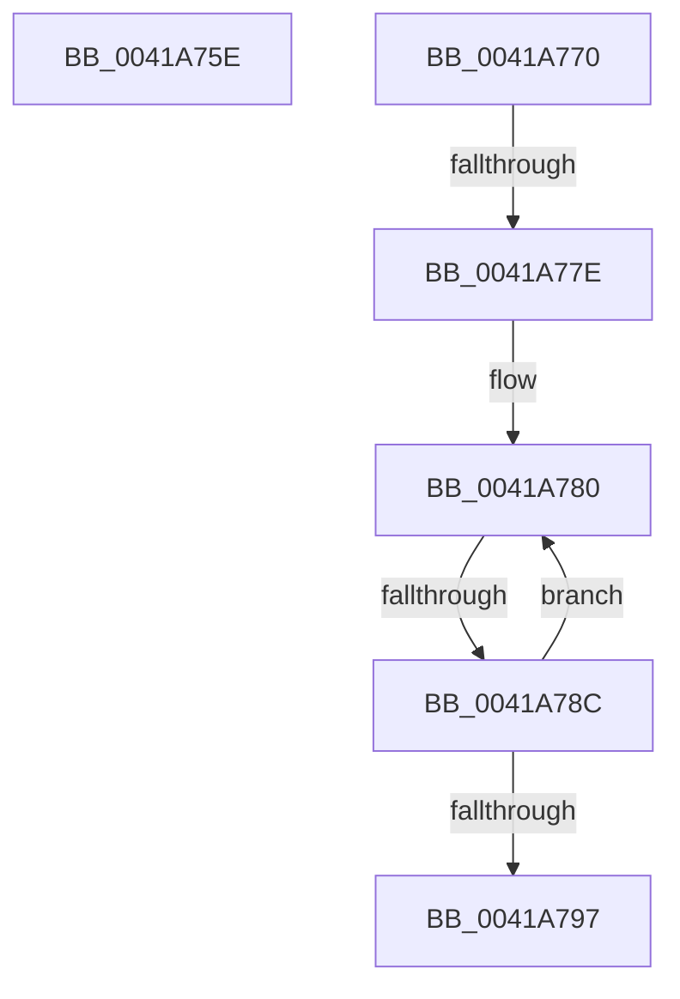

# sub_0041A75E

- RVA: `0x0041A75E`–`0x0041A79C` (길이 `62` bytes)
- VA: `0x000000014041A75E`
- 실행 섹션: `.text`
- PDB 이름 있음: `아니요`; PDB Function 태그: `아니요`
- unwind 정보 RVA: `0x0009D3A4`
- 디코드: `17`개 명령, `62/62` bytes 표시
- 미해석 바이트: `0` (있으면 어셈블리에 `.byte`로 보존)

> 이 문서는 커널 이미지의 기계어와 PDB 기호를 분석해 생성했습니다. 4번과 5번은 함수 원형과 자료형을 바이너리 사용 방식에서 추정한 C 해석이며 원본 소스 복구 결과는 아닙니다.

## 1. Dependencies

- 직접 호출 지점: **0**; 고유 호출 대상: **0**
- 직접 호출자로 확인된 함수: **0**
- RIP 상대 이미지 참조: **0**

### Outgoing calls
- 직접 디코드된 call 명령이 없습니다.

### Direct callers
- 이 함수 시작 RVA로 연결되는 직접 call은 확인되지 않았습니다. 간접 호출은 완전히 역산할 수 없습니다.

### Static image references
- 디코드된 RIP-relative 메모리 참조가 없습니다.

## 2. Other-region calls and transfers

- 다른 실행 섹션으로 향하는 call: **0**
- call이 아닌 외부 분기/꼬리 이동: **4**
  - `0x0041A76B` → [sub_0041A1D1 + 0x268](Unknown_function_0041A1D1.md) (`tail-transfer`)
  - `0x0041A778` → [sub_0041A1D1 + 0x22C](Unknown_function_0041A1D1.md) (`tail-transfer`)
  - `0x0041A786` → [sub_0041A1D1 + 0x22C](Unknown_function_0041A1D1.md) (`tail-transfer`)
  - `0x0041A797` → [sub_0041A1D1 + 0x22C](Unknown_function_0041A1D1.md) (`tail-transfer`)

## 3. Assembly (complete function range)

```asm
0041A75E  33 C9                           xor ecx, ecx
0041A760  66 89 4E 01                     mov word ptr [rsi + 1], cx
0041A764  89 56 03                        mov dword ptr [rsi + 3], edx
0041A767  48 83 C6 07                     add rsi, 7
0041A76B  E9 C9 FC FF FF                  jmp 0x14041a439
0041A770  48 8B 4C 24 40                  mov rcx, qword ptr [rsp + 0x40]
0041A775  48 3B D9                        cmp rbx, rcx
0041A778  0F 83 7F FC FF FF               jae 0x14041a3fd
0041A77E  66 90                           nop
0041A780  41 0F B6 00                     movzx eax, byte ptr [r8]
0041A784  38 03                           cmp byte ptr [rbx], al
0041A786  0F 85 71 FC FF FF               jne 0x14041a3fd
0041A78C  48 FF C3                        inc rbx
0041A78F  49 FF C0                        inc r8
0041A792  48 3B D9                        cmp rbx, rcx
0041A795  72 E9                           jb 0x14041a780
0041A797  E9 61 FC FF FF                  jmp 0x14041a3fd
```

## 4. C-style interpretation (structured pseudocode)

```c
__int64 __fastcall sub_0041A75E(int a1, int a2, __int64 a3)
{
    __int64 v_rsi;
    unsigned __int64 v_stack_p40;

    a1 = 0;
    *(unsigned __int16 *)(v_rsi + 1) = 0;
    *(unsigned int *)(v_rsi + 3) = a2;
    v_rsi = (v_rsi) + (7);
}
```

## 5. (Beta) C Style

```c
int64_t sub_0041A75E(int32_t Arg1, int32_t Arg2, int64_t Arg3)
{
    int64_t local_rsi;
    uint64_t v_stack_p40;

    Arg1 = 0;
    *(uint16_t *)(local_rsi + 0x1) = 0;
    *(uint32_t *)(local_rsi + 0x3) = Arg2;
    local_rsi = (local_rsi) + (7);
}
```

## 6. Execution-region graph

[열기: 2D/3D 그래프와 함수 탐색 컨트롤 패널](../../../control-panel.html?section=text&rva=0x0041A75E&view=graph)

- 2D 그래프는 위에서 아래로 흐르고, 3D 그래프는 빈 공간을 드래그해 회전합니다. Shift+드래그는 이동, 휠은 확대·축소, 함수 노드 선택은 대상 보고서 이동입니다.

### Static fallback


