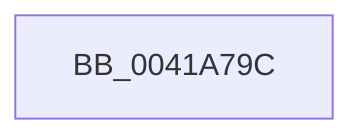

# sub_0041A79C

- RVA: `0x0041A79C`–`0x0041A7B1` (길이 `21` bytes)
- VA: `0x000000014041A79C`
- 실행 섹션: `.text`
- PDB 이름 있음: `아니요`; PDB Function 태그: `아니요`
- unwind 정보 RVA: `0x0009D3C0`
- 디코드: `5`개 명령, `21/21` bytes 표시
- 미해석 바이트: `0` (있으면 어셈블리에 `.byte`로 보존)

> 이 문서는 커널 이미지의 기계어와 PDB 기호를 분석해 생성했습니다. 4번과 5번은 함수 원형과 자료형을 바이너리 사용 방식에서 추정한 C 해석이며 원본 소스 복구 결과는 아닙니다.

## 1. Dependencies

- 직접 호출 지점: **0**; 고유 호출 대상: **0**
- 직접 호출자로 확인된 함수: **0**
- RIP 상대 이미지 참조: **0**

### Outgoing calls
- 직접 디코드된 call 명령이 없습니다.

### Direct callers
- 이 함수 시작 RVA로 연결되는 직접 call은 확인되지 않았습니다. 간접 호출은 완전히 역산할 수 없습니다.

### Static image references
- 디코드된 RIP-relative 메모리 참조가 없습니다.

## 2. Other-region calls and transfers

- 다른 실행 섹션으로 향하는 call: **0**
- call이 아닌 외부 분기/꼬리 이동: **1**
  - `0x0041A7AC` → [sub_0041A155 + 0x27](Unknown_function_0041A155.md) (`tail-transfer`)

## 3. Assembly (complete function range)

```asm
0041A79C  89 45 00                        mov dword ptr [rbp], eax
0041A79F  41 BE 01 00 00 00               mov r14d, 1
0041A7A5  48 8B E9                        mov rbp, rcx
0041A7A8  48 83 C6 04                     add rsi, 4
0041A7AC  E9 CB F9 FF FF                  jmp 0x14041a17c
```

## 4. C-style interpretation (structured pseudocode)

```c
void __fastcall sub_0041A79C(__int64 a1)
{
    __int64 v_rsi;

    *(unsigned int *)(v_rbp) = (unsigned int)(result);
    v_rsi = (v_rsi) + (4);
}
```

## 5. (Beta) C Style

```c
void sub_0041A79C(int64_t Arg1)
{
    int64_t local_rsi;

    *(uint32_t *)(local_rbp) = (uint32_t)(result);
    local_rsi = (local_rsi) + (4);
}
```

## 6. Execution-region graph

[열기: 2D/3D 그래프와 함수 탐색 컨트롤 패널](../../../control-panel.html?section=text&rva=0x0041A79C&view=graph)

- 2D 그래프는 위에서 아래로 흐르고, 3D 그래프는 빈 공간을 드래그해 회전합니다. Shift+드래그는 이동, 휠은 확대·축소, 함수 노드 선택은 대상 보고서 이동입니다.

### Static fallback


