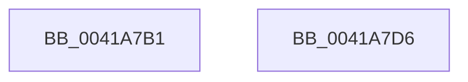

# sub_0041A7B1

- RVA: `0x0041A7B1`–`0x0041A7DD` (길이 `44` bytes)
- VA: `0x000000014041A7B1`
- 실행 섹션: `.text`
- PDB 이름 있음: `아니요`; PDB Function 태그: `아니요`
- unwind 정보 RVA: `0x0009D3D0`
- 디코드: `10`개 명령, `44/44` bytes 표시
- 미해석 바이트: `0` (있으면 어셈블리에 `.byte`로 보존)

> 이 문서는 커널 이미지의 기계어와 PDB 기호를 분석해 생성했습니다. 4번과 5번은 함수 원형과 자료형을 바이너리 사용 방식에서 추정한 C 해석이며 원본 소스 복구 결과는 아닙니다.

## 1. Dependencies

- 직접 호출 지점: **1**; 고유 호출 대상: **1**
- 직접 호출자로 확인된 함수: **0**
- RIP 상대 이미지 참조: **0**

### Outgoing calls
- `0x0041A7BC` → [RtlpMakeXpressCallback](RtlpMakeXpressCallback_function_0041A7F0.md) (function, `0x0041A7F0`)

### Direct callers
- 이 함수 시작 RVA로 연결되는 직접 call은 확인되지 않았습니다. 간접 호출은 완전히 역산할 수 없습니다.

### Static image references
- 디코드된 RIP-relative 메모리 참조가 없습니다.

## 2. Other-region calls and transfers

- 다른 실행 섹션으로 향하는 call: **0**
- call이 아닌 외부 분기/꼬리 이동: **2**
  - `0x0041A7D1` → [sub_0041A1D1 + 0x3F7](Unknown_function_0041A1D1.md) (`tail-transfer`)
  - `0x0041A7D8` → [sub_0041A0A8 + 0x49](Unknown_function_0041A0A8.md) (`tail-transfer`)

## 3. Assembly (complete function range)

```asm
0041A7B1  4C 8B C3                        mov r8, rbx
0041A7B4  48 8D 4C 24 50                  lea rcx, [rsp + 0x50]
0041A7B9  49 8B D1                        mov rdx, r9
0041A7BC  E8 2F 00 00 00                  call 0x14041a7f0
0041A7C1  4C 8B 4C 24 28                  mov r9, qword ptr [rsp + 0x28]
0041A7C6  4C 8B E0                        mov r12, rax
0041A7C9  48 89 84 24 B0 00 00 00         mov qword ptr [rsp + 0xb0], rax
0041A7D1  E9 F2 FD FF FF                  jmp 0x14041a5c8
0041A7D6  8B CA                           mov ecx, edx
0041A7D8  E9 14 F9 FF FF                  jmp 0x14041a0f1
```

## 4. C-style interpretation (structured pseudocode)

```c
__int64 __fastcall sub_0041A7B1(__int64 a1, __int64 a2, __int64 a3, __int64 a4, __int64 a5, __int64 a6, __int64 a7, __int64 a8, __int64 a9, __int64 a10)
{
    __int64 result;
    unsigned __int64 v_stack_pB0;

    result = RtlpMakeXpressCallback(a10, a4, v_rbx, a4);
    v_stack_pB0 = result;
}
```

## 5. (Beta) C Style

```c
int64_t sub_0041A7B1(int64_t Arg1, int64_t Arg2, int64_t Arg3, int64_t Arg4, int64_t Arg5, uint64_t Arg6, uint64_t Arg7, uint64_t Arg8, uint64_t Arg9, int64_t Arg10)
{
    int64_t result;
    uint64_t v_stack_pB0;

    result = RtlpMakeXpressCallback(Arg10, Arg4, local_rbx, Arg4);
    v_stack_pB0 = result;
}
```

## 6. Execution-region graph

[열기: 2D/3D 그래프와 함수 탐색 컨트롤 패널](../../../control-panel.html?section=text&rva=0x0041A7B1&view=graph)

- 2D 그래프는 위에서 아래로 흐르고, 3D 그래프는 빈 공간을 드래그해 회전합니다. Shift+드래그는 이동, 휠은 확대·축소, 함수 노드 선택은 대상 보고서 이동입니다.

### Static fallback


