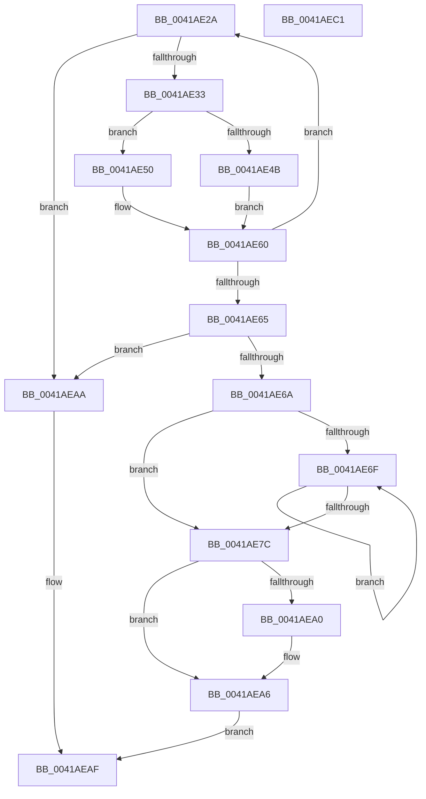

# sub_0041AE2A

- RVA: `0x0041AE2A`–`0x0041AEC2` (길이 `152` bytes)
- VA: `0x000000014041AE2A`
- 실행 섹션: `.text`
- PDB 이름 있음: `아니요`; PDB Function 태그: `아니요`
- unwind 정보 RVA: `0x0009D414`
- 디코드: `46`개 명령, `152/152` bytes 표시
- 미해석 바이트: `0` (있으면 어셈블리에 `.byte`로 보존)

> 이 문서는 커널 이미지의 기계어와 PDB 기호를 분석해 생성했습니다. 4번과 5번은 함수 원형과 자료형을 바이너리 사용 방식에서 추정한 C 해석이며 원본 소스 복구 결과는 아닙니다.

## 1. Dependencies

- 직접 호출 지점: **0**; 고유 호출 대상: **0**
- 직접 호출자로 확인된 함수: **0**
- RIP 상대 이미지 참조: **0**

### Outgoing calls
- 직접 디코드된 call 명령이 없습니다.

### Direct callers
- 이 함수 시작 RVA로 연결되는 직접 call은 확인되지 않았습니다. 간접 호출은 완전히 역산할 수 없습니다.

### Static image references
- 디코드된 RIP-relative 메모리 참조가 없습니다.

## 2. Other-region calls and transfers

- 다른 실행 섹션으로 향하는 call: **0**
- 별도 외부 분기/꼬리 이동을 확인하지 못했습니다.

## 3. Assembly (complete function range)

```asm
0041AE2A  4C 3B FA                        cmp r15, rdx
0041AE2D  0F 83 77 00 00 00               jae 0x14041aeaa
0041AE33  0F B6 03                        movzx eax, byte ptr [rbx]
0041AE36  48 FF C3                        inc rbx
0041AE39  41 88 07                        mov byte ptr [r15], al
0041AE3C  49 FF C7                        inc r15
0041AE3F  43 8D 04 09                     lea eax, [r9 + r9]
0041AE43  49 8B CF                        mov rcx, r15
0041AE46  45 85 C9                        test r9d, r9d
0041AE49  7E 05                           jle 0x14041ae50
0041AE4B  44 8B C8                        mov r9d, eax
0041AE4E  EB 10                           jmp 0x14041ae60
0041AE50  41 89 02                        mov dword ptr [r10], eax
0041AE53  41 B9 01 00 00 00               mov r9d, 1
0041AE59  4C 8B D1                        mov r10, rcx
0041AE5C  49 83 C7 04                     add r15, 4
0041AE60  48 3B DF                        cmp rbx, rdi
0041AE63  72 C5                           jb 0x14041ae2a
0041AE65  4C 3B FA                        cmp r15, rdx
0041AE68  73 40                           jae 0x14041aeaa
0041AE6A  45 85 C9                        test r9d, r9d
0041AE6D  7E 0D                           jle 0x14041ae7c
0041AE6F  46 8D 0C 4D 01 00 00 00         lea r9d, [r9*2 + 1]
0041AE77  45 85 C9                        test r9d, r9d
0041AE7A  7F F3                           jg 0x14041ae6f
0041AE7C  44 2B BC 24 D0 00 00 00         sub r15d, dword ptr [rsp + 0xd0]
0041AE84  42 8D 04 4D 01 00 00 00         lea eax, [r9*2 + 1]
0041AE8C  41 89 02                        mov dword ptr [r10], eax
0041AE8F  48 8B 84 24 E0 00 00 00         mov rax, qword ptr [rsp + 0xe0]
0041AE97  44 89 38                        mov dword ptr [rax], r15d
0041AE9A  41 83 FF 08                     cmp r15d, 8
0041AE9E  73 06                           jae 0x14041aea6
0041AEA0  C7 00 08 00 00 00               mov dword ptr [rax], 8
0041AEA6  33 C0                           xor eax, eax
0041AEA8  EB 05                           jmp 0x14041aeaf
0041AEAA  B8 23 00 00 C0                  mov eax, 0xc0000023
0041AEAF  48 81 C4 80 00 00 00            add rsp, 0x80
0041AEB6  41 5F                           pop r15
0041AEB8  41 5E                           pop r14
0041AEBA  41 5C                           pop r12
0041AEBC  5F                              pop rdi
0041AEBD  5E                              pop rsi
0041AEBE  5D                              pop rbp
0041AEBF  5B                              pop rbx
0041AEC0  C3                              ret
0041AEC1  CC                              int3
```

## 4. C-style interpretation (structured pseudocode)

```c
__int64 __fastcall sub_0041AE2A(__int64 a1, __int64 a2, __int64 a3, __int64 a4, __int64 a5, __int64 a6, __int64 a7, __int64 a8, __int64 a9, __int64 a10, __int64 a11, __int64 a12, __int64 a13, __int64 a14, __int64 a15, __int64 a16, __int64 a17, __int64 a18, __int64 a19, __int64 a20, __int64 a21, __int64 a22, __int64 a23, __int64 a24, __int64 a25, unsigned int a26, __int64 a27, __int64 a28)
{
    __int64 result;
    __int64 v_r15;
    __int64 v_rbx;
    __int64 v_rsp;

    if (v_r15 >= a2) goto loc_0041AEAA;
    v_rbx = (v_rbx) + 1;
    *(unsigned __int8 *)(v_r15) = (unsigned __int8)(*(unsigned __int8 *)(v_rbx));
    v_r15 = (v_r15) + 1;
    if (condition_is_less_or_equal) goto loc_0041AE50;
    goto loc_0041AE60;
loc_0041AE50:
    *(unsigned int *)(v_r10) = (unsigned int)(a4 + a4 * 1);
    v_r15 = (v_r15) + (4);
loc_0041AE60:
    if (v_rbx < v_rdi) goto loc_0041AE2A;
    if (v_r15 >= a2) goto loc_0041AEAA;
    if (condition_is_less_or_equal) goto loc_0041AE7C;
loc_0041AE6F:
    if (condition_is_greater) goto loc_0041AE6F;
loc_0041AE7C:
    v_r15 = (unsigned int)((v_r15) - (a26));
    *(unsigned int *)(v_r15) = (unsigned int)(1 * 2 + 1 * 2 + 1);
    *(unsigned int *)(a28) = (unsigned int)(v_r15);
    if (((unsigned int)(v_r15)) < 8) {
        *(unsigned int *)(a28) = 8;
    }
    result = 0;
    goto loc_0041AEAF;
loc_0041AEAA:
loc_0041AEAF:
    v_rsp = (v_rsp) + (128);
    return (unsigned int)(0xC0000023ULL);
}
```

## 5. (Beta) C Style

```c
int64_t sub_0041AE2A(int64_t Arg1, int64_t Arg2, int64_t Arg3, int64_t Arg4, uint64_t Arg5, uint64_t Arg6, uint64_t Arg7, uint64_t Arg8, uint64_t Arg9, uint64_t Arg10, uint64_t Arg11, uint64_t Arg12, uint64_t Arg13, uint64_t Arg14, uint64_t Arg15, uint64_t Arg16, uint64_t Arg17, uint64_t Arg18, uint64_t Arg19, uint64_t Arg20, uint64_t Arg21, uint64_t Arg22, uint64_t Arg23, uint64_t Arg24, uint64_t Arg25, uint32_t Arg26, uint64_t Arg27, void *Arg28)
{
    uint8_t *arg28 = (uint8_t *)Arg28;

    int64_t result;
    int64_t local_r15;
    int64_t local_rbx;
    int64_t local_rsp;

    if (local_r15 >= Arg2) goto loc_0041AEAA;
    local_rbx = (local_rbx) + 1;
    *(uint8_t *)(local_r15) = (uint8_t)(*(uint8_t *)(local_rbx));
    local_r15 = (local_r15) + 1;
    if (condition_is_less_or_equal) goto loc_0041AE50;
    goto loc_0041AE60;
loc_0041AE50:
    *(uint32_t *)(local_r10) = (uint32_t)(Arg4 + Arg4 * 1);
    local_r15 = (local_r15) + (4);
loc_0041AE60:
    if (local_rbx < local_rdi) goto loc_0041AE2A;
    if (local_r15 >= Arg2) goto loc_0041AEAA;
    if (condition_is_less_or_equal) goto loc_0041AE7C;
loc_0041AE6F:
    if (condition_is_greater) goto loc_0041AE6F;
loc_0041AE7C:
    local_r15 = (uint32_t)((local_r15) - (Arg26));
    *(uint32_t *)(local_r15) = (uint32_t)(1 * 2 + 1 * 2 + 1);
    *(uint32_t *)(arg28) = (uint32_t)(local_r15);
    if (((uint32_t)(local_r15)) < 8) {
        *(uint32_t *)(arg28) = 8;
    }
    result = 0;
    goto loc_0041AEAF;
loc_0041AEAA:
loc_0041AEAF:
    local_rsp = (local_rsp) + (128);
    return (uint32_t)(0xC0000023ULL);
}
```

### 관측된 메모리 오프셋

구조체 형식이 확인되지 않은 접근은 인자 기준의 오프셋으로만 기록했습니다.

| 기준 인자 | 오프셋 표현 | 폭 (bit) | 접근 |
|---|---:|---:|---|
| `Arg28` | `+ 0x0` | `32` | `W` |

## 6. Execution-region graph

[열기: 2D/3D 그래프와 함수 탐색 컨트롤 패널](../../../control-panel.html?section=text&rva=0x0041AE2A&view=graph)

- 2D 그래프는 위에서 아래로 흐르고, 3D 그래프는 빈 공간을 드래그해 회전합니다. Shift+드래그는 이동, 휠은 확대·축소, 함수 노드 선택은 대상 보고서 이동입니다.

### Static fallback


