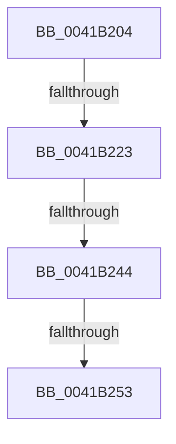

# sub_0041B204

- RVA: `0x0041B204`–`0x0041B277` (길이 `115` bytes)
- VA: `0x000000014041B204`
- 실행 섹션: `.text`
- PDB 이름 있음: `아니요`; PDB Function 태그: `아니요`
- unwind 정보 RVA: `0x0009D460`
- 디코드: `23`개 명령, `115/115` bytes 표시
- 미해석 바이트: `0` (있으면 어셈블리에 `.byte`로 보존)

> 이 문서는 커널 이미지의 기계어와 PDB 기호를 분석해 생성했습니다. 4번과 5번은 함수 원형과 자료형을 바이너리 사용 방식에서 추정한 C 해석이며 원본 소스 복구 결과는 아닙니다.

## 1. Dependencies

- 직접 호출 지점: **0**; 고유 호출 대상: **0**
- 직접 호출자로 확인된 함수: **0**
- RIP 상대 이미지 참조: **2**

### Outgoing calls
- 직접 디코드된 call 명령이 없습니다.

### Direct callers
- 이 함수 시작 RVA로 연결되는 직접 call은 확인되지 않았습니다. 간접 호출은 완전히 역산할 수 없습니다.

### Static image references
- `0x0041B216` → RVA `0x00FC6D20` (`ALMOSTRO`; read)
- `0x0041B237` → RVA `0x00FC6B06` (`ALMOSTRO`; read)

## 2. Other-region calls and transfers

- 다른 실행 섹션으로 향하는 call: **0**
- call이 아닌 외부 분기/꼬리 이동: **4**
  - `0x0041B21D` → [sub_0041B2EE + 0x38](Unknown_function_0041B2EE.md) (`tail-transfer`)
  - `0x0041B23E` → [sub_0041B2EE + 0x1D](Unknown_function_0041B2EE.md) (`tail-transfer`)
  - `0x0041B24D` → [sub_0041B2EE + 0x49](Unknown_function_0041B2EE.md) (`tail-transfer`)
  - `0x0041B275` → [sub_0041B2EE](Unknown_function_0041B2EE.md) (`tail-transfer`)

## 3. Assembly (complete function range)

```asm
0041B204  48 89 74 24 48                  mov qword ptr [rsp + 0x48], rsi
0041B209  44 0F 20 C5                     mov rbp, cr8
0041B20D  B8 02 00 00 00                  mov eax, 2
0041B212  44 0F 22 C0                     mov cr8, rax
0041B216  83 3D 03 BB BA 00 00            cmp dword ptr [rip + 0xbabb03], 0
0041B21D  0F 85 03 01 00 00               jne 0x14041b326
0041B223  65 48 8B 0C 25 28 00 00 00      mov rcx, qword ptr gs:[0x28]
0041B22C  48 81 C1 A0 00 00 00            add rcx, 0xa0
0041B233  4C 8B 41 08                     mov r8, qword ptr [rcx + 8]
0041B237  F6 05 C8 B8 BA 00 21            test byte ptr [rip + 0xbab8c8], 0x21
0041B23E  0F 85 C7 00 00 00               jne 0x14041b30b
0041B244  48 8B D1                        mov rdx, rcx
0041B247  49 87 10                        xchg qword ptr [r8], rdx
0041B24A  48 85 D2                        test rdx, rdx
0041B24D  0F 85 E4 00 00 00               jne 0x14041b337
0041B253  8B 47 04                        mov eax, dword ptr [rdi + 4]
0041B256  FF C0                           inc eax
0041B258  89 47 04                        mov dword ptr [rdi + 4], eax
0041B25B  8B 5F 04                        mov ebx, dword ptr [rdi + 4]
0041B25E  65 48 8B 34 25 28 00 00 00      mov rsi, qword ptr gs:[0x28]
0041B267  48 81 C6 A0 00 00 00            add rsi, 0xa0
0041B26E  F6 05 91 B8 BA 00 01            test byte ptr [rip + 0xbab891], 1
0041B275  75 77                           jne 0x14041b2ee
```

## 4. C-style interpretation (structured pseudocode)

```c
__int64 __fastcall sub_0041B204(void)
{
    __int64 result;
    __int64 v_rsi;
    unsigned __int64 v_stack_p48;

    v_stack_p48 = v_rsi;
    a1 = (*(unsigned __int64 *)(gs_base + (0 + 40))) + (160);
    result = (unsigned int)(((unsigned int)(*(unsigned int *)(v_rdi + 4))) + 1);
    *(unsigned int *)(v_rdi + 4) = (unsigned int)(result);
    v_rsi = (*(unsigned __int64 *)(gs_base + (0 + 40))) + (160);
}
```

## 5. (Beta) C Style

```c
void sub_0041B204(void)
{
    int64_t result;
    int64_t local_rsi;
    uint64_t v_stack_p48;

    v_stack_p48 = local_rsi;
    a1 = (*(uint64_t *)(gs_base + (0 + 0x28))) + (160);
    result = (uint32_t)(((uint32_t)(*(uint32_t *)(local_rdi + 0x4))) + 1);
    *(uint32_t *)(local_rdi + 0x4) = (uint32_t)(result);
    local_rsi = (*(uint64_t *)(gs_base + (0 + 0x28))) + (160);
}
```

## 6. Execution-region graph

[열기: 2D/3D 그래프와 함수 탐색 컨트롤 패널](../../../control-panel.html?section=text&rva=0x0041B204&view=graph)

- 2D 그래프는 위에서 아래로 흐르고, 3D 그래프는 빈 공간을 드래그해 회전합니다. Shift+드래그는 이동, 휠은 확대·축소, 함수 노드 선택은 대상 보고서 이동입니다.

### Static fallback


