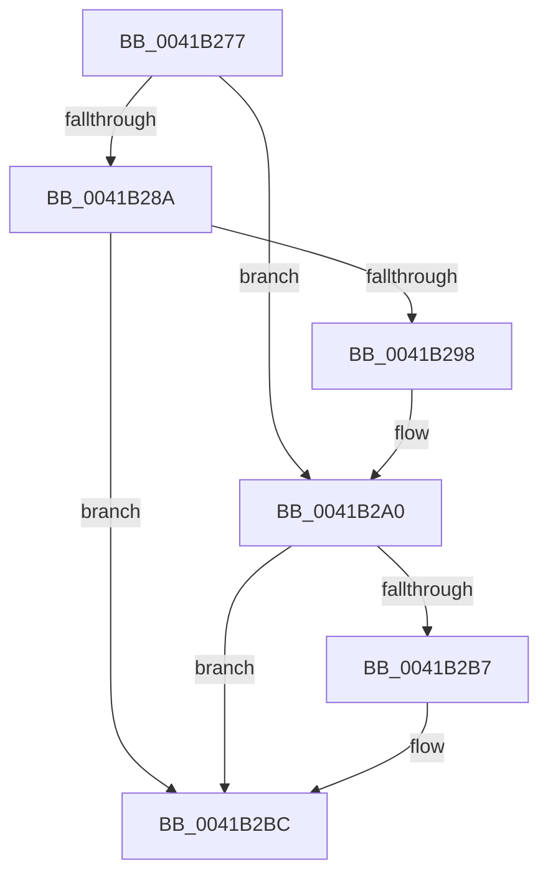

# sub_0041B277

- RVA: `0x0041B277`–`0x0041B2C1` (길이 `74` bytes)
- VA: `0x000000014041B277`
- 실행 섹션: `.text`
- PDB 이름 있음: `아니요`; PDB Function 태그: `아니요`
- unwind 정보 RVA: `0x0009D474`
- 디코드: `22`개 명령, `74/74` bytes 표시
- 미해석 바이트: `0` (있으면 어셈블리에 `.byte`로 보존)

> 이 문서는 커널 이미지의 기계어와 PDB 기호를 분석해 생성했습니다. 4번과 5번은 함수 원형과 자료형을 바이너리 사용 방식에서 추정한 C 해석이며 원본 소스 복구 결과는 아닙니다.

## 1. Dependencies

- 직접 호출 지점: **2**; 고유 호출 대상: **2**
- 직접 호출자로 확인된 함수: **0**
- RIP 상대 이미지 참조: **0**

### Outgoing calls
- `0x0041B29B` → [KxWaitForLockChainValid](../21/KxWaitForLockChainValid_function_00217AA0.md) (function, `0x00217AA0`)
- `0x0041B2B7` → [KeWakeAddressAll](../21/KeWakeAddressAll_function_00217C20.md) (function, `0x00217C20`)

### Direct callers
- 이 함수 시작 RVA로 연결되는 직접 call은 확인되지 않았습니다. 간접 호출은 완전히 역산할 수 없습니다.

### Static image references
- 디코드된 RIP-relative 메모리 참조가 없습니다.

## 2. Other-region calls and transfers

- 다른 실행 섹션으로 향하는 call: **0**
- 별도 외부 분기/꼬리 이동을 확인하지 못했습니다.

## 3. Assembly (complete function range)

```asm
0041B277  4C 89 74 24 50                  mov qword ptr [rsp + 0x50], r14
0041B27C  0F 0D 0E                        prefetchw byte ptr [rsi]
0041B27F  48 8B 06                        mov rax, qword ptr [rsi]
0041B282  45 33 F6                        xor r14d, r14d
0041B285  48 85 C0                        test rax, rax
0041B288  75 16                           jne 0x14041b2a0
0041B28A  48 8B 4E 08                     mov rcx, qword ptr [rsi + 8]
0041B28E  48 8B C6                        mov rax, rsi
0041B291  F0 4C 0F B1 31                  lock cmpxchg qword ptr [rcx], r14
0041B296  74 24                           je 0x14041b2bc
0041B298  48 8B CE                        mov rcx, rsi
0041B29B  E8 00 C8 DF FF                  call 0x140217aa0
0041B2A0  48 8D 48 08                     lea rcx, [rax + 8]
0041B2A4  4C 89 36                        mov qword ptr [rsi], r14
0041B2A7  48 8B 56 08                     mov rdx, qword ptr [rsi + 8]
0041B2AB  48 8B C2                        mov rax, rdx
0041B2AE  48 87 01                        xchg qword ptr [rcx], rax
0041B2B1  32 C2                           xor al, dl
0041B2B3  A8 04                           test al, 4
0041B2B5  74 05                           je 0x14041b2bc
0041B2B7  E8 64 C9 DF FF                  call 0x140217c20
0041B2BC  4C 8B 74 24 50                  mov r14, qword ptr [rsp + 0x50]
```

## 4. C-style interpretation (structured pseudocode)

```c
__int64 __fastcall sub_0041B277(__int64 a1, __int64 a2, __int64 a3, __int64 a4, __int64 a5, __int64 a6, __int64 a7, __int64 a8, __int64 a9, __int64 a10)
{
    __int64 result;
    __int64 v_r14;
    unsigned __int64 v_stack_p50;

    v_stack_p50 = v_r14;
    v_r14 = 0;
    if (*(unsigned __int64 *)(v_rsi) != 0) goto loc_0041B2A0;
    if (*(unsigned __int64 *)(v_rsi) == 0) goto loc_0041B2BC;
    result = KxWaitForLockChainValid(v_rsi, a2, a3, a4);
loc_0041B2A0:
    *(unsigned __int64 *)(v_rsi) = 0;
    result = (unsigned __int8)((*(unsigned __int64 *)(v_rsi + 8)) ^ ((unsigned __int8)(*(unsigned __int64 *)(v_rsi + 8))));
    if ((((unsigned __int8)(result)) & (4)) != 0) {
        result = KeWakeAddressAll(result + 8, *(unsigned __int64 *)(v_rsi + 8), a3, a4);
    }
    return result;
}
```

## 5. (Beta) C Style

```c
int64_t sub_0041B277(int64_t Arg1, int64_t Arg2, int64_t Arg3, int64_t Arg4, uint64_t Arg5, uint64_t Arg6, uint64_t Arg7, uint64_t Arg8, uint64_t Arg9, int64_t Arg10)
{
    int64_t result;
    int64_t local_r14;
    uint64_t v_stack_p50;

    v_stack_p50 = local_r14;
    local_r14 = 0;
    if (*(uint64_t *)(local_rsi) != 0) goto loc_0041B2A0;
    if (*(uint64_t *)(local_rsi) == 0) goto loc_0041B2BC;
    result = KxWaitForLockChainValid(local_rsi, Arg2, Arg3, Arg4);
loc_0041B2A0:
    *(uint64_t *)(local_rsi) = 0;
    result = (uint8_t)((*(uint64_t *)(local_rsi + 0x8)) ^ ((uint8_t)(*(uint64_t *)(local_rsi + 0x8))));
    if ((((uint8_t)(result)) & (4)) != 0) {
        result = KeWakeAddressAll(result + 8, *(uint64_t *)(local_rsi + 0x8), Arg3, Arg4);
    }
    return result;
}
```

## 6. Execution-region graph

[열기: 2D/3D 그래프와 함수 탐색 컨트롤 패널](../../../control-panel.html?section=text&rva=0x0041B277&view=graph)

- 2D 그래프는 위에서 아래로 흐르고, 3D 그래프는 빈 공간을 드래그해 회전합니다. Shift+드래그는 이동, 휠은 확대·축소, 함수 노드 선택은 대상 보고서 이동입니다.

### Static fallback


