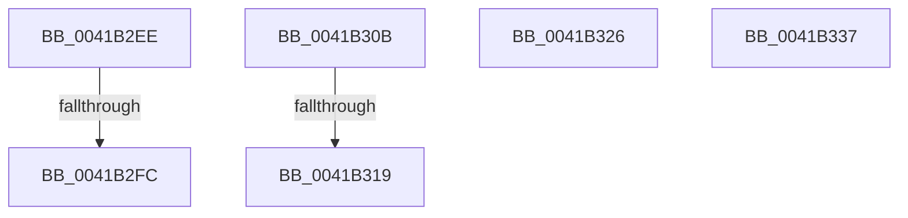

# sub_0041B2EE

- RVA: `0x0041B2EE`–`0x0041B341` (길이 `83` bytes)
- VA: `0x000000014041B2EE`
- 실행 섹션: `.text`
- PDB 이름 있음: `아니요`; PDB Function 태그: `아니요`
- unwind 정보 RVA: `0x0009D4A8`
- 디코드: `19`개 명령, `83/83` bytes 표시
- 미해석 바이트: `0` (있으면 어셈블리에 `.byte`로 보존)

> 이 문서는 커널 이미지의 기계어와 PDB 기호를 분석해 생성했습니다. 4번과 5번은 함수 원형과 자료형을 바이너리 사용 방식에서 추정한 C 해석이며 원본 소스 복구 결과는 아닙니다.

## 1. Dependencies

- 직접 호출 지점: **4**; 고유 호출 대상: **4**
- 직접 호출자로 확인된 함수: **0**
- RIP 상대 이미지 참조: **1**

### Outgoing calls
- `0x0041B304` → [KiReleaseQueuedSpinLockInstrumented](../21/KiReleaseQueuedSpinLockInstrumented_function_002179F0.md) (function, `0x002179F0`)
- `0x0041B31C` → [KiAcquireQueuedSpinLockInstrumented](../27/KiAcquireQueuedSpinLockInstrumented_function_00275850.md) (function, `0x00275850`)
- `0x0041B32D` → [KiRaiseIrqlProcessIrqlFlags](../4F/KiRaiseIrqlProcessIrqlFlags_function_004F56FC.md) (function, `0x004F56FC`)
- `0x0041B337` → [KxWaitForLockOwnerShip](../25/KxWaitForLockOwnerShip_function_00257EB0.md) (function, `0x00257EB0`)

### Direct callers
- 이 함수 시작 RVA로 연결되는 직접 call은 확인되지 않았습니다. 간접 호출은 완전히 역산할 수 없습니다.

### Static image references
- `0x0041B2EE` → RVA `0x00F0DE58` (`.data`; read)

## 2. Other-region calls and transfers

- 다른 실행 섹션으로 향하는 call: **0**
- call이 아닌 외부 분기/꼬리 이동: **6**
  - `0x0041B2F6` → [sub_0041B277](Unknown_function_0041B277.md) (`tail-transfer`)
  - `0x0041B309` → [sub_0041B2C1](Unknown_function_0041B2C1.md) (`tail-transfer`)
  - `0x0041B313` → [sub_0041B204 + 0x40](Unknown_function_0041B204.md) (`tail-transfer`)
  - `0x0041B321` → [sub_0041B204 + 0x4F](Unknown_function_0041B204.md) (`tail-transfer`)
  - `0x0041B332` → [sub_0041B204 + 0x1F](Unknown_function_0041B204.md) (`tail-transfer`)
  - `0x0041B33C` → [sub_0041B204 + 0x4F](Unknown_function_0041B204.md) (`tail-transfer`)

## 3. Assembly (complete function range)

```asm
0041B2EE  8B 05 64 2B AF 00               mov eax, dword ptr [rip + 0xaf2b64]
0041B2F4  85 C0                           test eax, eax
0041B2F6  0F 85 7B FF FF FF               jne 0x14041b277
0041B2FC  48 8B 54 24 38                  mov rdx, qword ptr [rsp + 0x38]
0041B301  48 8B CE                        mov rcx, rsi
0041B304  E8 E7 C6 DF FF                  call 0x1402179f0
0041B309  EB B6                           jmp 0x14041b2c1
0041B30B  8B 05 47 2B AF 00               mov eax, dword ptr [rip + 0xaf2b47]
0041B311  85 C0                           test eax, eax
0041B313  0F 85 2B FF FF FF               jne 0x14041b244
0041B319  49 8B D0                        mov rdx, r8
0041B31C  E8 2F A5 E5 FF                  call 0x140275850
0041B321  E9 2D FF FF FF                  jmp 0x14041b253
0041B326  0F B6 D0                        movzx edx, al
0041B329  40 0F B6 CD                     movzx ecx, bpl
0041B32D  E8 CA A3 0D 00                  call 0x1404f56fc
0041B332  E9 EC FE FF FF                  jmp 0x14041b223
0041B337  E8 74 CB E3 FF                  call 0x140257eb0
0041B33C  E9 12 FF FF FF                  jmp 0x14041b253
```

## 4. C-style interpretation (structured pseudocode)

```c
__int64 __fastcall sub_0041B2EE(__int64 a1, __int64 a2, __int64 a3, __int64 a4, __int64 a5, __int64 a6, __int64 a7)
{
    __int64 result;

    result = KiReleaseQueuedSpinLockInstrumented(v_rsi, a7, a3, a4);
}
```

## 5. (Beta) C Style

```c
int64_t sub_0041B2EE(int64_t Arg1, int64_t Arg2, int64_t Arg3, int64_t Arg4, uint64_t Arg5, uint64_t Arg6, int64_t Arg7)
{
    int64_t result;

    result = KiReleaseQueuedSpinLockInstrumented(local_rsi, Arg7, Arg3, Arg4);
}
```

## 6. Execution-region graph

[열기: 2D/3D 그래프와 함수 탐색 컨트롤 패널](../../../control-panel.html?section=text&rva=0x0041B2EE&view=graph)

- 2D 그래프는 위에서 아래로 흐르고, 3D 그래프는 빈 공간을 드래그해 회전합니다. Shift+드래그는 이동, 휠은 확대·축소, 함수 노드 선택은 대상 보고서 이동입니다.

### Static fallback


