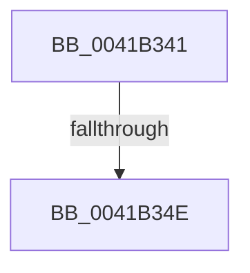

# sub_0041B341

- RVA: `0x0041B341`–`0x0041B36F` (길이 `46` bytes)
- VA: `0x000000014041B341`
- 실행 섹션: `.text`
- PDB 이름 있음: `아니요`; PDB Function 태그: `아니요`
- unwind 정보 RVA: `0x0009D4C0`
- 디코드: `11`개 명령, `46/46` bytes 표시
- 미해석 바이트: `0` (있으면 어셈블리에 `.byte`로 보존)

> 이 문서는 커널 이미지의 기계어와 PDB 기호를 분석해 생성했습니다. 4번과 5번은 함수 원형과 자료형을 바이너리 사용 방식에서 추정한 C 해석이며 원본 소스 복구 결과는 아닙니다.

## 1. Dependencies

- 직접 호출 지점: **2**; 고유 호출 대상: **1**
- 직접 호출자로 확인된 함수: **0**
- RIP 상대 이미지 참조: **0**

### Outgoing calls
- `0x0041B353` → [IoAddTriageDumpDataBlock](../42/IoAddTriageDumpDataBlock_function_00428374.md) (function, `0x00428374`)
- `0x0041B364` → [IoAddTriageDumpDataBlock](../42/IoAddTriageDumpDataBlock_function_00428374.md) (function, `0x00428374`)

### Direct callers
- 이 함수 시작 RVA로 연결되는 직접 call은 확인되지 않았습니다. 간접 호출은 완전히 역산할 수 없습니다.

### Static image references
- 디코드된 RIP-relative 메모리 참조가 없습니다.

## 2. Other-region calls and transfers

- 다른 실행 섹션으로 향하는 call: **0**
- call이 아닌 외부 분기/꼬리 이동: **2**
  - `0x0041B348` → [sub_006ED524](../6E/Unknown_function_006ED524.md) (`tail-transfer`)
  - `0x0041B36A` → [sub_006ED524](../6E/Unknown_function_006ED524.md) (`tail-transfer`)

## 3. Assembly (complete function range)

```asm
0041B341  48 8B 4F 08                     mov rcx, qword ptr [rdi + 8]
0041B345  48 85 C9                        test rcx, rcx
0041B348  0F 84 D6 21 2D 00               je 0x1406ed524
0041B34E  BA 50 01 00 00                  mov edx, 0x150
0041B353  E8 1C D0 00 00                  call 0x140428374
0041B358  48 8B 4F 08                     mov rcx, qword ptr [rdi + 8]
0041B35C  0F B7 51 38                     movzx edx, word ptr [rcx + 0x38]
0041B360  48 8B 49 40                     mov rcx, qword ptr [rcx + 0x40]
0041B364  E8 0B D0 00 00                  call 0x140428374
0041B369  90                              nop
0041B36A  E9 B5 21 2D 00                  jmp 0x1406ed524
```

## 4. C-style interpretation (structured pseudocode)

```c
__int64 __fastcall sub_0041B341(void)
{
    __int64 result;

    result = IoAddTriageDumpDataBlock(*(unsigned __int64 *)(v_rdi + 8), 336, a3, a4);
    result = IoAddTriageDumpDataBlock(*(unsigned __int64 *)(*(unsigned __int64 *)(v_rdi + 8) + 64), *(unsigned __int16 *)(*(unsigned __int64 *)(v_rdi + 8) + 56), a3, a4);
}
```

## 5. (Beta) C Style

```c
void sub_0041B341(void)
{
    int64_t result;

    result = IoAddTriageDumpDataBlock(*(uint64_t *)(local_rdi + 0x8), 336, a3, a4);
    result = IoAddTriageDumpDataBlock(*(uint64_t *)(*(uint64_t *)(local_rdi + 0x8) + 0x40), *(uint16_t *)(*(uint64_t *)(local_rdi + 0x8) + 0x38), a3, a4);
}
```

## 6. Execution-region graph

[열기: 2D/3D 그래프와 함수 탐색 컨트롤 패널](../../../control-panel.html?section=text&rva=0x0041B341&view=graph)

- 2D 그래프는 위에서 아래로 흐르고, 3D 그래프는 빈 공간을 드래그해 회전합니다. Shift+드래그는 이동, 휠은 확대·축소, 함수 노드 선택은 대상 보고서 이동입니다.

### Static fallback


