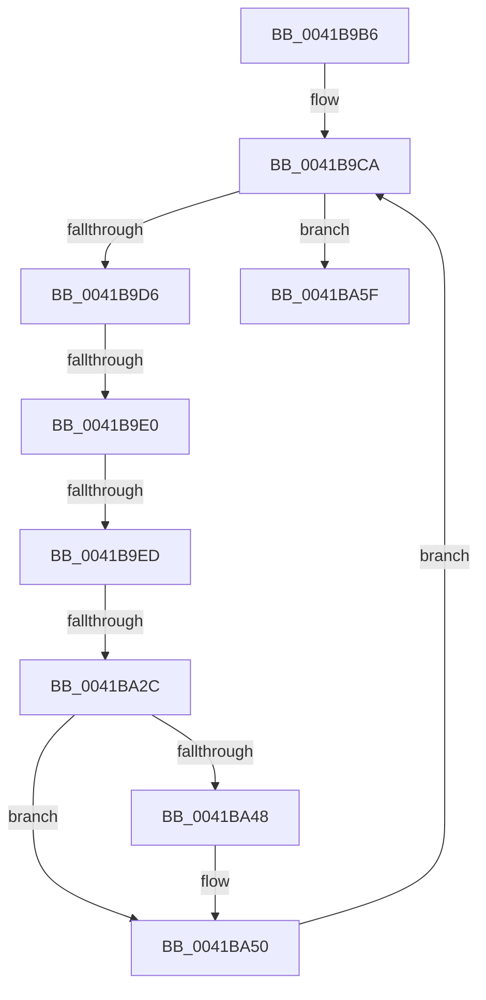

# sub_0041B9B6

- RVA: `0x0041B9B6`–`0x0041BA73` (길이 `189` bytes)
- VA: `0x000000014041B9B6`
- 실행 섹션: `.text`
- PDB 이름 있음: `아니요`; PDB Function 태그: `아니요`
- unwind 정보 RVA: `0x0009D54C`
- 디코드: `46`개 명령, `189/189` bytes 표시
- 미해석 바이트: `0` (있으면 어셈블리에 `.byte`로 보존)

> 이 문서는 커널 이미지의 기계어와 PDB 기호를 분석해 생성했습니다. 4번과 5번은 함수 원형과 자료형을 바이너리 사용 방식에서 추정한 C 해석이며 원본 소스 복구 결과는 아닙니다.

## 1. Dependencies

- 직접 호출 지점: **6**; 고유 호출 대상: **5**
- 직접 호출자로 확인된 함수: **0**
- RIP 상대 이미지 참조: **0**

### Outgoing calls
- `0x0041BA10` → [CmpLockHashEntryExclusiveByKcb](../../page/84/CmpLockHashEntryExclusiveByKcb_function_00849780.md) (function, `0x00849780`)
- `0x0041BA18` → [CmpLockKcbExclusive](../../page/86/CmpLockKcbExclusive_function_00861EB0.md) (function, `0x00861EB0`)
- `0x0041BA36` → [CmpDereferenceKeyControlBlockWithLock](../../page/86/CmpDereferenceKeyControlBlockWithLock_function_00862B60.md) (function, `0x00862B60`)
- `0x0041BA3E` → [CmpUnlockKcb](../../pagecmrc/BC/CmpUnlockKcb_function_00BC92C0.md) (function, `0x00BC92C0`)
- `0x0041BA4B` → [CmpUnlockKcb](../../pagecmrc/BC/CmpUnlockKcb_function_00BC92C0.md) (function, `0x00BC92C0`)
- `0x0041BA55` → [CmpUnlockHashEntry](../../page/86/CmpUnlockHashEntry_function_00864460.md) (function, `0x00864460`)

### Direct callers
- 이 함수 시작 RVA로 연결되는 직접 call은 확인되지 않았습니다. 간접 호출은 완전히 역산할 수 없습니다.

### Static image references
- 디코드된 RIP-relative 메모리 참조가 없습니다.

## 2. Other-region calls and transfers

- 다른 실행 섹션으로 향하는 call: **6**
  - `0x0041BA10` → [CmpLockHashEntryExclusiveByKcb](../../page/84/CmpLockHashEntryExclusiveByKcb_function_00849780.md) (`.text` → `PAGE`)
  - `0x0041BA18` → [CmpLockKcbExclusive](../../page/86/CmpLockKcbExclusive_function_00861EB0.md) (`.text` → `PAGE`)
  - `0x0041BA36` → [CmpDereferenceKeyControlBlockWithLock](../../page/86/CmpDereferenceKeyControlBlockWithLock_function_00862B60.md) (`.text` → `PAGE`)
  - `0x0041BA3E` → [CmpUnlockKcb](../../pagecmrc/BC/CmpUnlockKcb_function_00BC92C0.md) (`.text` → `PAGECMRC`)
  - `0x0041BA4B` → [CmpUnlockKcb](../../pagecmrc/BC/CmpUnlockKcb_function_00BC92C0.md) (`.text` → `PAGECMRC`)
  - `0x0041BA55` → [CmpUnlockHashEntry](../../page/86/CmpUnlockHashEntry_function_00864460.md) (`.text` → `PAGE`)
- call이 아닌 외부 분기/꼬리 이동: **3**
  - `0x0041B9DA` → [sub_0041BA7B + 0x27](Unknown_function_0041BA7B.md) (`tail-transfer`)
  - `0x0041B9E7` → [sub_0041BA7B + 0x27](Unknown_function_0041BA7B.md) (`tail-transfer`)
  - `0x0041BA2A` → [sub_0041BA7B](Unknown_function_0041BA7B.md) (`tail-transfer`)

## 3. Assembly (complete function range)

```asm
0041B9B6  48 89 5C 24 40                  mov qword ptr [rsp + 0x40], rbx
0041B9BB  48 89 6C 24 48                  mov qword ptr [rsp + 0x48], rbp
0041B9C0  4C 89 74 24 50                  mov qword ptr [rsp + 0x50], r14
0041B9C5  4C 89 7C 24 20                  mov qword ptr [rsp + 0x20], r15
0041B9CA  48 8B 07                        mov rax, qword ptr [rdi]
0041B9CD  48 3B C7                        cmp rax, rdi
0041B9D0  0F 84 89 00 00 00               je 0x14041ba5f
0041B9D6  48 39 78 08                     cmp qword ptr [rax + 8], rdi
0041B9DA  0F 85 C2 00 00 00               jne 0x14041baa2
0041B9E0  48 8B 08                        mov rcx, qword ptr [rax]
0041B9E3  48 39 41 08                     cmp qword ptr [rcx + 8], rax
0041B9E7  0F 85 B5 00 00 00               jne 0x14041baa2
0041B9ED  48 89 0F                        mov qword ptr [rdi], rcx
0041B9F0  48 8D A8 20 FF FF FF            lea rbp, [rax - 0xe0]
0041B9F7  48 89 79 08                     mov qword ptr [rcx + 8], rdi
0041B9FB  48 8B CD                        mov rcx, rbp
0041B9FE  48 89 40 08                     mov qword ptr [rax + 8], rax
0041BA02  48 89 00                        mov qword ptr [rax], rax
0041BA05  80 65 40 FE                     and byte ptr [rbp + 0x40], 0xfe
0041BA09  4C 8B 7D 20                     mov r15, qword ptr [rbp + 0x20]
0041BA0D  8B 5D 10                        mov ebx, dword ptr [rbp + 0x10]
0041BA10  E8 6B DD 42 00                  call 0x140849780
0041BA15  48 8B CD                        mov rcx, rbp
0041BA18  E8 93 64 44 00                  call 0x140861eb0
0041BA1D  48 8B 85 C0 00 00 00            mov rax, qword ptr [rbp + 0xc0]
0041BA24  45 33 F6                        xor r14d, r14d
0041BA27  48 85 C0                        test rax, rax
0041BA2A  75 4F                           jne 0x14041ba7b
0041BA2C  44 0F B6 C6                     movzx r8d, sil
0041BA30  48 8B D7                        mov rdx, rdi
0041BA33  48 8B CD                        mov rcx, rbp
0041BA36  E8 25 71 44 00                  call 0x140862b60
0041BA3B  48 8B CD                        mov rcx, rbp
0041BA3E  E8 7D D8 7A 00                  call 0x140bc92c0
0041BA43  4D 85 F6                        test r14, r14
0041BA46  74 08                           je 0x14041ba50
0041BA48  49 8B CE                        mov rcx, r14
0041BA4B  E8 70 D8 7A 00                  call 0x140bc92c0
0041BA50  8B D3                           mov edx, ebx
0041BA52  49 8B CF                        mov rcx, r15
0041BA55  E8 06 8A 44 00                  call 0x140864460
0041BA5A  E9 6B FF FF FF                  jmp 0x14041b9ca
0041BA5F  4C 8B 74 24 50                  mov r14, qword ptr [rsp + 0x50]
0041BA64  48 8B 6C 24 48                  mov rbp, qword ptr [rsp + 0x48]
0041BA69  48 8B 5C 24 40                  mov rbx, qword ptr [rsp + 0x40]
0041BA6E  4C 8B 7C 24 20                  mov r15, qword ptr [rsp + 0x20]
```

## 4. C-style interpretation (structured pseudocode)

```c
__int64 __fastcall sub_0041B9B6(__int64 a1, __int64 a2, __int64 a3, __int64 a4, __int64 a5, __int64 a6, __int64 a7, __int64 a8, __int64 a9, __int64 a10)
{
    __int64 result;
    __int64 v_r14;
    unsigned __int64 v_stack_p20;
    unsigned __int64 v_stack_p40;
    unsigned __int64 v_stack_p48;
    unsigned __int64 v_stack_p50;

    v_stack_p40 = v_rbx;
    v_stack_p48 = v_rbp;
    v_stack_p50 = v_r14;
    v_stack_p20 = v_r15;
loc_0041B9CA:
    if ((*(unsigned __int64 *)(v_rdi)) == v_rdi) goto loc_0041BA5F;
    *(unsigned __int64 *)(v_rdi) = *(unsigned __int64 *)(*(unsigned __int64 *)(v_rdi));
    *(unsigned __int64 *)(*(unsigned __int64 *)(*(unsigned __int64 *)(v_rdi)) + 8) = v_rdi;
    *(unsigned __int64 *)(*(unsigned __int64 *)(v_rdi) + 8) = *(unsigned __int64 *)(v_rdi);
    *(unsigned __int64 *)(*(unsigned __int64 *)(v_rdi)) = *(unsigned __int64 *)(v_rdi);
    result = CmpLockHashEntryExclusiveByKcb(*(unsigned __int64 *)(v_rdi) - 224, a2, a3, a4);
    result = CmpLockKcbExclusive(*(unsigned __int64 *)(v_rdi) - 224, a2, a3, a4);
    v_r14 = 0;
    result = CmpDereferenceKeyControlBlockWithLock(*(unsigned __int64 *)(v_rdi) - 224, v_rdi, (unsigned __int8)(v_rsi), a4);
    result = CmpUnlockKcb(*(unsigned __int64 *)(v_rdi) - 224, v_rdi, (unsigned __int8)(v_rsi), a4);
    if (0 != 0) {
        a1 = 0;
        result = CmpUnlockKcb(a1, v_rdi, (unsigned __int8)(v_rsi), a4);
    }
    result = CmpUnlockHashEntry(*(unsigned __int64 *)(*(unsigned __int64 *)(v_rdi) - 224 + 32), (unsigned int)((unsigned int)((unsigned int)(*(unsigned int *)(*(unsigned __int64 *)(v_rdi) - 224 + 16)))), (unsigned __int8)(v_rsi), a4);
    goto loc_0041B9CA;
loc_0041BA5F:
    return result;
}
```

## 5. (Beta) C Style

```c
int64_t sub_0041B9B6(int64_t Arg1, int64_t Arg2, int64_t Arg3, int64_t Arg4, uint64_t Arg5, uint64_t Arg6, uint64_t Arg7, int64_t Arg8, int64_t Arg9, int64_t Arg10)
{
    int64_t result;
    int64_t local_r14;
    uint64_t v_stack_p20;
    uint64_t v_stack_p40;
    uint64_t v_stack_p48;
    uint64_t v_stack_p50;

    v_stack_p40 = local_rbx;
    v_stack_p48 = local_rbp;
    v_stack_p50 = local_r14;
    v_stack_p20 = local_r15;
loc_0041B9CA:
    if ((*(uint64_t *)(local_rdi)) == local_rdi) goto loc_0041BA5F;
    *(uint64_t *)(local_rdi) = *(uint64_t *)(*(uint64_t *)(local_rdi));
    *(uint64_t *)(*(uint64_t *)(*(uint64_t *)(local_rdi)) + 0x8) = local_rdi;
    *(uint64_t *)(*(uint64_t *)(local_rdi) + 0x8) = *(uint64_t *)(local_rdi);
    *(uint64_t *)(*(uint64_t *)(local_rdi)) = *(uint64_t *)(local_rdi);
    result = CmpLockHashEntryExclusiveByKcb(*(uint64_t *)(local_rdi) - 224, Arg2, Arg3, Arg4);
    result = CmpLockKcbExclusive(*(uint64_t *)(local_rdi) - 224, Arg2, Arg3, Arg4);
    local_r14 = 0;
    result = CmpDereferenceKeyControlBlockWithLock(*(uint64_t *)(local_rdi) - 224, local_rdi, (uint8_t)(local_rsi), Arg4);
    result = CmpUnlockKcb(*(uint64_t *)(local_rdi) - 224, local_rdi, (uint8_t)(local_rsi), Arg4);
    if (0 != 0) {
        Arg1 = 0;
        result = CmpUnlockKcb(Arg1, local_rdi, (uint8_t)(local_rsi), Arg4);
    }
    result = CmpUnlockHashEntry(*(uint64_t *)(*(uint64_t *)(local_rdi) - 0xE0 + 0x20), (uint32_t)((uint32_t)((uint32_t)(*(uint32_t *)(*(uint64_t *)(local_rdi) - 0xE0 + 0x10)))), (uint8_t)(local_rsi), Arg4);
    goto loc_0041B9CA;
loc_0041BA5F:
    return result;
}
```

## 6. Execution-region graph

[열기: 2D/3D 그래프와 함수 탐색 컨트롤 패널](../../../control-panel.html?section=text&rva=0x0041B9B6&view=graph)

- 2D 그래프는 위에서 아래로 흐르고, 3D 그래프는 빈 공간을 드래그해 회전합니다. Shift+드래그는 이동, 휠은 확대·축소, 함수 노드 선택은 대상 보고서 이동입니다.

### Static fallback


