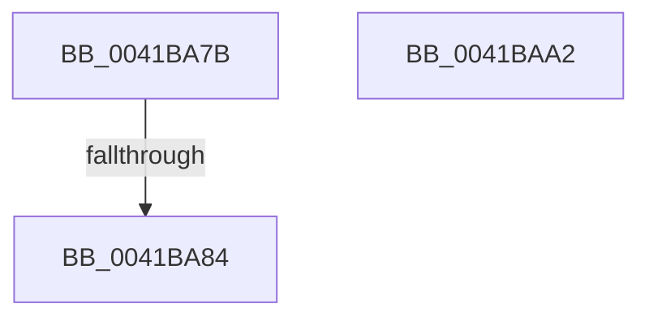

# sub_0041BA7B

- RVA: `0x0041BA7B`–`0x0041BAA9` (길이 `46` bytes)
- VA: `0x000000014041BA7B`
- 실행 섹션: `.text`
- PDB 이름 있음: `아니요`; PDB Function 태그: `아니요`
- unwind 정보 RVA: `0x0009D580`
- 디코드: `13`개 명령, `46/46` bytes 표시
- 미해석 바이트: `0` (있으면 어셈블리에 `.byte`로 보존)

> 이 문서는 커널 이미지의 기계어와 PDB 기호를 분석해 생성했습니다. 4번과 5번은 함수 원형과 자료형을 바이너리 사용 방식에서 추정한 C 해석이며 원본 소스 복구 결과는 아닙니다.

## 1. Dependencies

- 직접 호출 지점: **3**; 고유 호출 대상: **2**
- 직접 호출자로 확인된 함수: **0**
- RIP 상대 이미지 참조: **0**

### Outgoing calls
- `0x0041BA8B` → [CmpUnlockKcb](../../pagecmrc/BC/CmpUnlockKcb_function_00BC92C0.md) (function, `0x00BC92C0`)
- `0x0041BA93` → [CmpLockKcbExclusive](../../page/86/CmpLockKcbExclusive_function_00861EB0.md) (function, `0x00861EB0`)
- `0x0041BA9B` → [CmpLockKcbExclusive](../../page/86/CmpLockKcbExclusive_function_00861EB0.md) (function, `0x00861EB0`)

### Direct callers
- 이 함수 시작 RVA로 연결되는 직접 call은 확인되지 않았습니다. 간접 호출은 완전히 역산할 수 없습니다.

### Static image references
- 디코드된 RIP-relative 메모리 참조가 없습니다.

## 2. Other-region calls and transfers

- 다른 실행 섹션으로 향하는 call: **3**
  - `0x0041BA8B` → [CmpUnlockKcb](../../pagecmrc/BC/CmpUnlockKcb_function_00BC92C0.md) (`.text` → `PAGECMRC`)
  - `0x0041BA93` → [CmpLockKcbExclusive](../../page/86/CmpLockKcbExclusive_function_00861EB0.md) (`.text` → `PAGE`)
  - `0x0041BA9B` → [CmpLockKcbExclusive](../../page/86/CmpLockKcbExclusive_function_00861EB0.md) (`.text` → `PAGE`)
- call이 아닌 외부 분기/꼬리 이동: **2**
  - `0x0041BA82` → [sub_0041B9B6 + 0x76](Unknown_function_0041B9B6.md) (`tail-transfer`)
  - `0x0041BAA0` → [sub_0041B9B6 + 0x76](Unknown_function_0041B9B6.md) (`tail-transfer`)

## 3. Assembly (complete function range)

```asm
0041BA7B  48 8B 48 18                     mov rcx, qword ptr [rax + 0x18]
0041BA7F  48 85 C9                        test rcx, rcx
0041BA82  74 A8                           je 0x14041ba2c
0041BA84  4C 8B 71 10                     mov r14, qword ptr [rcx + 0x10]
0041BA88  48 8B CD                        mov rcx, rbp
0041BA8B  E8 30 D8 7A 00                  call 0x140bc92c0
0041BA90  49 8B CE                        mov rcx, r14
0041BA93  E8 18 64 44 00                  call 0x140861eb0
0041BA98  48 8B CD                        mov rcx, rbp
0041BA9B  E8 10 64 44 00                  call 0x140861eb0
0041BAA0  EB 8A                           jmp 0x14041ba2c
0041BAA2  B9 03 00 00 00                  mov ecx, 3
0041BAA7  CD 29                           int 0x29
```

## 4. C-style interpretation (structured pseudocode)

```c
__int64 __fastcall sub_0041BA7B(void)
{
    __int64 result;

    result = CmpUnlockKcb(v_rbp, a2, a3, a4);
    result = CmpLockKcbExclusive(*(unsigned __int64 *)(*(unsigned __int64 *)(result + 24) + 16), a2, a3, a4);
    result = CmpLockKcbExclusive(v_rbp, a2, a3, a4);
}
```

## 5. (Beta) C Style

```c
void sub_0041BA7B(void)
{
    int64_t result;

    result = CmpUnlockKcb(local_rbp, a2, a3, a4);
    result = CmpLockKcbExclusive(*(uint64_t *)(*(uint64_t *)(result + 0x18) + 0x10), a2, a3, a4);
    result = CmpLockKcbExclusive(local_rbp, a2, a3, a4);
}
```

## 6. Execution-region graph

[열기: 2D/3D 그래프와 함수 탐색 컨트롤 패널](../../../control-panel.html?section=text&rva=0x0041BA7B&view=graph)

- 2D 그래프는 위에서 아래로 흐르고, 3D 그래프는 빈 공간을 드래그해 회전합니다. Shift+드래그는 이동, 휠은 확대·축소, 함수 노드 선택은 대상 보고서 이동입니다.

### Static fallback


