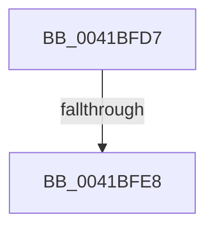

# sub_0041BFD7

- RVA: `0x0041BFD7`–`0x0041BFF1` (길이 `26` bytes)
- VA: `0x000000014041BFD7`
- 실행 섹션: `.text`
- PDB 이름 있음: `아니요`; PDB Function 태그: `아니요`
- unwind 정보 RVA: `0x0009D694`
- 디코드: `6`개 명령, `26/26` bytes 표시
- 미해석 바이트: `0` (있으면 어셈블리에 `.byte`로 보존)

> 이 문서는 커널 이미지의 기계어와 PDB 기호를 분석해 생성했습니다. 4번과 5번은 함수 원형과 자료형을 바이너리 사용 방식에서 추정한 C 해석이며 원본 소스 복구 결과는 아닙니다.

## 1. Dependencies

- 직접 호출 지점: **0**; 고유 호출 대상: **0**
- 직접 호출자로 확인된 함수: **0**
- RIP 상대 이미지 참조: **0**

### Outgoing calls
- 직접 디코드된 call 명령이 없습니다.

### Direct callers
- 이 함수 시작 RVA로 연결되는 직접 call은 확인되지 않았습니다. 간접 호출은 완전히 역산할 수 없습니다.

### Static image references
- 디코드된 RIP-relative 메모리 참조가 없습니다.

## 2. Other-region calls and transfers

- 다른 실행 섹션으로 향하는 call: **0**
- call이 아닌 외부 분기/꼬리 이동: **2**
  - `0x0041BFE2` → [sub_006ED6E6](../6E/Unknown_function_006ED6E6.md) (`tail-transfer`)
  - `0x0041BFEC` → [sub_006ED6E6 + 0xA3](../6E/Unknown_function_006ED6E6.md) (`tail-transfer`)

## 3. Assembly (complete function range)

```asm
0041BFD7  48 89 74 24 38                  mov qword ptr [rsp + 0x38], rsi
0041BFDC  33 F6                           xor esi, esi
0041BFDE  80 7B 18 01                     cmp byte ptr [rbx + 0x18], 1
0041BFE2  0F 85 FE 16 2D 00               jne 0x1406ed6e6
0041BFE8  48 89 73 08                     mov qword ptr [rbx + 8], rsi
0041BFEC  E9 98 17 2D 00                  jmp 0x1406ed789
```

## 4. C-style interpretation (structured pseudocode)

```c
void __fastcall sub_0041BFD7(void)
{
    __int64 v_rsi;
    unsigned __int64 v_stack_p38;

    v_stack_p38 = v_rsi;
    v_rsi = 0;
    *(unsigned __int64 *)(v_rbx + 8) = 0;
}
```

## 5. (Beta) C Style

```c
void sub_0041BFD7(void)
{
    int64_t local_rsi;
    uint64_t v_stack_p38;

    v_stack_p38 = local_rsi;
    local_rsi = 0;
    *(uint64_t *)(local_rbx + 0x8) = 0;
}
```

## 6. Execution-region graph

[열기: 2D/3D 그래프와 함수 탐색 컨트롤 패널](../../../control-panel.html?section=text&rva=0x0041BFD7&view=graph)

- 2D 그래프는 위에서 아래로 흐르고, 3D 그래프는 빈 공간을 드래그해 회전합니다. Shift+드래그는 이동, 휠은 확대·축소, 함수 노드 선택은 대상 보고서 이동입니다.

### Static fallback


