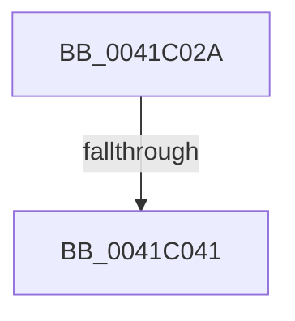

# sub_0041C02A

- RVA: `0x0041C02A`–`0x0041C055` (길이 `43` bytes)
- VA: `0x000000014041C02A`
- 실행 섹션: `.text`
- PDB 이름 있음: `아니요`; PDB Function 태그: `아니요`
- unwind 정보 RVA: `0x0009D6C8`
- 디코드: `13`개 명령, `43/43` bytes 표시
- 미해석 바이트: `0` (있으면 어셈블리에 `.byte`로 보존)

> 이 문서는 커널 이미지의 기계어와 PDB 기호를 분석해 생성했습니다. 4번과 5번은 함수 원형과 자료형을 바이너리 사용 방식에서 추정한 C 해석이며 원본 소스 복구 결과는 아닙니다.

## 1. Dependencies

- 직접 호출 지점: **0**; 고유 호출 대상: **0**
- 직접 호출자로 확인된 함수: **0**
- RIP 상대 이미지 참조: **0**

### Outgoing calls
- 직접 디코드된 call 명령이 없습니다.

### Direct callers
- 이 함수 시작 RVA로 연결되는 직접 call은 확인되지 않았습니다. 간접 호출은 완전히 역산할 수 없습니다.

### Static image references
- 디코드된 RIP-relative 메모리 참조가 없습니다.

## 2. Other-region calls and transfers

- 다른 실행 섹션으로 향하는 call: **0**
- call이 아닌 외부 분기/꼬리 이동: **2**
  - `0x0041C03F` → [sub_0041C08D](Unknown_function_0041C08D.md) (`tail-transfer`)
  - `0x0041C053` → [sub_0041C055 + 0x2C](Unknown_function_0041C055.md) (`tail-transfer`)

## 3. Assembly (complete function range)

```asm
0041C02A  48 89 5C 24 30                  mov qword ptr [rsp + 0x30], rbx
0041C02F  8B DA                           mov ebx, edx
0041C031  48 89 6C 24 38                  mov qword ptr [rsp + 0x38], rbp
0041C036  41 8B E8                        mov ebp, r8d
0041C039  48 8B F1                        mov rsi, rcx
0041C03C  45 85 C0                        test r8d, r8d
0041C03F  74 4C                           je 0x14041c08d
0041C041  40 B7 11                        mov dil, 0x11
0041C044  89 5E 40                        mov dword ptr [rsi + 0x40], ebx
0041C047  85 ED                           test ebp, ebp
0041C049  48 8B 5C 24 30                  mov rbx, qword ptr [rsp + 0x30]
0041C04E  48 8B 6C 24 38                  mov rbp, qword ptr [rsp + 0x38]
0041C053  75 2C                           jne 0x14041c081
```

## 4. C-style interpretation (structured pseudocode)

```c
void __fastcall sub_0041C02A(__int64 a1, int a2, int a3, __int64 a4, __int64 a5, __int64 a6, __int64 a7)
{
    unsigned __int64 v_stack_p30;
    unsigned __int64 v_stack_p38;

    v_stack_p30 = v_rbx;
    v_stack_p38 = v_rbp;
    *(unsigned int *)(a1 + 64) = (unsigned int)((unsigned int)(a2));
}
```

## 5. (Beta) C Style

```c
void sub_0041C02A(void *Arg1, int32_t Arg2, int32_t Arg3, int64_t Arg4, uint64_t Arg5, int64_t Arg6, int64_t Arg7)
{
    uint8_t *arg1 = (uint8_t *)Arg1;

    uint64_t v_stack_p30;
    uint64_t v_stack_p38;

    v_stack_p30 = local_rbx;
    v_stack_p38 = local_rbp;
    *(uint32_t *)(arg1 + 0x40) = (uint32_t)((uint32_t)(Arg2));
}
```

### 관측된 메모리 오프셋

구조체 형식이 확인되지 않은 접근은 인자 기준의 오프셋으로만 기록했습니다.

| 기준 인자 | 오프셋 표현 | 폭 (bit) | 접근 |
|---|---:|---:|---|
| `Arg1` | `+ 0x40` | `32` | `W` |

## 6. Execution-region graph

[열기: 2D/3D 그래프와 함수 탐색 컨트롤 패널](../../../control-panel.html?section=text&rva=0x0041C02A&view=graph)

- 2D 그래프는 위에서 아래로 흐르고, 3D 그래프는 빈 공간을 드래그해 회전합니다. Shift+드래그는 이동, 휠은 확대·축소, 함수 노드 선택은 대상 보고서 이동입니다.

### Static fallback


