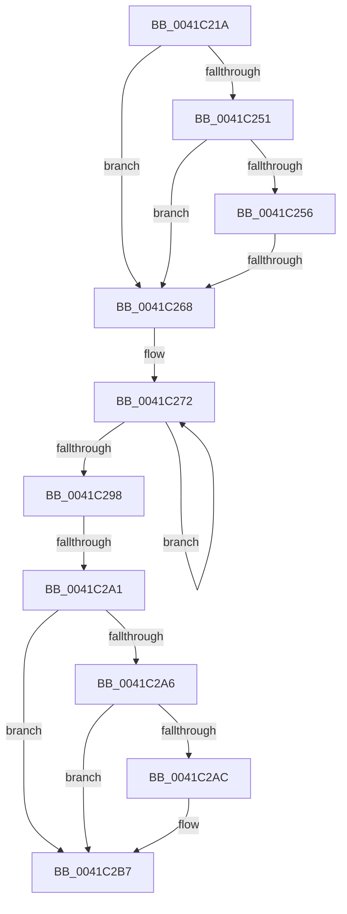

# sub_0041C21A

- RVA: `0x0041C21A`–`0x0041C2CB` (길이 `177` bytes)
- VA: `0x000000014041C21A`
- 실행 섹션: `.text`
- PDB 이름 있음: `아니요`; PDB Function 태그: `아니요`
- unwind 정보 RVA: `0x0009D778`
- 디코드: `45`개 명령, `177/177` bytes 표시
- 미해석 바이트: `0` (있으면 어셈블리에 `.byte`로 보존)

> 이 문서는 커널 이미지의 기계어와 PDB 기호를 분석해 생성했습니다. 4번과 5번은 함수 원형과 자료형을 바이너리 사용 방식에서 추정한 C 해석이며 원본 소스 복구 결과는 아닙니다.

## 1. Dependencies

- 직접 호출 지점: **0**; 고유 호출 대상: **0**
- 직접 호출자로 확인된 함수: **0**
- RIP 상대 이미지 참조: **3**

### Outgoing calls
- 직접 디코드된 call 명령이 없습니다.

### Direct callers
- 이 함수 시작 RVA로 연결되는 직접 call은 확인되지 않았습니다. 간접 호출은 완전히 역산할 수 없습니다.

### Static image references
- `0x0041C230` → RVA `0x00FC7350` (`ALMOSTRO`; read)
- `0x0041C256` → RVA `0x00F06648` (`.data`; read)
- `0x0041C26B` → RVA `0x00E27F80` (`.data`; read)

## 2. Other-region calls and transfers

- 다른 실행 섹션으로 향하는 call: **0**
- call이 아닌 외부 분기/꼬리 이동: **2**
  - `0x0041C266` → [sub_0041C2D3](Unknown_function_0041C2D3.md) (`tail-transfer`)
  - `0x0041C29B` → [sub_0041C2D3 + 0x57](Unknown_function_0041C2D3.md) (`tail-transfer`)

## 3. Assembly (complete function range)

```asm
0041C21A  48 89 6C 24 58                  mov qword ptr [rsp + 0x58], rbp
0041C21F  48 89 74 24 60                  mov qword ptr [rsp + 0x60], rsi
0041C224  4C 89 74 24 68                  mov qword ptr [rsp + 0x68], r14
0041C229  4C 8B B1 F8 02 00 00            mov r14, qword ptr [rcx + 0x2f8]
0041C230  0F B6 2D 19 B1 BA 00            movzx ebp, byte ptr [rip + 0xbab119]
0041C237  4C 89 7C 24 30                  mov qword ptr [rsp + 0x30], r15
0041C23C  4D 8B FE                        mov r15, r14
0041C23F  41 0F 0D 0E                     prefetchw byte ptr [r14]
0041C243  49 8B 36                        mov rsi, qword ptr [r14]
0041C246  49 8B 56 40                     mov rdx, qword ptr [r14 + 0x40]
0041C24A  49 83 7E 50 00                  cmp qword ptr [r14 + 0x50], 0
0041C24F  74 17                           je 0x14041c268
0041C251  48 3B D6                        cmp rdx, rsi
0041C254  76 12                           jbe 0x14041c268
0041C256  4C 8B 05 EB A3 AE 00            mov r8, qword ptr [rip + 0xaea3eb]
0041C25D  48 8B C2                        mov rax, rdx
0041C260  48 2B C6                        sub rax, rsi
0041C263  49 3B C0                        cmp rax, r8
0041C266  77 6B                           ja 0x14041c2d3
0041C268  4C 8B C7                        mov r8, rdi
0041C26B  4C 8D 15 0E BD A0 00            lea r10, [rip + 0xa0bd0e]
0041C272  4C 3B C6                        cmp r8, rsi
0041C275  4C 8B CE                        mov r9, rsi
0041C278  48 8B CE                        mov rcx, rsi
0041C27B  48 8B C6                        mov rax, rsi
0041C27E  4D 0F 42 C8                     cmovb r9, r8
0041C282  49 2B C8                        sub rcx, r8
0041C285  33 D2                           xor edx, edx
0041C287  4C 3B C6                        cmp r8, rsi
0041C28A  48 0F 42 D1                     cmovb rdx, rcx
0041C28E  F0 49 0F B1 17                  lock cmpxchg qword ptr [r15], rdx
0041C293  48 8B F0                        mov rsi, rax
0041C296  75 DA                           jne 0x14041c272
0041C298  4D 2B C1                        sub r8, r9
0041C29B  0F 85 89 00 00 00               jne 0x14041c32a
0041C2A1  48 85 DB                        test rbx, rbx
0041C2A4  74 11                           je 0x14041c2b7
0041C2A6  40 F6 C5 04                     test bpl, 4
0041C2AA  74 0B                           je 0x14041c2b7
0041C2AC  48 F7 DF                        neg rdi
0041C2AF  F0 48 01 BB 00 02 00 00         lock add qword ptr [rbx + 0x200], rdi
0041C2B7  4C 8B 74 24 68                  mov r14, qword ptr [rsp + 0x68]
0041C2BC  48 8B 74 24 60                  mov rsi, qword ptr [rsp + 0x60]
0041C2C1  48 8B 6C 24 58                  mov rbp, qword ptr [rsp + 0x58]
0041C2C6  4C 8B 7C 24 30                  mov r15, qword ptr [rsp + 0x30]
```

## 4. C-style interpretation (structured pseudocode)

```c
__int64 __fastcall sub_0041C21A(__int64 a1, __int64 a2, __int64 a3, __int64 a4, __int64 a5, __int64 a6, __int64 a7, __int64 a8, __int64 a9, __int64 a10, __int64 a11, __int64 a12, __int64 a13)
{
    __int64 result;
    __int64 v_rdi;
    unsigned __int64 v_stack_p30;
    unsigned __int64 v_stack_p58;
    unsigned __int64 v_stack_p60;
    unsigned __int64 v_stack_p68;

    v_stack_p58 = v_rbp;
    v_stack_p60 = v_rsi;
    v_stack_p68 = v_r14;
    v_stack_p30 = v_r15;
    if ((*(unsigned __int64 *)(*(unsigned __int64 *)(a1 + 760) + 80)) == 0) goto loc_0041C268;
    if ((*(unsigned __int64 *)(*(unsigned __int64 *)(a1 + 760) + 64)) <= (*(unsigned __int64 *)(*(unsigned __int64 *)(a1 + 760)))) goto loc_0041C268;
    result = (*(unsigned __int64 *)(*(unsigned __int64 *)(a1 + 760) + 64)) - (*(unsigned __int64 *)(*(unsigned __int64 *)(a1 + 760)));
loc_0041C268:
loc_0041C272:
    a4 = *(unsigned __int64 *)(*(unsigned __int64 *)(a1 + 760));
    if (v_rdi < (*(unsigned __int64 *)(*(unsigned __int64 *)(a1 + 760)))) { a4 = v_rdi; }
    a1 = (*(unsigned __int64 *)(*(unsigned __int64 *)(a1 + 760))) - (v_rdi);
    a2 = 0;
    if (v_rdi < (*(unsigned __int64 *)(*(unsigned __int64 *)(a1 + 760)))) { a2 = a1; }
    if (v_rdi != (*(unsigned __int64 *)(*(unsigned __int64 *)(a1 + 760)))) goto loc_0041C272;
    a3 = (v_rdi) - (a4);
    if (v_rbx == 0) goto loc_0041C2B7;
    if ((((unsigned __int8)(*(unsigned __int8 *)(v_rip + 12235033))) & (4)) != 0) {
        v_rdi = -(v_rdi);
    }
    return *(unsigned __int64 *)(*(unsigned __int64 *)(a1 + 760));
}
```

## 5. (Beta) C Style

```c
int64_t sub_0041C21A(void *Arg1, int64_t Arg2, int64_t Arg3, int64_t Arg4, uint64_t Arg5, int64_t Arg6, uint64_t Arg7, uint64_t Arg8, uint64_t Arg9, uint64_t Arg10, int64_t Arg11, int64_t Arg12, int64_t Arg13)
{
    uint8_t *arg1 = (uint8_t *)Arg1;

    int64_t result;
    int64_t local_rdi;
    uint64_t v_stack_p30;
    uint64_t v_stack_p58;
    uint64_t v_stack_p60;
    uint64_t v_stack_p68;

    v_stack_p58 = local_rbp;
    v_stack_p60 = local_rsi;
    v_stack_p68 = local_r14;
    v_stack_p30 = local_r15;
    if ((*(uint64_t *)(*(uint64_t *)(arg1 + 0x2F8) + 0x50)) == 0) goto loc_0041C268;
    if ((*(uint64_t *)(*(uint64_t *)(arg1 + 0x2F8) + 0x40)) <= (*(uint64_t *)(*(uint64_t *)(arg1 + 0x2F8)))) goto loc_0041C268;
    result = (*(uint64_t *)(*(uint64_t *)(arg1 + 0x2F8) + 0x40)) - (*(uint64_t *)(*(uint64_t *)(arg1 + 0x2F8)));
loc_0041C268:
loc_0041C272:
    Arg4 = *(uint64_t *)(*(uint64_t *)(arg1 + 0x2F8));
    if (local_rdi < (*(uint64_t *)(*(uint64_t *)(arg1 + 0x2F8)))) { Arg4 = local_rdi; }
    Arg1 = (*(uint64_t *)(*(uint64_t *)(arg1 + 0x2F8))) - (local_rdi);
    Arg2 = 0;
    if (local_rdi < (*(uint64_t *)(*(uint64_t *)(arg1 + 0x2F8)))) { Arg2 = Arg1; }
    if (local_rdi != (*(uint64_t *)(*(uint64_t *)(arg1 + 0x2F8)))) goto loc_0041C272;
    Arg3 = (local_rdi) - (Arg4);
    if (local_rbx == 0) goto loc_0041C2B7;
    if ((((uint8_t)(*(uint8_t *)(v_rip + 0xBAB119))) & (4)) != 0) {
        local_rdi = -(local_rdi);
    }
    return *(uint64_t *)(*(uint64_t *)(arg1 + 0x2F8));
}
```

### 관측된 메모리 오프셋

구조체 형식이 확인되지 않은 접근은 인자 기준의 오프셋으로만 기록했습니다.

| 기준 인자 | 오프셋 표현 | 폭 (bit) | 접근 |
|---|---:|---:|---|
| `Arg1` | `+ 0x2F8` | `64` | `R` |

## 6. Execution-region graph

[열기: 2D/3D 그래프와 함수 탐색 컨트롤 패널](../../../control-panel.html?section=text&rva=0x0041C21A&view=graph)

- 2D 그래프는 위에서 아래로 흐르고, 3D 그래프는 빈 공간을 드래그해 회전합니다. Shift+드래그는 이동, 휠은 확대·축소, 함수 노드 선택은 대상 보고서 이동입니다.

### Static fallback


