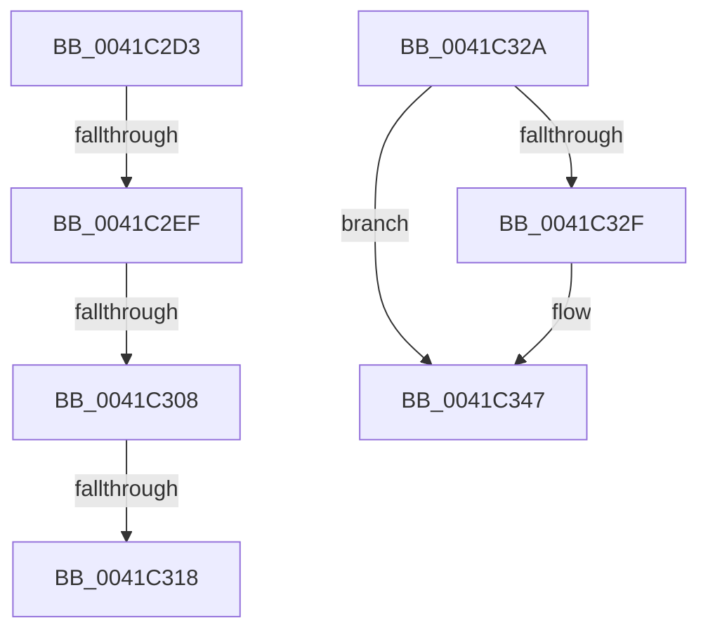

# sub_0041C2D3

- RVA: `0x0041C2D3`–`0x0041C360` (길이 `141` bytes)
- VA: `0x000000014041C2D3`
- 실행 섹션: `.text`
- PDB 이름 있음: `아니요`; PDB Function 태그: `아니요`
- unwind 정보 RVA: `0x0009D7AC`
- 디코드: `35`개 명령, `141/141` bytes 표시
- 미해석 바이트: `0` (있으면 어셈블리에 `.byte`로 보존)

> 이 문서는 커널 이미지의 기계어와 PDB 기호를 분석해 생성했습니다. 4번과 5번은 함수 원형과 자료형을 바이너리 사용 방식에서 추정한 C 해석이며 원본 소스 복구 결과는 아닙니다.

## 1. Dependencies

- 직접 호출 지점: **2**; 고유 호출 대상: **2**
- 직접 호출자로 확인된 함수: **0**
- RIP 상대 이미지 참조: **2**

### Outgoing calls
- `0x0041C320` → [PspReturnResourceQuota](../38/PspReturnResourceQuota_function_0038FFC4.md) (function, `0x0038FFC4`)
- `0x0041C341` → [KeBugCheckEx](../4F/KeBugCheckEx_function_004FD660.md) (function, `0x004FD660`)

### Direct callers
- 이 함수 시작 RVA로 연결되는 직접 call은 확인되지 않았습니다. 간접 호출은 완전히 역산할 수 없습니다.

### Static image references
- `0x0041C2FB` → RVA `0x00F06648` (`.data`; read)
- `0x0041C34D` → RVA `0x00E27F80` (`.data`; read)

## 2. Other-region calls and transfers

- 다른 실행 섹션으로 향하는 call: **0**
- call이 아닌 외부 분기/꼬리 이동: **5**
  - `0x0041C2E9` → [sub_0041C21A + 0x4E](Unknown_function_0041C21A.md) (`tail-transfer`)
  - `0x0041C302` → [sub_0041C21A + 0x4E](Unknown_function_0041C21A.md) (`tail-transfer`)
  - `0x0041C312` → [sub_0041C21A + 0x4E](Unknown_function_0041C21A.md) (`tail-transfer`)
  - `0x0041C325` → [sub_0041C21A + 0x4E](Unknown_function_0041C21A.md) (`tail-transfer`)
  - `0x0041C35B` → [sub_0041C21A + 0x58](Unknown_function_0041C21A.md) (`tail-transfer`)

## 3. Assembly (complete function range)

```asm
0041C2D3  4C 3B C7                        cmp r8, rdi
0041C2D6  48 8B CA                        mov rcx, rdx
0041C2D9  48 8B C2                        mov rax, rdx
0041C2DC  4C 0F 47 C7                     cmova r8, rdi
0041C2E0  49 2B C8                        sub rcx, r8
0041C2E3  F0 49 0F B1 4E 40               lock cmpxchg qword ptr [r14 + 0x40], rcx
0041C2E9  0F 85 79 FF FF FF               jne 0x14041c268
0041C2EF  49 8B C0                        mov rax, r8
0041C2F2  F0 49 0F C1 46 48               lock xadd qword ptr [r14 + 0x48], rax
0041C2F8  4C 03 C0                        add r8, rax
0041C2FB  4C 3B 05 46 A3 AE 00            cmp r8, qword ptr [rip + 0xaea346]
0041C302  0F 86 60 FF FF FF               jbe 0x14041c268
0041C308  45 33 C0                        xor r8d, r8d
0041C30B  4D 87 46 48                     xchg qword ptr [r14 + 0x48], r8
0041C30F  4D 85 C0                        test r8, r8
0041C312  0F 84 50 FF FF FF               je 0x14041c268
0041C318  45 33 C9                        xor r9d, r9d
0041C31B  49 8B D6                        mov rdx, r14
0041C31E  33 C9                           xor ecx, ecx
0041C320  E8 9F 3C F7 FF                  call 0x14038ffc4
0041C325  E9 3E FF FF FF                  jmp 0x14041c268
0041C32A  4D 3B F2                        cmp r14, r10
0041C32D  75 18                           jne 0x14041c347
0041C32F  4C 89 44 24 20                  mov qword ptr [rsp + 0x20], r8
0041C334  4C 8B CF                        mov r9, rdi
0041C337  45 33 C0                        xor r8d, r8d
0041C33A  48 8B D3                        mov rdx, rbx
0041C33D  41 8D 48 21                     lea ecx, [r8 + 0x21]
0041C341  E8 1A 13 0E 00                  call 0x1404fd660
0041C346  CC                              int3
0041C347  4D 8B F2                        mov r14, r10
0041C34A  4D 8B FA                        mov r15, r10
0041C34D  0F 0D 0D 2C BC A0 00            prefetchw byte ptr [rip + 0xa0bc2c]
0041C354  48 8B 35 25 BC A0 00            mov rsi, qword ptr [rip + 0xa0bc25]
0041C35B  E9 12 FF FF FF                  jmp 0x14041c272
```

## 4. C-style interpretation (structured pseudocode)

```c
__int64 __fastcall sub_0041C2D3(__int64 a1, __int64 a2, __int64 a3, int a4)
{
    __int64 result;
    unsigned __int64 v_stack_p20;

    if (a3 > v_rdi) { a3 = v_rdi; }
    a1 = (a2) - (a3);
    a3 = (a3) + (a3);
    a3 = 0;
    a4 = 0;
    a1 = 0;
    result = PspReturnResourceQuota(a1, v_r14, a3, a4);
}
```

## 5. (Beta) C Style

```c
int64_t sub_0041C2D3(int64_t Arg1, int64_t Arg2, int64_t Arg3, int32_t Arg4)
{
    int64_t result;
    uint64_t v_stack_p20;

    if (Arg3 > local_rdi) { Arg3 = local_rdi; }
    Arg1 = (Arg2) - (Arg3);
    Arg3 = (Arg3) + (Arg3);
    Arg3 = 0;
    Arg4 = 0;
    Arg1 = 0;
    result = PspReturnResourceQuota(Arg1, local_r14, Arg3, Arg4);
}
```

## 6. Execution-region graph

[열기: 2D/3D 그래프와 함수 탐색 컨트롤 패널](../../../control-panel.html?section=text&rva=0x0041C2D3&view=graph)

- 2D 그래프는 위에서 아래로 흐르고, 3D 그래프는 빈 공간을 드래그해 회전합니다. Shift+드래그는 이동, 휠은 확대·축소, 함수 노드 선택은 대상 보고서 이동입니다.

### Static fallback


